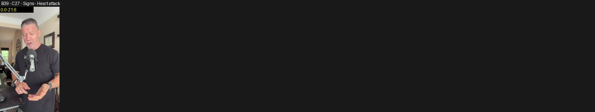

# B39 - C27 - Signs - Heart attack

Master: `Hook1.mp4` · 21.6s · 1080x1920

**Pacing:** 1 shots · avg 21.57s · median 21.57s · 0.0 cuts/10s · first cut Nones · 210.0 wpm · talk ratio 0.74 · cuts on word start None% · cuts in speech gaps None%
**Audio:** {'I_lufs': -21.9, 'LRA': 5.9, 'true_peak_db': -4.4} · BPM≈152.0 · music {'speech_rms_db': -28.8, 'pause_seconds': 4.8, 'pause_rms_db': -37.0, 'bed_minus_voice_db': -8.2, 'music_bed_likely': True} · cuts with SFX/transient None%

**Hook (0–3s) spoken:** There are three
**Hook on-screen:** 
**CTA (last 5s):** came out of nowhere. But they didn't actually come out of nowhere. · on-screen: 

## Beat sheet

| # | in–out (s) | dur | transition | spoken | on-screen text |
|---|---|---|---|---|---|
| 1 | 0.00–21.57 | 21.57 |  | There are three things that quietly shift in your body weeks before a heart attack happens. For decades, we've only been checking the wrong stuff. Blood pressure once a year, maybe an EKG if you're lucky, and people have kept having heart issues that came out of nowhere. But they didn't actually come out of nowhere. |  |

## Hook variants

| hook | file | dur | first cut | spoken 0–3s | on-screen 0–3s |
|---|---|---|---|---|---|
| 1 | `Hook1.mp4` | 21.6 | None | There are three |  |
| 2 | `Hook2.mp4` | 53.9 | None | Your body usually starts |  |
| 3 | `Hook3.mp4` | 58.8 | None | There are patterns that |  |
| None | `Body.mp4` | 300.5 | 3.933 | Now, we kind |  |

## Full transcript

There are three things that quietly shift in your body weeks before a heart attack happens. For decades, we've only been checking the wrong stuff. Blood pressure once a year, maybe an EKG if you're lucky, and people have kept having heart issues that came out of nowhere. But they didn't actually come out of nowhere.