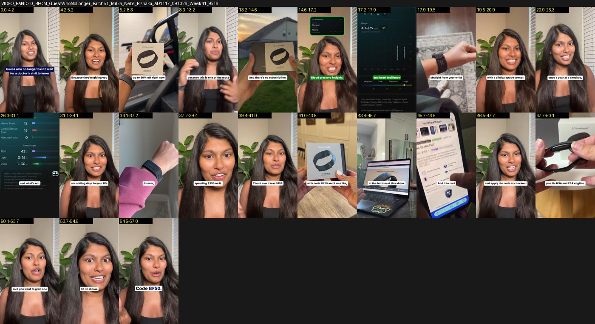

# VIDEO_BAND2.0_BFCM_GuessWhoNoLonger_Batch51_Milka_Neba_Bishaka_AD1117_091026_Week41_9x16

Master: `VIDEO_BAND2.0_BFCM_GuessWhoNoLonger_Batch51_Milka_Neba_Bishaka_AD1117_091026_Week41_9x16_hook1.mp4` · 57.0s · 1080x1920

**Pacing:** 23 shots · avg 2.477s · median 2.44s · 3.86 cuts/10s · first cut 4.24s · 245.0 wpm · talk ratio 0.94 · cuts on word start 86.4% · cuts in speech gaps 68.2%
**Audio:** {'I_lufs': -21.5, 'LRA': 6.4, 'true_peak_db': -3.4} · BPM≈123.0 · music {'speech_rms_db': -28.1, 'pause_seconds': 0.6, 'pause_rms_db': -30.0, 'bed_minus_voice_db': -1.9, 'music_bed_likely': True} · cuts with SFX/transient 40.9%

**Captions:** 111 cards · 1 words/card (median) · y≈0.655 of frame height · text height≈0.0281 · colours {'white': 89, 'dark/other': 19, 'green': 3} · cards crossing a cut: 1
Highlighted: complete longevity, andheartresilience, yep,done.
**Headlines:** 81bpm (3.0–3.0s, white) | CBlood Pressure (16.0–16.0s, white) | Elevated (16.0–16.0s, white) | Normal (16.0–16.0s, white) | Range (17.0–17.0s, white) | 40-139bpm (17.0–17.0s, white) | High (17.0–17.0s, dark/other) | O1/Apr/26-24/Oct/26 (17.0–17.0s, dark/other)

**Hook (0–3s) spoken:** Guess who no longer has to wait for a doctor's visit to know how their heart's
**Hook on-screen:** Guess who no longer has to wait / for a doctor's visitto know
**CTA (last 5s):** to grab one before it goes back to full price, I do it now. I'll leave a link for you. Code of EF50, go. · on-screen: Code BF50. / I'd do it now. / I'll leave it linked for you / before it goes back to full price, / so if you want to grab one

## Beat sheet

| # | in–out (s) | dur | transition | spoken | on-screen text |
|---|---|---|---|---|---|
| 1 | 0.00–4.24 | 4.24 |  | Guess who no longer has to wait for a doctor's visit to know how their heart's doing? You. | Guess who no longer has to wait / for a doctor's visitto know / 81bpm (HEADLINE) / howtheirheart'sdoing / Because they're giving you |
| 2 | 4.24–5.20 | 0.96 | cut +SFX hit | Because they're giving you up | Because they're giving you / HumeHealth / HumeBand2.0 / 24/7HeamTracking / up to 50%off right now |
| 3 | 5.20–8.28 | 3.08 | cut +SFX hit | to 50 % off right now with code BF50. | HumeHealth / HumeBand2.0 / 24/7HeamTracking / up to 50%off right now / XHumaHealthy / 24/7HealthTracking |
| 4 | 8.28–13.16 | 4.88 | cut | Which is seriously insane because this is one of the most complete longevity wearables out there. | HumeBand2.0 / XHumeHealth" / Whichisseriouslyinsane / because thisis one of the most / complete longevity [green] / wearables out there. |
| 5 | 13.16–14.56 | 1.4 | cut | And there's no subscription. | XHumeHealth / And there's no subscription. / Live Longer.Better, |
| 6 | 14.56–17.16 | 2.6 | cut | This thing gives you blood pressure insights, HRV, and heart | This thing gives you / CBlood Pressure (HEADLINE) / Elevated (HEADLINE) / Normal (HEADLINE) / Blood pressureinsights, / Range (HEADLINE) |
| 7 | 17.16–17.88 | 0.72 | cut +SFX hit | resilience straight | Range (HEADLINE) / 40-139bpm (HEADLINE) / High (HEADLINE) / O1/Apr/26-24/Oct/26 (HEADLINE) / 150 / May |
| 8 | 17.88–19.48 | 1.6 | cut +SFX hit | from your wrist every day | straight from your wrist / every day |
| 9 | 19.48–20.88 | 1.4 | cut +SFX hit | with a clinical grade sensor. | every day / with a clinical grade sensor. |
| 10 | 20.88–26.28 | 5.4 | cut +SFX hit | So instead of only thinking about your heart once a year at a checkup, you can actually see your trends day to day. and | So instead of only thinking / about your heart / once a year at a checkup, / Youcanactually seeyourtrends / day to day. |
| 11 | 26.28–31.12 | 4.84 | cut | Prof AI coaching tells you what's helping and what's not, like sleep, stress, and recovery, and | day to day. / StrainTypes (HEADLINE) / MentalStrain (HEADLINE) / Cardiovascular (HEADLINE) / Strain (HEADLINE) / MuscularStrain (HEADLINE) |
| 12 | 31.12–34.12 | 3.0 | cut +SFX hit | whether your daily habits are adding gaze to your life or taking them away. | and whether your daily habits / are adding days to your life / or taking them away. / Honestly,I've wanted one |
| 13 | 34.12–37.16 | 3.04 | cut | Honestly, I've wanted one forever, but I couldn't justify spending | Honestly,I've wanted one / but I couldn't justify / spending $356 on it. |
| 14 | 37.16–39.36 | 2.2 | cut | $356 on it. | spending $356 on it. |
| 15 | 39.36–41.04 | 1.68 | cut | Then I saw it was $199 | spending $356 on it. / ThenIsawitwas $199 / XhumeHealth (HEADLINE) / HumeBand2.0 / with code BF50 and Iwas like, |
| 16 | 41.04–43.80 | 2.76 | cut +SFX hit | with code BF50, and I was like, yep, done. | XhumeHealth (HEADLINE) / HumeBand2.0 / with code BF50 and Iwas like, / yep,done. [green] |
| 17 | 43.80–45.68 | 1.88 | cut | Just click the link at the bottom of this video, | 11 (HEADLINE) / Longevity isn'tluck.It's strategy. / Justclickthe link / at the bottom of this video. |
| 18 | 45.68–46.48 | 0.8 | cut | add it to cart, | humehealth.com (HEADLINE) / 4:8/5（48.252) (HEADLINE) / CK ERIBAVBENE (HEADLINE) / neHumePed (HEADLINE) / Makepaymentsof1 (HEADLINE) / fhe Hume Body Pod gives yoy the complete picture of (HEADLINE) |
| 19 | 46.48–47.68 | 1.2 | cut | and apply the code at checkout. | humehealth.com (HEADLINE) / 4:8/5（48.252) (HEADLINE) / CK ERIBAVBENE (HEADLINE) / neHumePed (HEADLINE) / Makepaymentsof1 (HEADLINE) / fhe Hume Body Pod gives yoy the complete picture of (HEADLINE) |
| 20 | 47.68–50.12 | 2.44 | cut | Plus, it's HSA and FSA -eligible. | XHumeHealth" (HEADLINE) / plus its HSA and FSA eligible. / XHumeHealth (HEADLINE) / plus its HSA and FSA eligible / This priceis only here |
| 21 | 50.12–53.72 | 3.6 | cut | This price is only here for Black Friday, so if you want to grab one before it goes back to full price, | This priceis only here / for Black Friday, / so if you want to grab one / before it goes back to full price, |
| 22 | 53.72–54.52 | 0.8 | cut | I do it now. I'll | I'd do it now. |
| 23 | 54.52–56.96 | 2.44 | cut +SFX hit | leave a link for you. Code of EF50, go. | I'll leave it linked for you / Code BF50. |

## Hook variants

| hook | file | dur | first cut | spoken 0–3s | on-screen 0–3s |
|---|---|---|---|---|---|
| 1 | `tch51_Milka_Neba_Bishaka_AD1117_091026_Week41_9x16_hook1.mp4` | 57.0 | 4.24 | Guess who no longer has to wait for a doctor's visit to know how their heart's | Guess who no longer has to wait / for a doctor's visitto know |
| 1 | `tch51_Milka_Neba_Bishaka_AD1117_091026_Week41_9x16_hook1.mp4` | 57.0 | 4.24 |  |  |
| 2 | `tch51_Milka_Neba_Bishaka_AD1117_091026_Week41_9x16_hook2.mp4` | 56.3 | 3.0 |  |  |
| 2 | `tch51_Milka_Neba_Bishaka_AD1117_091026_Week41_9x16_hook2.mp4` | 56.3 | 3.0 |  |  |
| 3 | `tch51_Milka_Neba_Bishaka_AD1117_091026_Week41_9x16_hook3.mp4` | 56.4 | 1.84 |  |  |
| 3 | `tch51_Milka_Neba_Bishaka_AD1117_091026_Week41_9x16_hook3.mp4` | 56.4 | 1.84 |  |  |
| 4 | `tch51_Milka_Neba_Bishaka_AD1117_091026_Week41_9x16_hook4.mp4` | 57.1 | 1.6 |  |  |
| 4 | `tch51_Milka_Neba_Bishaka_AD1117_091026_Week41_9x16_hook4.mp4` | 57.1 | 1.6 |  |  |
| 5 | `tch51_Milka_Neba_Bishaka_AD1117_091026_Week41_9x16_hook5.mp4` | 57.3 | 2.36 |  |  |
| 5 | `tch51_Milka_Neba_Bishaka_AD1117_091026_Week41_9x16_hook5.mp4` | 57.3 | 2.36 |  |  |
| 6 | `tch51_Milka_Neba_Bishaka_AD1117_091026_Week41_9x16_hook6.mp4` | 57.1 | 1.84 |  |  |
| 6 | `tch51_Milka_Neba_Bishaka_AD1117_091026_Week41_9x16_hook6.mp4` | 57.1 | 1.84 |  |  |

## Full transcript

Guess who no longer has to wait for a doctor's visit to know how their heart's doing? You. Because they're giving you up to 50% off right now with code BF50. Which is seriously insane because this is one of the most complete longevity wearables out there. And there's no subscription. This thing gives you blood pressure insights, HRV, and heart resilience straight from your wrist every day with a clinical grade sensor. So instead of only thinking about your heart once a year at a checkup, you can actually see your trends day to day. and Prof AI coaching tells you what's helping and what's not, like sleep, stress, and recovery, and whether your daily habits are adding gaze to your life or taking them away. Honestly, I've wanted one forever, but I couldn't justify spending $356 on it. Then I saw it was $199 with code BF50, and I was like, yep, done. Just click the link at the bottom of this video, add it to cart, and apply the code at checkout. Plus, it's HSA and FSA-eligible. This price is only here for Black Friday, so if you want to grab one before it goes back to full price, I do it now. I'll leave a link for you. Code of EF50, go.