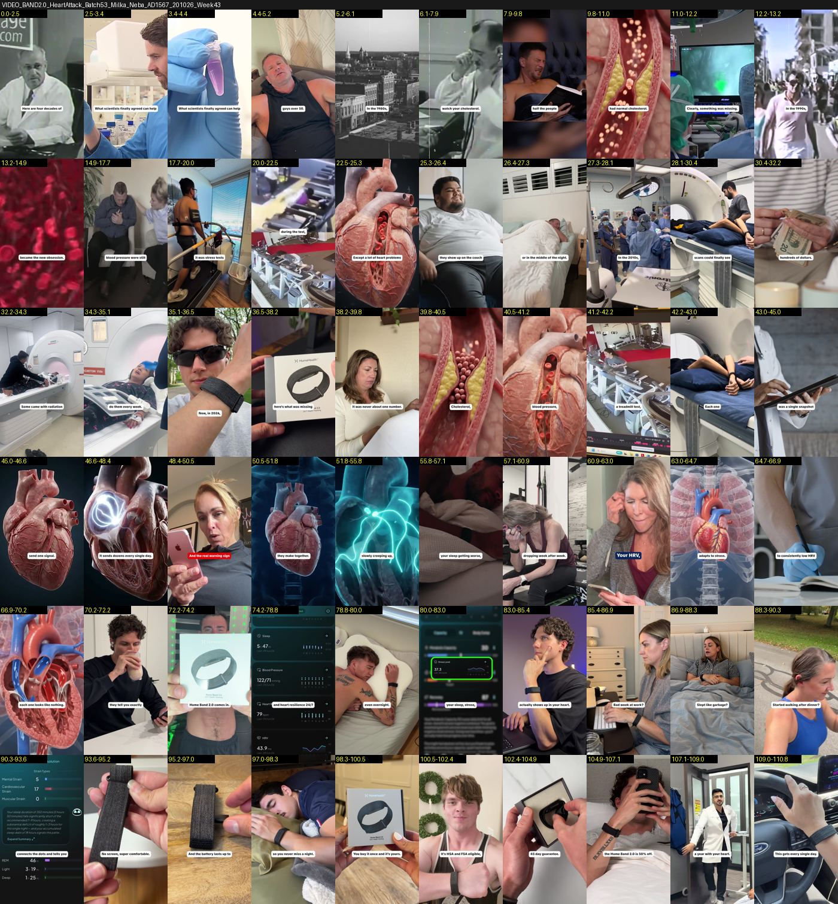

# VIDEO_BAND2.0_HeartAttack_Batch53_Milka_Neba_AD1567_201026_Week43

Master: `VIDEO_BAND2.0_HeartAttack_Batch53_Milka_Neba_AD1567_201026_Week43_hook1.mp4` · 112.6s · 1080x1920

**Pacing:** 61 shots · avg 1.846s · median 1.8s · 5.33 cuts/10s · first cut 2.48s · 245.0 wpm · talk ratio 0.95 · cuts on word start 75.0% · cuts in speech gaps 86.7%
**Audio:** {'I_lufs': -18.8, 'LRA': 2.0, 'true_peak_db': -4.4} · BPM≈123.0 · music {'speech_rms_db': -22.8, 'pause_seconds': 0.2} · cuts with SFX/transient 61.7%

**Captions:** 154 cards · 1.0 words/card (median) · y≈0.653 of frame height · text height≈0.0234 · colours {'white': 134, 'red': 5, 'green': 2, 'dark/other': 13} · cards crossing a cut: 1
Highlighted: bad heart healthadvice., having heart attacks, bloodpressure, congrats,you passed., And the real warning sign, to higher heart risk., Normal
**Headlines:** com (0.0–2.0s, white) | ae (0.5–1.0s, white) | age (1.5–2.0s, white) | SIEMENS (32.0–32.0s, white) | Heolthineers (32.0–33.0s, white) | SIEMENS (34.0–34.0s, white) | Heaithineers (34.0–34.0s, white) | 080127(W) (41.0–41.0s, white)

**Hook (0–3s) spoken:** Here are four decades of bad heart health advice. What scientists finally
**Hook on-screen:** Herearefourdecadesof / Whatscientistsfinallyagreed canhelp / ae / age / bad heart healthadvice. / com
**CTA (last 5s):** few minutes a year with your heart. This gets every single day. Click below to grab yours before the sale ends. · on-screen: Antta/Bray/Bad / Clickbelow to grab yours / Doudte Teyim / This gets every singleday. / a year with your heart. / beforethesaleends

## Beat sheet

| # | in–out (s) | dur | transition | spoken | on-screen text |
|---|---|---|---|---|---|
| 1 | 0.00–2.48 | 2.48 |  | Here are four decades of bad heart health advice. | com (HEADLINE) / Herearefourdecadesof / ae (HEADLINE) / age (HEADLINE) / bad heart healthadvice. [red] |
| 2 | 2.48–3.44 | 0.96 | cut | What scientists finally | com (HEADLINE) / age (HEADLINE) / bad heart healthadvice. [red] / Whatscientistsfinallyagreed canhelp |
| 3 | 3.44–4.40 | 0.96 | cut +SFX hit | agree can help | Whatscientistsfinallyagreed canhelp |
| 4 | 4.40–5.20 | 0.8 | cut +SFX hit | guys over 50. | Whatscientistsfinallyagreed canhelp / guys over 50. / Inthe1980s, |
| 5 | 5.20–6.08 | 0.88 | cut | In the 1980s, | Inthe1980s, / your doctor told you to |
| 6 | 6.08–7.92 | 1.84 | cut +SFX hit | your doctor told you to watch your cholesterol. | your doctor told you to / Watchyour cholesterol. |
| 7 | 7.92–9.84 | 1.92 | cut | The problem was, half the people having heart attacks | Theproblemwas, / having heart attacks [red] |
| 8 | 9.84–11.00 | 1.16 | cut +SFX hit | had normal cholesterol. | hadnormalcholesterol |
| 9 | 11.00–12.20 | 1.2 | cut | Clearly, something was missing. | Clearly, something was missing. / Inthe1990s, |
| 10 | 12.20–13.24 | 1.04 | cut | In the 1990s, | Inthe1990s, / bloodpressure [red] |
| 11 | 13.24–14.92 | 1.68 | cut | blood pressure became the new obsession. | bloodpressure [red] / becamethenewobsession. |
| 12 | 14.92–17.68 | 2.76 | cut +SFX hit | But people with perfect blood pressure were still having heart attacks. | Butpeoplewithperfect / bloodpressurewerestill / having heartattacks. |
| 13 | 17.68–20.00 | 2.32 | cut +SFX hit | In the 2000s, it was stress tests on a treadmill. | Inthe2000, / itwasstresstests |
| 14 | 20.00–22.48 | 2.48 | cut +SFX hit | If you didn't drop during the test, congrats, you passed. | If you didn't drop / during the test, / congrats,you passed. [green] |
| 15 | 22.48–25.28 | 2.8 | cut +SFX hit | Except a lot of heart problems don't show up during exercise. | congrats,you passed. [green] / Exceptalotofheartproblems / don'tshow up during exercise |
| 16 | 25.28–26.36 | 1.08 | cut +SFX hit | They show up on the couch or | don'tshow up during exercise / theyshowuponthecouch |
| 17 | 26.36–27.32 | 0.96 | cut | in the middle of the night. In | theyshowuponthecouch / orinthemiddleofthenight |
| 18 | 27.32–28.12 | 0.8 | cut +SFX hit | the 2010s, | orinthemiddleofthenight / scanscouldfinallysee |
| 19 | 28.12–30.40 | 2.28 | cut | scans could finally see inside your arteries, | scanscouldfinallysee / insideyourarteries. |
| 20 | 30.40–32.16 | 1.76 | cut +SFX hit | except they cost hundreds of dollars, | insideyourarteries. / hundredsofdollars. / SIEMENS (HEADLINE) / Heolthineers (HEADLINE) / Somecamewithradiation |
| 21 | 32.16–34.28 | 2.12 | cut +SFX hit | some came with radiation, and you definitely couldn't | SIEMENS (HEADLINE) / Heolthineers (HEADLINE) / Somecamewithradiation / SIEMENS (HEADLINE) / Heaithineers (HEADLINE) / and you definitely couldn't |
| 22 | 34.28–35.12 | 0.84 | cut +SFX hit | do them every week. | SIEMENS (HEADLINE) / Heaithineers (HEADLINE) / and you definitely couldn't / Now,in2026, |
| 23 | 35.12–36.48 | 1.36 | cut | Now, in 2026, | Now,in2026, / Now,in2026 |
| 24 | 36.48–38.16 | 1.68 | cut +SFX hit | here's what was missing the entire time. | Now,in2026 / XHumeHealth" / here's what was missing / nd2.0 / 24/7HealthTracking / Itwasneveraboutonenumber. |
| 25 | 38.16–39.76 | 1.6 | cut | It was never about one number. | Itwasneveraboutonenumber. |
| 26 | 39.76–40.48 | 0.72 | cut +SFX hit | Cholesterol, | Cholesterol, |
| 27 | 40.48–41.16 | 0.68 | cut +SFX hit | blood pressure, | Cholesterol, / 080127(W) (HEADLINE) / a treadmill test, / 2024-11-20 08:01:26 / Lenovo Commercial Vantage / QSearch |
| 28 | 41.16–42.16 | 1.0 | cut +SFX hit | a treadmill test, a | 080127(W) (HEADLINE) / a treadmill test, / 2024-11-20 08:01:26 / Lenovo Commercial Vantage / QSearch / a scan. |
| 29 | 42.16–42.96 | 0.8 | cut +SFX hit | scan, each one | a scan. |
| 30 | 42.96–45.00 | 2.04 | cut | was a single snapshot on a single day. | wasasinglesnapshot / on a single day. |
| 31 | 45.00–46.64 | 1.64 | cut +SFX hit | But your heart doesn't send one signal. | Butyourheartdoesn't / send one signal. |
| 32 | 46.64–48.44 | 1.8 | cut +SFX hit | It sends dozens, every single day. | It sends dozens every single day. |
| 33 | 48.44–50.52 | 2.08 | cut | And the real warning sign isn't any one of them. It's | It sends dozens every single day. / And the real warning sign [red] / isn't any one of them. |
| 34 | 50.52–51.84 | 1.32 | cut +SFX hit | the pattern they make together. | they maketogether. |
| 35 | 51.84–55.84 | 4.0 | cut +SFX hit | You're resting heart rates slowly creeping up, your blood pressure spiking on stressful days, your | Your resting heart rate / slowly creeping up, / your bloodpressure / spiking on stressful days, |
| 36 | 55.84–57.08 | 1.24 | cut +SFX hit | sleep getting worse, | your sleep getting worse, / Yourrecovery / TITAN |
| 37 | 57.08–60.88 | 3.8 | cut +SFX hit | your recovery dropping week after week, and the one most people have never even heard of, | Yourrecovery / TITAN / droppingweekafterweek. / Andtheonemostpeople / INCH (HEADLINE) / have never even heard of. |
| 38 | 60.88–62.96 | 2.08 | cut | your HRV, heart rate variability. | Your HRV / Heart Rate Variability. |
| 39 | 62.96–64.68 | 1.72 | cut +SFX hit | It's how well your heart adapts to stress, | Itshowwellyourheart / adaptstostress. |
| 40 | 64.68–66.92 | 2.24 | cut +SFX hit | and research has linked a consistently low HRV | Andresearchislinked / toconsistentlylowHRV |
| 41 | 66.92–70.16 | 3.24 | cut | to higher heart risk. On their own, each one looks like nothing. Together, | to higher heart risk. [red] / On their own, / each one looks likenothing. / theytell you exactly |
| 42 | 70.16–72.20 | 2.04 | cut | they tell you exactly where your heart is heading. | theytell you exactly / That'swherethe |
| 43 | 72.20–74.16 | 1.96 | cut | That's where the HumeBand 2 .0 comes in. | That'swherethe / XHuimeHeallh (HEADLINE) / HumeBand2.0 / 24/7Health.Trascking / HumeBand2.0comesin. / Connected [green] (HEADLINE) |
| 44 | 74.16–78.80 | 4.64 | cut +SFX hit | It tracks your heart rate, HRV, and heart resilience 24 -7, and gives you blood pressure insights, | Connected [green] (HEADLINE) / HumeBand(25%) (HEADLINE) / 99 steps (HEADLINE) / 4,346 (HEADLINE) / 4592 (HEADLINE) / TWTESSM (HEADLINE) |
| 45 | 78.80–80.00 | 1.2 | cut +SFX hit | even overnight, no cuff. It | even overnight. |
| 46 | 80.00–82.96 | 2.96 | cut +SFX hit | also tracks your sleep, stress, blood oxygen, and recovery, | Capacity (HEADLINE) / BodyComp (HEADLINE) / 30 (HEADLINE) / MetabolicCapacity (HEADLINE) / 100 / Baseline |
| 47 | 82.96–85.44 | 2.48 | cut +SFX hit | so you can see how your daily life actually shows up in your heart. | soyou canseehowyourdailylife / actuallyshowsup inyourheart. |
| 48 | 85.44–86.88 | 1.44 | cut | Bad week at work? You'll see it. | actuallyshowsup inyourheart. / Badweekatwork? |
| 49 | 86.88–88.32 | 1.44 | cut +SFX hit | Slept like garbage? You'll see it. | Slept like garbage? / You'll see it. |
| 50 | 88.32–90.28 | 1.96 | cut | Started walking after dinner? You'll see that too. | You'll see it. / Started walkingafter dinner? / You'll see thattoo. |
| 51 | 90.28–93.64 | 3.36 | cut | And Prof AI connects the dots and tells you exactly what to change. | You'll see thattoo. / Yesterday'sResolution [blue] (HEADLINE) / Strain Types (HEADLINE) / MentalStrain (HEADLINE) / Cardiovascular (HEADLINE) / Strain (HEADLINE) |
| 52 | 93.64–95.16 | 1.52 | cut +SFX hit | No screen, super comfortable, | Noscreen,supercomfortable. / Andthebatterylastsupto |
| 53 | 95.16–97.04 | 1.88 | cut | and the battery lasts up to 14 days, | Andthebatterylastsupto / so you never missa night. |
| 54 | 97.04–98.28 | 1.24 | cut +SFX hit | so you never miss a night. | so you never missa night. |
| 55 | 98.28–100.48 | 2.2 | cut | No subscription. You buy it once, and it's yours. | so you never missa night. / XHumeHealth (HEADLINE) / HumeBand2.0 / 24/7Health.Tracking / You buy it once and it'syours. / HumeHealth" (HEADLINE) |
| 56 | 100.48–102.40 | 1.92 | cut +SFX hit | It's HSA and FSA -eligible, | HumeBand2.0 / You buy it once and it'syours. / HumeHealth" (HEADLINE) / It's HSAand FSA eligible, / pbib (HEADLINE) |
| 57 | 102.40–104.92 | 2.52 | cut | and it comes with a 45 -day guarantee. Right now, | It's HSAand FSA eligible, / pbib (HEADLINE) / XHumoHealth / 45 dayguarantee. |
| 58 | 104.92–107.12 | 2.2 | cut +SFX hit | the HumeBand 2 .0 is 50 % off. | IX.XVIIL.LXXII [red] (HEADLINE) / theHumeBand2.0is50%off. / XVIII.LXXII [red] (HEADLINE) / Yourdoctorgetsafewminutes |
| 59 | 107.12–109.00 | 1.88 | cut +SFX hit | Your doctor gets a few minutes a year with your heart. | Yourdoctorgetsafewminutes / a year with your heart. |
| 60 | 109.00–110.80 | 1.8 | cut | This gets every single day. Click | This gets every singleday. / Antta/Bray/Bad [blue] (HEADLINE) / Doudte Teyim [blue] (HEADLINE) |
| 61 | 110.80–112.62 | 1.82 | cut +SFX hit | below to grab yours before the sale ends. | Clickbelow to grab yours / beforethesaleends |

## Hook variants

| hook | file | dur | first cut | spoken 0–3s | on-screen 0–3s |
|---|---|---|---|---|---|
| 1 | `eartAttack_Batch53_Milka_Neba_AD1567_201026_Week43_hook1.mp4` | 112.6 | 2.48 | Here are four decades of bad heart health advice. What scientists finally | Herearefourdecadesof / Whatscientistsfinallyagreed canhelp / ae / age / bad heart healthadvice. / com |
| 2 | `eartAttack_Batch53_Milka_Neba_AD1567_201026_Week43_hook2.mp4` | 113.5 | 0.8 | Every decade, there was a new number to watch for your heart, and |  |
| 3 | `eartAttack_Batch53_Milka_Neba_AD1567_201026_Week43_hook3.mp4` | 114.1 | 0.84 | Cholesterol, blood pressure, treadmill tests, scans, every | Cholesterol, / ENS / bloodpressure, / scans / treadmilltests, |
| 4 | `eartAttack_Batch53_Milka_Neba_AD1567_201026_Week43_hook4.mp4` | 112.9 | 3.08 | There's a reason heart attack still happened to people with perfect numbers, | There'sareasonheartattacks / still happentopeople / withperfectnumbers. |
| 5 | `eartAttack_Batch53_Milka_Neba_AD1567_201026_Week43_hook5.mp4` | 113.0 | 1.84 | Every decade, doctors picked a new number to blame for heart attacks. | Doctorspickedanewnumber / Every decade, / toblameforheartattacks |

## Full transcript

Here are four decades of bad heart health advice. What scientists finally agree can help guys over 50. In the 1980s, your doctor told you to watch your cholesterol. The problem was, half the people having heart attacks had normal cholesterol. Clearly, something was missing. In the 1990s, blood pressure became the new obsession. But people with perfect blood pressure were still having heart attacks. In the 2000s, it was stress tests on a treadmill. If you didn't drop during the test, congrats, you passed. Except a lot of heart problems don't show up during exercise. They show up on the couch or in the middle of the night. In the 2010s, scans could finally see inside your arteries, except they cost hundreds of dollars, some came with radiation, and you definitely couldn't do them every week. Now, in 2026, here's what was missing the entire time. It was never about one number. Cholesterol, blood pressure, a treadmill test, a scan, each one was a single snapshot on a single day. But your heart doesn't send one signal. It sends dozens, every single day. And the real warning sign isn't any one of them. It's the pattern they make together. You're resting heart rates slowly creeping up, your blood pressure spiking on stressful days, your sleep getting worse, your recovery dropping week after week, and the one most people have never even heard of, your HRV, heart rate variability. It's how well your heart adapts to stress, and research has linked a consistently low HRV to higher heart risk. On their own, each one looks like nothing. Together, they tell you exactly where your heart is heading. That's where the HumeBand 2.0 comes in. It tracks your heart rate, HRV, and heart resilience 24-7, and gives you blood pressure insights, even overnight, no cuff. It also tracks your sleep, stress, blood oxygen, and recovery, so you can see how your daily life actually shows up in your heart. Bad week at work? You'll see it. Slept like garbage? You'll see it. Started walking after dinner? You'll see that too. And Prof AI connects the dots and tells you exactly what to change. No screen, super comfortable, and the battery lasts up to 14 days, so you never miss a night. No subscription. You buy it once, and it's yours. It's HSA and FSA-eligible, and it comes with a 45-day guarantee. Right now, the HumeBand 2.0 is 50% off. Your doctor gets a few minutes a year with your heart. This gets every single day. Click below to grab yours before the sale ends.