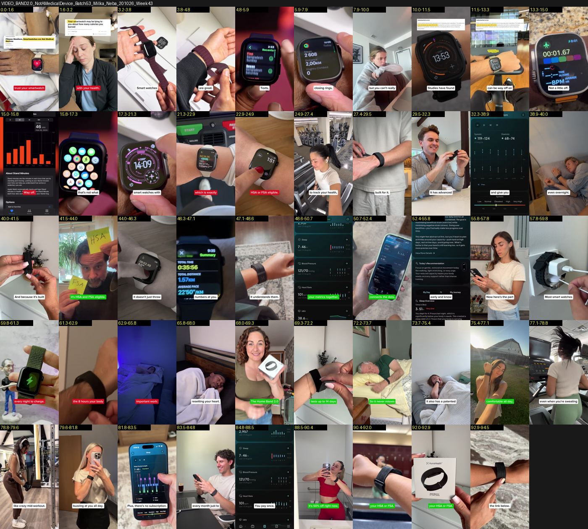

# VIDEO_BAND2.0_NotAMedicalDevice_Batch53_Milka_Neba_201026_Week43

Master: `VIDEO_BAND2.0_NotAMedicalDevice_Batch53_Milka_Neba_AD1598_201026_Week43_Hook1_9x16.mp4` · 94.5s · 1080x1920

**Pacing:** 49 shots · avg 1.929s · median 1.733s · 5.08 cuts/10s · first cut 1.633s · 197.0 wpm · talk ratio 0.95 · cuts on word start 81.2% · cuts in speech gaps 68.8%
**Audio:** {'I_lufs': -22.4, 'LRA': 1.7, 'true_peak_db': -4.1} · BPM≈117.5 · music {'speech_rms_db': -25.9, 'pause_seconds': 2.3, 'pause_rms_db': -26.2, 'bed_minus_voice_db': -0.3, 'music_bed_likely': True} · cuts with SFX/transient 64.6%

**Captions:** 291 cards · 1 words/card (median) · y≈0.738 of frame height · text height≈0.0281 · colours {'red': 14, 'white': 192, 'green': 18, 'dark/other': 58, 'blue': 7, 'yellow': 1, 'other-colour': 1} · cards crossing a cut: 2
Highlighted: 72, trustyoursmartwatch, withyourhealth, Recents, Rexon (2), Stand, 112, 106, with your health., TECHNOGYM, things like calorie burn., TIME, INZONE, AVERAGE, HR
**Headlines:** FitnessMonitors, (0.0–0.5s, white) | Devices (0.0–0.5s, white) | Thehigheryourbodyfatpercentage,theless (1.0–1.5s, yellow) | youburnwhenexercising-newstudy (1.0–1.0s, white) | Your smartwatchmaybelyingto (2.0–2.5s, yellow) | youabouthowmany caloriesyou (2.0–2.5s, white) | burned (2.0–2.5s, white) | 14:09 (6.0–7.0s, blue)

**Hook (0–3s) spoken:** You can't really trust your smartwatch with your health. Here's why.
**Hook on-screen:** 72 / Devices / FitnessMonitors, / Here's why. / Thehigheryourbodyfatpercentage,theless / You can't really / Your smartwatchmaybelyingto / burned / trustyoursmartwatch / withyourhealth / youabouthowmany caloriesyou / youburnwhenexercising-newstudy
**CTA (last 5s):** right now and you can pay with your HSA or FSA. Grab yours from the link below. · on-screen: 24/7 Health Tracking / Grab yours from / HumeBand2.0 / XHumeHealth / it's50% off right now, / the link below. / your HSA or FSA

## Beat sheet

| # | in–out (s) | dur | transition | spoken | on-screen text |
|---|---|---|---|---|---|
| 1 | 0.00–1.63 | 1.63 |  | You can't really trust your smartwatch | FitnessMonitors, (HEADLINE) / Devices (HEADLINE) / 72 [red] / You can't really / trustyoursmartwatch [red] / Thehigheryourbodyfatpercentage,theless [yellow] (HEADLINE) |
| 2 | 1.63–3.17 | 1.53 | cut +SFX hit | with your health. Here's why. | Thehigheryourbodyfatpercentage,theless [yellow] (HEADLINE) / withyourhealth [red] / Your smartwatchmaybelyingto [yellow] (HEADLINE) / youabouthowmany caloriesyou (HEADLINE) / burned (HEADLINE) / Here's why. |
| 3 | 3.17–3.80 | 0.63 | cut | Smartwatches | Smart watches |
| 4 | 3.80–4.83 | 1.03 | cut +SFX hit | are great. | Smart watches / are great. |
| 5 | 4.83–5.93 | 1.1 | cut +SFX hit | Texts, calls, | are great. / 2:33 / Recents [green] / Bangladesh / Texts, / Sunday |
| 6 | 5.93–7.87 | 1.93 | cut +SFX hit | steps, closing rings, | 2:33 / Recents [green] / Bangladesh / Sunday / Rexon / Saturday |
| 7 | 7.87–10.03 | 2.17 | cut | but you can't really trust them with your health. | OR / but you can't really / IOR / with your health. [red] / Substantialerror (HEADLINE) / 13:53 (HEADLINE) |
| 8 | 10.03–11.53 | 1.5 | cut | Studies have found wrist wearables can | Substantialerror (HEADLINE) / 13:53 (HEADLINE) / Studieshavefound / W259° / R15KM / 15:00 |
| 9 | 11.53–13.27 | 1.73 | cut | be way off on things like calorie | Substantialerror (HEADLINE) / TECHNOGYM [yellow] / 14:03 / can be way off on / things like calorie burn. [red] |
| 10 | 13.27–15.00 | 1.73 | cut | burn. Not a little off, | Substantialerror (HEADLINE) / 14:03 / things like calorie burn. [red] / *8:01 [blue] (HEADLINE) / 00:01.67 (HEADLINE) / TIME [blue] |
| 11 | 15.00–15.83 | 0.83 | cut | way off. | AllHealthData [blue] (HEADLINE) / StandMinutes (HEADLINE) / 6M (HEADLINE) / 46 (HEADLINE) / min (HEADLINE) / Sun |
| 12 | 15.83–17.30 | 1.47 | cut +SFX hit | And to be fair, that's not what they're | 16 / And to be fair, / that's not what |
| 13 | 17.30–21.27 | 3.97 | cut +SFX hit | built for. They're great smartwatches with some health features on the side, which | 16 / that's not what / 14:09 (HEADLINE) / NewWatchFac [other-colour] / 10:09 / Healthand Fitness |
| 14 | 21.27–22.93 | 1.67 | cut | is exactly why they're not HSA | 14:09 (HEADLINE) / on the side, / PAU [red] (HEADLINE) / START [green] (HEADLINE) / 2:45 / 04:34.06 |
| 15 | 22.93–24.93 | 2.0 | cut | or FSA eligible. | 55 / THU17 / 1:51 (HEADLINE) / steps / HSAorFSAeligible. [red] / Workout |
| 16 | 24.93–27.40 | 2.47 | cut +SFX hit | If you actually want to track your health, you need something | if you actually want / to track your health, / you need something |
| 17 | 27.40–29.53 | 2.13 | cut +SFX hit | built for it. That's the HumeBan 2 | you need something / built for it. / That's the Hume Band 2.0 [green] |
| 18 | 29.53–32.33 | 2.8 | cut | .0. It has advanced medical sensors that track your | It has advanced / medical sensorsthattrack |
| 19 | 32.33–38.87 | 6.53 | cut +SFX hit | heart rate, HRV, sleep, blood oxygen, and give you blood pressure insights 24 -7, | medical sensorsthattrack / HRV (HEADLINE) / Average (HEADLINE) / 38.6ms (HEADLINE) / Standard (HEADLINE) / 07/Aug/26 (HEADLINE) |
| 20 | 38.87–39.97 | 1.1 | cut | even overnight. | even overnight. |
| 21 | 39.97–41.47 | 1.5 | cut +SFX hit | And because it's built for health, | And because it'sbuilt / forhealth [green] |
| 22 | 41.47–44.03 | 2.57 | cut +SFX hit | it's HSA and FSA eligible. | forhealth [green] / HSA [yellow] (HEADLINE) / FSA [yellow] (HEADLINE) / it's HSA and FSA eligible. [green] / 00:01.49 (HEADLINE) / 1:51 |
| 23 | 44.03–46.30 | 2.27 | cut +SFX hit | Unlike smartwatches, it doesn't just throw numbers | 00:01.49 (HEADLINE) / 1:51 / TOTAL / CAL / OFT / Unlike smart watches, |
| 24 | 46.30–47.10 | 0.8 | cut +SFX hit | at you. | 1:51 / it doesn't just throw / 00:03.49 (HEADLINE) / It understands them. |
| 25 | 47.10–48.60 | 1.5 | cut +SFX hit | It understands them. | It understands them. |
| 26 | 48.60–50.67 | 2.07 | cut +SFX hit | It tracks all of your metrics together, | HumeBand(59%) (HEADLINE) / Connected (HEADLINE) / 9Steps (HEADLINE) / 2,957 (HEADLINE) / Sleep (HEADLINE) / 18:00 |
| 27 | 50.67–52.40 | 1.73 | cut +SFX hit | and Prof. AI connects the dots so | 1:251 [blue] (HEADLINE) / HumeBand [blue] (HEADLINE) / 4,267 (HEADLINE) / 6.45 / 103.9mm / and Prof Al |
| 28 | 52.40–55.83 | 3.43 | cut +SFX hit | you can spot patterns early and know exactly what to change. | 1:25 [blue] (HEADLINE) / CHumeBando3nd [blue] (HEADLINE) / 4.267 / 645 / 103.9m / connects the dots, [green] |
| 29 | 55.83–57.80 | 1.97 | cut +SFX hit | Now here's the part nobody talks about. | Now here's the part / nobody talks about |
| 30 | 57.80–59.80 | 2.0 | cut | Most smartwatches need to come off every | Most smart watches / need to come off [red] |
| 31 | 59.80–61.27 | 1.47 | cut +SFX hit | night to charge. | every night to charge. [red] / every night to charge [red] |
| 32 | 61.27–62.90 | 1.63 | cut +SFX hit | So they miss the eight hours your body | every night to charge [red] / the 8 hours your body [red] |
| 33 | 62.90–65.80 | 2.9 | cut +SFX hit | does its most important work, recovering, | 07:42 / sleep / does its most / important work: [red] / recovering, |
| 34 | 65.80–68.03 | 2.23 | cut | repairing, resetting your heart. | repairing, / resetting your heart. / TheHumeBand2.0 [green] |
| 35 | 68.03–69.30 | 1.27 | cut +SFX hit | The HumeBand 2 .0 | TheHumeBand2.0 [green] |
| 36 | 69.30–72.23 | 2.93 | cut | lasts up to 14 days on a single charge, so | TheHumeBand2.0 [green] / lastsupto14days [green] / on a single charge, / So it never misses [green] |
| 37 | 72.23–73.67 | 1.43 | cut +SFX hit | it never misses a night. | So it never misses [green] / a night. |
| 38 | 73.67–75.43 | 1.77 | cut +SFX hit | It also has a patented strap that stays | it also has a patented / strap that stays |
| 39 | 75.43–77.07 | 1.63 | cut +SFX hit | comfortable all day, | strap that stays / comfortable all day [green] / even when you're sweating |
| 40 | 77.07–78.80 | 1.73 | cut | even when you're sweating like crazy mid | even when you're sweating / like crazy mid-workout. |
| 41 | 78.80–79.63 | 0.83 | cut | -workout. | like crazy mid-workout. |
| 42 | 79.63–81.80 | 2.17 | cut +SFX hit | And there's no screen buzzing at you all day. | And there'sno screen [green] / buzzing at you all day. |
| 43 | 81.80–83.53 | 1.73 | cut +SFX hit | Plus, there's no subscription. | 3:04 [blue] (HEADLINE) / SleepSessionLength / Standard / 7h48m / 02/Sep/26 / REM |
| 44 | 83.53–84.80 | 1.27 | cut +SFX hit | You're not paying every month just | every month just to |
| 45 | 84.80–88.47 | 3.67 | cut +SFX hit | to see your own health data. You pay once and it's yours. | betteristhatyourbandisstill learningtoo,soitgets (HEADLINE) / ViewMoreDetails→ (HEADLINE) / ,Today'sRecommendation (HEADLINE) / Focusongentle,restorativemovementtoday (HEADLINE) / likewalking,lightstretching,oreasyyoga (HEADLINE) / Yourreducedcapacitymeansyourbody (HEADLINE) |
| 46 | 88.47–90.40 | 1.93 | cut +SFX hit | It's 50 % off right now and | Sleep (HEADLINE) / 7 h46m (HEADLINE) / 10:00 (HEADLINE) / Last:07/Aug/26 (HEADLINE) / Last:07/Aug/26 / HeartRate |
| 47 | 90.40–92.00 | 1.6 | cut +SFX hit | you can pay with your HSA or | it's50% off right now, [green] / your HSA or FSA [green] |
| 48 | 92.00–92.87 | 0.87 | cut | FSA. | your HSA or FSA [green] / XHumeHealth / HumeBand2.0 / 24/7 Health Tracking |
| 49 | 92.87–94.50 | 1.64 | cut | Grab yours from the link below. | Grab yours from / the link below. |

## Hook variants

| hook | file | dur | first cut | spoken 0–3s | on-screen 0–3s |
|---|---|---|---|---|---|
| 1 | `evice_Batch53_Milka_Neba_AD1598_201026_Week43_Hook1_9x16.mp4` | 94.5 | 1.633 | You can't really trust your smartwatch with your health. Here's why. | 72 / Devices / FitnessMonitors, / Here's why. / Thehigheryourbodyfatpercentage,theless / You can't really / Your smartwatchmaybelyingto / burned |
| 1 | `evice_Batch53_Milka_Neba_AD1598_201026_Week43_Hook1_9x16.mp4` | 97.8 | 1.633 | You can't really trust your smartwatch with your health. Here's why. |  |
| 2 | `evice_Batch53_Milka_Neba_AD1598_201026_Week43_Hook2_9x16.mp4` | 98.9 | 1.667 | There's a reason your HSA or FSA won't pay | There's a reason / won't pay / your HSA or FSA |
| 2 | `evice_Batch53_Milka_Neba_AD1598_201026_Week43_Hook2_9x16.mp4` | 101.8 | 1.667 | There's a reason your HSA or FSA won't pay for your | There's a reason / won't pay / your HSA or FSA |
| 3 | `evice_Batch53_Milka_Neba_AD1598_201026_Week43_Hook3_9x16.mp4` | 97.5 | 1.933 | Millions of people think their smartwatch is tracking their health. |  |
| 3 | `evice_Batch53_Milka_Neba_AD1598_201026_Week43_Hook3_9x16.mp4` | 100.2 | 1.933 | Millions of people think their smartwatch is tracking their health. Most of |  |
| 4 | `evice_Batch53_Milka_Neba_AD1598_201026_Week43_Hook4_9x16.mp4` | 96.5 | 2.033 | Ever wondered why you can't buy a smartwatch with your HSA or | Everwondered / buy a smartwatch / why you can't / withyour HSA or FSA? |
| 4 | `evice_Batch53_Milka_Neba_AD1598_201026_Week43_Hook4_9x16.mp4` | 99.6 | 2.033 | Ever wondered why you can't buy a smartwatch with your HSA or FSA? | 000.00 / 00000 / 10:14:06 / Ever wondered / WOOHOO / buy a smartwatch / why you can't / with your HSAor FSA? |
| 5 | `evice_Batch53_Milka_Neba_AD1598_201026_Week43_Hook5_9x16.mp4` | 94.9 | 2.033 | If you're using a smartwatch to track your health, you need to hear this. |  |
| 5 | `evice_Batch53_Milka_Neba_AD1598_201026_Week43_Hook5_9x16.mp4` | 98.2 | 2.133 | If you're using a smartwatch to track your health, you need to hear this. | 10:24 / If you're using a smartwatch / Sensornot paired / TP/BW / ensornotpaired / mg/dL / totrack yourhealth / withWatch |

## Full transcript

You can't really trust your smartwatch with your health. Here's why. Smartwatches are great. Texts, calls, steps, closing rings, but you can't really trust them with your health. Studies have found wrist wearables can be way off on things like calorie burn. Not a little off, way off. And to be fair, that's not what they're built for. They're great smartwatches with some health features on the side, which is exactly why they're not HSA or FSA eligible. If you actually want to track your health, you need something built for it. That's the HumeBan 2.0. It has advanced medical sensors that track your heart rate, HRV, sleep, blood oxygen, and give you blood pressure insights 24-7, even overnight. And because it's built for health, it's HSA and FSA eligible. Unlike smartwatches, it doesn't just throw numbers at you. It understands them. It tracks all of your metrics together, and Prof. AI connects the dots so you can spot patterns early and know exactly what to change. Now here's the part nobody talks about. Most smartwatches need to come off every night to charge. So they miss the eight hours your body does its most important work, recovering, repairing, resetting your heart. The HumeBand 2.0 lasts up to 14 days on a single charge, so it never misses a night. It also has a patented strap that stays comfortable all day, even when you're sweating like crazy mid-workout. And there's no screen buzzing at you all day. Plus, there's no subscription. You're not paying every month just to see your own health data. You pay once and it's yours. It's 50% off right now and you can pay with your HSA or FSA. Grab yours from the link below.