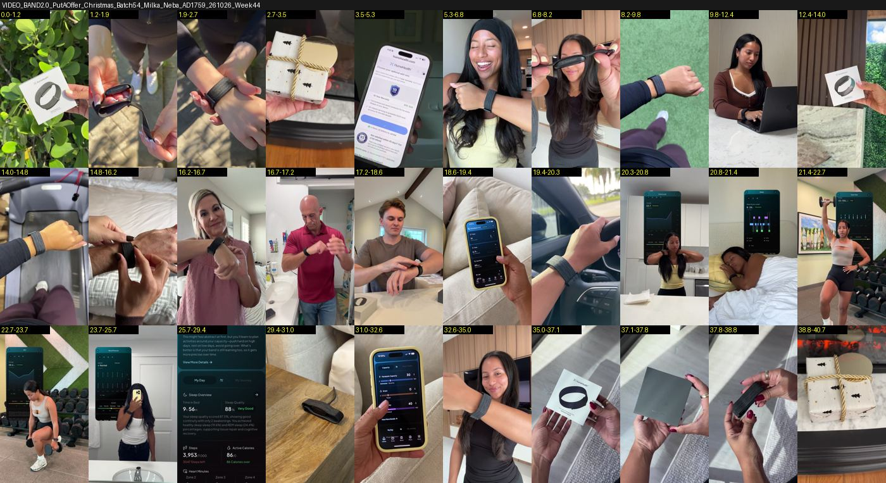

# VIDEO_BAND2.0_PutAOffer_Christmas_Batch54_Milka_Neba_AD1759_261026_Week44

Master: `VIDEO_BAND2.0_PutAOffer_Christmas_Batch54_Milka_Neba_AD1759_261026_Week44_9X16_HOOK1.mp4` · 40.7s · 1080x1920

**Pacing:** 30 shots · avg 1.356s · median 1.317s · 7.13 cuts/10s · first cut 1.167s · 221.0 wpm · talk ratio 0.93 · cuts on word start 86.2% · cuts in speech gaps 75.9%
**Audio:** {'I_lufs': -18.9, 'LRA': 2.8, 'true_peak_db': -3.3} · BPM≈129.2 · music {'speech_rms_db': -23.8, 'pause_seconds': 0.4} · cuts with SFX/transient 69.0%

**Captions:** 83 cards · 1 words/card (median) · y≈0.614 of frame height · text height≈0.0258 · colours {'dark/other': 28, 'red': 1, 'white': 49, 'blue': 5} · cards crossing a cut: 0
Highlighted: XHumetealth, 10, TEARS, YEARS, 12:27, HumeBand8%
**Headlines:** XHumeHealth (0.5–0.5s, white) | 1:512 (3.5–3.5s, white) | humehealth.com (3.5–5.0s, white) | Chooseyouroptionaladd-ons: (3.5–5.0s, white) | EachHumePodcomeswitha1-yearwarranty.butifyou (3.5–3.5s, white) | wanttoextendthlsyoucantickbelow. (3.5–3.5s, white) | VFullhardwareand sensor protectionforthe entire (3.5–3.5s, white) | On-request servicingto guaranteeDEXA-level (3.5–4.5s, blue)

**Hook (0–3s) spoken:** Hume put a countdown on this Christmas offer, and it's ticking. For Christmas,
**Hook on-screen:** HumelHealth / XHumeHealth / XHumetealth
**CTA (last 5s):** zero, the holiday price is gone. So grab yours now and maybe a few more for under the tree. · on-screen: MIONIGHT BLUE / XHumeHealth

## Beat sheet

| # | in–out (s) | dur | transition | spoken | on-screen text |
|---|---|---|---|---|---|
| 1 | 0.00–1.17 | 1.17 |  | Hume put a countdown on this | XHumeHealth (HEADLINE) / HumelHealth |
| 2 | 1.17–1.93 | 0.77 | cut | Christmas offer, | HumelHealth / XHumetealth [red] |
| 3 | 1.93–2.73 | 0.8 | cut +SFX hit | and it's ticking. | XHumetealth [red] |
| 4 | 2.73–3.50 | 0.77 | cut +SFX hit | For Christmas, |  |
| 5 | 3.50–5.27 | 1.77 | cut +SFX hit | Hume is running up to 50 % off | 1:512 (HEADLINE) / humehealth.com (HEADLINE) / XHumeHealth / Chooseyouroptionaladd-ons: (HEADLINE) / EachHumePodcomeswitha1-yearwarranty.butifyou (HEADLINE) / wanttoextendthlsyoucantickbelow. (HEADLINE) |
| 6 | 5.27–6.80 | 1.53 | cut +SFX hit | on the Hume Band 2 .0 with | humehealth.com (HEADLINE) / Chooseyouroptionaladd-ons: (HEADLINE) / 10-YearWarranty / $70 $46 / Not satisfiedwithin 45days?Get (HEADLINE) / 45 |
| 7 | 6.80–8.17 | 1.37 | cut +SFX hit | code BF50. | XHumeHeafth (HEADLINE) |
| 8 | 8.17–9.83 | 1.67 | cut | That's $199 when |  |
| 9 | 9.83–12.43 | 2.6 | cut +SFX hit | it normally costs $356. |  |
| 10 | 12.43–14.00 | 1.57 | cut | So at this price, it's easy to get | HumeHealah |
| 11 | 14.00–14.83 | 0.83 | cut +SFX hit | one for yourself and |  |
| 12 | 14.83–16.20 | 1.37 | cut | one for the people you love. |  |
| 13 | 16.20–16.67 | 0.47 | cut +SFX hit | Mom, |  |
| 14 | 16.67–17.20 | 0.53 | cut +SFX hit | Dad, |  |
| 15 | 17.20–18.63 | 1.43 | cut +SFX hit | your partner, all of them. |  |
| 16 | 18.63–19.40 | 0.77 | cut +SFX hit | Here's what they get. | 12:27 [blue] / HumeBand8% [blue] / eP Steps / CSeep / 6n9m / CCHeatRee |
| 17 | 19.40–20.27 | 0.87 | cut +SFX hit | A band that tracks their | 12:27 [blue] / HumeBand8% [blue] / eP Steps / CSeep / 6n9m / CCHeatRee |
| 18 | 20.27–20.83 | 0.57 | cut +SFX hit | stress, |  |
| 19 | 20.83–21.43 | 0.6 | cut +SFX hit | their sleep, |  |
| 20 | 21.43–22.70 | 1.27 | cut +SFX hit | their heart rate variability, |  |
| 21 | 22.70–23.73 | 1.03 | cut +SFX hit | and heart resilience, | 38.6ms (HEADLINE) |
| 22 | 23.73–25.73 | 2.0 | cut +SFX hit | with blood pressure insights day and night. |  |
| 23 | 25.73–29.43 | 3.7 | cut | Prof AI coaching that explains what every number means in plain English. Up | Pro.FActiveIntelligence (HEADLINE) / Unlockreal-timeinsightsandtimely (HEADLINE) / recommendationspoweredby (HEADLINE) / continuousmonitoring (HEADLINE) / ActiveIntelligence / Default |
| 24 | 29.43–31.03 | 1.6 | cut +SFX hit | to 14 days of battery and | healthydeepsleep(19.6%)andREMsleep(24.4%) / ActiveCalories / 86/0 / 86Caloriesover / 3047Stepsleft / HeartMinutes |
| 25 | 31.03–32.60 | 1.57 | cut | no subscription ever. | 12:23 [blue] (HEADLINE) / Capacity (HEADLINE) / 4MetabollcCapacity / Estimated Basetine / BodyComp (HEADLINE) / 30 (HEADLINE) |
| 26 | 32.60–34.97 | 2.37 | cut | Plus, it's HSA and FSA eligible. |  |
| 27 | 34.97–37.07 | 2.1 | cut +SFX hit | When the countdown hits zero, the holiday price | XHumeHealth / MIDNIGHTBLUE / XHumeHealth (HEADLINE) / MIONIGHT BLUE |
| 28 | 37.07–37.80 | 0.73 | cut | is gone. |  |
| 29 | 37.80–38.80 | 1.0 | cut +SFX hit | So grab yours now and |  |
| 30 | 38.80–40.68 | 1.88 | cut | maybe a few more for under the tree. |  |

## Hook variants

| hook | file | dur | first cut | spoken 0–3s | on-screen 0–3s |
|---|---|---|---|---|---|
| 1 | `stmas_Batch54_Milka_Neba_AD1759_261026_Week44_9X16_HOOK1.mp4` | 40.7 | 1.167 | Hume put a countdown on this Christmas offer, and it's ticking. For Christmas, | HumelHealth / XHumeHealth / XHumetealth |
| 1 | `stmas_Batch54_Milka_Neba_AD1759_261026_Week44_9X16_HOOK1.mp4` | 40.7 | 1.167 |  |  |
| 2 | `stmas_Batch54_Milka_Neba_AD1759_261026_Week44_9X16_HOOK2.mp4` | 42.9 | 1.2 |  |  |
| 2 | `stmas_Batch54_Milka_Neba_AD1759_261026_Week44_9X16_HOOK2.mp4` | 42.9 | 1.2 |  |  |
| 3 | `stmas_Batch54_Milka_Neba_AD1759_261026_Week44_9X16_HOOK3.mp4` | 42.4 | 1.233 |  |  |
| 3 | `stmas_Batch54_Milka_Neba_AD1759_261026_Week44_9X16_HOOK3.mp4` | 42.4 | 1.233 | Up to 50 % off the HumeBand 2 .0, but only until |  |

## Full transcript

Hume put a countdown on this Christmas offer, and it's ticking. For Christmas, Hume is running up to 50% off on the Hume Band 2.0 with code BF50. That's $199 when it normally costs $356. So at this price, it's easy to get one for yourself and one for the people you love. Mom, Dad, your partner, all of them. Here's what they get. A band that tracks their stress, their sleep, their heart rate variability, and heart resilience, with blood pressure insights day and night. Prof AI coaching that explains what every number means in plain English. Up to 14 days of battery and no subscription ever. Plus, it's HSA and FSA eligible. When the countdown hits zero, the holiday price is gone. So grab yours now and maybe a few more for under the tree.