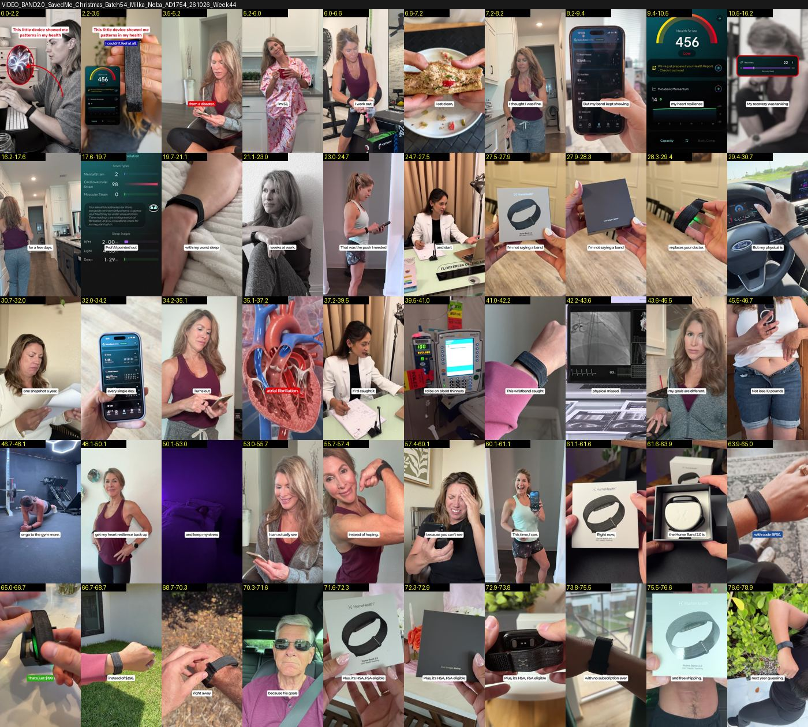

# VIDEO_BAND2.0_SavedMe_Christmas_Batch54_Milka_Neba_AD1754_261026_Week44

Master: `VIDEO_BAND2.0_SavedMe_Christmas_Batch54_Milka_Neba_AD1754_261026_Week44_9x16_hook1.mp4` · 78.9s · 1080x1920

**Pacing:** 50 shots · avg 1.579s · median 1.42s · 6.21 cuts/10s · first cut 2.2s · 238.0 wpm · talk ratio 0.95 · cuts on word start 89.8% · cuts in speech gaps 73.5%
**Audio:** {'I_lufs': -19.1, 'LRA': 3.9, 'true_peak_db': 0.0} · BPM≈123.0 · music {'speech_rms_db': -25.4, 'pause_seconds': 0.3} · cuts with SFX/transient 57.1%

**Captions:** 128 cards · 1.0 words/card (median) · y≈0.645 of frame height · text height≈0.0269 · colours {'white': 110, 'dark/other': 8, 'red': 2, 'yellow': 3, 'blue': 3, 'green': 2} · cards crossing a cut: 1
Highlighted: fromadisaster., We've justpreparedyourHealthReport, Checkitoutnow!, Last:27/un/26, atrial fibrillation., 100, OCCLUDE, 50%off, withcodeBF50., That's just $199
**Headlines:** Thislittledevice showedme (0.0–3.0s, red) | patternsinmyhealth (0.0–3.0s, red) | Icouldn'tfeelatall. (2.0–3.0s, blue) | 12:12 (8.0–9.0s, blue) | 09 steps (8.0–8.0s, white) | 36 (8.0–8.0s, white) | HumeBand(50%) (9.0–9.0s, dark/other) | Heart Rate (9.0–9.0s, white)

**Hook (0–3s) spoken:** This little device showed me patterns in my health I couldn't feel at
**Hook on-screen:** 456 / Icouldn'tfeelatall. / LMetabolicMomentum / Thislittledevice showedme / patternsinmyhealth
**CTA (last 5s):** with no subscription ever. And free shipping. Don't start next year guessing. Start it knowing. · on-screen: 24/7HealthTracking / HumeBand2.0 / Start it knowing. / X HumeHealth / and free shipping. / next year guessing / with no subscription ever

## Beat sheet

| # | in–out (s) | dur | transition | spoken | on-screen text |
|---|---|---|---|---|---|
| 1 | 0.00–2.20 | 2.2 |  | This little device showed me patterns in my health | Thislittledevice showedme [red] (HEADLINE) / patternsinmyhealth [red] (HEADLINE) / Icouldn'tfeelatall. [blue] (HEADLINE) / 456 / LMetabolicMomentum |
| 2 | 2.20–3.48 | 1.28 | cut | I couldn't feel at all. | Thislittledevice showedme [red] (HEADLINE) / patternsinmyhealth [red] (HEADLINE) / Icouldn'tfeelatall. [blue] (HEADLINE) / 456 / LMetabolicMomentum |
| 3 | 3.48–5.16 | 1.68 | cut | It saved me from a disaster. | Thislittledevice showedme [red] (HEADLINE) / patternsinmyhealth [red] (HEADLINE) / Icouldn'tfeelatall. [blue] (HEADLINE) / 456 / LMetabolicMomentum / Itsaved me |
| 4 | 5.16–5.96 | 0.8 | cut +SFX hit | I'm 52. | I'm 52, |
| 5 | 5.96–6.60 | 0.64 | cut | I work out. | I'm 52, / I work out, |
| 6 | 6.60–7.24 | 0.64 | cut +SFX hit | I eat clean. | Ithought Iwasfine. |
| 7 | 7.24–8.16 | 0.92 | cut | I thought I was fine. | Ithought Iwasfine. / 12:12 [blue] (HEADLINE) / 09 steps (HEADLINE) / 36 (HEADLINE) / TFSSHIW / CSleep |
| 8 | 8.16–9.36 | 1.2 | cut | But my band kept showing my | 12:12 [blue] (HEADLINE) / 09 steps (HEADLINE) / 36 (HEADLINE) / TFSSHIW / CSleep / 9h1m |
| 9 | 9.36–10.48 | 1.12 | cut | heart resilience dropping week | 12:12 [blue] (HEADLINE) / But my band kept showing / HumeBand(50%) (HEADLINE) / Heart Rate (HEADLINE) / 57mg / StressLevel |
| 10 | 10.48–16.24 | 5.76 | cut | after week. My HRV was low, my recovery was tanking, and my BP insights were higher than I expected. | HealthScore (HEADLINE) / 456 (HEADLINE) / Low [red] (HEADLINE) / We've justpreparedyourHealthReport [yellow] / Checkitoutnow! [yellow] / MetabolicMomentum |
| 11 | 16.24–17.60 | 1.36 | cut | I ignored it for a few days. | I ignored it / for a few days. |
| 12 | 17.60–19.68 | 2.08 | cut | Then, Prof AI pointed out the pattern. | Yesterday'sResolution [blue] (HEADLINE) / Strain Types (HEADLINE) / Mental Strain (HEADLINE) / Cardiovascular (HEADLINE) / Strain (HEADLINE) / MuscularStrain (HEADLINE) |
| 13 | 19.68–21.08 | 1.4 | cut +SFX hit | It lined up with my worst sleep | with my worst sleep / andmymoststressful |
| 14 | 21.08–23.00 | 1.92 | cut | and my most stressful weeks at work. That | andmymoststressful / weeksatwork |
| 15 | 23.00–24.72 | 1.72 | cut +SFX hit | was the push I needed to finally book | ThatwasthepushIneeded / tofinally book |
| 16 | 24.72–27.52 | 2.8 | cut | the checkup I'd been putting off and start changing my habits. | I'd been putting off / FLORTERESA O (HEADLINE) / andstart / FLORTERESAOLLERO,MD (HEADLINE) / changingmyhabits. / toloels |
| 17 | 27.52–27.92 | 0.4 | cut +SFX hit | I'm not saying |  |
| 18 | 27.92–28.32 | 0.4 | cut +SFX hit | a band | Live Longer.Better. / I'm not saying a band |
| 19 | 28.32–29.40 | 1.08 | cut +SFX hit | replaces your doctor. It | Live Longer.Better. / I'm not saying a band / replaces your doctor. |
| 20 | 29.40–30.68 | 1.28 | cut +SFX hit | doesn't. But my physical is | replaces your doctor. / Antta/Brap/BodG [blue] (HEADLINE) / 43185.3 / But my physical is |
| 21 | 30.68–32.00 | 1.32 | cut +SFX hit | one snapshot a year, | onesnapshotayear, |
| 22 | 32.00–34.16 | 2.16 | cut +SFX hit | and this shows me what's happening every single day. | HumeBand(88%) [blue] (HEADLINE) / 3,818 / Last:27/un/26 [blue] / SHTWTFS / 755m / Last:27//un/26 |
| 23 | 34.16–35.08 | 0.92 | cut | So I did. Turns out | So I did. / Ihad earlierstage |
| 24 | 35.08–37.24 | 2.16 | cut +SFX hit | I had early stage atrial fibrillation. | Ihad earlierstage / atrial fibrillation. [red] / (SAG.OL / My doctor said |
| 25 | 37.24–39.52 | 2.28 | cut +SFX hit | My doctor said if I'd caught it six months later, | (SAG.OL / My doctor said / if I'd caught it / ESA G OLLENY / later, |
| 26 | 39.52–41.04 | 1.52 | cut +SFX hit | I'd be on blood thinners for life. | CLE (HEADLINE) / INUSE [yellow] (HEADLINE) / Alaris PC (HEADLINE) / 100 [green] / OCCLUDE [yellow] / 00000 (HEADLINE) |
| 27 | 41.04–42.16 | 1.12 | cut | This wristband caught what | Thiswristband caught / what myannual |
| 28 | 42.16–43.60 | 1.44 | cut +SFX hit | my annual physical missed. | what myannual / physical missed. |
| 29 | 43.60–45.52 | 1.92 | cut +SFX hit | So, this year, my goals are different. | So this year, / my goals are different. |
| 30 | 45.52–46.68 | 1.16 | cut +SFX hit | Not lose 10 pounds | Notlose10pounds |
| 31 | 46.68–48.12 | 1.44 | cut | or go to the gym more. | or go to the gym more. / My goals are, |
| 32 | 48.12–50.08 | 1.96 | cut +SFX hit | My goals are get my heart resilience back up, | My goals are, / get my heart resilience back up / protectmysleep |
| 33 | 50.08–53.04 | 2.96 | cut +SFX hit | protect my sleep, and keep my stress from running my life. | protectmysleep / andkeepmystress / from running my life / And forthefirst time, |
| 34 | 53.04–55.68 | 2.64 | cut +SFX hit | And for the first time, I can actually see if I'm hitting them | And forthefirst time, / Icanactuallysee / if I'm hitting them |
| 35 | 55.68–57.40 | 1.72 | cut | week by week instead of hoping. Most | week by week / instead of hoping. |
| 36 | 57.40–60.08 | 2.68 | cut +SFX hit | New Year's goals fail because you can't see your progress. This | instead of hoping. / MostNewYear'sgoalsfail / your progress. / This time, I can. |
| 37 | 60.08–61.08 | 1.0 | cut +SFX hit | time, I can. | This time, I can. / XHumeHealth (HEADLINE) / Right now, |
| 38 | 61.08–61.56 | 0.48 | cut +SFX hit | Right now, | XHumeHealth (HEADLINE) / Right now, |
| 39 | 61.56–63.88 | 2.32 | cut +SFX hit | the HumeBand 2 .0 is 50 % off with | theHume Band 2.0is / 50%off [blue] |
| 40 | 63.88–65.00 | 1.12 | cut | code BF50. | withcodeBF50. [blue] |
| 41 | 65.00–66.68 | 1.68 | cut | That's just $199 instead | That's just $199 [green] |
| 42 | 66.68–68.68 | 2.0 | cut | of $356. | instead of $356. |
| 43 | 68.68–70.32 | 1.64 | cut +SFX hit | I bought one for my dad right away, | I bought one for my dad / right away |
| 44 | 70.32–71.60 | 1.28 | cut +SFX hit | because his goals matter too. | right away / mattertoo. |
| 45 | 71.60–72.28 | 0.68 | cut | Plus, it's | XHumeHealth (HEADLINE) / HumeBand2. / 24/7.HealthTrackil / Plus, it's HSA, FSA eligible |
| 46 | 72.28–72.92 | 0.64 | cut +SFX hit | HSA FSA | XHumeHealth (HEADLINE) / HumeBand2. / 24/7.HealthTrackil / Plus, it's HSA, FSA eligible |
| 47 | 72.92–73.84 | 0.92 | cut | -eligible, | Plus, it's HSA, FSA eligible |
| 48 | 73.84–75.52 | 1.68 | cut | with no subscription ever. | with no subscription ever |
| 49 | 75.52–76.56 | 1.04 | cut +SFX hit | And free shipping. Don't | X HumeHealth (HEADLINE) / HumeBand2.0 / 24/7HealthTracking / and free shipping. |
| 50 | 76.56–78.93 | 2.37 | cut +SFX hit | start next year guessing. Start it knowing. | next year guessing / Start it knowing. |

## Hook variants

| hook | file | dur | first cut | spoken 0–3s | on-screen 0–3s |
|---|---|---|---|---|---|
| 1 | `stmas_Batch54_Milka_Neba_AD1754_261026_Week44_9x16_hook1.mp4` | 78.9 | 2.2 | This little device showed me patterns in my health I couldn't feel at | 456 / Icouldn'tfeelatall. / LMetabolicMomentum / Thislittledevice showedme / patternsinmyhealth |
| 1 | `stmas_Batch54_Milka_Neba_AD1754_261026_Week44_9x16_hook1.mp4` | 78.8 | 2.2 |  |  |
| 2 | `stmas_Batch54_Milka_Neba_AD1754_261026_Week44_9x16_hook2.mp4` | 77.2 | 1.8 |  |  |
| 2 | `stmas_Batch54_Milka_Neba_AD1754_261026_Week44_9x16_hook2.mp4` | 77.2 | 1.8 |  |  |
| 3 | `stmas_Batch54_Milka_Neba_AD1754_261026_Week44_9x16_hook3.mp4` | 78.8 | 2.4 |  |  |
| 3 | `stmas_Batch54_Milka_Neba_AD1754_261026_Week44_9x16_hook3.mp4` | 78.8 | 2.4 |  |  |

## Full transcript

This little device showed me patterns in my health I couldn't feel at all. It saved me from a disaster. I'm 52. I work out. I eat clean. I thought I was fine. But my band kept showing my heart resilience dropping week after week. My HRV was low, my recovery was tanking, and my BP insights were higher than I expected. I ignored it for a few days. Then, Prof AI pointed out the pattern. It lined up with my worst sleep and my most stressful weeks at work. That was the push I needed to finally book the checkup I'd been putting off and start changing my habits. I'm not saying a band replaces your doctor. It doesn't. But my physical is one snapshot a year, and this shows me what's happening every single day. So I did. Turns out I had early stage atrial fibrillation. My doctor said if I'd caught it six months later, I'd be on blood thinners for life. This wristband caught what my annual physical missed. So, this year, my goals are different. Not lose 10 pounds or go to the gym more. My goals are get my heart resilience back up, protect my sleep, and keep my stress from running my life. And for the first time, I can actually see if I'm hitting them week by week instead of hoping. Most New Year's goals fail because you can't see your progress. This time, I can. Right now, the HumeBand 2.0 is 50% off with code BF50. That's just $199 instead of $356. I bought one for my dad right away, because his goals matter too. Plus, it's HSA FSA-eligible, with no subscription ever. And free shipping. Don't start next year guessing. Start it knowing.