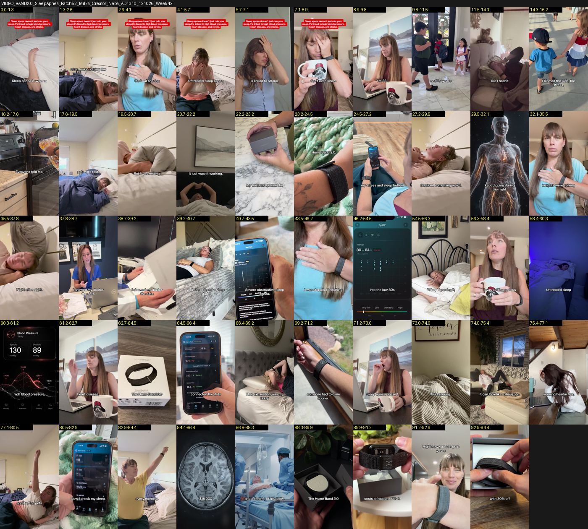

# VIDEO_BAND2.0_SleepApnea_Batch52_Milka_Creator_Neba_AD1310_121026_Week42

Master: `VIDEO_BAND2.0_SleepApnea_Batch52_Milka_Creator_Neba_AD1310_121026_Week42_Hook1_9x16.mp4` · 94.8s · 1080x1920

**Pacing:** 49 shots · avg 1.934s · median 1.72s · 5.06 cuts/10s · first cut 1.34s · 214.0 wpm · talk ratio 0.92 · cuts on word start 77.1% · cuts in speech gaps 83.3%
**Audio:** {'I_lufs': -13.7, 'LRA': 4.3, 'true_peak_db': 0.3} · BPM≈107.7 · music {'speech_rms_db': -18.1, 'pause_seconds': 0.9, 'pause_rms_db': -18.4, 'bed_minus_voice_db': -0.3, 'music_bed_likely': True} · cuts with SFX/transient 68.8%

**Captions:** 172 cards · 1.0 words/card (median) · y≈0.693 of frame height · text height≈0.0328 · colours {'white': 146, 'red': 3, 'blue': 2, 'dark/other': 20, 'other-colour': 1} · cards crossing a cut: 1
Highlighted: Severe obstructive sleep, Iwas stopping breathing, over40times anhour., connectedthe dots, Icouldn't see., every morning
**Headlines:** Sleepapneadoesn't justruinyour (0.0–8.0s, red) | sleep.lt'slinkedtohighbloodpressure, (0.0–2.0s, red) | heartdisease,andstroke. (0.0–8.0s, red) | sleep.It's linked tohigh blood pressure, (2.5–5.0s, red) | sleep.lt'slinkedtohighbloodpressure, (5.5–8.0s, red) | 220 (16.0–17.0s, white) | Ready (16.0–16.0s, red) | 09Steps (26.0–26.0s, white)

**Hook (0–3s) spoken:** Sleep apnea in women often looks nothing like the loud snoring
**Hook on-screen:** Sleep apneainwomen / Sleepapneadoesn't justruinyour / heartdisease,andstroke. / oftenlooksnothinglike / sleep.It's linked tohigh blood pressure, / sleep.lt'slinkedtohighbloodpressure, / theloud snoring
**CTA (last 5s):** a fraction of that. Right now, you can grab yours with 30 % off for the launch month. · on-screen: Right now you can grab / XHlumotlentth / costs a fraction of that / for the launch month. / with 30% off / yours

## Beat sheet

| # | in–out (s) | dur | transition | spoken | on-screen text |
|---|---|---|---|---|---|
| 1 | 0.00–1.34 | 1.34 |  | Sleep apnea in women often | Sleepapneadoesn't justruinyour [red] (HEADLINE) / sleep.lt'slinkedtohighbloodpressure, [red] (HEADLINE) / heartdisease,andstroke. [red] (HEADLINE) / Sleep apneainwomen |
| 2 | 1.34–2.58 | 1.24 | cut +SFX hit | looks nothing like | Sleepapneadoesn't justruinyour [red] (HEADLINE) / sleep.lt'slinkedtohighbloodpressure, [red] (HEADLINE) / heartdisease,andstroke. [red] (HEADLINE) / Sleep apneainwomen / oftenlooksnothinglike / sleep.It's linked tohigh blood pressure, [red] (HEADLINE) |
| 3 | 2.58–4.12 | 1.54 | cut +SFX hit | the loud snoring you hear about. | Sleepapneadoesn't justruinyour [red] (HEADLINE) / heartdisease,andstroke. [red] (HEADLINE) / sleep.It's linked tohigh blood pressure, [red] (HEADLINE) / theloud snoring / youhearabout. / Untreatedsleepapnea |
| 4 | 4.12–5.72 | 1.6 | cut | Untreated sleep apnea is | Sleepapneadoesn't justruinyour [red] (HEADLINE) / heartdisease,andstroke. [red] (HEADLINE) / sleep.It's linked tohigh blood pressure, [red] (HEADLINE) / Untreatedsleepapnea / sleep.lt'slinkedtohighbloodpressure, [red] (HEADLINE) / is linked to stroke, |
| 5 | 5.72–7.10 | 1.38 | cut +SFX hit | linked to stroke, and most people | Sleepapneadoesn't justruinyour [red] (HEADLINE) / heartdisease,andstroke. [red] (HEADLINE) / sleep.lt'slinkedtohighbloodpressure, [red] (HEADLINE) / is linked to stroke, / andmostpeople / whohaveit |
| 6 | 7.10–8.90 | 1.8 | cut +SFX hit | who have it don't even know. | Sleepapneadoesn't justruinyour [red] (HEADLINE) / heartdisease,andstroke. [red] (HEADLINE) / sleep.lt'slinkedtohighbloodpressure, [red] (HEADLINE) / andmostpeople / whohaveit / don'tevenknow. |
| 7 | 8.90–9.84 | 0.94 | cut | I'm 38, | I'm 38. |
| 8 | 9.84–11.50 | 1.66 | cut +SFX hit | I have three kids, and for years | I have three kids, / HAPPY / and for years |
| 9 | 11.50–14.30 | 2.8 | cut | I woke up feeling like I hadn't slept at all. | I woke up feeling / slept at all |
| 10 | 14.30–16.16 | 1.86 | cut +SFX hit | I blamed the kids, the stress. | slept at all / Iblamed the kids, the / stress. / 220 (HEADLINE) / Everyone told me, / Ready [red] (HEADLINE) |
| 11 | 16.16–17.64 | 1.48 | cut +SFX hit | Everyone told me, you're a tired | 220 (HEADLINE) / Everyone told me, / Ready [red] (HEADLINE) / you're a tired mom |
| 12 | 17.64–19.46 | 1.82 | cut +SFX hit | mom, get more rest. | you're a tired mom, / getmore rest. |
| 13 | 19.46–20.72 | 1.26 | cut | But I was resting, | getmore rest. / But I was resting. |
| 14 | 20.72–22.18 | 1.46 | cut +SFX hit | it just wasn't working. | It just wasn't working. / My husband got me the |
| 15 | 22.18–23.16 | 0.98 | cut +SFX hit | My husband got me the | My husband got me the / Hume Band 2.0, |
| 16 | 23.16–24.50 | 1.34 | cut | Hume Band 2 .0, | Hume Band 2.0, |
| 17 | 24.50–27.22 | 2.72 | cut +SFX hit | mostly so I could understand my stress and sleep better. | mostly soIcould / understand / 09Steps (HEADLINE) / 5,806 (HEADLINE) / mystress and sleep better. / within the first week, |
| 18 | 27.22–29.54 | 2.32 | cut +SFX hit | Within the first week, I noticed something weird. My | within the first week, / I noticed something weird. |
| 19 | 29.54–32.06 | 2.52 | cut | blood oxygen kept dipping during the night. | Myblood oxygen / kept dipping during / the night. / My heart rate and blood / pressure |
| 20 | 32.06–35.50 | 3.44 | cut +SFX hit | My heart rate and blood pressure insights were spiking while I slept. | My heart rate and blood / pressure / insights were spiking / While I slept. |
| 21 | 35.50–37.84 | 2.34 | cut | Same pattern, night after night. | Same pattern, / Night after night. |
| 22 | 37.84–38.68 | 0.84 | cut +SFX hit | I showed my doctor | Ishowed my doctor / thedata |
| 23 | 38.68–39.20 | 0.52 | cut +SFX hit | the data, | and she ordered a sleep / study. |
| 24 | 39.20–40.68 | 1.48 | cut | and she ordered a sleep study. | and she ordered a sleep / study. |
| 25 | 40.68–43.52 | 2.84 | cut +SFX hit | The results? Severe obstructive sleep apnea. | 51-156bpm / .The,results? / Very low / Yourheartrateshowshowmanytimesyourheart / cardiovascularhealth, / Arestingheartratebetween60-100bpmis |
| 26 | 43.52–46.24 | 2.72 | cut +SFX hit | I was stopping breathing over 40 times an hour, | Iwas stopping breathing [blue] / over40times anhour. [blue] / Every single night. |
| 27 | 46.24–54.52 | 8.28 | cut +SFX hit | every single night, for years. My oxygen was dropping into the low 80s while I slept, and my heart was working overtime just to keep up. | Every single night. / For years. / 11:024 [blue] (HEADLINE) / Sp02 (HEADLINE) / WM (HEADLINE) / Range (HEADLINE) |
| 28 | 54.52–56.34 | 1.82 | cut +SFX hit | She told me if I had kept ignoring it, | Id kept ignoring it, |
| 29 | 56.34–58.38 | 2.04 | cut | I was putting serious strain on my heart. | Id kept ignoring it, / Iwas putting serious / strain on my heart. |
| 30 | 58.38–60.30 | 1.92 | cut | Untreated sleep apnea is linked to | strain on my heart. / Untreatedsleep / apnea is linked to |
| 31 | 60.30–61.22 | 0.92 | cut +SFX hit | high blood pressure, | apnea is linked to / heart disease, |
| 32 | 61.22–62.74 | 1.52 | cut +SFX hit | heart disease, and stroke. | heart disease, / and stroke |
| 33 | 62.74–64.52 | 1.78 | cut +SFX hit | The Hume band 2 .0 connected | The Hume Band 2.0 / CEC / HumelHealth |
| 34 | 64.52–66.36 | 1.84 | cut +SFX hit | the dots I couldn't see. | 12:124 [blue] (HEADLINE) / StepOnScale (HEADLINE) / HumePod [blue] (HEADLINE) / SubcutanegusFat (HEADLINE) / 33.8% (HEADLINE) / Visceral Fatindex |
| 35 | 66.36–69.20 | 2.84 | cut +SFX hit | That exhaustion was my body fighting for air. | HumePod [blue] (HEADLINE) / Standard / 12:12# [blue] (HEADLINE) / 20.1车 (HEADLINE) / Standard (HEADLINE) / Standare |
| 36 | 69.20–71.16 | 1.96 | cut | Here's what I wish someone had told me sooner. | Here's what I wish / someone had told me / sooner. / Sleep apneadoesn't |
| 37 | 71.16–72.98 | 1.82 | cut | Sleep apnea doesn't always look like | Sleep apneadoesn't |
| 38 | 72.98–73.98 | 1.0 | cut +SFX hit | loud snoring. | YOU WILL (HEADLINE) / BE MY ALWAYS (HEADLINE) / loud snoring |
| 39 | 73.98–75.42 | 1.44 | cut +SFX hit | It can look like exhaustion, | It can look like exhaustion, |
| 40 | 75.42–77.14 | 1.72 | cut | brain fog, morning headaches, | It can look like exhaustion, / morning headaches, / and waking up drained, |
| 41 | 77.14–80.54 | 3.4 | cut +SFX hit | and waking up drained. And it often gets brushed off as stress. | and waking up drained, / and waking up drained / brushedoffasstress / brushedoffas stress. |
| 42 | 80.54–82.94 | 2.4 | cut +SFX hit | Now I check my sleep, blood oxygen, and | 1:39 [blue] (HEADLINE) / StressLevel / 42.5 / BodyTemperature / 35:4-38:8- / NowIcheck my sleep |
| 43 | 82.94–84.42 | 1.48 | cut +SFX hit | recovery every morning. One | blood oxygen, and recovery / every morning [other-colour] |
| 44 | 84.42–86.76 | 2.34 | cut +SFX hit | stroke costs $15 ,000 and | every morning [other-colour] / Onestrokecosts / $15,000 |
| 45 | 86.76–88.26 | 1.5 | cut +SFX hit | a lifetime of disability. | and a lifetime of disability. |
| 46 | 88.26–89.90 | 1.64 | cut | The Hume Van 2 .0 costs | and a lifetime of disability. / The Hume Band 2.0 |
| 47 | 89.90–91.20 | 1.3 | cut +SFX hit | a fraction of that. | costs a fraction of that / Right now you can grab (HEADLINE) / yours (HEADLINE) |
| 48 | 91.20–92.92 | 1.72 | cut | Right now, you can grab yours with | Right now you can grab (HEADLINE) / yours (HEADLINE) |
| 49 | 92.92–94.78 | 1.86 | cut +SFX hit | 30 % off for the launch month. | XHlumotlentth (HEADLINE) / with 30% off / for the launch month. |

## Hook variants

| hook | file | dur | first cut | spoken 0–3s | on-screen 0–3s |
|---|---|---|---|---|---|
| 1 | `tch52_Milka_Creator_Neba_AD1310_121026_Week42_Hook1_9x16.mp4` | 94.8 | 1.34 | Sleep apnea in women often looks nothing like the loud snoring | Sleep apneainwomen / Sleepapneadoesn't justruinyour / heartdisease,andstroke. / oftenlooksnothinglike / sleep.It's linked tohigh blood pressure, / sleep.lt'slinkedtohighbloodpressure, / theloud snoring |
| 2 | `tch52_Milka_Creator_Neba_AD1310_121026_Week42_Hook2_9x16.mp4` | 91.5 | 1.64 |  |  |
| 3 | `tch52_Milka_Creator_Neba_AD1310_121026_Week42_Hook3_9x16.mp4` | 91.0 | 2.42 |  |  |
| 4 | `tch52_Milka_Creator_Neba_AD1310_121026_Week42_Hook4_9x16.mp4` | 91.3 | 1.34 |  |  |

## Full transcript

Sleep apnea in women often looks nothing like the loud snoring you hear about. Untreated sleep apnea is linked to stroke, and most people who have it don't even know. I'm 38, I have three kids, and for years I woke up feeling like I hadn't slept at all. I blamed the kids, the stress. Everyone told me, you're a tired mom, get more rest. But I was resting, it just wasn't working. My husband got me the Hume Band 2.0, mostly so I could understand my stress and sleep better. Within the first week, I noticed something weird. My blood oxygen kept dipping during the night. My heart rate and blood pressure insights were spiking while I slept. Same pattern, night after night. I showed my doctor the data, and she ordered a sleep study. The results? Severe obstructive sleep apnea. I was stopping breathing over 40 times an hour, every single night, for years. My oxygen was dropping into the low 80s while I slept, and my heart was working overtime just to keep up. She told me if I had kept ignoring it, I was putting serious strain on my heart. Untreated sleep apnea is linked to high blood pressure, heart disease, and stroke. The Hume band 2.0 connected the dots I couldn't see. That exhaustion was my body fighting for air. Here's what I wish someone had told me sooner. Sleep apnea doesn't always look like loud snoring. It can look like exhaustion, brain fog, morning headaches, and waking up drained. And it often gets brushed off as stress. Now I check my sleep, blood oxygen, and recovery every morning. One stroke costs $15,000 and a lifetime of disability. The Hume Van 2.0 costs a fraction of that. Right now, you can grab yours with 30% off for the launch month.