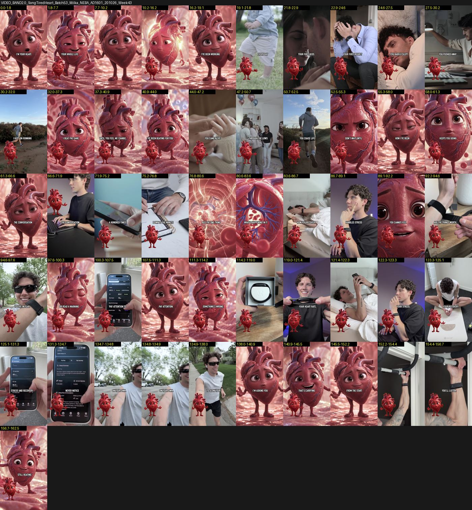

# VIDEO_BAND2.0_SongTiredHeart_Batch53_Milka_NEBA_AD1601_201026_Week43

Master: `VIDEO_BAND2.0_SongTiredHeart_Batch53_Milka_NEBA_AD1601_201026_Week43_H3_9x16.mp4` · 162.5s · 1080x1920

**Pacing:** 51 shots · avg 3.187s · median 2.92s · 3.08 cuts/10s · first cut 1.84s · 64.0 wpm · talk ratio 0.73 · cuts on word start 16.0% · cuts in speech gaps 82.0%
**Audio:** {'I_lufs': -14.7, 'LRA': 4.3, 'true_peak_db': -1.2} · BPM≈172.3 · music {'speech_rms_db': -19.4, 'pause_seconds': 113.4, 'pause_rms_db': -18.4, 'bed_minus_voice_db': 1.0, 'music_bed_likely': True} · cuts with SFX/transient 90.0%

**Captions:** 182 cards · 1.0 words/card (median) · y≈0.566 of frame height · text height≈0.0281 · colours {'white': 177, 'red': 4, 'blue': 1} · cards crossing a cut: 3
Highlighted: Body, Very low, 26.0ms, egoal, zed,accurate
**Headlines:** Weight (101.0–101.0s, white) | 70kg (101.0–101.0s, white) | 64.3kg* (101.0–101.0s, white) | 64.3 (104.0–104.0s, white) | 20.2 (104.0–104.0s, white) | NoDevice Paired (106.0–106.0s, blue) | 83.8% (106.0–106.0s, white) | 6.1kg+ (107.0–107.0s, white)

**Hook (0–3s) spoken:** I'm your heart We've
**Hook on-screen:** I'MYOURHEART.
**CTA (last 5s):**  · on-screen: LET'SKEEPITTHATWAY / STILL BEATING / STILL HERE

## Beat sheet

| # | in–out (s) | dur | transition | spoken | on-screen text |
|---|---|---|---|---|---|
| 1 | 0.00–1.84 | 1.84 |  | I'm your heart We've | I'MYOURHEART. |
| 2 | 1.84–7.72 | 5.88 | cut +SFX hit | been together your whole life Isn't it time you listen? | I'MYOURHEART. / WEVE BEEN TOGETHER / YOUR WHOLELIFE. / YOUR WHOLE LIFE / ISN'TIT TIMEYOU LISTENED? |
| 3 | 7.72–10.16 | 2.44 | cut +SFX hit | Every year that passes, | EVERYYEARTHATPASSES |
| 4 | 10.16–16.20 | 6.04 | cut +SFX hit | I get a little more fragile | EVERYYEARTHATPASSES / IGETALITTLEMORE / I'VEBEENWORKING |
| 5 | 16.20–19.12 | 2.92 | cut | I've been working in the back | I'VEBEENWORKING / INTHEBACKGROUND / EVERYSECOND |
| 6 | 19.12–21.76 | 2.64 | cut +SFX hit | in every day Through your first steps, your | EVERYSECOND / EVERY DAY / THROUGHYOURFIRSTSTEPS |
| 7 | 21.76–22.88 | 1.12 | cut +SFX hit | first kiss, | YOURFIRSTKISS |
| 8 | 22.88–24.60 | 1.72 | cut | your first regret | YOURFIRSTREGRET |
| 9 | 24.60–27.52 | 2.92 | cut +SFX hit | Through the nights you barely see | THROUGH THE NIGHTS / YOU BARELYSLEPT |
| 10 | 27.52–30.24 | 2.72 | cut +SFX hit | the stress you push | THROUGHTHESTRESS / YOU PUSHED AWAY / WHEN YOU RAN |
| 11 | 30.24–32.04 | 1.8 | cut +SFX hit |  | WHEN YOU RAN / KEPTON RUNNING / IKEPTON RUNNING |
| 12 | 32.04–37.28 | 5.24 | cut +SFX hit | Ain't good about me | IKEPTON RUNNING / WHENYOUBROKE / IBEATTHE SAME / YOU DON'T THINK / ABOUTMEMUCH |
| 13 | 37.28–40.88 | 3.6 | cut +SFX hit | much until you feel me change Meet | ABOUTMEMUCH / UNTIL YOU FEEL ME CHANGE |
| 14 | 40.88–43.96 | 3.08 | cut |  | I'VEBEEN BEATINGFORYOU / IVEBEEN BEATINGFOR YOU |
| 15 | 43.96–47.16 | 3.2 | cut +SFX hit |  | SINCETHE DAY / YOU CAMEALIVE / THROUGH THEHIGHS |
| 16 | 47.16–50.72 | 3.56 | cut +SFX hit |  | THROUGH THEHIGHS / THROUGH THE LOWS / KEEPINGTIME WHILE |
| 17 | 50.72–52.52 | 1.8 | cut +SFX hit |  | YOU CHASE LIFE |
| 18 | 52.52–55.28 | 2.76 | cut +SFX hit |  | DON'T WAIT UNTIL / I'MSCREAMING |
| 19 | 55.28–57.96 | 2.68 | cut +SFX hit |  | I'MSCREAMING / JUSTTOWONDER / HOWI'VE BEEN |
| 20 | 57.96–61.28 | 3.32 | cut +SFX hit |  | I'M THE HEARTTHAT / KEEPSYOU GOING |
| 21 | 61.28–66.64 | 5.36 | cut +SFX hit | back into the conversation you | KEEPSYOU GOING / THECONVERSATION |
| 22 | 66.64–71.88 | 5.24 | cut +SFX hit |  | LETME BACK INTO / THECONVERSATION |
| 23 | 71.88–75.24 | 3.36 | cut | check your phone a hundred times Know | YOU CHECK YOUR PHONE / AHUNDREDTIMES / KNOWYOURPLANS |
| 24 | 75.24–76.84 | 1.6 | cut +SFX hit | your plans down to the | KNOWYOURPLANS / DOWNTO THEMINUTE |
| 25 | 76.84–80.64 | 3.8 | cut +SFX hit |  | DOWNTO THEMINUTE / BUTTHEONETHING / KEEPING YOU HERE |
| 26 | 80.64–83.60 | 2.96 | cut +SFX hit |  | YOU DON'TKNOW / WHAT'SHAPPENINGINIT |
| 27 | 83.60–86.72 | 3.12 | cut +SFX hit |  | HOW YOU SLEEP, / HOWYOU RECOVER / IXXTHAXX |
| 28 | 86.72–89.12 | 2.4 | cut +SFX hit |  | HOW YOUR BODY / HANDLESSTRESS / SOMETIMESTHE THINGS |
| 29 | 89.12–92.16 | 3.04 | cut +SFX hit |  | SOMETIMESTHE THINGS / YOU CANNOT FEEL / ARETHE THINGS WORTH |
| 30 | 92.16–94.60 | 2.44 | cut +SFX hit |  | ARETHE THINGS WORTH / KNOWINGBEST |
| 31 | 94.60–97.60 | 3.0 | cut +SFX hit |  | NO,YOU DON'T HAVE / TO LIVE IN FEAR |
| 32 | 97.60–100.28 | 2.68 | cut +SFX hit |  | ORREADAWARNING / INEVERYBEAT |
| 33 | 100.28–107.52 | 7.24 | cut +SFX hit |  | INEVERYBEAT / Weight (HEADLINE) / 70kg (HEADLINE) / 64.3kg* (HEADLINE) / JUSTGETTOKNOW / Body [red] |
| 34 | 107.52–111.32 | 3.8 | cut +SFX hit | pay attention Not | THAT'SWHYI'MASKING YOU.. / PAY ATTENTION. |
| 35 | 111.32–114.24 | 2.92 | cut +SFX hit | because something's wrong Because | SOMETHING'SWRONG / BECAUSEYOURHEALTH |
| 36 | 114.24–118.96 | 4.72 | cut +SFX hit | your health is worth knowing The human band 2 .0 | BECAUSEYOURHEALTH / IS WORTH KNOWING. / THEHUMEBAND2.0 |
| 37 | 118.96–121.40 | 2.44 | cut | helps you see your heart rate | HELPSYOUSEE / YOURHEARTRATE |
| 38 | 121.40–122.32 | 0.92 | cut +SFX hit | You sleep your | XVI.LXXI (HEADLINE) / YOURSLEEP, |
| 39 | 122.32–123.32 | 1.0 | cut +SFX hit | stress your | XVI.LXXI (HEADLINE) / YOURSLEEP, / YOURRECOVERY |
| 40 | 123.32–125.12 | 1.8 | cut +SFX hit | recovery Blood | YOURRECOVERY / YOURRECOVERY. / GAIAM / 1:368 [blue] (HEADLINE) / 0Steps (HEADLINE) / 12,218 (HEADLINE) |
| 41 | 125.12–131.28 | 6.16 | cut +SFX hit | pressure in sight. See even while you sleep at night stress you | 1:368 [blue] (HEADLINE) / 0Steps (HEADLINE) / 12,218 (HEADLINE) / Sleep / CHeart Rate / BLOOD:PRESSUREINSIGHTS |
| 42 | 131.28–134.72 | 3.44 | cut +SFX hit |  | OSp02 / BodyTemperature (HEADLINE) / 35.5-37.3c (HEADLINE) / 93-98% / Thenutrition,sleepandactivit / THEWHOLE'STORY.L'AID'OUT |
| 43 | 134.72–134.80 | 0.08 | cut +SFX hit |  |  |
| 44 | 134.80–134.92 | 0.12 | cut +SFX hit |  |  |
| 45 | 134.92–138.04 | 3.12 | cut +SFX hit | to slow your | IM NOTASKING YOU / TO SLOWYOUR / WHOLELIFEDOWN! / I'MASKINGYOU |
| 46 | 138.04–140.92 | 2.88 | cut +SFX hit |  | I'MASKINGYOU |
| 47 | 140.92–145.48 | 4.56 | cut +SFX hit |  | TOUNDERSTAND THEBODY / THAT'SCARRYING / YOU THROUGH IT. |
| 48 | 145.48–152.24 | 6.76 | cut +SFX hit |  | YOU THROUGH IT. / I'MYOURHEART, / I'VE BEEN HERE / FROMTHESTART / MAYBENOW... |
| 49 | 152.24–154.36 | 2.12 | cut +SFX hit |  |  |
| 50 | 154.36–156.72 | 2.36 | cut +SFX hit |  | YOU'LL LISTEN. |
| 51 | 156.72–162.54 | 5.82 | cut +SFX hit |  | STILL HERE / STILL BEATING / LET'SKEEPITTHATWAY |

## Hook variants

| hook | file | dur | first cut | spoken 0–3s | on-screen 0–3s |
|---|---|---|---|---|---|
| 3 | `redHeart_Batch53_Milka_NEBA_AD1601_201026_Week43_H3_9x16.mp4` | 162.5 | 1.84 | I'm your heart We've | I'MYOURHEART. |
| 4 | `redHeart_Batch53_Milka_NEBA_AD1601_201026_Week43_H4_9x16.mp4` | 162.1 | 7.96 |  |  |

## Full transcript

I'm your heart We've been together your whole life Isn't it time you listen? Every year that passes, I get a little more fragile I've been working in the back in every day Through your first steps, your first kiss, your first regret Through the nights you barely see the stress you push Ain't good about me much until you feel me change Meet back into the conversation you check your phone a hundred times Know your plans down to the pay attention Not because something's wrong Because your health is worth knowing The human band 2.0 helps you see your heart rate You sleep your stress your recovery Blood pressure in sight. See even while you sleep at night stress you to slow your