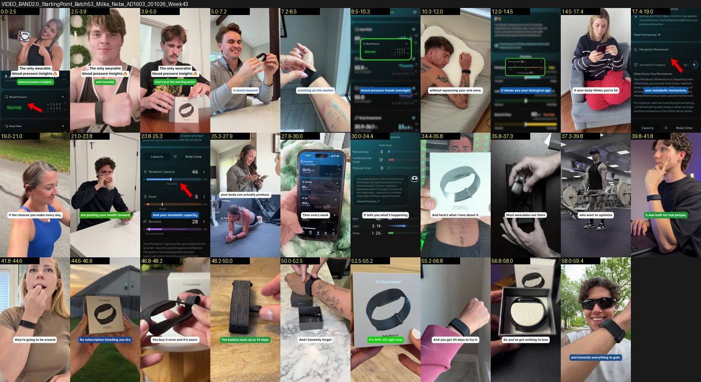

# VIDEO_BAND2.0_StartingPoint_Batch53_Milka_Neba_AD1603_201026_Week43

Master: `VIDEO_BAND2.0_StartingPoint_Batch53_Milka_Neba_AD1603_201026_Week43_9x16_hook1.mp4` · 59.4s · 1080x1920

**Pacing:** 29 shots · avg 2.049s · median 2.0s · 4.71 cuts/10s · first cut 2.48s · 246.0 wpm · talk ratio 0.99 · cuts on word start 96.4% · cuts in speech gaps 78.6%
**Audio:** {'I_lufs': -24.0, 'LRA': 5.1, 'true_peak_db': -5.3} · BPM≈123.0 · music {'speech_rms_db': -30.5, 'pause_seconds': 0.0} · cuts with SFX/transient 46.4%

**Captions:** 147 cards · 1 words/card (median) · y≈0.648 of frame height · text height≈0.0246 · colours {'white': 92, 'dark/other': 26, 'green': 11, 'blue': 17, 'red': 1} · cards crossing a cut: 2
Highlighted: This thing gives you, Normal, allday,, withoutacuff, andhonestly, that's just the starting point, islevelsbeyond, anything on the market, right now., Normal, blood pressure trends overnight, 50, Metahali, It showsyouyourbiologicalage, sleepqul
**Headlines:** CoBloodPressure (9.0–9.0s, white) | BloodPressure (10.0–10.0s, white) | BodyComposition (12.0–12.0s, dark/other) | 23 (12.0–12.0s, white) | /100 (12.0–12.0s, dark/other) | YourBodyCompositionscoreisformedby (12.0–12.0s, dark/other) | analyzingyourmetabolicage,musclemass,fat (12.0–12.0s, white) | Next:Day/.MetabolicMomentum (18.0–18.0s, white)

**Hook (0–3s) spoken:** This thing gives you blood pressure insights all day, without a cuff,
**Hook on-screen:** 14:00 / 9h6 / BloodPressure / HeartRate / Last:06/Aug / Last:06/Aug/2 / Last:06/Aug/26 / Normal / The only wearable / This thing gives you / allday, / bloodpressureinsights / withoutacuff
**CTA (last 5s):** .com and you get 45 days to try it. So you've got nothing to lose. And honestly, everything to gain. · on-screen: Andyouget45daystotryit. / HumoHealth / So you've got nothing to lose / and honestly everything to gain

## Beat sheet

| # | in–out (s) | dur | transition | spoken | on-screen text |
|---|---|---|---|---|---|
| 1 | 0.00–2.48 | 2.48 |  | This thing gives you blood pressure insights all day, | The only wearable / bloodpressureinsights / 9h6 / 14:00 / Last:06/Aug/2 / This thing gives you [green] |
| 2 | 2.48–3.92 | 1.44 | cut +SFX hit | without a cuff, and honestly, that's | The only wearable / bloodpressureinsights / 14:00 / BloodPressure / Normal [green] / HeartRate |
| 3 | 3.92–4.96 | 1.04 | cut +SFX hit | just the starting point. | The only wearable / bloodpressureinsights / andhonestly [green] / that's just the starting point [green] |
| 4 | 4.96–7.16 | 2.2 | cut +SFX hit | The HumeBand 2 .0 is levels beyond anything | The only wearable / bloodpressureinsights / that's just the starting point [green] / TheHumeBand2.0 / islevelsbeyond [blue] / anything on the market [blue] |
| 5 | 7.16–8.48 | 1.32 | cut +SFX hit | on the market right now. | anything on the market [blue] / right now. [blue] |
| 6 | 8.48–10.32 | 1.84 | cut | It tracks your blood pressure trends overnight, | right now. [blue] / CoBloodPressure (HEADLINE) / Normal [green] / blood pressure trends overnight [blue] / BloodPressure (HEADLINE) |
| 7 | 10.32–11.96 | 1.64 | cut +SFX hit | without squeezing your arm once. It | Normal [green] / blood pressure trends overnight [blue] / BloodPressure (HEADLINE) / without squeezing yourarmonce. |
| 8 | 11.96–14.48 | 2.52 | cut +SFX hit | shows you your biological age versus your real age, | BodyComposition (HEADLINE) / 23 (HEADLINE) / /100 (HEADLINE) / YourBodyCompositionscoreisformedby (HEADLINE) / analyzingyourmetabolicage,musclemass,fat (HEADLINE) / mass,consistenthydrationlevels,left/right |
| 9 | 14.48–17.40 | 2.92 | cut +SFX hit | so you can see if your body thinks you're 52 or 67. | 70 BiologicalAge 36 yrs / ChronologicalAge42 yrs / versus your real age, / ifyourbodythinksyou're52 / or 67. |
| 10 | 17.40–19.00 | 1.6 | cut | It gives you your metabolic momentum, | or 67. / Next:Day/.MetabolicMomentum (HEADLINE) / Duringyourfirst5days,metricsmayappear (HEADLINE) / unusualas your Hume Band establishes your (HEADLINE) / personalbaseline (HEADLINE) / ViewFull Journey→ (HEADLINE) |
| 11 | 19.00–21.00 | 2.0 | cut +SFX hit | which shows if the choices you make every day are | whichshows / if the choices you make every day, |
| 12 | 21.00–23.76 | 2.76 | cut | pushing your health forward or quietly pulling it back. | are pushing your health forward [green] / orquietlypullingitback. [red] |
| 13 | 23.76–25.28 | 1.52 | cut | And your metabolic capacity, | Capacity (HEADLINE) / BodyComp (HEADLINE) / MetabolicCapacity (HEADLINE) / 100 (HEADLINE) / Baseline (HEADLINE) / Strain |
| 14 | 25.28–27.88 | 2.6 | cut +SFX hit | which shows how much energy your body can actually produce. | Capacity (HEADLINE) / BodyComp (HEADLINE) / MetabolicCapacity (HEADLINE) / Strain / 100 / Target |
| 15 | 27.88–29.96 | 2.08 | cut | Then, every week, you get a heart health report where | 1:39# [blue] (HEADLINE) / Hume Band [blue] (HEADLINE) / 2mm月g / HeaftRate / Theneveryweek / 53.0mm |
| 16 | 29.96–34.40 | 4.44 | cut | Prof. AI doesn't just dump data on you. It tells you what's happening and exactly what to change. | Yesterday'sResolution [blue] (HEADLINE) / Strain Types (HEADLINE) / MentalStrain (HEADLINE) / Cardiovascular (HEADLINE) / Strain (HEADLINE) / MuscularStrain (HEADLINE) |
| 17 | 34.40–35.84 | 1.44 | cut | And here's what I love about it. | Yesterday'sResolution [blue] (HEADLINE) / Strain Types (HEADLINE) / MentalStrain (HEADLINE) / Strain (HEADLINE) / MuscularStrain (HEADLINE) / REM |
| 18 | 35.84–37.32 | 1.48 | cut | Most wearables out there are built for 25 | O-/dOOH (HEADLINE) / Mostwearablesoutthere / are built for |
| 19 | 37.32–39.80 | 2.48 | cut +SFX hit | -year -old athletes who want to optimize their deadlift. | are built for / 25 year old athletes / their deadlift. |
| 20 | 39.80–41.84 | 2.04 | cut | This one feels like it was built for real people. | Thisonefeelslike / it was built for real people [green] |
| 21 | 41.84–44.60 | 2.76 | cut +SFX hit | People who just want to know they're going to be around for the people they love. | Peoplewho justwanttoknow / they're going to be around / forthepeopletheylove |
| 22 | 44.60–46.84 | 2.24 | cut | No subscription bleeding you dry every month. | XHumeHealth" / Hume Band 2.0 / No subscription bleeding you dry [blue] / every month. |
| 23 | 46.84–48.16 | 1.32 | cut | You buy it once and it's yours. | Youbuyitonceand it'syours / The battery lasts up to 14 days. [green] |
| 24 | 48.16–50.00 | 1.84 | cut +SFX hit | The battery lasts up to 14 days. | The battery lasts up to 14 days. [green] |
| 25 | 50.00–52.48 | 2.48 | cut | There's no screen and I honestly forget I'm wearing it. | There'snoscreen / AndI honestlyforget / I'm wearing it. |
| 26 | 52.48–55.16 | 2.68 | cut | It's 50 % off right now at humehealth .com and | I'm wearing it. / XHumeHealth" (HEADLINE) / HumeBand2.0 / 24/7HealthTracking / It's50%offrightnow [green] / XHumeHealth (HEADLINE) |
| 27 | 55.16–56.76 | 1.6 | cut +SFX hit | you get 45 days to try it. | Andyouget45daystotryit. |
| 28 | 56.76–57.96 | 1.2 | cut | So you've got nothing to lose. | HumoHealth (HEADLINE) / So you've got nothing to lose |
| 29 | 57.96–59.41 | 1.45 | cut | And honestly, everything to gain. | and honestly everything to gain [blue] |

## Hook variants

| hook | file | dur | first cut | spoken 0–3s | on-screen 0–3s |
|---|---|---|---|---|---|
| 1 | `Point_Batch53_Milka_Neba_AD1603_201026_Week43_9x16_hook1.mp4` | 59.4 | 2.48 | This thing gives you blood pressure insights all day, without a cuff, | 14:00 / 9h6 / BloodPressure / HeartRate / Last:06/Aug / Last:06/Aug/2 / Last:06/Aug/26 / Normal |
| 1 | `Point_Batch53_Milka_Neba_AD1603_201026_Week43_9x16_hook1.mp4` | 59.4 | 2.48 | This thing gives you blood pressure insights all day, without a cuff, | 14:00 / 9h6m / BloodPressure / HeartRate / Last:06/Aug/26 / Normal |
| 2 | `Point_Batch53_Milka_Neba_AD1603_201026_Week43_9x16_hook2.mp4` | 59.1 | 2.04 | I didn't think a band this small could track my blood pressure overnight. |  |
| 2 | `Point_Batch53_Milka_Neba_AD1603_201026_Week43_9x16_hook2.mp4` | 59.1 | 2.04 | I didn't think a band this small could track my blood pressure overnight. |  |
| 3 | `Point_Batch53_Milka_Neba_AD1603_201026_Week43_9x16_hook3.mp4` | 59.3 | 1.8 | I didn't know you could get blood pressure insights from something this small. | BLOODPRESSURE / CoBloodPressure / Normal / bloodpressureinsights / didn't know you could get / fromsomethingthissmall / on your wrist? |
| 3 | `Point_Batch53_Milka_Neba_AD1603_201026_Week43_9x16_hook3.mp4` | 59.3 | 1.8 | I didn't know you could get blood pressure insights from something this small. | CBlood Pressure / Normal |

## Full transcript

This thing gives you blood pressure insights all day, without a cuff, and honestly, that's just the starting point. The HumeBand 2.0 is levels beyond anything on the market right now. It tracks your blood pressure trends overnight, without squeezing your arm once. It shows you your biological age versus your real age, so you can see if your body thinks you're 52 or 67. It gives you your metabolic momentum, which shows if the choices you make every day are pushing your health forward or quietly pulling it back. And your metabolic capacity, which shows how much energy your body can actually produce. Then, every week, you get a heart health report where Prof. AI doesn't just dump data on you. It tells you what's happening and exactly what to change. And here's what I love about it. Most wearables out there are built for 25-year-old athletes who want to optimize their deadlift. This one feels like it was built for real people. People who just want to know they're going to be around for the people they love. No subscription bleeding you dry every month. You buy it once and it's yours. The battery lasts up to 14 days. There's no screen and I honestly forget I'm wearing it. It's 50% off right now at humehealth.com and you get 45 days to try it. So you've got nothing to lose. And honestly, everything to gain.