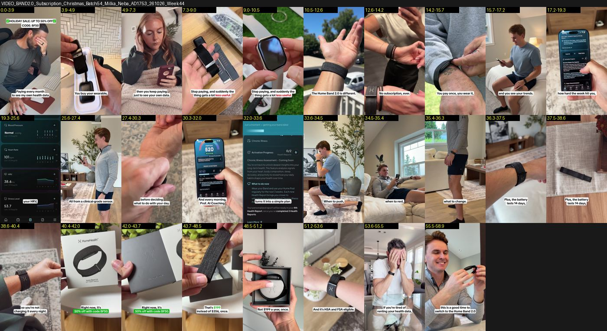

# VIDEO_BAND2.0_Subscription_Christmas_Batch54_Milka_Neba_AD1753_261026_Week44

Master: `VIDEO_BAND2.0_Subscription_Christmas_Batch54_Milka_Neba_AD1753_261026_Week44_Hook1_9x16.mp4` · 58.9s · 1080x1920

**Pacing:** 28 shots · avg 2.103s · median 1.719s · 4.59 cuts/10s · first cut 3.871s · 202.0 wpm · talk ratio 0.92 · cuts on word start 96.3% · cuts in speech gaps 96.3%
**Audio:** {'I_lufs': -19.7, 'LRA': 1.8, 'true_peak_db': -4.2} · BPM≈123.0 · music {'speech_rms_db': -23.4, 'pause_seconds': 0.2} · cuts with SFX/transient 59.3%

**Captions:** 136 cards · 1.0 words/card (median) · y≈0.718 of frame height · text height≈0.0258 · colours {'white': 115, 'red': 4, 'dark/other': 15, 'green': 2} · cards crossing a cut: 6
Highlighted: startedtofeelridiculous, startedtofeelridiculous., thing gets a lot less useful., Not optimal, 50%offwithcodeBF50, That's$199
**Headlines:** HOLIDAYSALE:UPTO5O%OFF (0.0–3.5s, white) | CODE:BF50 (0.0–1.0s, white) | CODE:BF5O (1.5–1.5s, white) | CODE:BF50O (2.0–2.0s, white) | CODE:BF50 (2.5–3.5s, white) | 3:00% (18.0–18.0s, blue) | Next:Day5.MetabollcCapaclty&MyDay (18.0–18.0s, white) | Duringyour fist5daysmetricsmayappear (18.0–18.0s, dark/other)

**Hook (0–3s) spoken:** Paying every month to see my own health data started to feel ridiculous.
**Hook on-screen:** CODE:BF50 / CODE:BF50O / CODE:BF5O / HOLIDAYSALE:UPTO5O%OFF / Payingevery month / startedtofeelridiculous / toseemyownhealthdata
**CTA (last 5s):** of renting your health data, this is a good time to switch to the HumeBand 2 .0. · on-screen: If you're tired of / renting your health data, / switchtotheHumeBand2.0 / this is a good time to

## Beat sheet

| # | in–out (s) | dur | transition | spoken | on-screen text |
|---|---|---|---|---|---|
| 1 | 0.00–3.87 | 3.87 |  | Paying every month to see my own health data started to feel ridiculous. | HOLIDAYSALE:UPTO5O%OFF (HEADLINE) / CODE:BF50 (HEADLINE) / Payingevery month / toseemyownhealthdata / CODE:BF5O (HEADLINE) / CODE:BF50O (HEADLINE) |
| 2 | 3.87–4.94 | 1.07 | cut | You buy your wearable, | HOLIDAYSALE:UPTO5O%OFF (HEADLINE) / CODE:BF50 (HEADLINE) / startedtofeelridiculous. [red] / You buy your wearable, / You buy your wearable |
| 3 | 4.94–7.34 | 2.4 | cut | then you keep paying just to see your own data. | You buy your wearable / then you keep paying / justtoseeyourowndata / justto see yourown data. |
| 4 | 7.34–9.04 | 1.7 | cut +SFX hit | Stop paying and suddenly the thing | then you keep paying / justto see yourown data. / Stop paying, and suddenly the / thing gets a lot less useful. [red] |
| 5 | 9.04–10.48 | 1.44 | cut +SFX hit | gets a lot less useful. | Stop paying, and suddenly the / thing gets a lot less useful. [red] |
| 6 | 10.48–12.61 | 2.14 | cut +SFX hit | The HumeBan 2 .0 is different. | Stop paying, and suddenly the / thing gets a lot less useful. [red] / TheHumeBand2.0isdifferent. |
| 7 | 12.61–14.18 | 1.57 | cut | No subscription ever. | No subscription, ever. / You pay once, you wear it, |
| 8 | 14.18–15.75 | 1.57 | cut +SFX hit | You pay once, you wear it, | You pay once, you wear it, / You pay once, you wear it |
| 9 | 15.75–17.18 | 1.44 | cut +SFX hit | and you see your trends. | and you see your trends. / 7.48m / How you slept, |
| 10 | 17.18–19.32 | 2.13 | cut +SFX hit | How you slept, how hard the week hit you, | 7.48m / How you slept, / 3:00% [blue] (HEADLINE) / Next:Day5.MetabollcCapaclty&MyDay (HEADLINE) / Duringyour fist5daysmetricsmayappear (HEADLINE) / personalbaseline: |
| 11 | 19.32–25.59 | 6.27 | cut | whether your recovery is moving up or down, your HRV, heart resilience, blood pressure insights, and more, | how hard the week hit you, / 3:004 (HEADLINE) / CActivation Progress: / Recovery ShapesYourCapacity / Yourbody'srecoveryfromstrain lsanotherkey / factorin yourdallyMetabolicCapacity.We |
| 12 | 25.59–27.39 | 1.8 | cut +SFX hit | all from a clinical grade sensor, The | All from a clinical-grade sensor / All fromaclinical-grade sensor. |
| 13 | 27.39–30.26 | 2.87 | cut +SFX hit | stuff you need before deciding what to do with your day. | All fromaclinical-grade sensor. / before deciding / what to do with your day. |
| 14 | 30.26–32.00 | 1.73 | cut +SFX hit | And every morning, Prof AI coaching | before deciding / what to do with your day. / 3:00元 [blue] (HEADLINE) / Health Seere [blue] (HEADLINE) / 520 [blue] (HEADLINE) / Hparading te Hume Plus |
| 15 | 32.00–33.63 | 1.64 | cut +SFX hit | turns it into a simple plan. | Syncing Hume Band! [blue] (HEADLINE) / Justamoment-gettingyourbanddata! [blue] (HEADLINE) / oComing Soon (HEADLINE) / Chronic lllness (HEADLINE) / 0/2 / ActivationProgress: |
| 16 | 33.63–34.50 | 0.87 | cut | When to push, | When to push, |
| 17 | 34.50–35.37 | 0.87 | cut +SFX hit | when to rest, | when to rest, |
| 18 | 35.37–36.34 | 0.97 | cut | what to change. | when to rest, / what to change. |
| 19 | 36.34–37.50 | 1.17 | cut +SFX hit | Plus, the battery lasts | what to change. / Plus, the battery / lasts 14 days, |
| 20 | 37.50–38.64 | 1.14 | cut | 14 days, | Plus, the battery / lasts 14 days, |
| 21 | 38.64–40.44 | 1.8 | cut | so you're not charging it every night. | so you're not / charging it every night. |
| 22 | 40.44–42.04 | 1.6 | cut | Right now, it's 50 % off | so you're not / charging it every night. / XiHumeHealth (HEADLINE) / HumeBand2.0 / 247HeathTrackirg / Rightnow,it's |
| 23 | 42.04–43.74 | 1.7 | cut | with code BF50. | Rightnow,it's / 50%offwithcodeBF50 [green] / XHumeHealt (HEADLINE) / Liye Longer.Bottar. / XHum (HEADLINE) / Livo Longor.Bottar. (HEADLINE) |
| 24 | 43.74–48.48 | 4.74 | cut +SFX hit | That's $199 instead of $356 once. | That's$199 [green] / instead of $356, once. |
| 25 | 48.48–51.22 | 2.74 | cut +SFX hit | Not $199 a year, once. | That's$199 [green] / instead of $356, once. / Not $199 a year, once / Not $199 a year, once. / And it's HSA and FSA eligible. |
| 26 | 51.22–53.62 | 2.4 | cut +SFX hit | And it's HSA and FSA eligible. If | And it's HSA and FSA eligible. |
| 27 | 53.62–55.52 | 1.9 | cut +SFX hit | you're tired of renting your health data, | If you're tired of / renting your health data, |
| 28 | 55.52–58.88 | 3.36 | cut | this is a good time to switch to the HumeBand 2 .0. | this is a good time to / switchtotheHumeBand2.0 |

## Hook variants

| hook | file | dur | first cut | spoken 0–3s | on-screen 0–3s |
|---|---|---|---|---|---|
| 1 | `stmas_Batch54_Milka_Neba_AD1753_261026_Week44_Hook1_9x16.mp4` | 58.9 | 3.871 | Paying every month to see my own health data started to feel ridiculous. | CODE:BF50 / CODE:BF50O / CODE:BF5O / HOLIDAYSALE:UPTO5O%OFF / Payingevery month / startedtofeelridiculous / toseemyownhealthdata |
| 2 | `stmas_Batch54_Milka_Neba_AD1753_261026_Week44_Hook2_9x16.mp4` | 58.0 | 2.97 |  |  |
| 3 | `stmas_Batch54_Milka_Neba_AD1753_261026_Week44_Hook3_9x16.mp4` | 58.3 | 1.301 |  |  |
| 5 | `stmas_Batch54_Milka_Neba_AD1753_261026_Week44_Hook5_9x16.mp4` | 59.8 | 1.401 |  |  |
| None | `n_Christmas_Batch54_Milka_Neba_AD1753_261026_Week44_9x16.mp4` | 59.3 | 0.734 |  |  |

## Full transcript

Paying every month to see my own health data started to feel ridiculous. You buy your wearable, then you keep paying just to see your own data. Stop paying and suddenly the thing gets a lot less useful. The HumeBan 2.0 is different. No subscription ever. You pay once, you wear it, and you see your trends. How you slept, how hard the week hit you, whether your recovery is moving up or down, your HRV, heart resilience, blood pressure insights, and more, all from a clinical grade sensor, The stuff you need before deciding what to do with your day. And every morning, Prof AI coaching turns it into a simple plan. When to push, when to rest, what to change. Plus, the battery lasts 14 days, so you're not charging it every night. Right now, it's 50% off with code BF50. That's $199 instead of $356 once. Not $199 a year, once. And it's HSA and FSA eligible. If you're tired of renting your health data, this is a good time to switch to the HumeBand 2.0.