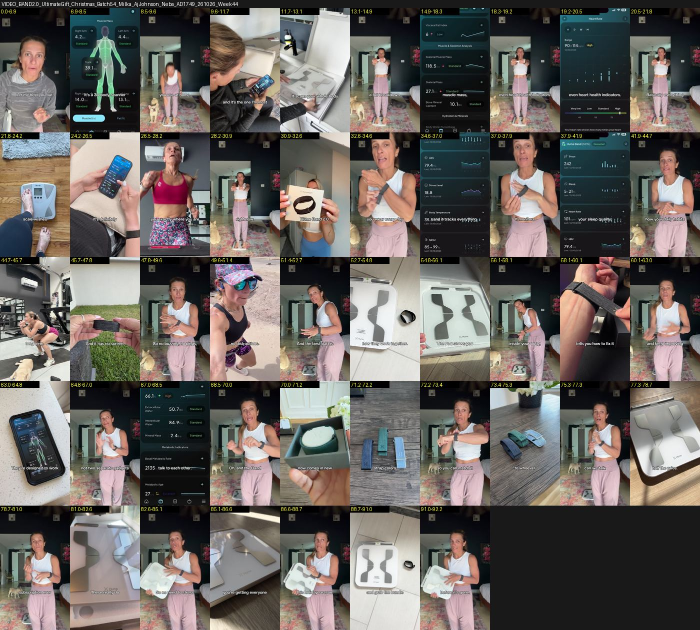

# VIDEO_BAND2.0_UltimateGift_Christmas_Batch54_Milka_AjJohnson_Neba_AD1749_261026_Week44

Master: `VIDEO_BAND2.0_UltimateGift_Christmas_Batch54_Milka_AjJohnson_Neba_AD1749_261026_Week44_Hook1_9x16.mp4` · 92.2s · 1080x1920

**Pacing:** 47 shots · avg 1.961s · median 1.82s · 4.99 cuts/10s · first cut 6.88s · 173.0 wpm · talk ratio 0.96 · cuts on word start 60.9% · cuts in speech gaps 41.3%
**Audio:** {'I_lufs': -14.0, 'LRA': 5.0, 'true_peak_db': 0.4} · BPM≈136.0 · music {'speech_rms_db': -19.6, 'pause_seconds': 0.7, 'pause_rms_db': -19.8, 'bed_minus_voice_db': -0.2, 'music_bed_likely': True} · cuts with SFX/transient 28.3%

**Captions:** 237 cards · 1 words/card (median) · y≈0.681 of frame height · text height≈0.0293 · colours {'white': 201, 'green': 1, 'dark/other': 32, 'blue': 1, 'yellow': 1, 'red': 1} · cards crossing a cut: 3
Highlighted: Standard, Muscle(lbs), Right Lelt's a 3D body scannereg, Hume Band 2.0.
**Headlines:** Body Pod (7.0–8.0s, white) | Connected (7.0–8.0s, green) | 45yrs (7.0–7.0s, white) | 5/yrs (7.0–7.0s, white) | 5Lft (7.0–7.0s, white) | MuscleMass (7.0–7.0s, white) | RightArm (7.0–8.0s, white) | LeftArm (7.0–8.0s, white)

**Hook (0–3s) spoken:** If you're struggling with gift ideas, let me help you out.
**Hook on-screen:** If you're struggling / Let me help you out. / with gift ideas.
**CTA (last 5s):** Go to humehealth .com and grab the bundle before it's gone. · on-screen: Go to humehealth.com / X Hume / and grab the bundle / before it's gone.

## Beat sheet

| # | in–out (s) | dur | transition | spoken | on-screen text |
|---|---|---|---|---|---|
| 1 | 0.00–6.88 | 6.88 |  | If you're struggling with gift ideas, let me help you out. Let's start with a human pod 2 .0. It's | If you're struggling / with gift ideas. / Let me help you out. / Let's startwith the / Hume Pod 2.0 |
| 2 | 6.88–8.52 | 1.64 | cut | a 3D body scanner you | Body Pod (HEADLINE) / Connected [green] (HEADLINE) / 45yrs (HEADLINE) / 5/yrs (HEADLINE) / 5Lft (HEADLINE) / MuscleMass (HEADLINE) |
| 3 | 8.52–9.56 | 1.04 | cut | use at home and | you use at home, |
| 4 | 9.56–11.66 | 2.1 | cut +SFX hit | it's the one I'm most impressed by. | and it's the one I'm most / impressed by. |
| 5 | 11.66–13.12 | 1.46 | cut | It scans your whole body and | It scans your whole body / and gives you |
| 6 | 13.12–14.94 | 1.82 | cut | gives you a full breakdown. | and gives you / a full breakdown. |
| 7 | 14.94–18.30 | 3.36 | cut +SFX hit | Body fat, visceral fat, muscle mass, metabolic age, | HumePod (HEADLINE) / Connected [green] (HEADLINE) / 132.3ibs (HEADLINE) / Goal Weight (HEADLINE) / BodyFatPercentage (HEADLINE) / 45.2%个High (HEADLINE) |
| 8 | 18.30–19.24 | 0.94 | cut | even heart health | MetabolicIndicators (HEADLINE) / BasalMetabolicRate (HEADLINE) / 2135 (HEADLINE) / Standard (HEADLINE) / kcal (HEADLINE) / MetabolicAge |
| 9 | 19.24–20.52 | 1.28 | cut | indicators. | 9:10 [blue] (HEADLINE) / 98 (HEADLINE) / HumeBand（50%) (HEADLINE) / Connected [green] (HEADLINE) / 09 steps (HEADLINE) / 3233 (HEADLINE) |
| 10 | 20.52–21.84 | 1.32 | cut | Basically everything your | Basically everything |
| 11 | 21.84–24.24 | 2.4 | cut | bathroom scale wishes it could tell you. | yourbathroom / TANITA / 58 / scale wishes / It's definitely |
| 12 | 24.24–26.52 | 2.28 | cut | It's definitely the starting point. | It's definitely / the starting point. |
| 13 | 26.52–28.24 | 1.72 | cut | It shows you exactly where | you exactly where you are |
| 14 | 28.24–30.90 | 2.66 | cut +SFX hit | you are right now. Then we had | you exactly where you are / right now. / Then wehave |
| 15 | 30.90–32.62 | 1.72 | cut | the Hume Band 2 .0. | HumeHealth / Hume Band 2.0. [red] / Humehieau / HumeBand2.0 |
| 16 | 32.62–34.56 | 1.94 | cut | This is the one you wear every day and | This is the one / you wear every day |
| 17 | 34.56–37.04 | 2.48 | cut +SFX hit | it tracks everything the pod can't. | HeartRate (HEADLINE) / 101bpm (HEADLINE) / Last:13/10/2025 (HEADLINE) / HRV (HEADLINE) / 79.4ms / Last:13/10/2025 |
| 18 | 37.04–37.88 | 0.84 | cut | It monitors your | It monitors |
| 19 | 37.88–41.86 | 3.98 | cut | strain and recovery, your sleep quality, your heart health and | Capacity (HEADLINE) / BodyComp (HEADLINE) / MetabolicCapacity (HEADLINE) / Strain (HEADLINE) / 100 / Target |
| 20 | 41.86–44.66 | 2.8 | cut +SFX hit | how your daily habits actually affect your body | how your daily habits / actually affect your body |
| 21 | 44.66–45.70 | 1.04 | cut +SFX hit | long term. | Iong term. |
| 22 | 45.70–47.80 | 2.1 | cut +SFX hit | And it has no screen, | And ithasno screen / And ithasno screen. |
| 23 | 47.80–49.60 | 1.8 | cut | so no buzzing, no pings, | So no buzzing, no pings / So no buzzing, no pings, |
| 24 | 49.60–51.44 | 1.84 | cut +SFX hit | no distractions. | no distractions. |
| 25 | 51.44–52.72 | 1.28 | cut | And the best part is | no distractions. / And the best part is |
| 26 | 52.72–54.80 | 2.08 | cut | how they work together. The pod | how they work together. / HHume |
| 27 | 54.80–56.10 | 1.3 | cut | shows you what's | XHume / The Pod shows you / what's happening |
| 28 | 56.10–58.08 | 1.98 | cut +SFX hit | happening inside your body and | what's happening / inside your body / and the band |
| 29 | 58.08–60.12 | 2.04 | cut | the band tells you how to fix | and the band / tells you how to fix it |
| 30 | 60.12–63.00 | 2.88 | cut +SFX hit | it and keep improving day by day. | tells you how to fix it / and keep improving / day by day. |
| 31 | 63.00–64.78 | 1.78 | cut | They're designed to work as one system, | 12:120 [blue] (HEADLINE) / Height (HEADLINE) / 6'5" (HEADLINE) / MetaboicAge / Lean Mass / LeftArm |
| 32 | 64.78–67.02 | 2.24 | cut | not two separate gadgets that | as one system / not two separate gadgets / BoneMineral (HEADLINE) / 10.ibs (HEADLINE) / Standard (HEADLINE) / Content (HEADLINE) |
| 33 | 67.02–68.50 | 1.48 | cut | don't talk to each other. | BoneMineral (HEADLINE) / 10.ibs (HEADLINE) / Standard (HEADLINE) / Content (HEADLINE) / Hydration&Minerals (HEADLINE) / BodyWaterPercentage (HEADLINE) |
| 34 | 68.50–70.04 | 1.54 | cut | Oh, and the band now | Oh, and the Band / now comes in new |
| 35 | 70.04–71.20 | 1.16 | cut | comes in new strap | now comes in new / strap colors |
| 36 | 71.20–72.18 | 0.98 | cut | colors, so | strap colors / so you can match it |
| 37 | 72.18–73.38 | 1.2 | cut | you can match it | so you can match it |
| 38 | 73.38–75.34 | 1.96 | cut +SFX hit | to whoever you're gifting. | so you can match it / to whoever / you're gifting. |
| 39 | 75.34–77.26 | 1.92 | cut +SFX hit | Also, can we talk about the value? | you're gifting. / can we talk / It's almost |
| 40 | 77.26–78.74 | 1.48 | cut | It's almost half the price. | It's almost / XHume / half the price |
| 41 | 78.74–80.96 | 2.22 | cut | There's no subscription ever. These | There's no / subscription ever |
| 42 | 80.96–82.58 | 1.62 | cut | really do make the perfect | XHume / These really do / make the perfect gift. |
| 43 | 82.58–85.10 | 2.52 | cut | gifts so no need to stress about what | make the perfect gift / So no need to stress / you're getting everyone |
| 44 | 85.10–86.60 | 1.5 | cut +SFX hit | you're getting everyone this | you're getting everyone / YHume |
| 45 | 86.60–88.72 | 2.12 | cut | holiday season. Go to humehealth | this holiday season / Go to humehealth.com |
| 46 | 88.72–91.04 | 2.32 | cut | .com and grab the bundle before | Go to humehealth.com / X Hume / and grab the bundle / before it's gone. |
| 47 | 91.04–92.18 | 1.14 | cut | it's gone. | before it's gone. |

## Hook variants

| hook | file | dur | first cut | spoken 0–3s | on-screen 0–3s |
|---|---|---|---|---|---|
| 1 | `h54_Milka_AjJohnson_Neba_AD1749_261026_Week44_Hook1_9x16.mp4` | 92.2 | 6.88 | If you're struggling with gift ideas, let me help you out. | If you're struggling / Let me help you out. / with gift ideas. |
| 2 | `h54_Milka_AjJohnson_Neba_AD1749_261026_Week44_Hook2_9x16.mp4` | 98.1 | 1.56 |  |  |
| 3 | `h54_Milka_AjJohnson_Neba_AD1749_261026_Week44_Hook3_9x16.mp4` | 95.4 | 1.02 |  |  |
| 4 | `h54_Milka_AjJohnson_Neba_AD1749_261026_Week44_Hook4_9x16.mp4` | 95.4 | 3.44 |  |  |

## Full transcript

If you're struggling with gift ideas, let me help you out. Let's start with a human pod 2.0. It's a 3D body scanner you use at home and it's the one I'm most impressed by. It scans your whole body and gives you a full breakdown. Body fat, visceral fat, muscle mass, metabolic age, even heart health indicators. Basically everything your bathroom scale wishes it could tell you. It's definitely the starting point. It shows you exactly where you are right now. Then we had the Hume Band 2.0. This is the one you wear every day and it tracks everything the pod can't. It monitors your strain and recovery, your sleep quality, your heart health and how your daily habits actually affect your body long term. And it has no screen, so no buzzing, no pings, no distractions. And the best part is how they work together. The pod shows you what's happening inside your body and the band tells you how to fix it and keep improving day by day. They're designed to work as one system, not two separate gadgets that don't talk to each other. Oh, and the band now comes in new strap colors, so you can match it to whoever you're gifting. Also, can we talk about the value? It's almost half the price. There's no subscription ever. These really do make the perfect gifts so no need to stress about what you're getting everyone this holiday season. Go to humehealth.com and grab the bundle before it's gone.