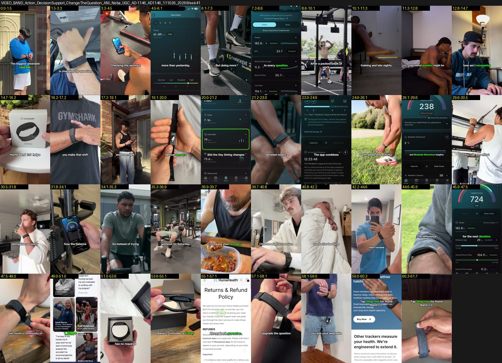

# VIDEO_BAND_Action_DecisionSupport_ChangeTheQuestion_ANI_Neba_UGC_AD-1146_AD1146_111026_2026Week41

Master: `VIDEO_BAND_Action_DecisionSupport_ChangeTheQuestion_ANI_Neba_UGC_AD-1146_AD1146_111026_2026Week41_Hook1_9x16.mp4` · 61.7s · 1080x1920

**Pacing:** 39 shots · avg 1.582s · median 1.44s · 6.16 cuts/10s · first cut 1.48s · 208.0 wpm · talk ratio 0.94 · cuts on word start 73.7% · cuts in speech gaps 60.5%
**Audio:** {'I_lufs': -21.8, 'LRA': 2.3, 'true_peak_db': -6.5} · BPM≈143.6 · music {'speech_rms_db': -25.8, 'pause_seconds': 0.0} · cuts with SFX/transient 28.9%

**Captions:** 214 cards · 1.0 words/card (median) · y≈0.653 of frame height · text height≈0.0246 · colours {'blue': 9, 'green': 14, 'white': 142, 'red': 7, 'dark/other': 39, 'yellow': 2, 'other-colour': 1} · cards crossing a cut: 2
Highlighted: The biggest wearable, upgrade, Checking the workout, 11.3% +to every question., theuseful question might be, how amI recovering, CHATT, Opticalsensors, track heart rate, 443, 178, 675, Theappcombines, QSearch, with sleep and activity
**Headlines:** 1:50 (4.5–5.5s, blue) | Heart Rate (4.5–5.5s, white) | Range (4.5–5.5s, white) | 61-89bpm (4.5–5.5s, white) | High (4.5–5.5s, dark/other) | 08/08/2025 (5.5–5.5s, dark/other) | concept (6.0–6.0s, dark/other) | BikeER (6.0–6.0s, yellow)

**Hook (0–3s) spoken:** The biggest wearable upgrade is changing the question you ask.
**Hook on-screen:** The biggest wearable / is changing the question / upgrade / you ask.
**CTA (last 5s):** Upgrade the question you ask your wearable. Tap Shop Now for HumeBand 2 .0. · on-screen: Band2.0. / BuyNow / Hume membersusereal health datato / Humeconnectseverybiomarkertotell you / Othertrackers measure / Small improvemeBandi2.O.abitscan / Small improvementsin dailyhabitscan / Tap Shopnow for Hume / TapShopnowforHume / Theonlywearablewithlongevityatitscore. / Upgrade the question / dramatically change

## Beat sheet

| # | in–out (s) | dur | transition | spoken | on-screen text |
|---|---|---|---|---|---|
| 1 | 0.00–1.48 | 1.48 |  | The biggest wearable upgrade is | The biggest wearable [blue] / upgrade [green] |
| 2 | 1.48–3.26 | 1.78 | cut | changing the question you ask. | The biggest wearable [blue] / upgrade [green] / is changing the question / you ask. |
| 3 | 3.26–4.54 | 1.28 | cut +SFX hit | Checking the workout can tell you whether | you ask. / Checking the workout [red] / can tell you / 1:50 [blue] (HEADLINE) / Heart Rate (HEADLINE) / Range (HEADLINE) |
| 4 | 4.54–6.08 | 1.54 | cut +SFX hit | you did more than yesterday. | 1:50 [blue] (HEADLINE) / Heart Rate (HEADLINE) / Range (HEADLINE) / 61-89bpm (HEADLINE) / High (HEADLINE) / whether you did |
| 5 | 6.08–7.28 | 1.2 | cut | But doing more isn't the | concept (HEADLINE) / But doing more / BikeER [yellow] (HEADLINE) / concept2 (HEADLINE) / isn'tthe answer / BikeERG [yellow] (HEADLINE) |
| 6 | 7.28–8.62 | 1.34 | cut | answer to every question. | concept2 (HEADLINE) / isn'tthe answer / BikeERG [yellow] (HEADLINE) / Want deeper insights intoyour progress? (HEADLINE) / GenerateProgressReport → (HEADLINE) / Body (HEADLINE) |
| 7 | 8.62–10.06 | 1.44 | cut | After a packed week of work, | After a packedweek,of / work,UEIFITNESS RAGING / training and late nights, |
| 8 | 10.06–11.34 | 1.28 | cut | training, and late nights, | training and late nights, |
| 9 | 11.34–12.84 | 1.5 | cut | the useful question might be, | training and late nights, / theuseful question might be [green] |
| 10 | 12.84–14.70 | 1.86 | cut | how am I recovering from all of this? | how amI recovering [green] / IRON / NOO / CHATT [blue] / from all of this? / CHATANOO |
| 11 | 14.70–16.24 | 1.54 | cut | HumeBand 2 .0 helps you | XHumeHealth (HEADLINE) / Hume Band 2.0 helps / GYMSHARK (HEADLINE) / you make that shift |
| 12 | 16.24–17.20 | 0.96 | cut | make that shift. | GYMSHARK (HEADLINE) / you make that shift / Wear it through the day |
| 13 | 17.20–19.10 | 1.9 | cut | Wear it through the day and overnight. | Wear it through the day / and overnight. / Opticalsensors [green] |
| 14 | 19.10–20.02 | 0.92 | cut | Optical sensors track | Opticalsensors [green] / DeSteps (HEADLINE) / 1,460 (HEADLINE) / Last:08/08/2025 (HEADLINE) / Sleep (HEADLINE) / 23:00 (HEADLINE) |
| 15 | 20.02–21.20 | 1.18 | cut | heart rate and the tiny | DeSteps (HEADLINE) / 1,460 (HEADLINE) / Last:08/08/2025 (HEADLINE) / Sleep (HEADLINE) / 23:00 (HEADLINE) / 7h16m (HEADLINE) |
| 16 | 21.20–23.00 | 1.8 | cut +SFX hit | timing changes between beats. | and the tiny timing changes / between beats. |
| 17 | 23.00–24.88 | 1.88 | cut | The app combines those signals with sleep | Financedwith (HEADLINE) / Books (HEADLINE) / Games [green] (HEADLINE) / Entertainment (HEADLINE) / 43 [red] (HEADLINE) / in [blue] (HEADLINE) |
| 18 | 24.88–26.06 | 1.18 | cut | and activity in | with sleep and activity [yellow] / Capacity (HEADLINE) / Body Comp (HEADLINE) / MetabolicCapacity / 100 / Strain |
| 19 | 26.06–29.60 | 3.54 | cut +SFX hit | Hume's metabolic capacity and metabolic momentum insights. You | Capacity (HEADLINE) / Body Comp (HEADLINE) / MetabolicCapacity / 100 / Strain / Target |
| 20 | 29.60–30.52 | 0.92 | cut | can see effort | You can seeeffort |
| 21 | 30.52–31.84 | 1.32 | cut | alongside recovery and | alongside recovery |
| 22 | 31.84–34.10 | 2.26 | cut +SFX hit | follow how the balance changes over time. | 10:168 [blue] / 837 / wyhe / how thebalance / 10:108 [blue] / Heamohfluport [blue] |
| 23 | 34.10–35.26 | 1.16 | cut | So instead of trying to beat | So instead of trying / to beat Friday's |
| 24 | 35.26–36.90 | 1.64 | cut | Friday's workout on Saturday, | to beat Friday's / workout on Saturday, |
| 25 | 36.90–39.70 | 2.8 | cut | you can first compare your recovery with your usual pattern. | you can first [red] / compare your recovery [other-colour] / with your usual pattern. |
| 26 | 39.70–40.82 | 1.12 | cut +SFX hit | Choose a lighter session or | Choosealighter session |
| 27 | 40.82–42.22 | 1.4 | cut | a better bedtime if that fits | orabetterbedtime / what you're seeing, |
| 28 | 42.22–44.64 | 2.42 | cut | what you're seeing, then review the following days. | what you're seeing, / thenreview / the following days. [red] |
| 29 | 44.64–45.92 | 1.28 | cut +SFX hit | The difference is having feedback | Thedifference / XHumeHealth |
| 30 | 45.92–47.54 | 1.62 | cut | for the next decision. | HealthScore (HEADLINE) / 724 (HEADLINE) / High (HEADLINE) / BodyComp (HEADLINE) / Capacity (HEADLINE) / Weight |
| 31 | 47.54–49.00 | 1.46 | cut | Join Hume's community of 1 | Join Hume's community of [red] |
| 32 | 49.00–51.00 | 2.0 | cut +SFX hit | .3 million plus users. | toeveyuay (HEADLINE) / heroes, Hume Health is the future of (HEADLINE) / human performance and longevity (HEADLINE) / "Beingabletosee (HEADLINE) / mymuscleupand (HEADLINE) / fatdownwhilemy (HEADLINE) |
| 33 | 51.00–53.64 | 2.64 | cut | Core Tracking has no required subscription and Band | Core tracking / has no required / Subscription,and [green] |
| 34 | 53.64–55.08 | 1.44 | cut +SFX hit | 2 .0 includes a | XHumeHealth (HEADLINE) / Band2.0 includes a45day [yellow] / X HumeHealth"2 (HEADLINE) / Returns & Refund (HEADLINE) / Policy (HEADLINE) / WewantyoutoloveyourHumeHealthpurchase! |
| 35 | 55.08–57.08 | 2.0 | cut | 45 -day money -back guarantee. | Band2.0 includes a45day [yellow] / X HumeHealth"2 (HEADLINE) / Returns & Refund (HEADLINE) / Policy (HEADLINE) / WewantyoutoloveyourHumeHealthpurchase! / But if it's not quite right,no worries,you can |
| 36 | 57.08–58.12 | 1.04 | cut +SFX hit | Upgrade the question you | Upgrade the question / youask your wearable |
| 37 | 58.12–59.04 | 0.92 | cut | ask your wearable. | youask your wearable / lifespanfromhealthier (HEADLINE) / habits (HEADLINE) / Hume membersusereal health datato (HEADLINE) / improvesleep,reducestress,andbuild (HEADLINE) / healthierroutinesthat compound overtime [blue] (HEADLINE) |
| 38 | 59.04–60.32 | 1.28 | cut +SFX hit | Tap Shop Now for HumeBand | lifespanfromhealthier (HEADLINE) / habits (HEADLINE) / Hume membersusereal health datato (HEADLINE) / improvesleep,reducestress,andbuild (HEADLINE) / healthierroutinesthat compound overtime [blue] (HEADLINE) / TapShopnowforHume [green] (HEADLINE) |
| 39 | 60.32–61.72 | 1.4 | cut | 2 .0. | Hume membersusereal health datato (HEADLINE) / improvesleep,reducestress,andbuild (HEADLINE) / healthierroutinesthat compound overtime [blue] (HEADLINE) / BuyNow / Othertrackers measure / your health. We're |

## Hook variants

| hook | file | dur | first cut | spoken 0–3s | on-screen 0–3s |
|---|---|---|---|---|---|
| 1 | `ANI_Neba_UGC_AD-1146_AD1146_111026_2026Week41_Hook1_9x16.mp4` | 61.7 | 1.48 | The biggest wearable upgrade is changing the question you ask. | The biggest wearable / is changing the question / upgrade / you ask. |
| 2 | `ANI_Neba_UGC_AD-1146_AD1146_111026_2026Week41_Hook2_9x16.mp4` | 61.4 | 1.52 | What happens when you stop treating your tracker like a scoreboard? Checking | Whathappenswhen youstop / like ascoreboard? / treating your tracker |
| 3 | `ANI_Neba_UGC_AD-1146_AD1146_111026_2026Week41_Hook3_9x16.mp4` | 61.1 | 1.38 | From how much did I do to how am I recovering? Checking the |  |

## Full transcript

The biggest wearable upgrade is changing the question you ask. Checking the workout can tell you whether you did more than yesterday. But doing more isn't the answer to every question. After a packed week of work, training, and late nights, the useful question might be, how am I recovering from all of this? HumeBand 2.0 helps you make that shift. Wear it through the day and overnight. Optical sensors track heart rate and the tiny timing changes between beats. The app combines those signals with sleep and activity in Hume's metabolic capacity and metabolic momentum insights. You can see effort alongside recovery and follow how the balance changes over time. So instead of trying to beat Friday's workout on Saturday, you can first compare your recovery with your usual pattern. Choose a lighter session or a better bedtime if that fits what you're seeing, then review the following days. The difference is having feedback for the next decision. Join Hume's community of 1.3 million plus users. Core Tracking has no required subscription and Band 2.0 includes a 45-day money-back guarantee. Upgrade the question you ask your wearable. Tap Shop Now for HumeBand 2.0.