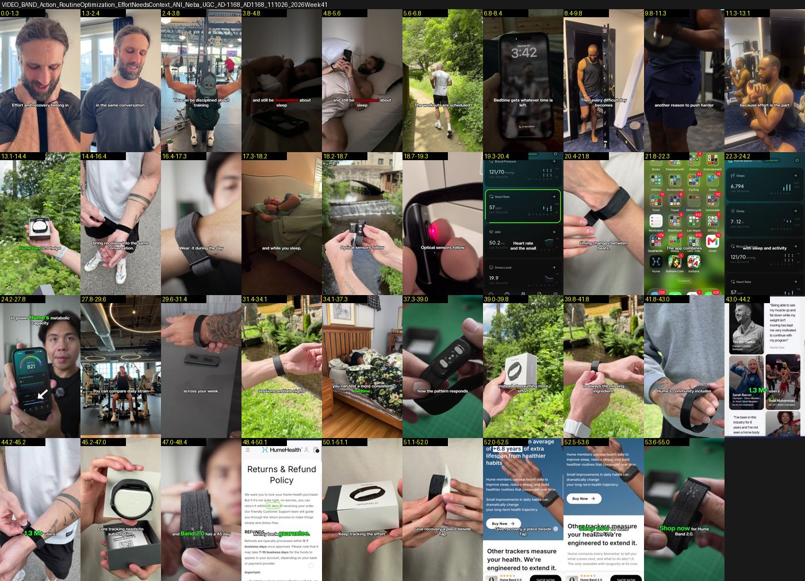

# VIDEO_BAND_Action_RoutineOptimization_EffortNeedsContext_ANI_Neba_UGC_AD-1168_AD1168_111026_2026Week41

Master: `VIDEO_BAND_Action_RoutineOptimization_EffortNeedsContext_ANI_Neba_UGC_AD-1168_AD1168_111026_2026Week41_Hook 1_9x16.mp4` · 55.0s · 1080x1920

**Pacing:** 39 shots · avg 1.41s · median 1.32s · 6.91 cuts/10s · first cut 1.28s · 220.0 wpm · talk ratio 0.94 · cuts on word start 78.9% · cuts in speech gaps 63.2%
**Audio:** {'I_lufs': -16.3, 'LRA': 1.9, 'true_peak_db': -1.1} · BPM≈95.7 · music {'speech_rms_db': -20.2, 'pause_seconds': 0.0} · cuts with SFX/transient 34.2%

**Captions:** 139 cards · 1 words/card (median) · y≈0.655 of frame height · text height≈0.0269 · colours {'white': 107, 'red': 7, 'green': 8, 'dark/other': 9, 'blue': 4, 'yellow': 4} · cards crossing a cut: 12
Highlighted: and still be inconsistent about, because effortisthepart, HumeBand2.0helps, 443, 178, 675, Theappcombines, QSearch, 226, 428, 3:57减, sessions and late nights, have stacked uptogether,, bedtime, effort
**Headlines:** SunFeb22 (7.0–8.0s, white) | 3:42 (7.0–8.0s, white) | HumeBand(77%) (20.0–20.0s, white) | BloodPressure (20.0–20.0s, white) | 121/70 (20.0–20.0s, white) | mmHg (20.0–20.0s, white) | Last:30/Jun/26 (20.0–20.0s, dark/other) | Heart Rate (20.0–20.0s, white)

**Hook (0–3s) spoken:** Effort and recovery belong in the same conversation. You can be disciplined
**Hook on-screen:** Effort and recoverybelong in / You can be disciplined about / inthesameconversation. / training
**CTA (last 5s):** Keep tracking the effort. Give recovery a place beside it. Tap Shop Now for Hume Band 2 .0. · on-screen: >HumeHeaith" / Band 2.0. / Buy Now / Giverecovery aplacebeside / Hume membersusereal healthdatato / Humeconnectseverybiomarkertotell you / Keep tracking the effort. / Membersgainanaverage / Othertrackers measure / Othg / Shop now for Hume / Shop'how Aasure

## Beat sheet

| # | in–out (s) | dur | transition | spoken | on-screen text |
|---|---|---|---|---|---|
| 1 | 0.00–1.28 | 1.28 |  | Effort and recovery belong in | Effort and recoverybelong in |
| 2 | 1.28–2.40 | 1.12 | cut | the same conversation. | Effort and recoverybelong in / inthesameconversation. |
| 3 | 2.40–3.80 | 1.4 | cut | You can be disciplined about training and | inthesameconversation. / You can be disciplined about / training |
| 4 | 3.80–4.76 | 0.96 | cut | still be inconsistent | You can be disciplined about / training / and still be inconsistent about [red] / sleep |
| 5 | 4.76–5.62 | 0.86 | cut +SFX hit | about sleep. | and still be inconsistent about [red] / sleep / The workouts are scheduled. |
| 6 | 5.62–6.80 | 1.18 | cut | The workouts are scheduled. | The workouts are scheduled. / The workouts are scheduled |
| 7 | 6.80–8.36 | 1.56 | cut +SFX hit | Bedtime gets whatever time is left. | SunFeb22 (HEADLINE) / 3:42 (HEADLINE) / Bedtime gets whatever time is / left. / CDoNotDisturb / DoNotDisturb |
| 8 | 8.36–9.80 | 1.44 | cut | Then every difficult day becomes | SunFeb22 (HEADLINE) / 3:42 (HEADLINE) / Bedtime gets whatever time is / left. / DoNotDisturb / Then every difficult day |
| 9 | 9.80–11.26 | 1.46 | cut | another reason to push harder because | another reason to pushharder |
| 10 | 11.26–13.06 | 1.8 | cut +SFX hit | effort is the part you've been measuring. | another reason to pushharder / because effortisthepart [red] / HumeBand2.0helps [green] |
| 11 | 13.06–14.38 | 1.32 | cut +SFX hit | HumeBand 2 .0 helps bring | HumeBand2.0helps [green] |
| 12 | 14.38–16.40 | 2.02 | cut +SFX hit | recovery into the same conversation. | HumeBand2.0helps [green] / bring recovery into the same / conversation. |
| 13 | 16.40–17.30 | 0.9 | cut | Wear it during the day | bring recovery into the same / conversation. / Wear it during the day |
| 14 | 17.30–18.18 | 0.88 | cut | and while you sleep. | Wear it during the day / Optical sensors follow |
| 15 | 18.18–18.68 | 0.5 | cut +SFX hit | Optical sensors | Optical sensors follow |
| 16 | 18.68–19.30 | 0.62 | cut +SFX hit | follow heart | Optical sensors follow |
| 17 | 19.30–20.40 | 1.1 | cut | rate and the small timing | Optical sensors follow / HumeBand(77%) (HEADLINE) / BloodPressure (HEADLINE) / 121/70 (HEADLINE) / mmHg (HEADLINE) / Last:30/Jun/26 (HEADLINE) |
| 18 | 20.40–21.84 | 1.44 | cut +SFX hit | changes between beats. | HumeBand(77%) (HEADLINE) / BloodPressure (HEADLINE) / 121/70 (HEADLINE) / mmHg (HEADLINE) / Last:30/Jun/26 (HEADLINE) / Heart Rate (HEADLINE) |
| 19 | 21.84–22.34 | 0.5 | cut | The app combines | 740 [red] (HEADLINE) / Books (HEADLINE) / Financedwith (HEADLINE) / Entertainment (HEADLINE) / 14 [red] (HEADLINE) / 43 [red] (HEADLINE) |
| 20 | 22.34–24.22 | 1.88 | cut | those signals with sleep and activity to | 740 [red] (HEADLINE) / Books (HEADLINE) / Financedwith (HEADLINE) / Entertainment (HEADLINE) / 14 [red] (HEADLINE) / 43 [red] (HEADLINE) |
| 21 | 24.22–27.76 | 3.54 | cut | power Hume's metabolic capacity and metabolic momentum insight. | with sleep and activity / to power l (HEADLINE) / Hume's [green] (HEADLINE) / metabolic (HEADLINE) / capacity (HEADLINE) / 821 |
| 22 | 27.76–29.60 | 1.84 | cut | You can compare daily strain with recovery | You can compare daily strain / withrecoveryandseethe / balance |
| 23 | 29.60–31.40 | 1.8 | cut +SFX hit | and see the balance across your week. | withrecoveryandseethe / balance / across your week. |
| 24 | 31.40–34.08 | 2.68 | cut +SFX hit | If demanding sessions and late nights have stacked up together, | across your week. / sessions and late nights [yellow] / have stacked uptogether, [yellow] / youcantesta more consistent / bedtime [green] |
| 25 | 34.08–37.34 | 3.26 | cut | you can test a more consistent bedtime before increasing the workload. | youcantesta more consistent / bedtime [green] / you:cantesta more consistent / beforeincreasingthe / workload. / workload! |
| 26 | 37.34–38.96 | 1.62 | cut | Then review how the pattern responds instead | beforeincreasingthe / workload! / how the pattern responds |
| 27 | 38.96–39.84 | 0.88 | cut | of assuming more | instead ofassuming more / effort [yellow] |
| 28 | 39.84–41.82 | 1.98 | cut | effort is always the missing ingredient. | instead ofassuming more / effort [yellow] / MCMLAIY / is always themissing / ingredient. |
| 29 | 41.82–42.96 | 1.14 | cut | Hume's community includes | Hume's community includes |
| 30 | 42.96–44.16 | 1.2 | cut | 1 .3 million | heroes, Hume Health is the future of (HEADLINE) / human performance and longevity (HEADLINE) / "Being ableto see (HEADLINE) / mymuscleupand (HEADLINE) / fatdown whilemy (HEADLINE) / weight isn't (HEADLINE) |
| 31 | 44.16–45.20 | 1.04 | cut | plus users. | 1.3 M+ users. [green] / Core trackingneeds no / subscription, / Hume Band |
| 32 | 45.20–46.96 | 1.76 | cut | Core Tracking needs no subscription and | Core trackingneeds no / subscription, / Hume Band / Band2.o |
| 33 | 46.96–48.36 | 1.4 | cut | Band 2 .0 has a 45 | and Band 2.0 has a45 day [green] |
| 34 | 48.36–50.10 | 1.74 | cut +SFX hit | day money back guarantee. | and Band 2.0 has a45 day [green] / HumeHealth"° (HEADLINE) / Returns & Refund (HEADLINE) / Policy (HEADLINE) / WewantyoutoloveyourHumeHealthpurchase! / But if it'snotquiteright, noworries,you can |
| 35 | 50.10–51.12 | 1.02 | cut +SFX hit | Keep tracking the effort. | >HumeHeaith" / Keep tracking the effort. / Giverecovery aplacebeside / Tap. |
| 36 | 51.12–52.00 | 0.88 | cut | Give recovery a place | Giverecovery aplacebeside / Tap. |
| 37 | 52.00–52.54 | 0.54 | cut +SFX hit | beside | Giverecovery aplacebeside / Tap. / Membersgainanaverage (HEADLINE) / of +6.8 years (HEADLINE) / of extra (HEADLINE) / lifespanfromhealthier (HEADLINE) |
| 38 | 52.54–53.62 | 1.08 | cut | it. Tap Shop Now for | Hume membersusereal healthdatato (HEADLINE) / improvesleep,reducestress,andbuild (HEADLINE) / Buy Now / engineered to extend it. / healthier routinesthat compound overtime [blue] (HEADLINE) / Small improvementsin dailyhabits can [blue] (HEADLINE) |
| 39 | 53.62–55.00 | 1.38 | cut | Hume Band 2 .0. | Shop now for Hume [green] / Band 2.0. |

## Hook variants

| hook | file | dur | first cut | spoken 0–3s | on-screen 0–3s |
|---|---|---|---|---|---|
| 1 | `NI_Neba_UGC_AD-1168_AD1168_111026_2026Week41_Hook 1_9x16.mp4` | 55.0 | 1.28 | Effort and recovery belong in the same conversation. You can be disciplined | Effort and recoverybelong in / You can be disciplined about / inthesameconversation. / training |
| 2 | `NI_Neba_UGC_AD-1168_AD1168_111026_2026Week41_Hook 2_9x16.mp4` | 54.7 | 0.76 | Working harder isn't the only thing worth track. You can be disciplined about |  |
| 3 | `NI_Neba_UGC_AD-1168_AD1168_111026_2026Week41_Hook 3_9x16.mp4` | 55.7 | 1.38 | Before adding another workout, look at what happens after the last one. |  |

## Full transcript

Effort and recovery belong in the same conversation. You can be disciplined about training and still be inconsistent about sleep. The workouts are scheduled. Bedtime gets whatever time is left. Then every difficult day becomes another reason to push harder because effort is the part you've been measuring. HumeBand 2.0 helps bring recovery into the same conversation. Wear it during the day and while you sleep. Optical sensors follow heart rate and the small timing changes between beats. The app combines those signals with sleep and activity to power Hume's metabolic capacity and metabolic momentum insight. You can compare daily strain with recovery and see the balance across your week. If demanding sessions and late nights have stacked up together, you can test a more consistent bedtime before increasing the workload. Then review how the pattern responds instead of assuming more effort is always the missing ingredient. Hume's community includes 1.3 million plus users. Core Tracking needs no subscription and Band 2.0 has a 45 day money back guarantee. Keep tracking the effort. Give recovery a place beside it. Tap Shop Now for Hume Band 2.0.