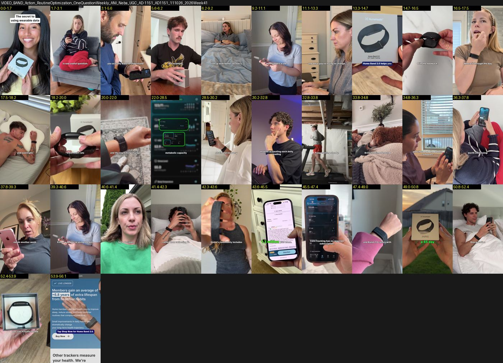

# VIDEO_BAND_Action_RoutineOptimization_OneQuestionWeekly_ANI_Neba_UGC_AD-1151_AD1151_111026_2026Week41

Master: `VIDEO_BAND_Action_RoutineOptimization_OneQuestionWeekly_ANI_Neba_UGC_AD-1151_AD1151_111026_2026Week41_9x16_hook1.mp4` · 56.1s · 1080x1920

**Pacing:** 32 shots · avg 1.754s · median 1.58s · 5.52 cuts/10s · first cut 1.68s · 224.0 wpm · talk ratio 0.96 · cuts on word start 61.3% · cuts in speech gaps 71.0%
**Audio:** {'I_lufs': -18.0, 'LRA': 1.9, 'true_peak_db': -4.4} · BPM≈123.0 · music {'speech_rms_db': -21.4, 'pause_seconds': 0.0} · cuts with SFX/transient 48.4%

**Captions:** 151 cards · 1 words/card (median) · y≈0.632 of frame height · text height≈0.0269 · colours {'red': 3, 'white': 110, 'other-colour': 2, 'yellow': 3, 'dark/other': 18, 'green': 4, 'blue': 11} · cards crossing a cut: 0
Highlighted: is one useful question., you actually want to understand., Forexample, for a decision, 1.3million, metobolie gge in underdmin, 50%OFE, $366$183, 50%0F6, subscription,, andBand2.0 comeswith, a45day, One question, LIVE LONGER, Membersgainanaverageof
**Headlines:** The secret to (0.0–1.0s, white) | using wearable data (0.0–1.0s, white) | XHumeHealth (14.0–14.0s, white) | XHumefoalt (19.0–19.0s, white) | Syncing.. (22.0–22.0s, dark/other) | HumeBand(91%) (22.0–23.0s, white) | Sleep (22.0–22.0s, white) | 9h6m (22.0–22.0s, white)

**Hook (0–3s) spoken:** The secret to using wearable data is one useful question.
**Hook on-screen:** The secret to / is one useful question. / using wearable data
**CTA (last 5s):** the secret. One question you can actually follow through on. Tap Shop now for Hume Band 2 .0. · on-screen: +6.8yearsofextra lifespan / BuyNow→ / EmilyLoogman / FrankGore / GamesIHybridAthlete / Hume members usereal health datato improve / LIVE LONGER / LIVELONGER / Membersgainanaverageof / NFL / One question / Othertrackersmeasure

## Beat sheet

| # | in–out (s) | dur | transition | spoken | on-screen text |
|---|---|---|---|---|---|
| 1 | 0.00–1.68 | 1.68 |  | The secret to using wearable data is | The secret to (HEADLINE) / using wearable data (HEADLINE) / is one useful question. [red] |
| 2 | 1.68–3.08 | 1.4 | cut +SFX hit | one useful question. | is one useful question. [red] / Pick one thing |
| 3 | 3.08–5.56 | 2.48 | cut | Pick one thing you actually want to understand. | Pick one thing / you actually want to understand. [other-colour] / Forexample [yellow] |
| 4 | 5.56–6.24 | 0.68 | cut +SFX hit | For example, | Forexample [yellow] / doesa more consistentbedtime |
| 5 | 6.24–9.16 | 2.92 | cut | does a more consistent bedtime line up with better recovery for me? | doesa more consistentbedtime / lineup with better recovery / That question gives |
| 6 | 9.16–11.12 | 1.96 | cut | That question gives the numbers a job. | That question gives / the numbers a job. / You know whatto lookat |
| 7 | 11.12–13.32 | 2.2 | cut | You know what to look at and what you're trying to change. | You know whatto lookat / and what you're trying to change / and what you're trying to change. |
| 8 | 13.32–14.72 | 1.4 | cut | HumeBand 2 .0 helps you | and what you're trying to change. / XHumeHealth (HEADLINE) / HumeBand2.0 / HumeBand2.0helpsyou |
| 9 | 14.72–16.52 | 1.8 | cut +SFX hit | connect the routine with the feedback. | connect the routine / with the feedback. |
| 10 | 16.52–17.52 | 1.0 | cut | Wear it through the day and | Where it through the day |
| 11 | 17.52–18.20 | 0.68 | cut +SFX hit | overnight. | Itsoptical sensors |
| 12 | 18.20–19.96 | 1.76 | cut +SFX hit | Its optical sensors track heart rate and | Itsoptical sensors / XHumefoalt (HEADLINE) / trackheartrate |
| 13 | 19.96–21.96 | 2.0 | cut +SFX hit | the tiny timing changes between beats. | and the tiny timing changes |
| 14 | 21.96–28.48 | 6.52 | cut +SFX hit | The app combines those signals with sleep and activity in Hume's metabolic capacity and metabolic momentum insights. sites. You can compare strain | Syncing.. (HEADLINE) / HumeBand(91%) (HEADLINE) / Sleep (HEADLINE) / 9h6m (HEADLINE) / 14:00 (HEADLINE) / Last:06/Aug/26 (HEADLINE) |
| 15 | 28.48–30.24 | 1.76 | cut | and recovery across the week, | Duringyourfirst5days,metricsmayappear (HEADLINE) / unusualasyourHumeBandestablishesyour (HEADLINE) / ViewFull Journey→ (HEADLINE) / ActivationProgress: / 2/4 / WhatDrivesYourMomentum |
| 16 | 30.24–32.80 | 2.56 | cut | instead of treating each daily reading as a separate verdict. | Instead of treating each daily / reading / as a separateverdict. |
| 17 | 32.80–33.76 | 0.96 | cut +SFX hit | Keep training steady, | Keep training steady. |
| 18 | 33.76–34.80 | 1.04 | cut | bring bedtime forward, | Bring bedtime forward |
| 19 | 34.80–36.28 | 1.48 | cut +SFX hit | and check how the pattern compares. | and checkhowthepattern / compares, / compares. |
| 20 | 36.28–37.84 | 1.56 | cut +SFX hit | Maybe you learned something worth continuing. | and checkhowthepattern / compares. / worth continuing |
| 21 | 37.84–39.32 | 1.48 | cut | Maybe the question needs another week. | tyrni / Maybe the question / turnit / needs another week. |
| 22 | 39.32–40.64 | 1.32 | cut +SFX hit | Either way, you're using the data for | turnit / needs another week. / Either way,you're using the data |
| 23 | 40.64–41.36 | 0.72 | cut +SFX hit | a decision rather | for a decision [green] |
| 24 | 41.36–42.32 | 0.96 | cut | than collecting it. | for a decision [green] / IX.XVI.LXXII [red] (HEADLINE) / rather than collecting it. |
| 25 | 42.32–43.56 | 1.24 | cut +SFX hit | Hume's community includes 1 | IX.XVI.LXXII [red] (HEADLINE) / rather than collecting it. / Hume's community includes |
| 26 | 43.56–45.52 | 1.96 | cut +SFX hit | .3 million plus users. | 10:174 (HEADLINE) / 4.9 (HEADLINE) / CWritea feview / GyAskaQinestion / Guestions / Revlews |
| 27 | 45.52–47.40 | 1.88 | cut | Core tracking has no required subscription, | 12:12# [blue] (HEADLINE) / 122/68mmHg (HEADLINE) / C Heart Rate / Core tracking has no required / subscription, [red] / 35.6-358c |
| 28 | 47.40–49.00 | 1.6 | cut | and Band 2 .0 comes with a | Core tracking has no required / subscription, [red] / l58 (HEADLINE) / 12:124 [blue] (HEADLINE) / HumeBand(50%) (HEADLINE) / HRV (HEADLINE) |
| 29 | 49.00–50.80 | 1.8 | cut | 45 -day money -back guarantee. | HumeHealth / HumeBand2.0 / a45day [green] / XHumeHealth / money back guarantee. |
| 30 | 50.80–52.36 | 1.56 | cut | That's the secret. One question you | That'sthesecret. / One question [red] |
| 31 | 52.36–53.92 | 1.56 | cut +SFX hit | can actually follow through on. | One question [red] / XHumeHealth (HEADLINE) / you can actually follow |
| 32 | 53.92–56.13 | 2.21 | cut | Tap Shop now for Hume Band 2 .0. | humehealth.com (HEADLINE) / EmilyLoogman (HEADLINE) / FrankGore (HEADLINE) / T&FAll-AmericanI3xCF (HEADLINE) / NFL (HEADLINE) / GamesIHybridAthlete (HEADLINE) |

## Hook variants

| hook | file | dur | first cut | spoken 0–3s | on-screen 0–3s |
|---|---|---|---|---|---|
| 1 | `ANI_Neba_UGC_AD-1151_AD1151_111026_2026Week41_9x16_hook1.mp4` | 56.1 | 1.68 | The secret to using wearable data is one useful question. | The secret to / is one useful question. / using wearable data |
| 1 | `ANI_Neba_UGC_AD-1151_AD1151_111026_2026Week41_9x16_hook1.mp4` | 56.0 | 1.68 | The secret to using wearable data is one useful question. |  |
| 2 | `ANI_Neba_UGC_AD-1151_AD1151_111026_2026Week41_9x16_hook2.mp4` | 56.0 | 3.0 | You don't need to understand 20 metrics to start learning from your tracker. | 122/71mmHg / 122/7mmHg / 22/71mmHg / 3,818 / 7h55m / 88bom / 88bpm / C Blood Pressure |
| 2 | `ANI_Neba_UGC_AD-1151_AD1151_111026_2026Week41_9x16_hook2.mp4` | 56.0 | 3.0 | You don't need to understand 20 metrics to start learning from your tracker. | -artRato / 122/71mmHg / 22/7mmHg / 3,818 / 755m / 7h55m / 7n55m / 88bpm |
| 3 | `ANI_Neba_UGC_AD-1151_AD1151_111026_2026Week41_9x16_hook3.mp4` | 54.8 | 1.8 | Want a simpler way to use all that health data? Pick one thing you actually |  |
| 3 | `ANI_Neba_UGC_AD-1151_AD1151_111026_2026Week41_9x16_hook3.mp4` | 54.8 | 1.8 | Want a simpler way to use all that health data? Pick one thing you actually |  |

## Full transcript

The secret to using wearable data is one useful question. Pick one thing you actually want to understand. For example, does a more consistent bedtime line up with better recovery for me? That question gives the numbers a job. You know what to look at and what you're trying to change. HumeBand 2.0 helps you connect the routine with the feedback. Wear it through the day and overnight. Its optical sensors track heart rate and the tiny timing changes between beats. The app combines those signals with sleep and activity in Hume's metabolic capacity and metabolic momentum insights. sites. You can compare strain and recovery across the week, instead of treating each daily reading as a separate verdict. Keep training steady, bring bedtime forward, and check how the pattern compares. Maybe you learned something worth continuing. Maybe the question needs another week. Either way, you're using the data for a decision rather than collecting it. Hume's community includes 1.3 million plus users. Core tracking has no required subscription, and Band 2.0 comes with a 45-day money-back guarantee. That's the secret. One question you can actually follow through on. Tap Shop now for Hume Band 2.0.