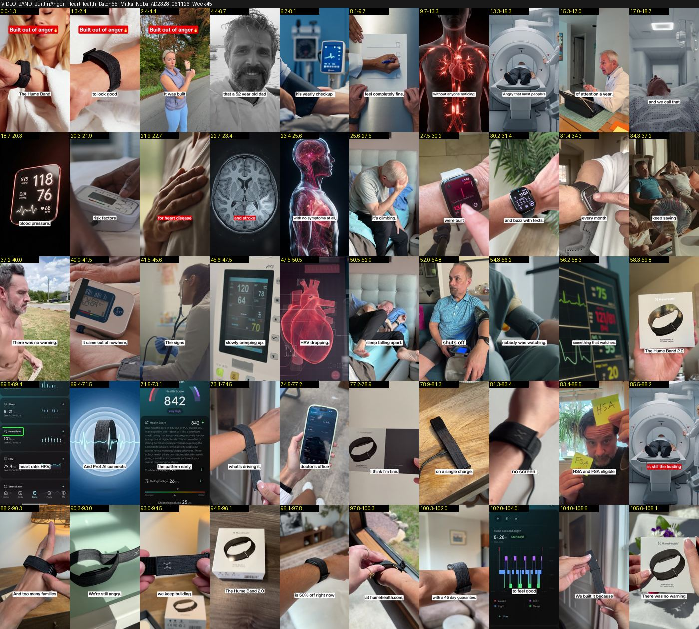

# VIDEO_BAND_BuiltInAnger_HeartHealth_Batch55_Milka_Neba_AD2328_061126_Week45

Master: `VIDEO_BAND_BuiltInAnger_HeartHealth_Batch55_Milka_Neba_AD2328_061126_Week45_Hook1_9x16.mp4` · 108.1s · 1080x1920

**Pacing:** 50 shots · avg 2.161s · median 1.94s · 4.53 cuts/10s · first cut 1.32s · 201.0 wpm · talk ratio 0.92 · cuts on word start 83.7% · cuts in speech gaps 67.3%
**Audio:** {'I_lufs': -16.1, 'LRA': 1.5, 'true_peak_db': -1.3} · BPM≈136.0 · music {'speech_rms_db': -19.8, 'pause_seconds': 1.2, 'pause_rms_db': -19.6, 'bed_minus_voice_db': 0.2, 'music_bed_likely': True} · cuts with SFX/transient 51.0%

**Captions:** 198 cards · 1.0 words/card (median) · y≈0.677 of frame height · text height≈0.0328 · colours {'white': 161, 'red': 7, 'other-colour': 1, 'dark/other': 28, 'blue': 1} · cards crossing a cut: 2
Highlighted: in the wrong direction, forheartdisease, and stroke, 1:08, Move., 460, CAL, 皖20:27:42, is still the leading
**Headlines:** Built out of anger (0.0–4.0s, red) | 118 (19.0–20.0s, white) | 76 (19.0–20.0s, white) | 12AM6AM12PM6PM (28.0–28.0s, dark/other) | 11:04 (31.0–31.0s, white) | 120 (46.0–47.0s, white) | 78 (46.0–47.0s, white) | 64 (46.0–47.0s, white)

**Hook (0–3s) spoken:** The Hume Band wasn't built to look good on your wrist. It was
**Hook on-screen:** Built out of anger / The Hume Band / on your wrist. / to look good / wasn't built
**CTA (last 5s):** about ourselves. We built it because we were tired of people saying there was no warning. · on-screen: 24/7HealthTracking / HumeBand2.0 / There was no warning. / We built it because / XHumeHealth" / eHealth / of people saying, / we were tired

## Beat sheet

| # | in–out (s) | dur | transition | spoken | on-screen text |
|---|---|---|---|---|---|
| 1 | 0.00–1.32 | 1.32 |  | The Hume Band wasn't built | Built out of anger [red] (HEADLINE) / The Hume Band / wasn't built |
| 2 | 1.32–2.40 | 1.08 | cut +SFX hit | to look good on your wrist. | Built out of anger [red] (HEADLINE) / wasn't built / to look good / on your wrist. |
| 3 | 2.40–4.40 | 2.0 | cut +SFX hit | It was built out of anger. | Built out of anger [red] (HEADLINE) / on your wrist. / It was built / out of anger, |
| 4 | 4.40–6.70 | 2.3 | cut | We were angry that a 52 -year -old dad | Built out of anger [red] (HEADLINE) / out of anger, / We were angry / that a 52 year old dad |
| 5 | 6.70–8.06 | 1.36 | cut | could pass his yearly checkup, | his yearly checkup, |
| 6 | 8.06–9.74 | 1.68 | cut +SFX hit | feel completely fine, | his yearly checkup, / feel completely fine, |
| 7 | 9.74–13.26 | 3.52 | cut | and still be heading in the wrong direction without anyone noticing. | and still be heading / in the wrong direction [red] / without anyone noticing. / without anyone noticing |
| 8 | 13.26–15.34 | 2.08 | cut | Angry that most people's heart gets about 10 | without anyone noticing / Angry that most people's / heart gets about |
| 9 | 15.34–17.00 | 1.66 | cut +SFX hit | minutes of attention a year, | heart gets about / of attention a year, |
| 10 | 17.00–18.68 | 1.68 | cut +SFX hit | and we call that prevention. | and we call that / prevention. |
| 11 | 18.68–20.34 | 1.66 | cut +SFX hit | Angry that high blood pressure, | 118 (HEADLINE) / SYS / mmHg / 76 (HEADLINE) / DIA / 68 |
| 12 | 20.34–21.92 | 1.58 | cut | one of the biggest risk factors for | 118 (HEADLINE) / SYS / mmHg / 76 (HEADLINE) / DIA / 68 |
| 13 | 21.92–22.68 | 0.76 | cut +SFX hit | heart disease and | forheartdisease [red] |
| 14 | 22.68–23.36 | 0.68 | cut | stroke, | and stroke [red] |
| 15 | 23.36–25.56 | 2.2 | cut +SFX hit | usually comes with no symptoms at all, | and stroke [red] / with no symptoms at all, |
| 16 | 25.56–27.46 | 1.9 | cut | so people never know it's climbing. | so people never know / it's climbing. |
| 17 | 27.46–30.20 | 2.74 | cut | Angry that most wearables were were built to count steps and | it's climbing. / 1:08 [other-colour] / Move. [red] / 12AM6AM12PM6PM (HEADLINE) / 460 [red] / CAL [red] |
| 18 | 30.20–31.44 | 1.24 | cut +SFX hit | buzz with texts, | 11:04 / and buzz with texts, / THU4 / 11:04 (HEADLINE) / H:19°L:10° / 116 |
| 19 | 31.44–34.28 | 2.84 | cut | then charge you every month just to see your own data and | and buzz with texts, / THU4 / 11:04 (HEADLINE) / H:19°L:10° / 116 / 92 |
| 20 | 34.28–37.18 | 2.9 | cut +SFX hit | angry that families keep saying the same thing. | your own data. / that families / the same thing. / He seems so healthy. |
| 21 | 37.18–40.00 | 2.82 | cut +SFX hit | He seemed so healthy. There was no warning. | He seems so healthy. / There was no warning. |
| 22 | 40.00–41.54 | 1.54 | cut | It came out of nowhere, but | CTAPT / It came out of nowhere, |
| 23 | 41.54–45.64 | 4.1 | cut +SFX hit | it rarely comes out of nowhere. The signs are often there for years. | But it rarely comes / out of nowhere. / are often there / for years. |
| 24 | 45.64–47.50 | 1.86 | cut +SFX hit | Blood pressure slowly creeping up, | 120 (HEADLINE) / 78 (HEADLINE) / 64 (HEADLINE) / CUFF: / PR(BPM) / 70 (HEADLINE) |
| 25 | 47.50–50.52 | 3.02 | cut | resting heart rate rising, HRV dropping, | Resting heart rate rising. / HRV dropping. |
| 26 | 50.52–52.02 | 1.5 | cut | sleep falling apart, | sleep falling apart. / Stress that never |
| 27 | 52.02–54.82 | 2.8 | cut +SFX hit | stress that never shuts off. Quiet changes nobody | Stress that never / shuts off. / Quiet changes |
| 28 | 54.82–56.20 | 1.38 | cut +SFX hit | was watching, | nobody was watching. / 75 [green] (HEADLINE) / So we built |
| 29 | 56.20–58.28 | 2.08 | cut | so we built something that watches. The | 75 [green] (HEADLINE) / So we built / something that watches / 20 [yellow] (HEADLINE) / :95 (HEADLINE) |
| 30 | 58.28–59.78 | 1.5 | cut | HumeBan 2 .0 gives | 75 [green] (HEADLINE) / something that watches / :95 (HEADLINE) / XHumeHealth (HEADLINE) / HumeBand2.0 / The Hume Band 2.0 |
| 31 | 59.78–69.42 | 9.64 | cut +SFX hit | you blood pressure insights day and night, without a cuff. It tracks your resting heart rate, HRV, sleep, blood oxygen, and stress 24 -7. | Connected [green] (HEADLINE) / HumeBand(39%) (HEADLINE) / Sleep (HEADLINE) / 18:00 (HEADLINE) / 8h28m (HEADLINE) / 08:00 (HEADLINE) |
| 32 | 69.42–71.50 | 2.08 | cut | And PROF AI connects all of it. | Last:21/Jul/26 (HEADLINE) / SpO2 / 94 -100% / Plans / Home / Body |
| 33 | 71.50–73.08 | 1.58 | cut | So you can see the pattern early, | HealthReport (HEADLINE) / HealthScore (HEADLINE) / 842 (HEADLINE) / VeryHigh (HEADLINE) / Yourhealthscoreof842outof900placesyou / inanexcellenttier-thinkofitlikeapremium |
| 34 | 73.08–74.50 | 1.42 | cut +SFX hit | understand what's driving it, | understand / what's driving it, |
| 35 | 74.50–77.16 | 2.66 | cut +SFX hit | and walk into your doctor's office with real data instead | 1:254 [blue] (HEADLINE) / 4.267 (HEADLINE) / 6.45 / 103.9mm / and walk into your / 103.9m |
| 36 | 77.16–78.86 | 1.7 | cut | of, I think I'm fine. | XHumeHealth / Hume Band2.0 / instead of / MHusmeHealtn / IinLonger,Better / I think I'm fine. |
| 37 | 78.86–81.30 | 2.44 | cut +SFX hit | Up to 14 days on a single charge. | Up to 14 days / on a single charge. |
| 38 | 81.30–83.44 | 2.14 | cut | No screen, no subscription. | on a single charge. / no screen. / no subscription. |
| 39 | 83.44–85.54 | 2.1 | cut +SFX hit | HSA and FSA eligible. Heart | no subscription. / HSA [yellow] (HEADLINE) / FSA [yellow] (HEADLINE) / HSA and FSA eligible |
| 40 | 85.54–88.18 | 2.64 | cut | disease is still the leading cause of death. | is still the leading [red] / And too many families |
| 41 | 88.18–90.34 | 2.16 | cut +SFX hit | And too many families find out too late | And too many families / find out too late |
| 42 | 90.34–92.96 | 2.62 | cut +SFX hit | that the signs were there. We're still angry. | find out too late / were there. / We're still angry. |
| 43 | 92.96–94.48 | 1.52 | cut +SFX hit | That's why we keep building. | That's why / we keep building. |
| 44 | 94.48–96.08 | 1.6 | cut | The HumeBand 2 .0 is | we keep building. / The Hume Band 2.0 / is 50% off right now |
| 45 | 96.08–97.82 | 1.74 | cut +SFX hit | 50 % off right now | is 50% off right now |
| 46 | 97.82–100.30 | 2.48 | cut | at HumeHealth .com with a 45 -day | at humehealth.com, / witha45dayguarantee. |
| 47 | 100.30–102.00 | 1.7 | cut +SFX hit | guarantee because we didn't | witha45dayguarantee. / witha45dayguarantee |
| 48 | 102.00–103.98 | 1.98 | cut | build this to feel good about ourselves. | ep (HEADLINE) / SleepSessionLength (HEADLINE) / Jul/26 (HEADLINE) / 8h28m (HEADLINE) / Standard (HEADLINE) / 21/Jul/26 (HEADLINE) |
| 49 | 103.98–105.58 | 1.6 | cut | We built it because we were tired of | We built it because / we were tired |
| 50 | 105.58–108.05 | 2.47 | cut | people saying there was no warning. | eHealth (HEADLINE) / of people saying, / XHumeHealth" (HEADLINE) / HumeBand2.0 / 24/7HealthTracking / There was no warning. |

## Hook variants

| hook | file | dur | first cut | spoken 0–3s | on-screen 0–3s |
|---|---|---|---|---|---|
| 1 | `ealth_Batch55_Milka_Neba_AD2328_061126_Week45_Hook1_9x16.mp4` | 108.1 | 1.32 | The Hume Band wasn't built to look good on your wrist. It was | Built out of anger / The Hume Band / on your wrist. / to look good / wasn't built |
| 2 | `ealth_Batch55_Milka_Neba_AD2328_061126_Week45_Hook2_9x16.mp4` | 108.5 | 1.62 |  |  |
| 3 | `ealth_Batch55_Milka_Neba_AD2328_061126_Week45_Hook3_9x16.mp4` | 112.9 | 1.32 |  |  |

## Full transcript

The Hume Band wasn't built to look good on your wrist. It was built out of anger. We were angry that a 52-year-old dad could pass his yearly checkup, feel completely fine, and still be heading in the wrong direction without anyone noticing. Angry that most people's heart gets about 10 minutes of attention a year, and we call that prevention. Angry that high blood pressure, one of the biggest risk factors for heart disease and stroke, usually comes with no symptoms at all, so people never know it's climbing. Angry that most wearables were were built to count steps and buzz with texts, then charge you every month just to see your own data and angry that families keep saying the same thing. He seemed so healthy. There was no warning. It came out of nowhere, but it rarely comes out of nowhere. The signs are often there for years. Blood pressure slowly creeping up, resting heart rate rising, HRV dropping, sleep falling apart, stress that never shuts off. Quiet changes nobody was watching, so we built something that watches. The HumeBan 2.0 gives you blood pressure insights day and night, without a cuff. It tracks your resting heart rate, HRV, sleep, blood oxygen, and stress 24-7. And PROF AI connects all of it. So you can see the pattern early, understand what's driving it, and walk into your doctor's office with real data instead of, I think I'm fine. Up to 14 days on a single charge. No screen, no subscription. HSA and FSA eligible. Heart disease is still the leading cause of death. And too many families find out too late that the signs were there. We're still angry. That's why we keep building. The HumeBand 2.0 is 50% off right now at HumeHealth.com with a 45-day guarantee because we didn't build this to feel good about ourselves. We built it because we were tired of people saying there was no warning.