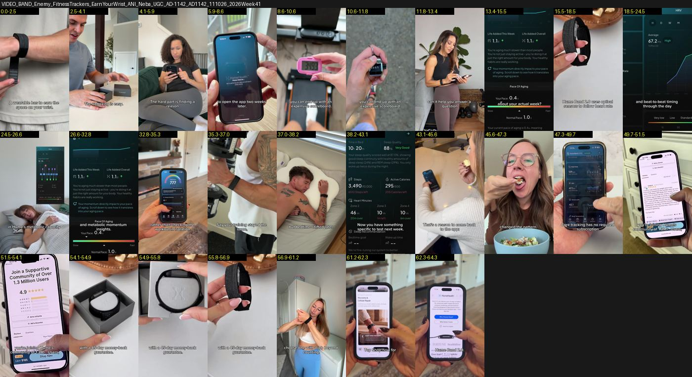

# VIDEO_BAND_Enemy_FitnessTrackers_EarnYourWrist_ANI_Neba_UGC_AD-1142_AD1142_111026_2026Week41

Master: `VIDEO_BAND_Enemy_FitnessTrackers_EarnYourWrist_ANI_Neba_UGC_AD-1142_AD1142_111026_2026Week41_Hook1_9x16.mp4` · 64.3s · 1080x1920

**Pacing:** 27 shots · avg 2.381s · median 2.033s · 4.04 cuts/10s · first cut 2.533s · 204.0 wpm · talk ratio 0.95 · cuts on word start 65.4% · cuts in speech gaps 50.0%
**Audio:** {'I_lufs': -8.1, 'LRA': 1.7, 'true_peak_db': 0.4} · BPM≈117.5 · music {'speech_rms_db': -11.8, 'pause_seconds': 0.0} · cuts with SFX/transient 73.1%

**Captions:** 263 cards · 1 words/card (median) · y≈0.721 of frame height · text height≈0.0281 · colours {'white': 163, 'blue': 6, 'dark/other': 82, 'yellow': 2, 'red': 8, 'green': 1, 'other-colour': 1} · cards crossing a cut: 14
Highlighted: MMmeHealth, Health Score, Metabolic JourneyProgress, about youractual week?, 777, rather than checking the, workout in isolation, workout in isolation., Say your training stayed the, same,, Very Good, subscription, with a 45-day money-back, If a wearable has to earn its, place on your wrist,
**Headlines:** 12:044 (6.0–6.0s, white) | 12:041 (7.0–7.0s, blue) | 12:044 (8.0–8.0s, blue) | 3492 (9.0–9.0s, dark/other) | h6hE (10.0–10.0s, dark/other) | LifeAddedOverall (14.0–15.0s, white) | LifeAddedThisWeek (14.0–15.0s, white) | 1.1d + (14.0–15.0s, white)

**Hook (0–3s) spoken:** A wearable has to earn the space on your wrist. The unboxing
**Hook on-screen:** A wearable has to earn the / The unboxing is easy. / space on your wrist.
**CTA (last 5s):** with a job beyond counting. Tap Shop Now for Hume Band 2 .0. · on-screen: Band2.0nowdeliversupto14daysofbattery / CellularRepair / FORTUNEhealthline / H8witW8Fks / HSA/FSA Eligible / Heaith. / HumeBand2.0 / HumeBand2.0. / Oneband.Acomplete / Onebandamplete / Optimize yourbody'siabilitytoheal,recharge, / PORTUNThcalhiine

## Beat sheet

| # | in–out (s) | dur | transition | spoken | on-screen text |
|---|---|---|---|---|---|
| 1 | 0.00–2.53 | 2.53 |  | A wearable has to earn the space on your wrist. | A wearable has to earn the / space on your wrist. / The unboxing is easy. |
| 2 | 2.53–4.10 | 1.57 | cut +SFX hit | The unboxing is easy. | The unboxing is easy. / The hard part is finding a / reason |
| 3 | 4.10–5.90 | 1.8 | cut +SFX hit | The hard part is finding a reason to open | The hard part is finding a / reason / to open the app two weeks / later. |
| 4 | 5.90–8.57 | 2.67 | cut +SFX hit | the app two weeks later. If all you get is another activity | to open the app two weeks / later. / 12:044 (HEADLINE) / MMmeHealth [blue] / 12:041 [blue] (HEADLINE) / XHumeHealth |
| 5 | 8.57–10.60 | 2.03 | cut +SFX hit | number, you can end up with an expensive | If all you get is another activity / number, / 3492 (HEADLINE) / h6hE (HEADLINE) / you can end up with an / expensive scoreboard |
| 6 | 10.60–11.83 | 1.23 | cut +SFX hit | scoreboard. Here's a | you can end up with an / 0065 / expensive scoreboard. |
| 7 | 11.83–13.43 | 1.6 | cut | better test. Can it help you answer | Here's a better test: / can it help you answera / question |
| 8 | 13.43–15.47 | 2.03 | cut +SFX hit | a question about your actual week? | can it help you answera / question / LifeAddedOverall (HEADLINE) / LifeAddedThisWeek (HEADLINE) / 1.1d + (HEADLINE) / 4 1.1d + (HEADLINE) |
| 9 | 15.47–18.47 | 3.0 | cut +SFX hit | HumeBand 2 .0 uses optical sensors to follow | LifeAddedOverall (HEADLINE) / LifeAddedThisWeek (HEADLINE) / 1.1d + (HEADLINE) / 4 1.1d + (HEADLINE) / You'reagingmuchslowerthanmostpeople / You'renot juststayingactive-you'redoingit at |
| 10 | 18.47–24.50 | 6.03 | cut +SFX hit | heart rate and beat -to -beat timing through the day and while you sleep. Its app combines those signals with sleep | Hume Band 2.0 uses optical / sensors to follow heart rate / Heart Rate (HEADLINE) / Range (HEADLINE) / 53-147 (HEADLINE) / High [yellow] (HEADLINE) |
| 11 | 24.50–26.57 | 2.07 | cut | and activity in Hume's metabolic | Its app combines those signals / with sleep and activity / in Hume's metabolic capacity |
| 12 | 26.57–32.77 | 6.2 | cut +SFX hit | capacity and metabolic momentum insights. so you can look at how effort and recovery fit together rather | in Hume's metabolic capacity / Capacity (HEADLINE) / BodyComp (HEADLINE) / MetabolicCapacity (HEADLINE) / 100 / Baseline |
| 13 | 32.77–35.30 | 2.53 | cut | than checking the workout in isolation. Say your training | 777 [blue] / rather than checking the [red] / workout in isolation [red] / workout in isolation. [red] / Say your training stayed the [red] / same, [yellow] |
| 14 | 35.30–36.97 | 1.67 | cut +SFX hit | stayed the same, but bedtime | Say your training stayed the [red] / same, [yellow] |
| 15 | 36.97–38.17 | 1.2 | cut +SFX hit | shifted later. | but bedtime shifted later. / overbackfires-you'llactuallymakelessprogress (HEADLINE) / overtime. (HEADLINE) / Thismightfeelabstractatfirst,butyou'll learnto (HEADLINE) / planactivitiesaroundyourcapacity-pushhard (HEADLINE) / onhighdays,restonlowdays,avoidgoingover. (HEADLINE) |
| 16 | 38.17–43.07 | 4.9 | cut +SFX hit | Put those days beside your recovery trend. Now you have something specific to test next week. | overbackfires-you'llactuallymakelessprogress (HEADLINE) / overtime. (HEADLINE) / Thismightfeelabstractatfirst,butyou'll learnto (HEADLINE) / planactivitiesaroundyourcapacity-pushhard (HEADLINE) / onhighdays,restonlowdays,avoidgoingover. (HEADLINE) / What'sbetteristhatyourbandisstill learningtoo, (HEADLINE) |
| 17 | 43.07–45.57 | 2.5 | cut +SFX hit | That's a reason to come back to the app, checking whether your | That's a reason to come back / to the app: / checking whether your / adjustment |
| 18 | 45.57–47.30 | 1.73 | cut | adjustment changed the pattern. | changed the pattern. |
| 19 | 47.30–49.73 | 2.43 | cut +SFX hit | Core tracking has no required subscription. | changed the pattern. / 3:516 [blue] (HEADLINE) / HumeBand (81%) [blue] (HEADLINE) / 129bpm (HEADLINE) / 47.1ms / 42.1 |
| 20 | 49.73–51.50 | 1.77 | cut +SFX hit | You're joining Hume's community of 1 | 10:17* (HEADLINE) / ★★ (HEADLINE) / Writea Review (HEADLINE) / QAskaQuestion (HEADLINE) / Questions / Reviews |
| 21 | 51.50–54.07 | 2.57 | cut +SFX hit | .3 million plus users with | Join a Supportive (HEADLINE) / Community of Over (HEADLINE) / 1.3 Million Users (HEADLINE) / 4.9★★★★* (HEADLINE) / Rrdoos / you're'joining Hume's |
| 22 | 54.07–54.93 | 0.87 | cut +SFX hit | a 45 -day | with a 45-day money-back [red] / guarantee. |
| 23 | 54.93–55.80 | 0.87 | cut | money -back guarantee. | with a 45-day money-back [red] / guarantee. |
| 24 | 55.80–56.87 | 1.07 | cut +SFX hit | If a wearable | with a 45-day money-back [red] / guarantee. |
| 25 | 56.87–61.23 | 4.37 | cut | has to earn its place on your wrist, choose one with a job beyond counting. | If a wearable has to earn its [red] / place on your wrist, [blue] / choose one with a job beyond [other-colour] / counting. [blue] / Recovery& / Optimize yourbody'siabilitytoheal,recharge, |
| 26 | 61.23–62.27 | 1.03 | cut +SFX hit | Tap Shop Now | Recovery& / Optimize yourbody'siabilitytoheal,recharge, / Tap Shop'nowfor / CellularRepair / Tap Shop now for [red] |
| 27 | 62.27–64.30 | 2.03 | cut | for Hume Band 2 .0. | CellularRepair / Tap Shop now for [red] / XHumeHealth (HEADLINE) / Band2.0nowdeliversupto14daysofbattery / pressuremonitoring,and personalized / ilnessand improveyourblologicalagefrom |

## Hook variants

| hook | file | dur | first cut | spoken 0–3s | on-screen 0–3s |
|---|---|---|---|---|---|
| 1 | `ANI_Neba_UGC_AD-1142_AD1142_111026_2026Week41_Hook1_9x16.mp4` | 64.3 | 2.533 | A wearable has to earn the space on your wrist. The unboxing | A wearable has to earn the / The unboxing is easy. / space on your wrist. |
| 2 | `ANI_Neba_UGC_AD-1142_AD1142_111026_2026Week41_Hook2_9x16.mp4` | 65.3 | 3.633 | If you stop opening the app after a week, what was the point? |  |
| 3 | `ANI_Neba_UGC_AD-1142_AD1142_111026_2026Week41_Hook3_9x16.mp4` | 66.0 | 1.933 | But another device is easy to buy. What makes it useful enough |  |

## Full transcript

A wearable has to earn the space on your wrist. The unboxing is easy. The hard part is finding a reason to open the app two weeks later. If all you get is another activity number, you can end up with an expensive scoreboard. Here's a better test. Can it help you answer a question about your actual week? HumeBand 2.0 uses optical sensors to follow heart rate and beat-to-beat timing through the day and while you sleep. Its app combines those signals with sleep and activity in Hume's metabolic capacity and metabolic momentum insights. so you can look at how effort and recovery fit together rather than checking the workout in isolation. Say your training stayed the same, but bedtime shifted later. Put those days beside your recovery trend. Now you have something specific to test next week. That's a reason to come back to the app, checking whether your adjustment changed the pattern. Core tracking has no required subscription. You're joining Hume's community of 1.3 million plus users with a 45-day money-back guarantee. If a wearable has to earn its place on your wrist, choose one with a job beyond counting. Tap Shop Now for Hume Band 2.0.