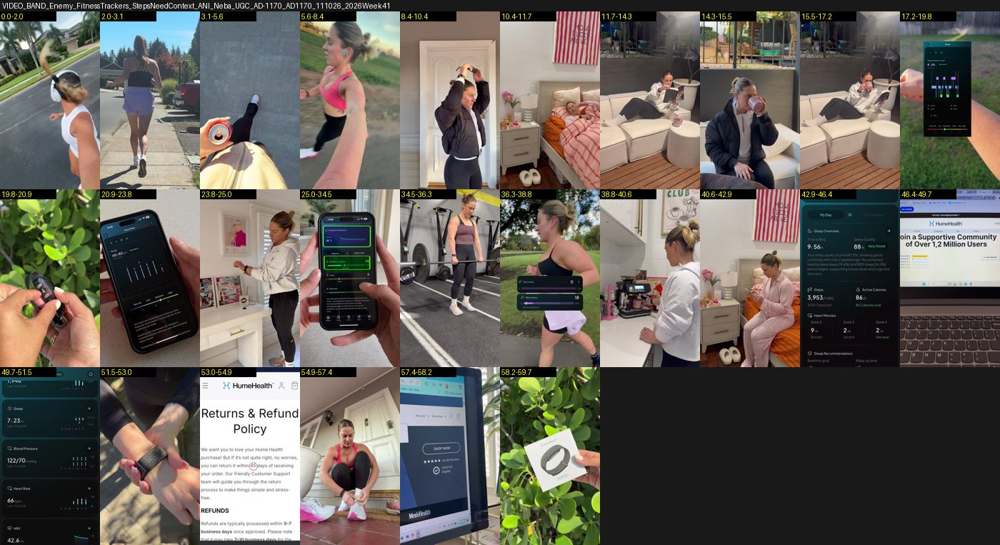

# VIDEO_BAND_Enemy_FitnessTrackers_StepsNeedContext_ANI_Neba_UGC_AD-1170_AD1170_111026_2026Week41

Master: `VIDEO_BAND_Enemy_FitnessTrackers_StepsNeedContext_ANI_Neba_UGC_AD-1170_AD1170_111026_2026Week41_9X16_HOOK1.mp4` · 59.7s · 1080x1920

**Pacing:** 26 shots · avg 2.297s · median 1.933s · 4.19 cuts/10s · first cut 2.0s · 223.0 wpm · talk ratio 0.93 · cuts on word start 84.0% · cuts in speech gaps 60.0%
**Audio:** {'I_lufs': -14.8, 'LRA': 2.0, 'true_peak_db': -2.7} · BPM≈117.5 · music {'speech_rms_db': -20.1, 'pause_seconds': 0.2} · cuts with SFX/transient 52.0%

**Captions:** 129 cards · 1 words/card (median) · y≈0.612 of frame height · text height≈0.0222 · colours {'white': 59, 'dark/other': 68, 'red': 1, 'green': 1} · cards crossing a cut: 0
Highlighted: 15:000k, 34
**Headlines:** 6n24m (19.0–19.0s, white) | 9:40 (21.0–23.0s, white) | Connected (21.0–21.0s, dark/other) | HumeBand(100%) (21.0–21.0s, dark/other) | Last210707/2023 (21.0–21.0s, dark/other) | Sleep (21.0–21.0s, white) | HeartRate (22.0–23.0s, white) | Standard (22.0–23.0s, dark/other)

**Hook (0–3s) spoken:** Stop treating your step goal like a report on your whole routine.
**Hook on-screen:** 
**CTA (last 5s):** Keep the step goal. Stop making it the whole story. Tap Shop now for Hume Band 2 .0 · on-screen: HumeHealth

## Beat sheet

| # | in–out (s) | dur | transition | spoken | on-screen text |
|---|---|---|---|---|---|
| 1 | 0.00–2.00 | 2.0 |  | Stop treating your step goal like a report on |  |
| 2 | 2.00–3.07 | 1.07 | cut +SFX hit | your whole routine. |  |
| 3 | 3.07–5.63 | 2.57 | cut | Ten thousand steps answers a useful question. |  |
| 4 | 5.63–8.37 | 2.73 | cut +SFX hit | How much did you move? It doesn't answer every question about |  |
| 5 | 8.37–10.40 | 2.03 | cut | what comes next. You could hit that goal after |  |
| 6 | 10.40–11.67 | 1.27 | cut | consistent sleep or |  |
| 7 | 11.67–14.27 | 2.6 | cut +SFX hit | after a week of late nights and demanding sessions. | ECRET? |
| 8 | 14.27–15.47 | 1.2 | cut +SFX hit | The total can look the same while |  |
| 9 | 15.47–17.17 | 1.7 | cut | the routine around it is different. |  |
| 10 | 17.17–19.83 | 2.67 | cut +SFX hit | Hume Band 2 .0 helps you see that context. | 6n24m (HEADLINE) |
| 11 | 19.83–20.90 | 1.07 | cut +SFX hit | Its optical sensors track |  |
| 12 | 20.90–23.83 | 2.93 | cut | heart rate and the small timing changes between beats while | 9:40 (HEADLINE) / Connected (HEADLINE) / HumeBand(100%) (HEADLINE) / Last210707/2023 (HEADLINE) / Sleep (HEADLINE) / Last:11/07/2025 |
| 13 | 23.83–25.00 | 1.17 | cut | you wear it day and night. | 15:000k [red] |
| 14 | 25.00–34.50 | 9.5 | cut | The app combines those signals with sleep and activity in Hume's metabolic capacity and metabolic momentum insights. You can compare strain with recovery and follow the pattern across your week. | 09steps (HEADLINE) / 12,218 (HEADLINE) / Csleep / 65bpm / 86.0ms / ?Stress Level |
| 15 | 34.50–36.27 | 1.77 | cut | Before adding another hard session, |  |
| 16 | 36.27–38.77 | 2.5 | cut +SFX hit | check how recovery compares with your usual pattern. | Recovery / PRecovery |
| 17 | 38.77–40.60 | 1.83 | cut +SFX hit | Choose an adjustment, like a lighter day or | CLUB (HEADLINE) / FRESH (HEADLINE) / EVERY (HEADLINE) |
| 18 | 40.60–42.93 | 2.33 | cut | a steadier bedtime, and review the feedback. |  |
| 19 | 42.93–46.37 | 3.43 | cut +SFX hit | That gives tomorrow's plan more to go on than today's activity total. | time. (HEADLINE) / Thismightfeelabstractatfirst,butyou'llearntoplan (HEADLINE) / activitiesaroundyourcapacity-pushhardonhigh (HEADLINE) / days,restonlowdays,avoidgoingover.What's (HEADLINE) / betteristhatyourbandisstill learningtoo,soitgets (HEADLINE) / ViewMoreDetails→ (HEADLINE) |
| 20 | 46.37–49.73 | 3.37 | cut +SFX hit | Hume's community includes 1 .3 million plus users. | ActiveCalories / 86/0 / 3047Stepsleft / 86Caloriesover / Zone 4 / Zone 2 |
| 21 | 49.73–51.53 | 1.8 | cut | Core tracking needs no subscription, | HumeBand(65%) (HEADLINE) / Connected [green] (HEADLINE) / Steps (HEADLINE) / 4576 (HEADLINE) / 1,946 (HEADLINE) / 2288 (HEADLINE) |
| 22 | 51.53–53.03 | 1.5 | cut +SFX hit | and Band 2 .0 comes with | X HumeHealth"g (HEADLINE) / Returns & Refund (HEADLINE) / Policy (HEADLINE) / WewantyoutoloveyourHumeHealth / purchase! But if it's not quite right, no worries, / you can return it within(45ydays of receiving |
| 23 | 53.03–54.90 | 1.87 | cut +SFX hit | a 45 -day money -back guarantee. | X HumeHealth"g (HEADLINE) / Returns & Refund (HEADLINE) / Policy (HEADLINE) / WewantyoutoloveyourHumeHealth / purchase! But if it's not quite right, no worries, / you can return it within(45ydays of receiving |
| 24 | 54.90–57.43 | 2.53 | cut | Keep the step goal. Stop making it the whole story. Tap |  |
| 25 | 57.43–58.17 | 0.73 | cut +SFX hit | Shop now for |  |
| 26 | 58.17–59.72 | 1.55 | cut | Hume Band 2 .0 | HumeHealth (HEADLINE) |

## Hook variants

| hook | file | dur | first cut | spoken 0–3s | on-screen 0–3s |
|---|---|---|---|---|---|
| 1 | `ANI_Neba_UGC_AD-1170_AD1170_111026_2026Week41_9X16_HOOK1.mp4` | 59.7 | 2.0 | Stop treating your step goal like a report on your whole routine. |  |
| 1 | `ANI_Neba_UGC_AD-1170_AD1170_111026_2026Week41_9X16_HOOK1.mp4` | 59.7 | 1.3 | Stop treating your step goal like a report on your whole routine. | Stop / Your / likeareport / on your whole routine. / stepgoal |
| 2 | `ANI_Neba_UGC_AD-1170_AD1170_111026_2026Week41_9X16_HOOK2.mp4` | 58.7 | 0.967 | Your workout score needs some context. 10 ,000 steps answers |  |
| 2 | `ANI_Neba_UGC_AD-1170_AD1170_111026_2026Week41_9X16_HOOK2.mp4` | 58.7 | 0.967 | Your workout score needs some context. 10 ,000 steps answers |  |
| 3 | `ANI_Neba_UGC_AD-1170_AD1170_111026_2026Week41_9X16_HOOK3.mp4` | 60.0 | 1.833 | Before chasing tomorrow's number, look at what's surrounded today's. |  |
| 3 | `ANI_Neba_UGC_AD-1170_AD1170_111026_2026Week41_9X16_HOOK3.mp4` | 60.0 | 1.833 | Before chasing tomorrow's number, look at what surrounded today's. |  |

## Full transcript

Stop treating your step goal like a report on your whole routine. Ten thousand steps answers a useful question. How much did you move? It doesn't answer every question about what comes next. You could hit that goal after consistent sleep or after a week of late nights and demanding sessions. The total can look the same while the routine around it is different. Hume Band 2.0 helps you see that context. Its optical sensors track heart rate and the small timing changes between beats while you wear it day and night. The app combines those signals with sleep and activity in Hume's metabolic capacity and metabolic momentum insights. You can compare strain with recovery and follow the pattern across your week. Before adding another hard session, check how recovery compares with your usual pattern. Choose an adjustment, like a lighter day or a steadier bedtime, and review the feedback. That gives tomorrow's plan more to go on than today's activity total. Hume's community includes 1.3 million plus users. Core tracking needs no subscription, and Band 2.0 comes with a 45-day money-back guarantee. Keep the step goal. Stop making it the whole story. Tap Shop now for Hume Band 2.0