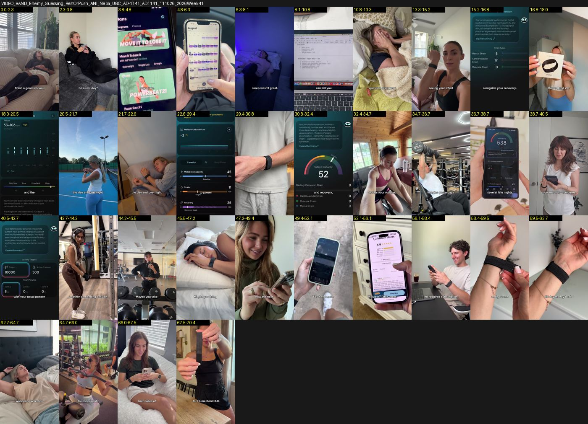

# VIDEO_BAND_Enemy_Guessing_RestOrPush_ANI_Neba_UGC_AD-1141_AD1141_111026_2026Week41

Master: `VIDEO_BAND_Enemy_Guessing_RestOrPush_ANI_Neba_UGC_AD-1141_AD1141_111026_2026Week41_Hook1_9x16.mp4` · 70.4s · 1080x1920

**Pacing:** 34 shots · avg 2.07s · median 1.833s · 4.69 cuts/10s · first cut 2.3s · 203.0 wpm · talk ratio 0.93 · cuts on word start 81.8% · cuts in speech gaps 51.5%
**Audio:** {'I_lufs': -21.1, 'LRA': 3.5, 'true_peak_db': -3.3} · BPM≈123.0 · music {'speech_rms_db': -26.6, 'pause_seconds': 0.0} · cuts with SFX/transient 72.7%

**Captions:** 229 cards · 1 words/card (median) · y≈0.674 of frame height · text height≈0.0258 · colours {'white': 194, 'red': 3, 'other-colour': 1, 'blue': 6, 'yellow': 2, 'dark/other': 23} · cards crossing a cut: 3
Highlighted: says train., Evening, Day, Cvening, Evenin, Evening, It can't make, the day and overnight., 50%OFF, $366 $183, 50%0F6, 50%OFF
**Headlines:** 9:59: (4.0–4.0s, white) | lans (4.0–4.5s, white) | Classes (4.0–4.5s, white) | Programs (4.0–4.0s, white) | MOVEITTOLOSEIT (4.0–4.5s, red) | POWERBEAT21 (4.0–4.5s, white) | rograms (4.5–4.5s, white) | WITHJEDSONTAVERNIER (4.5–4.5s, white)

**Hook (0–3s) spoken:** Anyone else finish a good workout and still wonder whether tomorrow should be
**Hook on-screen:** Anyone else / and still wonder / finish a good workout / whethertomorrow should
**CTA (last 5s):** checking both sides of the question. Tap Shop Now for Hume Band 2 .0. · on-screen: Tap Shop Now / both sides of / forHumeBand2.0. / the question.

## Beat sheet

| # | in–out (s) | dur | transition | spoken | on-screen text |
|---|---|---|---|---|---|
| 1 | 0.00–2.30 | 2.3 |  | Anyone else finish a good workout and still wonder whether | Anyone else / finish a good workout / and still wonder / whethertomorrow should |
| 2 | 2.30–3.77 | 1.47 | cut +SFX hit | tomorrow should be a rest day? | whethertomorrow should / be a rest day? |
| 3 | 3.77–4.77 | 1.0 | cut +SFX hit | The plan says train. | be a rest day? / 9:59: (HEADLINE) / lans (HEADLINE) / Classes (HEADLINE) / Programs (HEADLINE) / MOVEITTOLOSEIT [red] (HEADLINE) |
| 4 | 4.77–6.33 | 1.57 | cut | Your calendar says you're busy and | lans (HEADLINE) / Classes (HEADLINE) / MOVEITTOLOSEIT [red] (HEADLINE) / Strength / Weight Loss / says train. [red] |
| 5 | 6.33–8.13 | 1.8 | cut +SFX hit | last night's sleep wasn't great. | August (HEADLINE) / you're busy. / Evening [blue] / Night / sleep wasn't great. / Equipment Needed: Just a mat and optional dumbbells/resistance bands |
| 6 | 8.13–10.77 | 2.63 | cut +SFX hit | A workout summary can tell you yesterday went well. | Equipment Needed: Just a mat and optional dumbbells/resistance bands / Aworkoutsummary / Push-ups (knceorful)—3x10-15 / can tell you / Bent-over rows (dumbbellsorwaterbottles)-3x12 / Thursday=Active Resovery |
| 7 | 10.77–13.33 | 2.57 | cut +SFX hit | It can't make that next day question disappear. | It can't make [yellow] / question disappear. |
| 8 | 13.33–15.17 | 1.83 | cut +SFX hit | What helps is seeing your effort alongside | question disappear. / seeing your effort / Yesterday'sResolution [blue] (HEADLINE) / Yourcardiovascularsystemcarriesthefull (HEADLINE) / loadofrecentpositivetrainingactivity,and (HEADLINE) / itrecoveredcompletely-astrongsignal (HEADLINE) |
| 9 | 15.17–16.77 | 1.6 | cut +SFX hit | your recovery. HumeBand | Yesterday'sResolution [blue] (HEADLINE) / Yourcardiovascularsystemcarriesthefull (HEADLINE) / loadofrecentpositivetrainingactivity,and (HEADLINE) / itrecoveredcompletely-astrongsignal (HEADLINE) / thatyouraerobicworkandrecovery (HEADLINE) / practicesalignedwell.Muscularandmental (HEADLINE) |
| 10 | 16.77–18.00 | 1.23 | cut | 2 .0 tracks | HumeHeann / Hume Band 2.0 |
| 11 | 18.00–20.50 | 2.5 | cut +SFX hit | your heart rate and the timing between beats while | HeartRate (HEADLINE) / Range (HEADLINE) / 53-106bpm (HEADLINE) / High (HEADLINE) / 07/Aug/26 (HEADLINE) / Prev |
| 12 | 20.50–21.70 | 1.2 | cut +SFX hit | you wear it through the day and | the day and overnight. [blue] |
| 13 | 21.70–22.63 | 0.93 | cut | overnight. The | the day and overnight. [blue] |
| 14 | 22.63–29.40 | 6.77 | cut +SFX hit | HumeHealth app combines those signals with sleep and activity to power metabolic capacity and metabolic momentum. That | HumeBand(80%) (HEADLINE) / Connected [green] (HEADLINE) / 99steps (HEADLINE) / 5826 (HEADLINE) / 3,033 (HEADLINE) / 2913 (HEADLINE) |
| 15 | 29.40–30.77 | 1.37 | cut +SFX hit | gives you a view of daily | Yesterday'sResolution [blue] (HEADLINE) / Accumulated (HEADLINE) / 22 (HEADLINE) / RecoveredStrain (HEADLINE) / Strain (HEADLINE) / MetabolicMomentum (HEADLINE) |
| 16 | 30.77–32.43 | 1.67 | cut | strain and recovery, with trends | Today [blue] (HEADLINE) / Yesterday (HEADLINE) / threedays showingastableandslightly (HEADLINE) / upwardpattern.Thiskindofsteady (HEADLINE) / drops-suggestsyourbodyadaptswellto (HEADLINE) / currentde... (HEADLINE) |
| 17 | 32.43–34.67 | 2.23 | cut +SFX hit | you can follow across your routine. | Today [blue] (HEADLINE) / threedays showingastableandslightly (HEADLINE) / upwardpattern.Thiskindofsteady (HEADLINE) / drops-suggestsyourbodyadaptswellto (HEADLINE) / currentde... (HEADLINE) / ExpandSummary (HEADLINE) |
| 18 | 34.67–36.67 | 2.0 | cut +SFX hit | Imagine yesterday's hard session landing | KG / S'LE / Imagine yesterday's / KG (HEADLINE) / hard session |
| 19 | 36.67–38.67 | 2.0 | cut | after several late nights. | HealthScore (HEADLINE) / 538 (HEADLINE) / HumePlusExclusive / Generate your HealthReportby / upgradingto Hume Plus / wMetabolicMomentum |
| 20 | 38.67–40.50 | 1.83 | cut +SFX hit | You can check how recovery compares with | You can check / how recovery compares |
| 21 | 40.50–42.67 | 2.17 | cut +SFX hit | your usual pattern before choosing another | Today [blue] (HEADLINE) / Yesterday (HEADLINE) / Yourdatarevealsagenuinelyinteresting (HEADLINE) / pattern:near-perfectsleepqualitypaired (HEADLINE) / withinsufficientsleepduration.Yourbody (HEADLINE) / executessleepwithexceptionalefficiency (HEADLINE) |
| 22 | 42.67–44.20 | 1.53 | cut | demanding session. | another demanding session. / Maybe you take |
| 23 | 44.20–45.50 | 1.3 | cut +SFX hit | Maybe you take a lighter day. | Maybe you take / a lighter day. / 42 |
| 24 | 45.50–47.17 | 1.67 | cut +SFX hit | Maybe you bring bedtime forward. | Maybe you bring / Then you |
| 25 | 47.17–49.37 | 2.2 | cut +SFX hit | Then you can see how the next few days compare. | Then you / how the next / few days compare. |
| 26 | 49.37–52.13 | 2.77 | cut +SFX hit | You still make the decision. You have more to base it on. | few days compare. / 4,267 (HEADLINE) / 6-45 / 103.9 / the decision. / You have more |
| 27 | 52.13–56.07 | 3.93 | cut +SFX hit | Hume's community includes 1 .3 million plus users. Core | 10:17 (HEADLINE) / Joina Supportive (HEADLINE) / Community of Over (HEADLINE) / 1,2MillionUsers (HEADLINE) / 4.9★★★★★ (HEADLINE) / ★★★★★ |
| 28 | 56.07–58.37 | 2.3 | cut | Tracking has no required subscription, and | Core tracking has / no required subscription, |
| 29 | 58.37–59.53 | 1.17 | cut +SFX hit | you can try Band 2 | no required subscription, / try Band 2.0 |
| 30 | 59.53–62.73 | 3.2 | cut +SFX hit | .0 with a 45 -day money -back guarantee. | try Band 2.0 / 45-day money-back / guarantee. |
| 31 | 62.73–64.67 | 1.93 | cut +SFX hit | If you keep wondering whether to rest or | If you keep / wondering whether |
| 32 | 64.67–66.03 | 1.37 | cut | push, start checking both | to rest or push, / both sides of |
| 33 | 66.03–67.50 | 1.47 | cut | sides of the question. | both sides of / the question. |
| 34 | 67.50–70.38 | 2.88 | cut +SFX hit | Tap Shop Now for Hume Band 2 .0. | Tap Shop Now / forHumeBand2.0. |

## Hook variants

| hook | file | dur | first cut | spoken 0–3s | on-screen 0–3s |
|---|---|---|---|---|---|
| 1 | `ANI_Neba_UGC_AD-1141_AD1141_111026_2026Week41_Hook1_9x16.mp4` | 70.4 | 2.3 | Anyone else finish a good workout and still wonder whether tomorrow should be | Anyone else / and still wonder / finish a good workout / whethertomorrow should |
| 2 | `ANI_Neba_UGC_AD-1141_AD1141_111026_2026Week41_Hook2_9x16.mp4` | 70.0 | 1.3 | You trained yesterday. You slept badly. Do you push again today? |  |
| 3 | `ANI_Neba_UGC_AD-1141_AD1141_111026_2026Week41_Hook3_9x16.mp4` | 70.4 | 2.033 | A workout summary tells you what you did. How do you decide what comes |  |

## Full transcript

Anyone else finish a good workout and still wonder whether tomorrow should be a rest day? The plan says train. Your calendar says you're busy and last night's sleep wasn't great. A workout summary can tell you yesterday went well. It can't make that next day question disappear. What helps is seeing your effort alongside your recovery. HumeBand 2.0 tracks your heart rate and the timing between beats while you wear it through the day and overnight. The HumeHealth app combines those signals with sleep and activity to power metabolic capacity and metabolic momentum. That gives you a view of daily strain and recovery, with trends you can follow across your routine. Imagine yesterday's hard session landing after several late nights. You can check how recovery compares with your usual pattern before choosing another demanding session. Maybe you take a lighter day. Maybe you bring bedtime forward. Then you can see how the next few days compare. You still make the decision. You have more to base it on. Hume's community includes 1.3 million plus users. Core Tracking has no required subscription, and you can try Band 2.0 with a 45-day money-back guarantee. If you keep wondering whether to rest or push, start checking both sides of the question. Tap Shop Now for Hume Band 2.0.