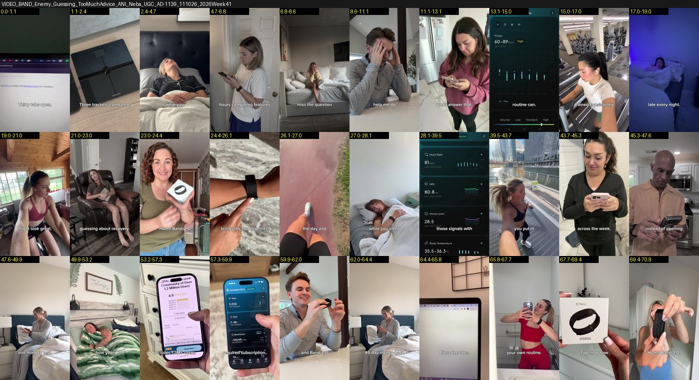

# VIDEO_BAND_Enemy_Guessing_TooMuchAdvice_ANI_Neba_UGC_AD-1139_111026_2026Week41

Master: `VIDEO_BAND_Enemy_Guessing_TooMuchAdvice_ANI_Neba_UGC_AD-1139_111026_2026Week41_Hook1_9x16.mp4` · 70.9s · 1080x1920

**Pacing:** 30 shots · avg 2.362s · median 1.967s · 4.09 cuts/10s · first cut 1.133s · 191.0 wpm · talk ratio 0.9 · cuts on word start 79.3% · cuts in speech gaps 65.5%
**Audio:** {'I_lufs': -21.5, 'LRA': 3.4, 'true_peak_db': -3.3} · BPM≈152.0 · music {'speech_rms_db': -27.2, 'pause_seconds': 1.9, 'pause_rms_db': -26.5, 'bed_minus_voice_db': 0.7, 'music_bed_likely': True} · cuts with SFX/transient 82.8%

**Captions:** 232 cards · 1.0 words/card (median) · y≈0.703 of frame height · text height≈0.0275 · colours {'white': 178, 'dark/other': 46, 'red': 6, 'blue': 1, 'yellow': 1} · cards crossing a cut: 4
Highlighted: trained consistently, Wear it through, 50%0FF, $366 $183, 50%OFE, 50%0FF, Start learning from, your own routine.
**Headlines:** HumeBand(27%) (13.0–13.0s, white) | Connected (13.0–13.0s, green) | 99 Steps (13.0–13.0s, white) | 661 (13.0–13.0s, white) | Last:24/1/2025 (13.0–13.0s, dark/other) | Heart Rate (14.0–14.0s, white) | Range (14.0–14.0s, white) | High (14.0–14.0s, yellow)

**Hook (0–3s) spoken:** 30 tabs open, three trackers compared. Still no
**Hook on-screen:** Still no idea / Thirty tabs open. / Three trackers compared / WITHING / WITHINGS / fnooms
**CTA (last 5s):** learning from your own routine. Tap Shop Now to get Hume Band 2 .0. · on-screen: HumeBand2.0 / HumeHealth / Start learning from / Tap shop now / XHumeHealth / to get / your own routine.

## Beat sheet

| # | in–out (s) | dur | transition | spoken | on-screen text |
|---|---|---|---|---|---|
| 1 | 0.00–1.13 | 1.13 |  | 30 tabs open, three | fnooms / Thirty tabs open. / WITHINGS / Three trackers compared |
| 2 | 1.13–2.40 | 1.27 | cut +SFX hit | trackers compared. | WITHINGS / Three trackers compared / WITHING |
| 3 | 2.40–4.73 | 2.33 | cut +SFX hit | Still no idea what you actually need? | Three trackers compared / WITHING / Still no idea / what you / actually need? |
| 4 | 4.73–6.77 | 2.03 | cut +SFX hit | You can spend hours comparing features and | actually need? / You can spend / hours comparing features |
| 5 | 6.77–8.57 | 1.8 | cut | still miss the question that matters. | miss the question / that matters: |
| 6 | 8.57–11.13 | 2.57 | cut | What will this help me do differently tomorrow? | what will this / differently tomorrow? / More advice |
| 7 | 11.13–13.07 | 1.93 | cut +SFX hit | More advice won't answer that. Feedback | More advice / won't answer that. / HumeBand(27%) (HEADLINE) / Connected [green] (HEADLINE) / 99 Steps (HEADLINE) / 661 (HEADLINE) |
| 8 | 13.07–15.00 | 1.93 | cut +SFX hit | from your own routine can. | HumeBand(27%) (HEADLINE) / Connected [green] (HEADLINE) / 99 Steps (HEADLINE) / 661 (HEADLINE) / Last:24/1/2025 (HEADLINE) / Sleep |
| 9 | 15.00–17.03 | 2.03 | cut +SFX hit | Take a week where you trained consistently but | Take a week / trained consistently [red] / but stayed up |
| 10 | 17.03–18.97 | 1.93 | cut +SFX hit | stayed up late every night. Your | but stayed up / late every night |
| 11 | 18.97–21.03 | 2.07 | cut +SFX hit | activity total might look great. It | Your activity total / might look great. / It leaves you |
| 12 | 21.03–23.03 | 2.0 | cut +SFX hit | leaves you guessing about recovery. | It leaves you / guessing about recovery. / Hume Band 2.0 |
| 13 | 23.03–24.43 | 1.4 | cut | HumeBand 2 .0 brings | Hume Band 2.0 / brings the two together. |
| 14 | 24.43–26.07 | 1.63 | cut +SFX hit | the two together. | brings the two together. / Wear it through [red] |
| 15 | 26.07–27.03 | 0.97 | cut +SFX hit | Wear it through the day and | Wear it through [red] / while you sleep |
| 16 | 27.03–28.07 | 1.03 | cut +SFX hit | while you sleep. Optical | while you sleep / HumeBand(27%) (HEADLINE) / Connected [green] (HEADLINE) / Sleep (HEADLINE) / 7h26m (HEADLINE) / Last:20/11/2025 (HEADLINE) |
| 17 | 28.07–39.53 | 11.47 | cut +SFX hit | sensors track your heart rate and the small timing changes between beats. The app combines those signals with sleep and activity in Hume's metabolic capacity and metabolic momentum insights. | HumeBand(27%) (HEADLINE) / Connected [green] (HEADLINE) / Sleep (HEADLINE) / 7h26m (HEADLINE) / Last:20/11/2025 (HEADLINE) / TWTFSSM (HEADLINE) |
| 18 | 39.53–43.67 | 4.13 | cut +SFX hit | Now you can compare the effort you put in with how you're recovering, then follow | Now you can / you put in / you're recovering, / then follow |
| 19 | 43.67–45.33 | 1.67 | cut | the pattern across the week. Instead | the pattern / across the week |
| 20 | 45.33–47.63 | 2.3 | cut +SFX hit | of opening another comparison tab, | across the week / instead of opening / another comparison tab, |
| 21 | 47.63–49.93 | 2.3 | cut +SFX hit | you can choose one thing to test, like an | you can choose / one thing to test, |
| 22 | 49.93–53.23 | 3.3 | cut +SFX hit | earlier bedtime, and see how your recovery responds. Hume's | ITWAS (HEADLINE) / YOU (HEADLINE) / earlier bedtime, / and see / YOU (HEADLINE) / recovery responds. |
| 23 | 53.23–57.30 | 4.07 | cut +SFX hit | community includes 1 .3 million plus users. | recovery responds. / 10:17元 (HEADLINE) / Join a Supportive (HEADLINE) / Community ofOver (HEADLINE) / 1,2MillionUsers (HEADLINE) / ★★★★ [yellow] (HEADLINE) |
| 24 | 57.30–59.90 | 2.6 | cut +SFX hit | Core Tracking has no required subscription, | humehealth.com / QAskaQuestion (HEADLINE) / Questions / Reviews / Most Recent / 11/22/2025 |
| 25 | 59.90–62.00 | 2.1 | cut +SFX hit | and Band 2 .0 comes with a | and Band 2.0 / comes with a |
| 26 | 62.00–64.37 | 2.37 | cut +SFX hit | 45 -day money -back guarantee. | 45-day money-back / guarantee. |
| 27 | 64.37–65.80 | 1.43 | cut | Close the tabs. Start | guarantee. / Close the tabs. |
| 28 | 65.80–67.70 | 1.9 | cut +SFX hit | learning from your own routine. | Start learning from [red] / your own routine. [red] |
| 29 | 67.70–69.37 | 1.67 | cut +SFX hit | Tap Shop Now to get Hume | XHumeHealth / Tap shop now / HumeHealth / HumeBand2.0 / to get |
| 30 | 69.37–70.87 | 1.5 | cut +SFX hit | Band 2 .0. | HumeHealth / HumeBand2.0 / to get |

## Hook variants

| hook | file | dur | first cut | spoken 0–3s | on-screen 0–3s |
|---|---|---|---|---|---|
| 1 | `Advice_ANI_Neba_UGC_AD-1139_111026_2026Week41_Hook1_9x16.mp4` | 70.9 | 1.133 | 30 tabs open, three trackers compared. Still no | Still no idea / Thirty tabs open. / Three trackers compared / WITHING / WITHINGS / fnooms |
| 2 | `Advice_ANI_Neba_UGC_AD-1139_111026_2026Week41_Hook2_9x16.mp4` | 71.3 | 3.4 | One person says train harder. Another says recover more. |  |
| 3 | `Advice_ANI_Neba_UGC_AD-1139_111026_2026Week41_Hook3_9x16.mp4` | 69.6 | 1.0 | Choosing a wearable shouldn't feel like studying for an exam. | Choosing a wearable / shouldn't feel like / studying for an exam. |

## Full transcript

30 tabs open, three trackers compared. Still no idea what you actually need? You can spend hours comparing features and still miss the question that matters. What will this help me do differently tomorrow? More advice won't answer that. Feedback from your own routine can. Take a week where you trained consistently but stayed up late every night. Your activity total might look great. It leaves you guessing about recovery. HumeBand 2.0 brings the two together. Wear it through the day and while you sleep. Optical sensors track your heart rate and the small timing changes between beats. The app combines those signals with sleep and activity in Hume's metabolic capacity and metabolic momentum insights. Now you can compare the effort you put in with how you're recovering, then follow the pattern across the week. Instead of opening another comparison tab, you can choose one thing to test, like an earlier bedtime, and see how your recovery responds. Hume's community includes 1.3 million plus users. Core Tracking has no required subscription, and Band 2.0 comes with a 45-day money-back guarantee. Close the tabs. Start learning from your own routine. Tap Shop Now to get Hume Band 2.0.