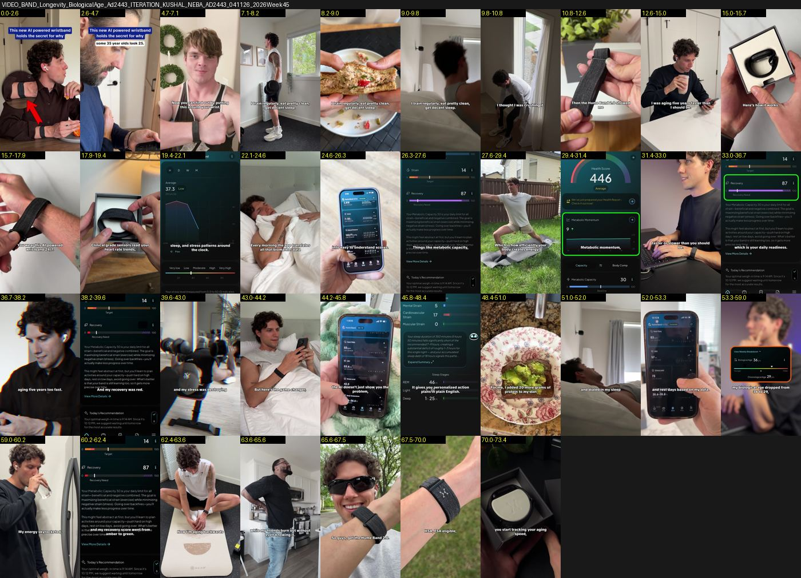

# VIDEO_BAND_Longevity_BiologicalAge_Ad2443_ITERATION_KUSHAL_NEBA_AD2443_041126_2026Week45

Master: `VIDEO_BAND_Longevity_BiologicalAge_Ad2443_ITERATION_KUSHAL_NEBA_AD2443_041126_2026Week45_9x16_hook1.mp4` · 73.4s · 1080x1920

**Pacing:** 37 shots · avg 1.984s · median 1.8s · 4.9 cuts/10s · first cut 2.6s · 234.0 wpm · talk ratio 0.97 · cuts on word start 94.4% · cuts in speech gaps 66.7%
**Audio:** {'I_lufs': -23.3, 'LRA': 2.4, 'true_peak_db': -4.2} · BPM≈129.2 · music {'speech_rms_db': -28.1, 'pause_seconds': 0.0} · cuts with SFX/transient 61.1%

**Hook (0–3s) spoken:** This new AI -powered wristband holds the secret for why some 35
**Hook on-screen:** 
**CTA (last 5s):** eligible no subscription required the earlier you start tracking your aging speed the longer you stay in your prime · on-screen: 

## Beat sheet

| # | in–out (s) | dur | transition | spoken | on-screen text |
|---|---|---|---|---|---|
| 1 | 0.00–2.60 | 2.6 |  | This new AI -powered wristband holds the secret for why |  |
| 2 | 2.60–4.72 | 2.12 | cut | some 35 -year -olds look 25. |  |
| 3 | 4.72–7.08 | 2.36 | cut | Now you can find out by putting this around your wrist. |  |
| 4 | 7.08–8.16 | 1.08 | cut +SFX hit | I train regularly, eat |  |
| 5 | 8.16–9.00 | 0.84 | cut | pretty clean, |  |
| 6 | 9.00–9.80 | 0.8 | cut +SFX hit | get decent sleep. |  |
| 7 | 9.80–10.76 | 0.96 | cut +SFX hit | I thought I was crushing it. |  |
| 8 | 10.76–12.56 | 1.8 | cut | Then the HumeBand 2 .0 showed |  |
| 9 | 12.56–14.96 | 2.4 | cut | me I was aging five years faster than I should be. |  |
| 10 | 14.96–15.68 | 0.72 | cut +SFX hit | Here's how it works. |  |
| 11 | 15.68–17.92 | 2.24 | cut +SFX hit | You wear this AI -powered wristband 24 -7. |  |
| 12 | 17.92–19.36 | 1.44 | cut | Clinical grade sensors read your heart |  |
| 13 | 19.36–22.12 | 2.76 | cut +SFX hit | rate trends, sleep, and stress patterns around the clock. |  |
| 14 | 22.12–24.56 | 2.44 | cut +SFX hit | Every morning, the app translates all that biomarker data |  |
| 15 | 24.56–26.28 | 1.72 | cut | into easy -to -understand scores. Things |  |
| 16 | 26.28–27.60 | 1.32 | cut +SFX hit | like metabolic capacity, which |  |
| 17 | 27.60–29.40 | 1.8 | cut +SFX hit | is how efficiently your body creates energy. |  |
| 18 | 29.40–31.40 | 2.0 | cut +SFX hit | Metabolic momentum, which is whether you're aging faster |  |
| 19 | 31.40–32.96 | 1.56 | cut +SFX hit | or slower than you should be, and |  |
| 20 | 32.96–36.72 | 3.76 | cut | recovery score, which is your daily readiness. My metabolic momentum was orange, |  |
| 21 | 36.72–38.16 | 1.44 | cut +SFX hit | aging five years too fast, |  |
| 22 | 38.16–39.56 | 1.4 | cut | and my recovery was red. Turns |  |
| 23 | 39.56–42.96 | 3.4 | cut +SFX hit | out, I was overtraining, and my stress was destroying cellular repair. |  |
| 24 | 42.96–44.16 | 1.2 | cut +SFX hit | But here's the game changer. |  |
| 25 | 44.16–45.84 | 1.68 | cut | The AI doesn't just show you the problem, |  |
| 26 | 45.84–48.36 | 2.52 | cut +SFX hit | it gives you personalized action plans in plain English. |  |
| 27 | 48.36–51.00 | 2.64 | cut | For me, I added 20 more grams of protein to my diet, |  |
| 28 | 51.00–51.96 | 0.96 | cut +SFX hit | and dialed in my sleep and |  |
| 29 | 51.96–53.32 | 1.36 | cut +SFX hit | rest days based on my data. |  |
| 30 | 53.32–59.04 | 5.72 | cut +SFX hit | Within six weeks of following these micro -recommendations, my biological age dropped from 36 to 29 my energy |  |
| 31 | 59.04–60.16 | 1.12 | cut +SFX hit | skyrocketed |  |
| 32 | 60.16–62.40 | 2.24 | cut | and my recovery score went from amber to green now |  |
| 33 | 62.40–63.64 | 1.24 | cut +SFX hit | I'm aging backwards while |  |
| 34 | 63.64–65.60 | 1.96 | cut +SFX hit | my friends burn out without even knowing it |  |
| 35 | 65.60–67.48 | 1.88 | cut | so guys get the hume band 2 .0 |  |
| 36 | 67.48–70.00 | 2.52 | cut | HSA FSA eligible no subscription required the |  |
| 37 | 70.00–73.41 | 3.41 | cut +SFX hit | earlier you start tracking your aging speed the longer you stay in your prime |  |

## Hook variants

| hook | file | dur | first cut | spoken 0–3s | on-screen 0–3s |
|---|---|---|---|---|---|
| 1 | `TERATION_KUSHAL_NEBA_AD2443_041126_2026Week45_9x16_hook1.mp4` | 73.4 | 2.6 | This new AI -powered wristband holds the secret for why some 35 |  |
| 1 | `TERATION_KUSHAL_NEBA_AD2443_041126_2026Week45_9x16_hook1.mp4` | 73.4 | 2.6 |  |  |
| 2 | `TERATION_KUSHAL_NEBA_AD2443_041126_2026Week45_9x16_hook2.mp4` | 73.3 | 0.72 |  |  |
| 2 | `TERATION_KUSHAL_NEBA_AD2443_041126_2026Week45_9x16_hook2.mp4` | 73.3 | 0.72 |  |  |
| 3 | `TERATION_KUSHAL_NEBA_AD2443_041126_2026Week45_9x16_hook3.mp4` | 71.9 | 2.32 |  |  |
| 3 | `TERATION_KUSHAL_NEBA_AD2443_041126_2026Week45_9x16_hook3.mp4` | 71.9 | 2.32 |  |  |

## Full transcript

This new AI-powered wristband holds the secret for why some 35-year-olds look 25. Now you can find out by putting this around your wrist. I train regularly, eat pretty clean, get decent sleep. I thought I was crushing it. Then the HumeBand 2.0 showed me I was aging five years faster than I should be. Here's how it works. You wear this AI-powered wristband 24-7. Clinical grade sensors read your heart rate trends, sleep, and stress patterns around the clock. Every morning, the app translates all that biomarker data into easy-to-understand scores. Things like metabolic capacity, which is how efficiently your body creates energy. Metabolic momentum, which is whether you're aging faster or slower than you should be, and recovery score, which is your daily readiness. My metabolic momentum was orange, aging five years too fast, and my recovery was red. Turns out, I was overtraining, and my stress was destroying cellular repair. But here's the game changer. The AI doesn't just show you the problem, it gives you personalized action plans in plain English. For me, I added 20 more grams of protein to my diet, and dialed in my sleep and rest days based on my data. Within six weeks of following these micro-recommendations, my biological age dropped from 36 to 29 my energy skyrocketed and my recovery score went from amber to green now I'm aging backwards while my friends burn out without even knowing it so guys get the hume band 2.0 HSA FSA eligible no subscription required the earlier you start tracking your aging speed the longer you stay in your prime