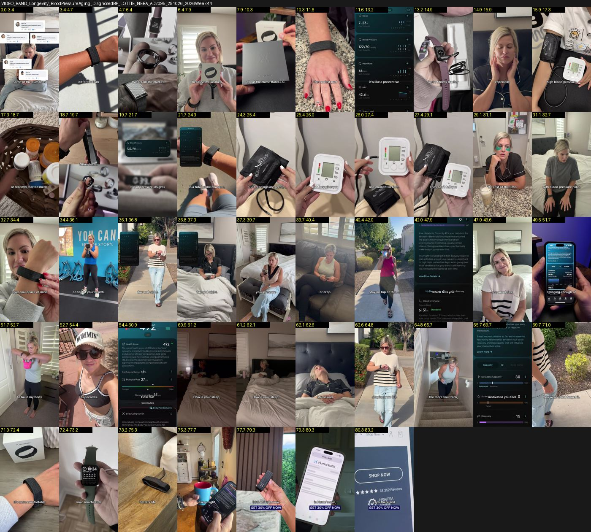

# VIDEO_BAND_Longevity_BloodPressureAging_DiagnosedBP_LOTTIE_NEBA_AD2095_291026_2026Week44

Master: `VIDEO_BAND_Longevity_BloodPressureAging_DiagnosedBP_LOTTIE_NEBA_AD2095_291026_2026Week44_9X16_HOOK1.mp4` · 83.2s · 1080x1920

**Pacing:** 47 shots · avg 1.771s · median 1.633s · 5.53 cuts/10s · first cut 3.367s · 259.0 wpm · talk ratio 0.94 · cuts on word start 89.1% · cuts in speech gaps 73.9%
**Audio:** {'I_lufs': -19.2, 'LRA': 2.4, 'true_peak_db': -3.3} · BPM≈112.3 · music {'speech_rms_db': -23.6, 'pause_seconds': 0.0} · cuts with SFX/transient 67.4%

**Hook (0–3s) spoken:** we wanted to come back and answer some of the questions that we keep getting the most
**Hook on-screen:** 
**CTA (last 5s):** % off right now in Hume sale, so do yourself a favor. Click there and get it before it's gone. · on-screen: 

## Beat sheet

| # | in–out (s) | dur | transition | spoken | on-screen text |
|---|---|---|---|---|---|
| 1 | 0.00–3.37 | 3.37 |  | we wanted to come back and answer some of the questions that we keep getting the most about, |  |
| 2 | 3.37–4.67 | 1.3 | cut +SFX hit | like what makes this different than |  |
| 3 | 4.67–6.37 | 1.7 | cut +SFX hit | any other fitness tracker on the market? |  |
| 4 | 6.37–7.87 | 1.5 | cut +SFX hit | Because we've tried most of them. |  |
| 5 | 7.87–10.33 | 2.47 | cut | Some of you have been asking about the Hume Band 2 .0. |  |
| 6 | 10.33–11.63 | 1.3 | cut +SFX hit | The coolest part about this is |  |
| 7 | 11.63–13.20 | 1.57 | cut +SFX hit | it's like a preventative health tool and |  |
| 8 | 13.20–14.93 | 1.73 | cut +SFX hit | not really just a fitness tracker, |  |
| 9 | 14.93–15.90 | 0.97 | cut +SFX hit | especially if you've been |  |
| 10 | 15.90–17.30 | 1.4 | cut +SFX hit | diagnosed with high blood pressure or |  |
| 11 | 17.30–18.73 | 1.43 | cut | recently started meds. |  |
| 12 | 18.73–19.73 | 1.0 | cut +SFX hit | Other bands and rings don't |  |
| 13 | 19.73–21.70 | 1.97 | cut +SFX hit | have any blood pressure insights, |  |
| 14 | 21.70–24.30 | 2.6 | cut | so having this tracking is a total game changer. |  |
| 15 | 24.30–25.37 | 1.07 | cut +SFX hit | Cuff readings are great, |  |
| 16 | 25.37–26.00 | 0.63 | cut | but they give you |  |
| 17 | 26.00–27.43 | 1.43 | cut | a reading from one moment in time. |  |
| 18 | 27.43–29.13 | 1.7 | cut +SFX hit | They can't tell you what's happening to |  |
| 19 | 29.13–31.07 | 1.93 | cut +SFX hit | your blood pressure the rest of the time. |  |
| 20 | 31.07–32.73 | 1.67 | cut +SFX hit | If you're someone with blood pressure risks, |  |
| 21 | 32.73–34.43 | 1.7 | cut +SFX hit | the Hume Band gives you peace of mind |  |
| 22 | 34.43–36.13 | 1.7 | cut | that you're staying on top of your health, |  |
| 23 | 36.13–36.77 | 0.63 | cut | day and |  |
| 24 | 36.77–37.30 | 0.53 | cut +SFX hit | night. |  |
| 25 | 37.30–39.70 | 2.4 | cut +SFX hit | You can see exactly when your pressure tends to spike or |  |
| 26 | 39.70–40.37 | 0.67 | cut +SFX hit | drop and |  |
| 27 | 40.37–42.00 | 1.63 | cut +SFX hit | how you can stay on top of them. |  |
| 28 | 42.00–47.90 | 5.9 | cut +SFX hit | Inside the app, you also get a capacity report, which tells you how to tackle today based on how your body is really doing. |  |
| 29 | 47.90–49.57 | 1.67 | cut +SFX hit | And it's not about one good day, |  |
| 30 | 49.57–51.70 | 2.13 | cut +SFX hit | it's about stringing enough of these days together to |  |
| 31 | 51.70–52.70 | 1.0 | cut | build my body that |  |
| 32 | 52.70–54.40 | 1.7 | cut +SFX hit | can perform for decades. |  |
| 33 | 54.40–60.93 | 6.53 | cut | Building momentum that you can see and feel for yourself. How fast are you really aging? How many days of life are you adding? |  |
| 34 | 60.93–61.20 | 0.27 | cut +SFX hit | How is |  |
| 35 | 61.20–62.10 | 0.9 | cut | your sleep, stress, |  |
| 36 | 62.10–62.63 | 0.53 | cut | and |  |
| 37 | 62.63–64.83 | 2.2 | cut +SFX hit | lifestyle shaping your life long term? |  |
| 38 | 64.83–65.70 | 0.87 | cut +SFX hit | The more you track, |  |
| 39 | 65.70–69.70 | 4.0 | cut | the more insights you unlock, and the more motivated you feel to change your numbers. |  |
| 40 | 69.70–71.00 | 1.3 | cut | You wear it and forget it. |  |
| 41 | 71.00–72.43 | 1.43 | cut +SFX hit | It's more comfortable to sleep in than |  |
| 42 | 72.43–73.17 | 0.73 | cut +SFX hit | your smartwatch, |  |
| 43 | 73.17–75.33 | 2.17 | cut +SFX hit | and the 14 -day battery life means you're not missing |  |
| 44 | 75.33–77.67 | 2.33 | cut +SFX hit | out on data every night while it's charging. |  |
| 45 | 77.67–79.33 | 1.67 | cut +SFX hit | It's up to 30 % off right now |  |
| 46 | 79.33–80.27 | 0.93 | cut | in Hume sale, |  |
| 47 | 80.27–83.24 | 2.98 | cut | so do yourself a favor. Click there and get it before it's gone. |  |

## Hook variants

| hook | file | dur | first cut | spoken 0–3s | on-screen 0–3s |
|---|---|---|---|---|---|
| 1 | `gnosedBP_LOTTIE_NEBA_AD2095_291026_2026Week44_9X16_HOOK1.mp4` | 83.2 | 3.367 | we wanted to come back and answer some of the questions that we keep getting the most |  |
| 1 | `gnosedBP_LOTTIE_NEBA_AD2095_291026_2026Week44_9X16_HOOK1.mp4` | 83.2 | 3.367 |  |  |
| 2 | `gnosedBP_LOTTIE_NEBA_AD2095_291026_2026Week44_9X16_HOOK2.mp4` | 84.1 | 0.567 |  |  |
| 2 | `gnosedBP_LOTTIE_NEBA_AD2095_291026_2026Week44_9X16_HOOK2.mp4` | 84.1 | 0.567 |  |  |
| 3 | `gnosedBP_LOTTIE_NEBA_AD2095_291026_2026Week44_9X16_HOOK3.mp4` | 80.5 | 2.267 |  |  |
| 3 | `gnosedBP_LOTTIE_NEBA_AD2095_291026_2026Week44_9X16_HOOK3.mp4` | 80.5 | 2.267 |  |  |

## Full transcript

we wanted to come back and answer some of the questions that we keep getting the most about, like what makes this different than any other fitness tracker on the market? Because we've tried most of them. Some of you have been asking about the Hume Band 2.0. The coolest part about this is it's like a preventative health tool and not really just a fitness tracker, especially if you've been diagnosed with high blood pressure or recently started meds. Other bands and rings don't have any blood pressure insights, so having this tracking is a total game changer. Cuff readings are great, but they give you a reading from one moment in time. They can't tell you what's happening to your blood pressure the rest of the time. If you're someone with blood pressure risks, the Hume Band gives you peace of mind that you're staying on top of your health, day and night. You can see exactly when your pressure tends to spike or drop and how you can stay on top of them. Inside the app, you also get a capacity report, which tells you how to tackle today based on how your body is really doing. And it's not about one good day, it's about stringing enough of these days together to build my body that can perform for decades. Building momentum that you can see and feel for yourself. How fast are you really aging? How many days of life are you adding? How is your sleep, stress, and lifestyle shaping your life long term? The more you track, the more insights you unlock, and the more motivated you feel to change your numbers. You wear it and forget it. It's more comfortable to sleep in than your smartwatch, and the 14-day battery life means you're not missing out on data every night while it's charging. It's up to 30% off right now in Hume sale, so do yourself a favor. Click there and get it before it's gone.