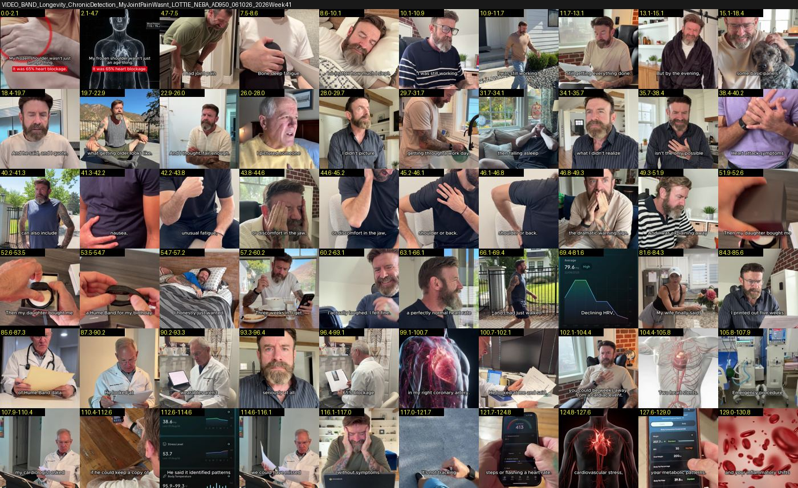

# VIDEO_BAND_Longevity_ChronicDetection_MyJointPainWasnt_LOTTIE_NEBA_AD950_061026_2026Week41

Master: `VIDEO_BAND_Longevity_ChronicDetection_MyJointPainWasnt_LOTTIE_NEBA_AD950_061026_2026Week41_hook1_1*1.mp4` · 162.8s · 1080x1080

**Pacing:** 73 shots · avg 2.231s · median 2.067s · 4.42 cuts/10s · first cut 2.067s · 193.0 wpm · talk ratio 0.91 · cuts on word start 63.9% · cuts in speech gaps 73.6%
**Audio:** {'I_lufs': -21.4, 'LRA': 4.0, 'true_peak_db': -0.0} · BPM≈117.5 · music {'speech_rms_db': -26.6, 'pause_seconds': 11.1, 'pause_rms_db': -27.8, 'bed_minus_voice_db': -1.2, 'music_bed_likely': True} · cuts with SFX/transient 47.2%

**Captions:** 248 cards · 2.0 words/card (median) · y≈0.775 of frame height · text height≈0.049 · colours {'white': 174, 'red': 7, 'dark/other': 62, 'other-colour': 1, 'yellow': 1, 'blue': 3} · cards crossing a cut: 15
Highlighted: Itwas65%heartblockage, Itwas65%heartblockage., Itwas65%heartblockage, Itwas65%heartblockage., HeartDisease Detected, of Hume Band data, and brought it to, Very High, 188, And itcan be present, withoutobvioussymptoms., don't brush it off.
**Headlines:** BloodPressu (2.0–4.0s, white) | 119/79 (2.0–2.0s, white) | 119/797 (2.5–2.5s, white) | 119/79m (3.0–3.0s, white) | 119/79r (3.5–3.5s, white) | 119/79 (4.0–4.0s, white) | Still getting everything done. (12.0–12.0s, white) | And he said, and I quote, (19.0–19.0s, white)

**Hook (0–3s) spoken:** My frozen shoulder wasn't just an age thing, it was 65
**Hook on-screen:** 119/79 / 119/797 / BloodPressu / Itwas65%heartblockage / Itwas65%heartblockage. / My frozen shoulder wasn't just / an age thing. / an agething
**CTA (last 5s):** no subscription. My daughter jokes she saved my life with this birthday gift. · on-screen: My daughter jokes / and there's no subscription / and there's no subscription. / she saved my life / with this birthday gift

## Beat sheet

| # | in–out (s) | dur | transition | spoken | on-screen text |
|---|---|---|---|---|---|
| 1 | 0.00–2.07 | 2.07 |  | My frozen shoulder wasn't just an age thing, | My frozen shoulder wasn't just / an age thing. / Itwas65%heartblockage [red] / Itwas65%heartblockage. [red] / Itwas65%heartblockage [red] / BloodPressu (HEADLINE) |
| 2 | 2.07–4.73 | 2.67 | cut +SFX hit | it was 65 % heart blockage. | My frozen shoulder wasn't just / BloodPressu (HEADLINE) / 119/79 (HEADLINE) / an agething / Itwas65%heartblockage. [red] / 119/797 (HEADLINE) |
| 3 | 4.73–7.50 | 2.77 | cut | For about six months, I had joint pain that would come and go, | For about six months, / I had joint pain / that would come and go. |
| 4 | 7.50–8.57 | 1.07 | cut | bone deep fatigue, | Bone deep fatigue, |
| 5 | 8.57–10.10 | 1.53 | cut | no matter how much I slept. | no matterhowmuchIslept. / I was still working |
| 6 | 10.10–10.90 | 0.8 | cut +SFX hit | I was still working, | I was still working |
| 7 | 10.90–11.70 | 0.8 | cut +SFX hit | still walking, | I was still working |
| 8 | 11.70–13.10 | 1.4 | cut +SFX hit | still getting everything done, | Still getting everything done. (HEADLINE) / But by the evening. |
| 9 | 13.10–15.10 | 2.0 | cut +SFX hit | but by the evening I had nothing left. | But by the evening. / My doctor ran |
| 10 | 15.10–18.37 | 3.27 | cut +SFX hit | My doctor ran some basic panels and everything came back fine. | My doctor ran / somebasic panels / and everything / came back fine |
| 11 | 18.37–19.70 | 1.33 | cut | And he said, and I quote, | came back fine / And he said, and I quote, (HEADLINE) |
| 12 | 19.70–22.90 | 3.2 | cut | you're 53. This is just what getting older looks like. | you're 53. This is just / what getting older looks like. |
| 13 | 22.90–25.97 | 3.07 | cut +SFX hit | And I thought, fair enough. Because if I pictured heart trouble, | And I thought, fair enough / Because if i |
| 14 | 25.97–28.00 | 2.03 | cut | I pictured someone clutching their chest. | Ipictured someone / clutching their chest. |
| 15 | 28.00–29.73 | 1.73 | cut | I didn't picture a guy my age getting | I didn't picture / a guy my age |
| 16 | 29.73–31.70 | 1.97 | cut +SFX hit | through a work day, doing usual chores, | getting through a work day, / doing usual chores, |
| 17 | 31.70–34.10 | 2.4 | cut +SFX hit | then falling asleep on the sofa. | doing usual chores, / then falling asleep / on the sofa. |
| 18 | 34.10–35.67 | 1.57 | cut | What I didn't realize is that chest | on the sofa. / whatI didn't realize |
| 19 | 35.67–38.40 | 2.73 | cut +SFX hit | pain isn't the only possible warning sign. | is that chest pain / isn't the only possible / warning sign. |
| 20 | 38.40–40.23 | 1.83 | cut | Heart attack symptoms can also include | warning sign. / Heart attacksymptoms / can also include |
| 21 | 40.23–41.30 | 1.07 | cut | breathlessness, | can also include / breathlessness |
| 22 | 41.30–42.23 | 0.93 | cut | nausea, | breathlessness / nausea, |
| 23 | 42.23–43.77 | 1.53 | cut | unusual fatigue, | nausea, / unusual fatigue, |
| 24 | 43.77–44.60 | 0.83 | cut +SFX hit | or discomfort in | or discomfort in thejaw, |
| 25 | 44.60–45.23 | 0.63 | cut | the jaw, | or discomfort in thejaw, |
| 26 | 45.23–46.07 | 0.83 | cut | shoulder, | or discomfort in thejaw, / shoulder or back. |
| 27 | 46.07–46.83 | 0.77 | cut | or back. | shoulder or back. |
| 28 | 46.83–49.33 | 2.5 | cut | I was looking for the dramatic warning sign, | I was looking for / the dramatic warning sign / the dramatic warning sign. |
| 29 | 49.33–51.87 | 2.53 | cut +SFX hit | and I was explaining away everything else. | the dramatic warning sign. / Andiwasexplainingaway |
| 30 | 51.87–52.57 | 0.7 | cut | Then my daughter bought | Then my daughter bought me [red] (HEADLINE) |
| 31 | 52.57–53.53 | 0.97 | cut +SFX hit | me a human band | Then my daughter bought me |
| 32 | 53.53–54.70 | 1.17 | cut | for my birthday. | a Hume Band for my birthday. [red] (HEADLINE) |
| 33 | 54.70–57.17 | 2.47 | cut | I honestly just wanted to track my sleep. Three | Ihonestly just wanted / to track my sleep |
| 34 | 57.17–60.17 | 3.0 | cut | weeks in, I get this alert from the AI app. | to track my sleep / Three weeks in,Iget / this alert from the Al app. / this alert from the Al app |
| 35 | 60.17–63.07 | 2.9 | cut | I actually laughed, I felt fine. | this alert from the Al app / Iactually laughed.Ifelt fine. |
| 36 | 63.07–66.07 | 3.0 | cut | My smartwatch showed a perfectly normal heart rate and I | Iactually laughed.Ifelt fine. / My smartwatchshowed / a perfectly normal heart rate / and I had just walked |
| 37 | 66.07–69.43 | 3.37 | cut +SFX hit | had just walked 8 ,000 steps. So I ignored it, | and I had just walked / 8,000 steps. / So I ignored it. |
| 38 | 69.43–81.63 | 12.2 | cut | but the band didn't. Every single day for the next five days, it kept flagging the same thing. Declining HRV, metabolic momentum dropping, cardiovascular stress indicators spiking. | So I ignored it. / TimeAsleep (HEADLINE) / 6h44m (HEADLINE) / Standard [green] (HEADLINE) / 22/08/2025 (HEADLINE) / Awake |
| 39 | 81.63–84.33 | 2.7 | cut +SFX hit | My wife finally said, just go get it checked. I | My wife finally said, / just go get it checked. |
| 40 | 84.33–85.57 | 1.23 | cut | printed out five weeks | just go get it checked. / Iprinted out fiveweeks |
| 41 | 85.57–87.33 | 1.77 | cut +SFX hit | of HumeBand data and brought it to | Biane S / of Hume Band data [other-colour] / BianSe / and brought it to [yellow] |
| 42 | 87.33–90.23 | 2.9 | cut +SFX hit | my cardiologist. He looked at my printouts and said, | BianSe / and brought it to [yellow] / Blane Schming.M.D. / my cardiologist. / Biane Schng,M.D. / He looked at |
| 43 | 90.23–93.27 | 3.03 | cut | you know, wearables aren't medical devices. | Blane SchilinaLD. / my printouts and said, / Blane ScilingLD. / wearables aren't / BlaneSchllingLD, / Blane SctllingLD. |
| 44 | 93.27–96.40 | 3.13 | cut +SFX hit | He didn't take it seriously at all until the CT scan | Blane SctllingLD. / medical devices." (HEADLINE) / He didn't take it / seriously at all / until the CTscan came back |
| 45 | 96.40–99.13 | 2.73 | cut | came back. 65 % blockage in my | until the CTscan came back / 65%blockage / in my right coronary artery (HEADLINE) / in my right coronary artery. |
| 46 | 99.13–100.67 | 1.53 | cut +SFX hit | right coronary artery. | in my right coronary artery. |
| 47 | 100.67–102.10 | 1.43 | cut +SFX hit | He looked at me and said, | odforthesoul / He looked at me and said, / you could be weeks away (HEADLINE) / fromacardiac event |
| 48 | 102.10–104.40 | 2.3 | cut +SFX hit | you could be weeks away from a cardiac event. | you could be weeks away (HEADLINE) / fromacardiac event / you could be weeks away / from a cardiac event. / you could be weeks away (HEADLINE) |
| 49 | 104.40–105.77 | 1.37 | cut +SFX hit | Two heart stents, | from a cardiac event. / you could be weeks away (HEADLINE) / Two heart stents. |
| 50 | 105.77–107.93 | 2.17 | cut +SFX hit | emergency procedure three days later. | Emergencyprocedure / three days later. |
| 51 | 107.93–110.43 | 2.5 | cut | Afterward, my cardiologist asked | three days later. / my cardiologist asked (HEADLINE) |
| 52 | 110.43–112.63 | 2.2 | cut +SFX hit | if he could keep a copy of my HumeBand data. | my cardiologist asked (HEADLINE) / if he could keep a copy of / my Hume Band data |
| 53 | 112.63–114.63 | 2.0 | cut +SFX hit | He said it identified patterns | Average (HEADLINE) / 53.7 (HEADLINE) / Moderate (HEADLINE) / 07/Aug/26 (HEADLINE) / 80 (HEADLINE) / 60 |
| 54 | 114.63–116.13 | 1.5 | cut +SFX hit | we could have missed without | we could have missed / without symptoms / chromebook |
| 55 | 116.13–116.97 | 0.83 | cut +SFX hit | symptoms. | without symptoms / chromebook |
| 56 | 116.97–121.70 | 4.73 | cut +SFX hit | Here's the thing about Hume. It's not tracking what your usual smartwatch tracks. | Here's the thing about Hume. / It's not tracking (HEADLINE) / what your usual / smartwatch tracks. |
| 57 | 121.70–124.83 | 3.13 | cut | It's not counting steps or flashing a heart rate. | HealthScore (HEADLINE) / 413 (HEADLINE) / Capacity / 37 / 100 / Baseline |
| 58 | 124.83–127.57 | 2.73 | cut | It's watching your cardiovascular stress, your | It's watching your / cardiovascular stress, / cardiovascularstress |
| 59 | 127.57–129.03 | 1.47 | cut +SFX hit | metabolic patterns, and | 05/10 [blue] (HEADLINE) / 06. (HEADLINE) / 04/10 [blue] (HEADLINE) / 03/10 [blue] (HEADLINE) / Wantdeeperinsights intoyourprogress? [blue] (HEADLINE) / GenorateProgressReport→ [blue] (HEADLINE) |
| 60 | 129.03–130.77 | 1.73 | cut | your inflammatory shifts weeks | and yourinflammatory shifts |
| 61 | 130.77–132.90 | 2.13 | cut | before you feel anything. | 100 [blue] (HEADLINE) / 19.3 / 95.7-97.2+ / weeks before you feel anything (HEADLINE) / 188 [blue] |
| 62 | 132.90–136.77 | 3.87 | cut | My joint pain was a symptom. I was ready to dismiss it, | My joint pain was a symptom. / I was ready to dismiss it. |
| 63 | 136.77–138.37 | 1.6 | cut +SFX hit | but the band didn't. Heart | But the band didn't. |
| 64 | 138.37–141.13 | 2.77 | cut | disease is the number one cause of death | But the band didn't. / Heart disease / is the number one / Heart diseaseremains (HEADLINE) / leading cause of death as key / healthriskfactorscontinue |
| 65 | 141.13–142.63 | 1.5 | cut +SFX hit | for men in the US, | Heart diseaseremains (HEADLINE) / leading cause of death as key / healthriskfactorscontinue / torise / Fueled by ongoing increases in high blood pressure, obesity / andothermajorriskfactors,heartdiseasecontinuestokill |
| 66 | 142.63–144.93 | 2.3 | cut | and it can be present without obvious symptoms. | Heart diseaseremains (HEADLINE) / leading cause of death as key / healthriskfactorscontinue / torise / Fueled by ongoing increases in high blood pressure, obesity / morepeopleintheU.S.thananyothercause,accordingto |
| 67 | 144.93–145.73 | 0.8 | cut +SFX hit |  | withoutobvioussymptoms. [blue] |
| 68 | 145.73–148.63 | 2.9 | cut +SFX hit | I kept saying, I'm just getting older, | I kept saying, / "I'm just getting older." (HEADLINE) |
| 69 | 148.63–150.93 | 2.3 | cut | but that wasn't a diagnosis. | But that wasn't a diagnosis. |
| 70 | 150.93–152.13 | 1.2 | cut | It was an assumption. | It was an assumption. / If something feels different, |
| 71 | 152.13–155.27 | 3.13 | cut | If something feels different, don't brush it off. | If something feels different, / don't brush it off. [red] / don't brush it off |
| 72 | 155.27–158.83 | 3.57 | cut +SFX hit | The Hume Band might still be on sale, and there's no subscription. | don't brush it off / HumeBand2.0 / 24/7Heath Tracking / Live Longer / might still be on sale. / Live Longer, Botter. |
| 73 | 158.83–162.84 | 4.01 | cut | My daughter jokes she saved my life with this birthday gift. | and there's no subscription / My daughter jokes / she saved my life / with this birthday gift |

## Hook variants

| hook | file | dur | first cut | spoken 0–3s | on-screen 0–3s |
|---|---|---|---|---|---|
| 1 | `PainWasnt_LOTTIE_NEBA_AD950_061026_2026Week41_hook1_9*16.mp4` | 162.8 | 2.067 |  |  |
| 1 | `tPainWasnt_LOTTIE_NEBA_AD950_061026_2026Week41_hook1_1*1.mp4` | 162.8 | 2.067 | My frozen shoulder wasn't just an age thing, it was 65 | 119/79 / 119/797 / BloodPressu / Itwas65%heartblockage / Itwas65%heartblockage. / My frozen shoulder wasn't just / an age thing. / an agething |
| 1 | `tPainWasnt_LOTTIE_NEBA_AD950_061026_2026Week41_hook1_4*5.mp4` | 162.8 | 2.067 |  |  |
| 2 | `PainWasnt_LOTTIE_NEBA_AD950_061026_2026Week41_hook2_9*16.mp4` | 162.4 | 1.833 |  |  |
| 2 | `tPainWasnt_LOTTIE_NEBA_AD950_061026_2026Week41_hook2_1*1.mp4` | 162.4 | 1.833 |  |  |
| 2 | `tPainWasnt_LOTTIE_NEBA_AD950_061026_2026Week41_hook2_4*5.mp4` | 162.4 | 1.833 |  |  |
| 3 | `ointPainWasnt_LOTTIE_NEBA_AD950_061026_2026Week41_hook3_.mp4` | 163.0 | 2.667 |  |  |
| 3 | `tPainWasnt_LOTTIE_NEBA_AD950_061026_2026Week41_hook3_1*1.mp4` | 163.0 | 2.667 |  |  |
| 3 | `tPainWasnt_LOTTIE_NEBA_AD950_061026_2026Week41_hook3_4*5.mp4` | 163.0 | 2.667 |  |  |

## Full transcript

My frozen shoulder wasn't just an age thing, it was 65% heart blockage. For about six months, I had joint pain that would come and go, bone deep fatigue, no matter how much I slept. I was still working, still walking, still getting everything done, but by the evening I had nothing left. My doctor ran some basic panels and everything came back fine. And he said, and I quote, you're 53. This is just what getting older looks like. And I thought, fair enough. Because if I pictured heart trouble, I pictured someone clutching their chest. I didn't picture a guy my age getting through a work day, doing usual chores, then falling asleep on the sofa. What I didn't realize is that chest pain isn't the only possible warning sign. Heart attack symptoms can also include breathlessness, nausea, unusual fatigue, or discomfort in the jaw, shoulder, or back. I was looking for the dramatic warning sign, and I was explaining away everything else. Then my daughter bought me a human band for my birthday. I honestly just wanted to track my sleep. Three weeks in, I get this alert from the AI app. I actually laughed, I felt fine. My smartwatch showed a perfectly normal heart rate and I had just walked 8,000 steps. So I ignored it, but the band didn't. Every single day for the next five days, it kept flagging the same thing. Declining HRV, metabolic momentum dropping, cardiovascular stress indicators spiking. My wife finally said, just go get it checked. I printed out five weeks of HumeBand data and brought it to my cardiologist. He looked at my printouts and said, you know, wearables aren't medical devices. He didn't take it seriously at all until the CT scan came back. 65% blockage in my right coronary artery. He looked at me and said, you could be weeks away from a cardiac event. Two heart stents, emergency procedure three days later. Afterward, my cardiologist asked if he could keep a copy of my HumeBand data. He said it identified patterns we could have missed without symptoms. Here's the thing about Hume. It's not tracking what your usual smartwatch tracks. It's not counting steps or flashing a heart rate. It's watching your cardiovascular stress, your metabolic patterns, and your inflammatory shifts weeks before you feel anything. My joint pain was a symptom. I was ready to dismiss it, but the band didn't. Heart disease is the number one cause of death for men in the US, and it can be present without obvious symptoms. I kept saying, I'm just getting older, but that wasn't a diagnosis. It was an assumption. If something feels different, don't brush it off. The Hume Band might still be on sale, and there's no subscription. My daughter jokes she saved my life with this birthday gift.