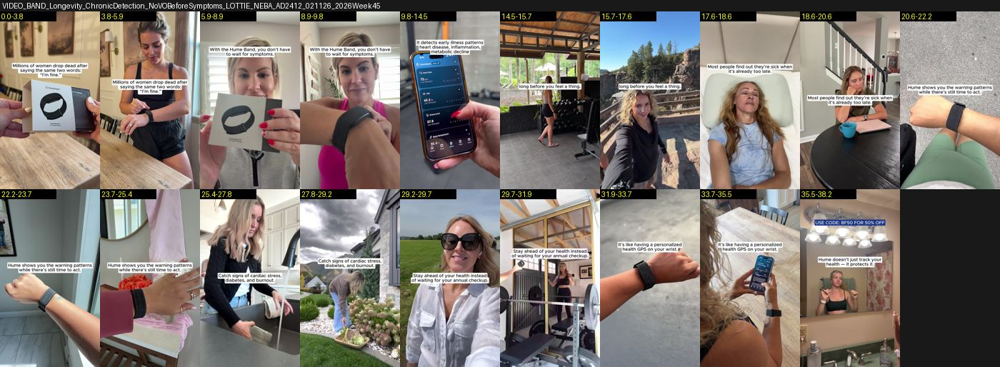

# VIDEO_BAND_Longevity_ChronicDetection_NoVOBeforeSymptoms_LOTTIE_NEBA_AD2412_021126_2026Week45

Master: `VIDEO_BAND_Longevity_ChronicDetection_NoVOBeforeSymptoms_LOTTIE_NEBA_AD2412_021126_2026Week45_Hook1_9x16.mp4` · 38.2s · 1080x1920

**Pacing:** 19 shots · avg 2.013s · median 1.866s · 4.71 cuts/10s · first cut 3.833s · None wpm · talk ratio 0.0 · cuts on word start 0.0% · cuts in speech gaps 100.0%
**Audio:** {'I_lufs': -14.1, 'LRA': 1.6, 'true_peak_db': -3.4} · BPM≈123.0 · music None · cuts with SFX/transient 83.3%

**Captions:** 68 cards · 1.0 words/card (median) · y≈0.508 of frame height · text height≈0.0258 · colours {'white': 61, 'dark/other': 7} · cards crossing a cut: 8
**Headlines:** Millions ofwomendrop deadafter (0.0–3.5s, white) | sayingthe same two words: (0.0–3.5s, white) | WiththeHumeBand,youdon'thave (6.0–9.0s, white) | towaitforsymptoms. (6.0–9.0s, white) | Itdetectsearlyillnesspatterns (10.0–14.0s, white) | heart disease,inflammation, (10.0–14.0s, white) | metabolicdecline (10.0–14.0s, white) | 3:44 (10.0–10.0s, blue)

**Hook (0–3s) spoken:** 
**Hook on-screen:** "I'm fine." / "I'm fine.” / 247 HeatnTacking / 247HeatnTaciong / Hume Band2.0 / HumeBand 2.0 / LveLonges.Boter. / Millions ofwomendrop deadafter / XHumeHeaith" / XHumeHealth / XHurmeHealth / sayingthe same two words:
**CTA (last 5s):**  · on-screen: Hume doesn'tjusttrack your / It's likehavingapersonalized / USECODE:BF5OFOR5O%OFF / health-itprotectsit. / healthGPSonyourwrist.

## Beat sheet

| # | in–out (s) | dur | transition | spoken | on-screen text |
|---|---|---|---|---|---|
| 1 | 0.00–3.83 | 3.83 |  |  | Millions ofwomendrop deadafter (HEADLINE) / sayingthe same two words: (HEADLINE) / "I'm fine." / XHumeHealth / Hume Band2.0 / "I'm fine.” |
| 2 | 3.83–5.93 | 2.1 | cut +SFX hit |  | Millions ofwomendrop deadafter (HEADLINE) / sayingthe same two words: (HEADLINE) / "I'mfine." / Millions of womendropdeadafter / sayingthe sametwo words: |
| 3 | 5.93–8.87 | 2.93 | cut +SFX hit |  | "I'mfine." / Millions of womendropdeadafter / sayingthe sametwo words: / WiththeHumeBand,youdon'thave (HEADLINE) / towaitforsymptoms. (HEADLINE) / XHumeHealth |
| 4 | 8.87–9.83 | 0.97 | cut +SFX hit |  | WiththeHumeBand,youdon'thave (HEADLINE) / towaitforsymptoms. (HEADLINE) |
| 5 | 9.83–14.53 | 4.7 | cut +SFX hit |  | Itdetectsearlyillnesspatterns (HEADLINE) / heart disease,inflammation, (HEADLINE) / metabolicdecline (HEADLINE) / 3:44 [blue] (HEADLINE) / HumeBand [blue] (HEADLINE) / 心Sleep |
| 6 | 14.53–15.70 | 1.17 | cut +SFX hit |  | long before you feel a thing. |
| 7 | 15.70–17.60 | 1.9 | cut |  | long before you feel a thing. |
| 8 | 17.60–18.63 | 1.03 | cut +SFX hit |  | Most peoplefindoutthey'resickwhen (HEADLINE) / it'salreadytoolate. (HEADLINE) |
| 9 | 18.63–20.63 | 2.0 | cut +SFX hit |  | Mostpeoplefind outthey'resickwhen / it'salreadytoolate. |
| 10 | 20.63–22.20 | 1.57 | cut +SFX hit |  | Humeshowsyouthewarningpatterns / whilethere'sstilltimeto act. |
| 11 | 22.20–23.67 | 1.47 | cut +SFX hit |  | Humeshowsyouthewarningpatterns / whilethere'sstilltimeto act. |
| 12 | 23.67–25.43 | 1.77 | cut +SFX hit |  | Humeshowsyouthewarningpatterns / whilethere'sstilltimeto act. |
| 13 | 25.43–27.80 | 2.37 | cut +SFX hit |  | Humeshowsyouthewarningpatterns / whilethere'sstilltimeto act. / Catchsignsof cardiacstress, / diabetes,andburnout. |
| 14 | 27.80–29.20 | 1.4 | cut +SFX hit |  | Catchsignsof cardiacstress, / diabetes,andburnout. / Stay ahead of your health instead / of waitingforyour annual checkup. |
| 15 | 29.20–29.70 | 0.5 | cut +SFX hit |  | Stay ahead of your health instead / of waitingforyour annual checkup. |
| 16 | 29.70–31.87 | 2.17 | cut |  | Stay ahead of your health instead / of waitingforyour annual checkup. |
| 17 | 31.87–33.73 | 1.87 | cut |  | It's likehavingapersonalized (HEADLINE) / healthGPSonyourwrist. (HEADLINE) |
| 18 | 33.73–35.47 | 1.73 | cut +SFX hit |  | It's likehavingapersonalized (HEADLINE) / healthGPSonyourwrist. (HEADLINE) |
| 19 | 35.47–38.24 | 2.78 | cut +SFX hit |  | It's likehavingapersonalized (HEADLINE) / healthGPSonyourwrist. (HEADLINE) / USECODE:BF5OFOR5O%OFF [blue] (HEADLINE) / Hume doesn'tjusttrack your / health-itprotectsit. |

## Full transcript

