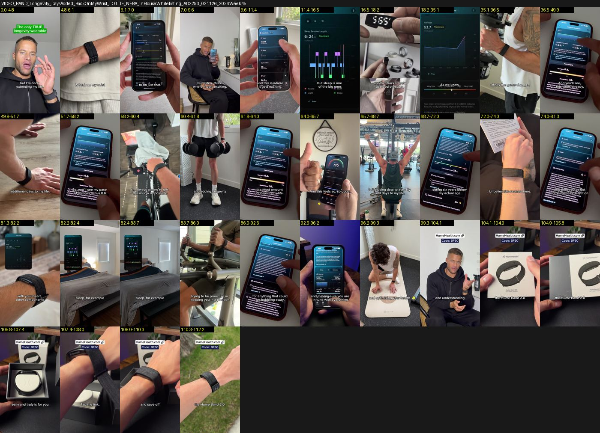

# VIDEO_BAND_Longevity_DaysAdded_BackOnMyWrist_LOTTIE_NEBA_InHouseWhitelisting_AD2293_021126_2026Week45

Master: `VIDEO_BAND_Longevity_DaysAdded_BackOnMyWrist_LOTTIE_NEBA_InHouseWhitelisting_AD2293_021126_2026Week45_9x16_HOOK1.mp4` · 112.2s · 1080x1920

**Pacing:** 34 shots · avg 3.299s · median 2.067s · 2.94 cuts/10s · first cut 4.833s · 238.0 wpm · talk ratio 0.96 · cuts on word start 57.6% · cuts in speech gaps 36.4%
**Audio:** {'I_lufs': -19.0, 'LRA': 7.3, 'true_peak_db': -0.5} · BPM≈112.3 · music {'speech_rms_db': -26.2, 'pause_seconds': 0.6, 'pause_rms_db': -26.4, 'bed_minus_voice_db': -0.2, 'music_bed_likely': True} · cuts with SFX/transient 57.6%

**Captions:** 534 cards · 1.0 words/card (median) · y≈0.667 of frame height · text height≈0.0304 · colours {'white': 402, 'dark/other': 125, 'red': 3, 'other-colour': 2, 'yellow': 2} · cards crossing a cut: 2
Highlighted: where it gets exciting, at every single day., This is about adding, clength to my life., I'm always aiming to get, Unbelievable scenesthere., It feels good.
**Headlines:** TheonlyTRUE (0.0–2.0s, green) | longevitywearable (0.0–2.0s, green) | 9steps (10.0–13.0s, white) | 12,218 (10.0–11.0s, white) | 1:368 (11.0–11.0s, blue) | HumeBand（65%) (12.0–13.0s, dark/other) | Connected (12.0–13.0s, green) | 1,946 (12.0–13.0s, white)

**Hook (0–3s) spoken:** Choose the excitement, but I'm back extending my life. And that is why the Hume
**Hook on-screen:** And that is why / Excuse theexcitement, / TheonlyTRUE / butI'm-back / butI'mback / extending my life. / longevitywearable
**CTA (last 5s):** the link enter the code and save off the human band 2 .0 · on-screen: Code:BF50 / HumeHealth.com / and save off / enter the code, / the Hume Band 2.0

## Beat sheet

| # | in–out (s) | dur | transition | spoken | on-screen text |
|---|---|---|---|---|---|
| 1 | 0.00–4.83 | 4.83 |  | Choose the excitement, but I'm back extending my life. And that is why the Hume Band 2 .0 is | TheonlyTRUE [green] (HEADLINE) / longevitywearable [green] (HEADLINE) / Excuse theexcitement, / butI'mback / extending my life. / butI'm-back |
| 2 | 4.83–6.10 | 1.27 | cut +SFX hit | back on my wrist to | the Hume Band 2.0 / is back on my wrist / OStrain / YourMetabolicCapacity34lsyourdalylimitfor / maxdimizingbeneficialstrain (exercise)wh / minimizingnegative strain(stress).Goingo. |
| 3 | 6.10–6.97 | 0.87 | cut +SFX hit | do just that. | OStrain / YourMetabolicCapacity34lsyourdalylimitfor / maxdimizingbeneficialstrain (exercise)wh / minimizingnegative strain(stress).Goingo. / backfires-youllactuallymakelessprogressovei / Thismightfeelabstractatfirst,butyou'llearntoplan |
| 4 | 6.97–9.63 | 2.67 | cut | But listen, this is where it gets exciting. Come and have a look at this data. | But listen, this is / where it gets exciting [red] / Come and have / a look at this data. |
| 5 | 9.63–11.43 | 1.8 | cut +SFX hit | So we're in the app and this is where it gets exciting. | 9steps (HEADLINE) / 12,218 (HEADLINE) / 65bpm / 86.0ms / So,we're in'thetapp. / 1:368 [blue] (HEADLINE) |
| 6 | 11.43–16.47 | 5.03 | cut | Of course you've got my activity, my steps, which you'd expect, but sleep is one of the big ones that I look at. Blood pressure, I've never seen another | 9steps (HEADLINE) / 12,218 (HEADLINE) / 65bpm / 86.0ms / 1:368 [blue] (HEADLINE) / and"thisisawhere |
| 7 | 16.47–18.23 | 1.77 | cut +SFX hit | tracker look at blood pressure in | Prev / BloodPressure (HEADLINE) / Date:27/Sep/26 (HEADLINE) / Systolic (HEADLINE) / Diastolic / 2PM |
| 8 | 18.23–35.07 | 16.83 | cut | a hugely important metric for so many of us. And then I've got my other elements here, HRV rate, heart rate, heart health. We're in a good place. Stress level, crucial to try and keep this down. As we know, stress has a big impact on the level. But what I love about this it's not just about raw data. It's how this is all drawn together so you can make sense of it This | BloodPressure (HEADLINE) / Date:27/Sep/26 (HEADLINE) / Very High (HEADLINE) / Systolic (HEADLINE) / Very High / Diastolic |
| 9 | 35.07–36.53 | 1.47 | cut +SFX hit | is the game change. This | This is the game changer. |
| 10 | 36.53–49.87 | 13.33 | cut +SFX hit | is the one I look at every single day This is about adding length to my life Metabolic momentum and you'll see this week already I've added a third of a day, but I've already added in recent times 17 .8 additional | 16:324 [blue] (HEADLINE) / HeaithScore [blue] (HEADLINE) / 813 [blue] (HEADLINE) / VeryHigh [blue] (HEADLINE) / LMetabolicMomentum (HEADLINE) / Capacity |
| 11 | 49.87–51.73 | 1.87 | cut +SFX hit | days to my life So | additional days to my life / additional days to my life. |
| 12 | 51.73–58.20 | 6.47 | cut +SFX hit | you'll see my pace of aging is minus naught point six if you like 0 .6 is below the normal pace of aging. | 16:32小 [blue] (HEADLINE) / MetabolicMomentum [blue] (HEADLINE) / LifeAdded Overall / X17.8d+ / You'reaging slower thannormall You'restayingactive / attherightlevelforyourbody.and it'spayingoff,Keep |
| 13 | 58.20–60.40 | 2.2 | cut | I'm always aiming to get this as low as possible and | I'm always aiming to get [red] / this as low aspossible |
| 14 | 60.40–61.83 | 1.43 | cut +SFX hit | adding longevity here, | I'm always aiming to get [red] / this as low aspossible / and adding longevity |
| 15 | 61.83–63.97 | 2.13 | cut | the most amount of days to my life. | 16:334 [blue] (HEADLINE) / MetabolicMomentum [blue] (HEADLINE) / LifeAdded ThisWeek (HEADLINE) / LifeAddedOverall / X17.8d+ / You'reaging slower thannormallYou'restaying active |
| 16 | 63.97–65.70 | 1.73 | cut | And this feels so, so good to | difficultroads (HEADLINE) / oftenleadto (HEADLINE) / destinations (HEADLINE) / Health Score / 770 / BodyComp |
| 17 | 65.70–68.67 | 2.97 | cut | be using data to actually add days to my life. | to be using data to actually / add days to my life. |
| 18 | 68.67–71.97 | 3.3 | cut +SFX hit | Now I've got my biological age sitting six years below my actual age, | 16:34小 [blue] (HEADLINE) / HealthReport [blue] (HEADLINE) / Health Score [blue] (HEADLINE) / Yourhealthscoreof813outof900reflectsstrong [blue] (HEADLINE) / overall physiologicalfunctionacrossthemeasured [blue] (HEADLINE) / Categories,Likea creditscore,gains atthislevel (HEADLINE) |
| 19 | 71.97–73.97 | 2.0 | cut +SFX hit | unbelievable things there. It feels good. | TSN:176-0-85711-N [red] (HEADLINE) / TINANEFIRABISE (HEADLINE) / 978085719822 (HEADLINE) / Unbelievable scenesthere. [red] / It feels good. [other-colour] |
| 20 | 73.97–81.27 | 7.3 | cut +SFX hit | Cardiovascular health, incredible here, super important. And then you've got chronic illness detection. So what this is doing is looking at trends with your heart, | 16:344 [blue] (HEADLINE) / Health Report [blue] (HEADLINE) / CCardiovascularHealth [blue] (HEADLINE) / Yourcardiovascularscoreof83standsasthestrongest (HEADLINE) / plllarin thisweek'shealthdata.Consistent SpO2at (HEADLINE) / 98%,ahealthyRHRrangeof63to71bpm,andzerolow (HEADLINE) |
| 21 | 81.27–82.20 | 0.93 | cut | other components, | 16:354 [blue] (HEADLINE) / HealthRopont [blue] (HEADLINE) / Yourcardiovascularscoreof83standsasthestronges [blue] (HEADLINE) / pillarinthisweek'shealthdata.Consis: (HEADLINE) / 98%,ahealthyRHRrangeof63to71b (HEADLINE) / Oxygenwarningsallpointtoawell-fun (HEADLINE) |
| 22 | 82.20–82.40 | 0.2 | cut +SFX hit | sleep | sleep, for example |
| 23 | 82.40–83.70 | 1.3 | cut | for example, I'm really trying | sleep, for example |
| 24 | 83.70–86.00 | 2.3 | cut +SFX hit | to be proactive in keeping you in a position | trying to be proactive in / keeping you in a position |
| 25 | 86.00–92.60 | 6.6 | cut | and giving you preventative Information for anything that could be bubbling away And this is where longevity is key and | 16:35小 [blue] (HEADLINE) / HealthReport [blue] (HEADLINE) / ViewAllDotails [blue] (HEADLINE) / oChronicllness (HEADLINE) / Yourmostnotablephysiologicalpatterncentersona (HEADLINE) / significantmismatchbetweenyoufactivitydemand (HEADLINE) |
| 26 | 92.60–96.23 | 3.63 | cut +SFX hit | getting in early and making sure you are in tune with everything that | 147.6ibs / 141.91bs / 154.3bs / 146.5bs / andgetting in early / 141.9ibs |
| 27 | 96.23–99.27 | 3.03 | cut | is going on in your life and Optimizing your health. So | that is going on in your life / GAIAM / WKALA (HEADLINE) / and optimising your health. |
| 28 | 99.27–104.13 | 4.87 | cut +SFX hit | if you're serious about your health adding longevity to your life and understanding what you need to do to live longer The | GAIAM / and optimising your health. / HumeHealth.com? (HEADLINE) / Code:BF50 (HEADLINE) / So, if you're serious / about your health, |
| 29 | 104.13–104.90 | 0.77 | cut | human band | Code:BF50 (HEADLINE) / HumeHealth.com (HEADLINE) / xHumeHealth / 24/7HealthTracking / the Hume Band2.0 |
| 30 | 104.90–105.83 | 0.93 | cut | 2 .0 really | Code:BF50 (HEADLINE) / HumeHealth.com (HEADLINE) / the Hume Band2.0 / HHumeleale |
| 31 | 105.83–107.43 | 1.6 | cut | truly is for you tap | Code:BF50 (HEADLINE) / HumeHealth.com (HEADLINE) / really and truly is for you. / HumeHealth.com ? (HEADLINE) / Tap the link, |
| 32 | 107.43–108.00 | 0.57 | cut +SFX hit | the link enter | Code:BF50 (HEADLINE) / HumeHealth.com ? (HEADLINE) / Tap the link, |
| 33 | 108.00–110.33 | 2.33 | cut +SFX hit | the code and save off the | Code:BF50 (HEADLINE) / HumeHealth.com (HEADLINE) / enter the code, / and save off |
| 34 | 110.33–112.15 | 1.82 | cut +SFX hit | human band 2 .0 | Code:BF50 (HEADLINE) / HumeHealth.com (HEADLINE) / and save off / the Hume Band 2.0 |

## Hook variants

| hook | file | dur | first cut | spoken 0–3s | on-screen 0–3s |
|---|---|---|---|---|---|
| 1 | `_InHouseWhitelisting_AD2293_021126_2026Week45_9x16_HOOK1.mp4` | 112.2 | 4.833 | Choose the excitement, but I'm back extending my life. And that is why the Hume | And that is why / Excuse theexcitement, / TheonlyTRUE / butI'm-back / butI'mback / extending my life. / longevitywearable |
| 1 | `_InHouseWhitelisting_AD2293_021126_2026Week45_9x16_HOOK1.mp4` | 112.2 | 4.833 |  |  |
| 2 | `_InHouseWhitelisting_AD2293_021126_2026Week45_9x16_HOOK2.mp4` | 116.9 | 4.3 |  |  |
| 2 | `_InHouseWhitelisting_AD2293_021126_2026Week45_9x16_HOOK2.mp4` | 116.9 | 4.3 |  |  |
| 3 | `_InHouseWhitelisting_AD2293_021126_2026Week45_9x16_HOOK3.mp4` | 118.9 | 9.133 |  |  |
| 3 | `_InHouseWhitelisting_AD2293_021126_2026Week45_9x16_HOOK3.mp4` | 118.9 | 9.133 |  |  |

## Full transcript

Choose the excitement, but I'm back extending my life. And that is why the Hume Band 2.0 is back on my wrist to do just that. But listen, this is where it gets exciting. Come and have a look at this data. So we're in the app and this is where it gets exciting. Of course you've got my activity, my steps, which you'd expect, but sleep is one of the big ones that I look at. Blood pressure, I've never seen another tracker look at blood pressure in a hugely important metric for so many of us. And then I've got my other elements here, HRV rate, heart rate, heart health. We're in a good place. Stress level, crucial to try and keep this down. As we know, stress has a big impact on the level. But what I love about this it's not just about raw data. It's how this is all drawn together so you can make sense of it This is the game change. This is the one I look at every single day This is about adding length to my life Metabolic momentum and you'll see this week already I've added a third of a day, but I've already added in recent times 17.8 additional days to my life So you'll see my pace of aging is minus naught point six if you like 0.6 is below the normal pace of aging. I'm always aiming to get this as low as possible and adding longevity here, the most amount of days to my life. And this feels so, so good to be using data to actually add days to my life. Now I've got my biological age sitting six years below my actual age, unbelievable things there. It feels good. Cardiovascular health, incredible here, super important. And then you've got chronic illness detection. So what this is doing is looking at trends with your heart, other components, sleep for example, I'm really trying to be proactive in keeping you in a position and giving you preventative Information for anything that could be bubbling away And this is where longevity is key and getting in early and making sure you are in tune with everything that is going on in your life and Optimizing your health. So if you're serious about your health adding longevity to your life and understanding what you need to do to live longer The human band 2.0 really truly is for you tap the link enter the code and save off the human band 2.0