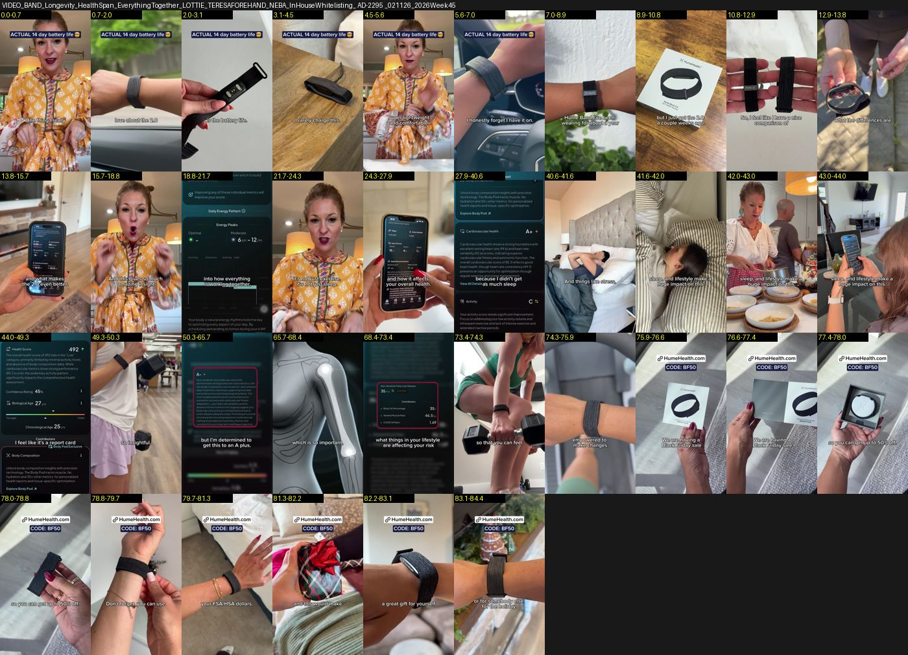

# VIDEO_BAND_Longevity_HealthSpan_EverythingTogether_LOTTIE_TERESAFOREHAND_NEBA_InHouseWhitelisting_ AD-2295 _021126_2026Week45

Master: `VIDEO_BAND_Longevity_HealthSpan_EverythingTogether_LOTTIE_TERESAFOREHAND_NEBA_InHouseWhitelisting_ AD-2295 _021126_2026Week45_9x16_HOOK1.mp4` · 84.4s · 1080x1920

**Pacing:** 36 shots · avg 2.344s · median 1.257s · 4.15 cuts/10s · first cut 0.7s · 266.0 wpm · talk ratio 0.96 · cuts on word start 82.9% · cuts in speech gaps 57.1%
**Audio:** {'I_lufs': -21.2, 'LRA': 5.5, 'true_peak_db': -2.5} · BPM≈129.2 · music {'speech_rms_db': -26.9, 'pause_seconds': 0.3} · cuts with SFX/transient 51.4%

**Captions:** 439 cards · 1 words/card (median) · y≈0.667 of frame height · text height≈0.0246 · colours {'red': 9, 'white': 287, 'other-colour': 2, 'dark/other': 138, 'blue': 2, 'green': 1} · cards crossing a cut: 3
Highlighted: Onething I really, I rarely charge this., andcomfortable., a couple weeks ago, the 2.0 even better., andwhat.makes, And this gives so much, amazing insight, it's not just weight,, it's not just exercise,, it's not just sleep., thesevariables together,, Very Good, your FSA/HSA dollars,
**Headlines:** ACTUAL14daybattery life (0.0–6.0s, white) | XHumeHealth (9.0–9.0s, yellow) | XHumeHealth" (10.0–10.0s, yellow) | 24/7Health Tracking (10.0–10.0s, white) | theclearstrengthofyourhealthdata.A (19.0–19.0s, dark/other) | cardiovascularscoreof9O,RHRinthehealthy (19.0–19.0s, dark/other) | 60s.SpO2consistentlyat97-98%.stableHRV (19.0–19.0s, dark/other) | andzerolowoxygenwarningscollectivelypainta (19.0–19.0s, dark/other)

**Hook (0–3s) spoken:** One thing I really love about the 2 .0 is battery life.
**Hook on-screen:** ACTUAL14daybattery life / Onething I really / is the battery life. / love about the 2.0
**CTA (last 5s):** use your FSA HSA dollars, and this will be a great gift for yourself or for somebody else for the holiday. · on-screen: ?HumeHealth.com / CODE:BF50 / HumeHealth.com / a great gift for yourself / for the holiday. / orfor somebody else / your FSA/HSA dollars,

## Beat sheet

| # | in–out (s) | dur | transition | spoken | on-screen text |
|---|---|---|---|---|---|
| 1 | 0.00–0.70 | 0.7 |  | One thing I really love | ACTUAL14daybattery life (HEADLINE) / Onething I really [red] / love about the 2.0 |
| 2 | 0.70–1.97 | 1.27 | cut | about the 2 .0 is | ACTUAL14daybattery life (HEADLINE) / love about the 2.0 |
| 3 | 1.97–3.13 | 1.17 | cut | battery life. So | ACTUAL14daybattery life (HEADLINE) / love about the 2.0 / is the battery life. / I rarely charge this. [other-colour] |
| 4 | 3.13–4.50 | 1.37 | cut +SFX hit | I rarely charge this. | ACTUAL14daybattery life (HEADLINE) / I rarely charge this. [other-colour] |
| 5 | 4.50–5.57 | 1.07 | cut +SFX hit | Super lightweight and comfortable. | ACTUAL14daybattery life (HEADLINE) / Super lightweight / andcomfortable / andcomfortable. [red] / I honestly forget I have it on. |
| 6 | 5.57–6.97 | 1.4 | cut +SFX hit | I honestly forget I have it on. | ACTUAL14daybattery life (HEADLINE) / I honestly forget I have it on. |
| 7 | 6.97–8.87 | 1.9 | cut +SFX hit | Team B and I've been wearing for about a year, | XHume / Hume Band I've been / wearing for about a year |
| 8 | 8.87–10.77 | 1.9 | cut | but I just got the 2 .0 a couple weeks ago. | XHumeHealth [yellow] (HEADLINE) / HumeBand2.0 / 24/7 Health Tracking / but I just got the 2.0 / a couple weeks ago [other-colour] / XHumeHealth" [yellow] (HEADLINE) |
| 9 | 10.77–12.87 | 2.1 | cut | So I feel like I have a nice comparison of what | So,I feel like I have a nice / comparison of / XHume |
| 10 | 12.87–13.77 | 0.9 | cut +SFX hit | the differences are and | XHumeHeath / what the differences are |
| 11 | 13.77–15.70 | 1.93 | cut | what makes the 2 .0 even better. | 5.195/8.00 / 184/80ical / CSieephicomemendation / 05:21M / feedback.andinsightsgenerasted / and what makes |
| 12 | 15.70–18.80 | 3.1 | cut | And this gives so much amazing insight into | And this gives so much [red] / amazing insight [red] |
| 13 | 18.80–21.70 | 2.9 | cut | how everything is working together, which I love because it's | theclearstrengthofyourhealthdata.A (HEADLINE) / cardiovascularscoreof9O,RHRinthehealthy (HEADLINE) / 60s.SpO2consistentlyat97-98%.stableHRV (HEADLINE) / andzerolowoxygenwarningscollectivelypainta (HEADLINE) / pictureofawell-conditionedcardiovascular (HEADLINE) / system.Thisstrongfoundationprovidesexcellent (HEADLINE) |
| 14 | 21.70–24.33 | 2.63 | cut +SFX hit | not just weight, it's not just exercise, it's not just sleep. | it's not just weight, [red] / it's not just exercise, [red] / it's not just sleep. [red] |
| 15 | 24.33–27.87 | 3.53 | cut | It's how all of those pieces come together and how it affects your overall health. | it's not just exercise, [red] / it's not just sleep. [red] / 8:13 (HEADLINE) / SleepOverview / .-h--m / Wedidn'tdetectsleepdatafromlastnight- |
| 16 | 27.87–40.57 | 12.7 | cut +SFX hit | So here's where we put all these variables together like metabolic capacity, which is really showing me what my body's ready to handle for the day. And I'm not shocked here because I didn't get as much sleep as normal last night. And then we look at metabolic momentum, which is super fascinating. This is going to show your pace of aging and | Capacity (HEADLINE) / BodyComp (HEADLINE) / 34 i (HEADLINE) / MetabolicCapacity (HEADLINE) / 100 / 38 |
| 17 | 40.57–41.57 | 1.0 | cut +SFX hit | things like stress, | And things like stress, |
| 18 | 41.57–42.03 | 0.47 | cut +SFX hit | sleep and lifestyle | sleep,and lifestyle make a / hugeimpact on this |
| 19 | 42.03–42.97 | 0.93 | cut | make a huge | sleep,and lifestyle make a / hugeimpact on this |
| 20 | 42.97–44.00 | 1.03 | cut | impact on this. | sleep,and lifestyle make a / huge impact on this. |
| 21 | 44.00–49.33 | 5.33 | cut +SFX hit | And then my favorite part, which is the weekly health report. I feel like it's a report card to kind of help you review how you're doing. | Oct27-Nov2 (HEADLINE) / HealthScore (HEADLINE) / 492 (HEADLINE) / Low / 492+ / HealthScore |
| 22 | 49.33–50.30 | 0.97 | cut +SFX hit | It is so insightful. So | BodyComposition / Unlockbodycompositioninsightswithprecision / technology.TheBodyPodtracksmuscle,fat, / hydrationand3O+othermetricsforpersonalized / Contributors / LaBodyPodExclusive |
| 23 | 50.30–65.67 | 15.37 | cut +SFX hit | it gives you biological age, but the area that I think is the most interesting is chronic illness. So I have an A minus, but I'm determined to get this to an A plus. And then it shows you the different chronic diseases and what are the risk factors for them. So things like sleep apnea, chronic kidney disease, | so insightful. / 0BiologicalAge27yrs / Older / Younger / So, it gives you biological age, / A+ + (HEADLINE) |
| 24 | 65.67–68.37 | 2.7 | cut +SFX hit | osteoporosis, which is so important, especially in women. | osteoporosis / which is so important, / especially in women. |
| 25 | 68.37–73.40 | 5.03 | cut +SFX hit | And it's helping you understand what things in your lifestyle are affecting your risk for different disease processes so | especially in women. / Non-AlcoholicFatty LiverDisease (HEADLINE) / 35/100车 / 35% / BodyFatPercentage / 46.5 lbs |
| 26 | 73.40–74.33 | 0.93 | cut +SFX hit | that you can feel empowered | 48% (HEADLINE) / SleepQuality (HEADLINE) / fordifferent / 75% (HEADLINE) / HeartRateConsistency (HEADLINE) / 24.0 ibs (HEADLINE) |
| 27 | 74.33–75.93 | 1.6 | cut | to make changes where you need to. | so that you can feel / empowered to / make changes |
| 28 | 75.93–76.63 | 0.7 | cut +SFX hit | You're having a Black Friday | ?HumeHealth.com (HEADLINE) / CODE:BF50 (HEADLINE) / XHumeHealth" / MIONGHTBLUE / We are having a / Black Friday sale |
| 29 | 76.63–77.40 | 0.77 | cut | fail so | ?HumeHealth.com (HEADLINE) / CODE:BF50 (HEADLINE) / We are having a / Black Friday sale / HumeHealth / MIDNIGHTBLUE |
| 30 | 77.40–78.00 | 0.6 | cut | you can get up to | ?HumeHealth.com (HEADLINE) / CODE:BF50 (HEADLINE) / We are having a / Black Friday sale / HumeHealth / MIDNIGHTBLUE |
| 31 | 78.00–78.80 | 0.8 | cut +SFX hit | 50 % off. | CODE:BF50 (HEADLINE) / HumeHealth.com (HEADLINE) / so you can get up to 50% off. |
| 32 | 78.80–79.70 | 0.9 | cut | Don't forget you can use | CODE:BF50 (HEADLINE) / HumeHealth.com (HEADLINE) / Don't forget, you can use |
| 33 | 79.70–81.33 | 1.63 | cut +SFX hit | your FSA HSA dollars, | CODE:BF50 (HEADLINE) / ?HumeHealth.com (HEADLINE) / your FSA/HSA dollars, [red] |
| 34 | 81.33–82.23 | 0.9 | cut | and this will be a great gift for | CODE:BF50 (HEADLINE) / ?HumeHealth.com (HEADLINE) / your FSA/HSA dollars, [red] / a great gift for yourself |
| 35 | 82.23–83.13 | 0.9 | cut | yourself or for | CODE:BF50 (HEADLINE) / ?HumeHealth.com (HEADLINE) / a great gift for yourself / HumeHealth.com (HEADLINE) / orfor somebody else / for the holiday. |
| 36 | 83.13–84.38 | 1.25 | cut | somebody else for the holiday. | CODE:BF50 (HEADLINE) / HumeHealth.com (HEADLINE) / orfor somebody else / for the holiday. |

## Hook variants

| hook | file | dur | first cut | spoken 0–3s | on-screen 0–3s |
|---|---|---|---|---|---|
| 1 | `HouseWhitelisting_ AD-2295 _021126_2026Week45_9x16_HOOK1.mp4` | 84.4 | 0.7 | One thing I really love about the 2 .0 is battery life. | ACTUAL14daybattery life / Onething I really / is the battery life. / love about the 2.0 |
| 1 | `HouseWhitelisting_ AD-2295 _021126_2026Week45_9x16_HOOK1.mp4` | 84.4 | 0.7 |  |  |
| 2 | `HouseWhitelisting_ AD-2295 _021126_2026Week45_9x16_HOOK2.mp4` | 86.2 | 1.767 |  |  |
| 2 | `HouseWhitelisting_ AD-2295 _021126_2026Week45_9x16_HOOK2.mp4` | 86.2 | 1.767 |  |  |
| 3 | `HouseWhitelisting_ AD-2295 _021126_2026Week45_9x16_HOOK3.mp4` | 83.4 | 1.633 |  |  |
| 3 | `HouseWhitelisting_ AD-2295 _021126_2026Week45_9x16_HOOK3.mp4` | 83.4 | 1.633 |  |  |

## Full transcript

One thing I really love about the 2.0 is battery life. So I rarely charge this. Super lightweight and comfortable. I honestly forget I have it on. Team B and I've been wearing for about a year, but I just got the 2.0 a couple weeks ago. So I feel like I have a nice comparison of what the differences are and what makes the 2.0 even better. And this gives so much amazing insight into how everything is working together, which I love because it's not just weight, it's not just exercise, it's not just sleep. It's how all of those pieces come together and how it affects your overall health. So here's where we put all these variables together like metabolic capacity, which is really showing me what my body's ready to handle for the day. And I'm not shocked here because I didn't get as much sleep as normal last night. And then we look at metabolic momentum, which is super fascinating. This is going to show your pace of aging and things like stress, sleep and lifestyle make a huge impact on this. And then my favorite part, which is the weekly health report. I feel like it's a report card to kind of help you review how you're doing. It is so insightful. So it gives you biological age, but the area that I think is the most interesting is chronic illness. So I have an A minus, but I'm determined to get this to an A plus. And then it shows you the different chronic diseases and what are the risk factors for them. So things like sleep apnea, chronic kidney disease, osteoporosis, which is so important, especially in women. And it's helping you understand what things in your lifestyle are affecting your risk for different disease processes so that you can feel empowered to make changes where you need to. You're having a Black Friday fail so you can get up to 50% off. Don't forget you can use your FSA HSA dollars, and this will be a great gift for yourself or for somebody else for the holiday.