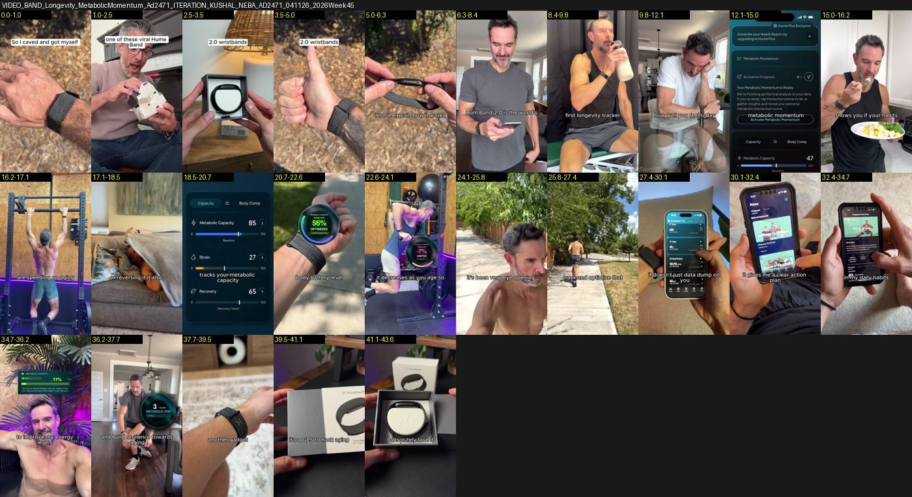

# VIDEO_BAND_Longevity_MetabolicMomentum_Ad2471_ITERATION_KUSHAL_NEBA_AD2471_041126_2026Week45

Master: `VIDEO_BAND_Longevity_MetabolicMomentum_Ad2471_ITERATION_KUSHAL_NEBA_AD2471_041126_2026Week45_Hook1_9x16.mp4` · 43.6s · 1080x1920

**Pacing:** 25 shots · avg 1.743s · median 1.534s · 5.51 cuts/10s · first cut 1.0s · 216.0 wpm · talk ratio 0.96 · cuts on word start 70.8% · cuts in speech gaps 33.3%
**Audio:** {'I_lufs': -18.8, 'LRA': 2.7, 'true_peak_db': -0.5} · BPM≈107.7 · music {'speech_rms_db': -22.6, 'pause_seconds': 0.2} · cuts with SFX/transient 70.8%

**Captions:** 92 cards · 1.0 words/card (median) · y≈0.615 of frame height · text height≈0.0293 · colours {'white': 79, 'dark/other': 4, 'blue': 4, 'green': 1, 'other-colour': 2, 'red': 2} · cards crossing a cut: 5
Highlighted: are speeding up aging, UnlimitedEn, -7%, plan, to improve my energy, METABOLICAGE, -7Years.vs.Chronological, this really isn't, another gadget
**Headlines:** So I caved and got myself (0.0–1.0s, white) | one of these viral Hume (1.5–2.5s, white) | Band (1.5–2.5s, white) | 2.0 wristbands (3.0–4.0s, white) | 7:49 (12.0–14.0s, blue) | HealthScore (12.0–12.0s, dark/other) | 479 (12.0–12.0s, white) | HumePlusExclusive (12.0–13.0s, dark/other)

**Hook (0–3s) spoken:** So I caved and got myself one of these viral HumeBand 2
**Hook on-screen:** Band / So I caved and got myself / one of these viral Hume
**CTA (last 5s):** gadget. It's a GPS to hack aging. I absolutely love it. 10 out of 10. · on-screen: 10/10 / HHUreear / HumoHeath / I absolutely love it / another gadget / it's a GPS to hack aging

## Beat sheet

| # | in–out (s) | dur | transition | spoken | on-screen text |
|---|---|---|---|---|---|
| 1 | 0.00–1.00 | 1.0 |  | So I caved and | So I caved and got myself (HEADLINE) |
| 2 | 1.00–2.50 | 1.5 | cut +SFX hit | got myself one of these viral HumeBand | So I caved and got myself (HEADLINE) / one of these viral Hume (HEADLINE) / Band (HEADLINE) |
| 3 | 2.50–3.53 | 1.03 | cut | 2 .0 | one of these viral Hume (HEADLINE) / Band (HEADLINE) / 2.0 wristbands (HEADLINE) |
| 4 | 3.53–5.03 | 1.5 | cut | wrist bands. Let me explain | 2.0 wristbands (HEADLINE) / let me explain how it works |
| 5 | 5.03–6.33 | 1.3 | cut +SFX hit | how it works. HumeBand | let me explain how it works / XHumeHelth / Hum Band 2.0 is the world's |
| 6 | 6.33–8.43 | 2.1 | cut +SFX hit | 2 .0 is the world's first longevity | Hum Band 2.0 is the world's / first longevity tracker |
| 7 | 8.43–9.77 | 1.33 | cut +SFX hit | tracker. Instead of | first longevity tracker |
| 8 | 9.77–12.07 | 2.3 | cut +SFX hit | just tracking how well you feel today, it measures | instead of just tracking / how well you feel today / 7:49 [blue] (HEADLINE) / HealthScore (HEADLINE) / 479 (HEADLINE) / HumePlusExclusive (HEADLINE) |
| 9 | 12.07–15.03 | 2.97 | cut | your metabolic momentum, which is a score that shows you if | 7:49 [blue] (HEADLINE) / HealthScore (HEADLINE) / 479 (HEADLINE) / HumePlusExclusive (HEADLINE) / Generateyour HealthReportby / upgradingtoHumePlus |
| 10 | 15.03–16.17 | 1.13 | cut | your habits are speeding up | shows you if your habits / are speeding up aging [blue] |
| 11 | 16.17–17.10 | 0.93 | cut +SFX hit | aging or reversing | are speeding up aging [blue] / or reversing it it also |
| 12 | 17.10–18.47 | 1.37 | cut +SFX hit | it. It also tracks | or reversing it it also |
| 13 | 18.47–20.70 | 2.23 | cut +SFX hit | your metabolic capacity, which is your internal | or reversing it it also / Capacity (HEADLINE) / Body Comp (HEADLINE) / 36 (HEADLINE) / MetabolicCapacity (HEADLINE) / 100 |
| 14 | 20.70–22.60 | 1.9 | cut +SFX hit | body battery level. It decreases | which is your internal / 22% [green] (HEADLINE) / UnlimitedEn [green] / 71% [green] (HEADLINE) / it decreases as you age so |
| 15 | 22.60–24.13 | 1.53 | cut +SFX hit | as you age, so it's been very | it decreases as you age so / -7% [other-colour] / it's been very eye opening |
| 16 | 24.13–25.83 | 1.7 | cut +SFX hit | eye -opening being able to now track | it's been very eye opening / being able to now |
| 17 | 25.83–27.37 | 1.53 | cut +SFX hit | and optimize that. | track and optimize that |
| 18 | 27.37–30.10 | 2.73 | cut +SFX hit | I love the app because it doesn't just data dump on you. It | track and optimize that / 625 / 42m / 121/72mmg / lovetheapp because / 53bpm |
| 19 | 30.10–32.40 | 2.3 | cut +SFX hit | gives me a clear action plan on what I need | 10:57 (HEADLINE) / Plans (HEADLINE) / New&Foaturod (HEADLINE) / WelcomeToFltTrack / withEvanLee / MOVEITTOLOSETT |
| 20 | 32.40–34.67 | 2.27 | cut | to change in my daily habits. To improve | 10:57 (HEADLINE) / Plans (HEADLINE) / withEvanLee / Classes (HEADLINE) / Programs (HEADLINE) / New&Featured (HEADLINE) |
| 21 | 34.67–36.20 | 1.53 | cut | my energy levels and build resilience | to improve my energy [blue] / levels / YEARS / and build resilience towards / aging |
| 22 | 36.20–37.73 | 1.53 | cut | towards aging, | YEARS / and build resilience towards / aging / METABOLICAGE [blue] / -7Years.vs.Chronological [blue] |
| 23 | 37.73–39.47 | 1.73 | cut +SFX hit | this really isn't another gadget. It's | this really isn't [other-colour] / another gadget [red] |
| 24 | 39.47–41.07 | 1.6 | cut +SFX hit | a GPS to hack aging. | another gadget [red] / HHUreear / it's a GPS to hack aging / I absolutely love it |
| 25 | 41.07–43.58 | 2.52 | cut +SFX hit | I absolutely love it. 10 out of 10. | I absolutely love it / HumoHeath / 10/10 |

## Hook variants

| hook | file | dur | first cut | spoken 0–3s | on-screen 0–3s |
|---|---|---|---|---|---|
| 1 | `TERATION_KUSHAL_NEBA_AD2471_041126_2026Week45_Hook1_9x16.mp4` | 43.6 | 1.0 | So I caved and got myself one of these viral HumeBand 2 | Band / So I caved and got myself / one of these viral Hume |
| 2 | `TERATION_KUSHAL_NEBA_AD2471_041126_2026Week45_Hook2_9x16.mp4` | 42.7 | 2.1 |  |  |
| 3 | `TERATION_KUSHAL_NEBA_AD2471_041126_2026Week45_Hook3_9x16.mp4` | 43.0 | 1.867 |  |  |

## Full transcript

So I caved and got myself one of these viral HumeBand 2.0 wrist bands. Let me explain how it works. HumeBand 2.0 is the world's first longevity tracker. Instead of just tracking how well you feel today, it measures your metabolic momentum, which is a score that shows you if your habits are speeding up aging or reversing it. It also tracks your metabolic capacity, which is your internal body battery level. It decreases as you age, so it's been very eye-opening being able to now track and optimize that. I love the app because it doesn't just data dump on you. It gives me a clear action plan on what I need to change in my daily habits. To improve my energy levels and build resilience towards aging, this really isn't another gadget. It's a GPS to hack aging. I absolutely love it. 10 out of 10.