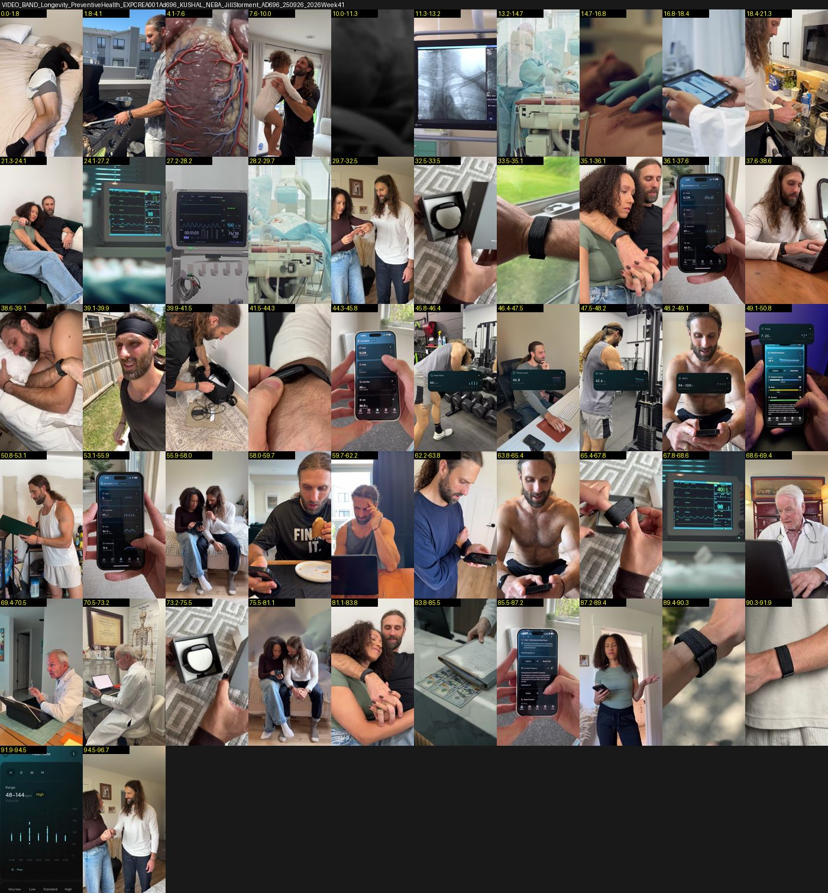

# VIDEO_BAND_Longevity_PreventiveHealth_EXPCREA001Ad696_KUSHAL_NEBA_JillStorment_AD696_250926_2026Week41

Master: `VIDEO_BAND_Longevity_PreventiveHealth_EXPCREA001Ad696_KUSHAL_NEBA_JillStorment_AD696_250926_2026Week41_9X16_HOOK1.mp4` · 96.7s · 1080x1920

**Pacing:** 52 shots · avg 1.86s · median 1.65s · 5.27 cuts/10s · first cut 1.767s · 252.0 wpm · talk ratio 0.94 · cuts on word start 90.2% · cuts in speech gaps 70.6%
**Audio:** {'I_lufs': -20.9, 'LRA': 3.7, 'true_peak_db': -0.2} · BPM≈123.0 · music {'speech_rms_db': -24.4, 'pause_seconds': 0.5, 'pause_rms_db': -25.6, 'bed_minus_voice_db': -1.2, 'music_bed_likely': True} · cuts with SFX/transient 76.5%

**Captions:** 46 cards · 1.0 words/card (median) · y≈0.591 of frame height · text height≈0.0217 · colours {'white': 25, 'blue': 3, 'dark/other': 18} · cards crossing a cut: 0
Highlighted: 98, 100, 98
**Headlines:** ONELJABBAR (12.0–12.0s, white) | 40 (26.0–26.0s, green) | mindray (27.0–27.0s, white) | Artis (29.0–29.0s, white) | HumeBand(00%) (36.0–36.0s, blue) | 09 steps (36.0–36.0s, white) | 12,218 (36.0–37.0s, white) | 9:38 (37.0–37.0s, blue)

**Hook (0–3s) spoken:** A year ago, my husband had a heart attack and the scariest part is that none
**Hook on-screen:** 
**CTA (last 5s):** and gives me a little more peace of mind than I had before. And after what we went through, that's priceless. · on-screen: 12PM / 150 / 17/0ct/26 / 1PM / 20 / 200 / 2PM / 3PM / 43.8 / 45.5ms / 48-144bpm / 4PM

## Beat sheet

| # | in–out (s) | dur | transition | spoken | on-screen text |
|---|---|---|---|---|---|
| 1 | 0.00–1.77 | 1.77 |  | A year ago, my husband had a heart attack and |  |
| 2 | 1.77–4.10 | 2.33 | cut +SFX hit | the scariest part is that none of us saw it coming. |  |
| 3 | 4.10–7.63 | 3.53 | cut | One of his arteries was almost 80 % blocked and he had no idea. |  |
| 4 | 7.63–9.97 | 2.33 | cut +SFX hit | We genuinely thought he was completely fine until |  |
| 5 | 9.97–11.27 | 1.3 | cut +SFX hit | one day he wasn't. |  |
| 6 | 11.27–13.17 | 1.9 | cut +SFX hit | Suddenly I was sitting in an emergency room watching | ONELJABBAR (HEADLINE) / FLNeuro（ |
| 7 | 13.17–14.67 | 1.5 | cut | doctors run around him not |  |
| 8 | 14.67–16.77 | 2.1 | cut | knowing whether my husband was going to be okay. |  |
| 9 | 16.77–18.43 | 1.67 | cut | It was the scariest day of my life. |  |
| 10 | 18.43–21.33 | 2.9 | cut +SFX hit | After he came home, I became almost obsessed with one thing. |  |
| 11 | 21.33–24.10 | 2.77 | cut +SFX hit | I never wanted us to be that blind about his health again. | 98 [blue] |
| 12 | 24.10–27.20 | 3.1 | cut +SFX hit | If I could have kept him connected to an ECG monitor 24 seven, | 98 [blue] / 40 [green] (HEADLINE) / mindray (HEADLINE) / 100 [blue] / 75 / 00:51:03 |
| 13 | 27.20–28.23 | 1.03 | cut +SFX hit | I probably would have. | mindray (HEADLINE) / 100 [blue] / 75 / 00:51:03 / 74/38 / (54) |
| 14 | 28.23–29.73 | 1.5 | cut +SFX hit | Obviously you can't live like that. So | Artis (HEADLINE) |
| 15 | 29.73–32.53 | 2.8 | cut +SFX hit | I started looking for something he could actually wear every day. |  |
| 16 | 32.53–33.47 | 0.93 | cut | That's when I found the |  |
| 17 | 33.47–35.10 | 1.63 | cut +SFX hit | Hume band 2 .0. |  |
| 18 | 35.10–36.10 | 1.0 | cut +SFX hit | He puts it on his wrist and | HumeBand(00%) [blue] (HEADLINE) / 09 steps (HEADLINE) / 12,218 (HEADLINE) / 65bpm / 86.0ms |
| 19 | 36.10–37.63 | 1.53 | cut +SFX hit | it quietly keeps tracking him while | HumeBand(00%) [blue] (HEADLINE) / 09 steps (HEADLINE) / 12,218 (HEADLINE) / 65bpm / 86.0ms / 9:38 [blue] (HEADLINE) |
| 20 | 37.63–38.63 | 1.0 | cut +SFX hit | he's working, |  |
| 21 | 38.63–39.13 | 0.5 | cut | sleeping, |  |
| 22 | 39.13–39.90 | 0.77 | cut | walking around, |  |
| 23 | 39.90–41.50 | 1.6 | cut +SFX hit | basically living his normal life. |  |
| 24 | 41.50–44.27 | 2.77 | cut +SFX hit | It takes millions of PPG sensor samples every day and |  |
| 25 | 44.27–45.77 | 1.5 | cut +SFX hit | continuously tracks things like | 1:368 [blue] (HEADLINE) / Hume Band [blue] (HEADLINE) / 99stops (HEADLINE) / 12,218 (HEADLINE) / 65bpm / Last:I/u/25 |
| 26 | 45.77–46.43 | 0.67 | cut +SFX hit | his heart rate, | 66bpm / Last:17/l0l/26 |
| 27 | 46.43–47.53 | 1.1 | cut +SFX hit | cardiovascular stress, | 66bpm / Last:17/l0l/26 / 46.8 |
| 28 | 47.53–48.20 | 0.67 | cut +SFX hit | HRV, | 94-100% |
| 29 | 48.20–49.10 | 0.9 | cut +SFX hit | SPO2, | 94-100% / Sleep (HEADLINE) / 7n23m (HEADLINE) |
| 30 | 49.10–50.77 | 1.67 | cut +SFX hit | sleep and other health signals. | Sleep (HEADLINE) / 7n23m (HEADLINE) / CSleep (HEADLINE) / 7h23m (HEADLINE) / MetabolicMomentum [blue] (HEADLINE) / Capaelty |
| 31 | 50.77–53.13 | 2.37 | cut +SFX hit | So instead of seeing one reading every once in a while, | 86.0ms (HEADLINE) / HRVmeasures thetinyvariations in time betweenyour |
| 32 | 53.13–55.93 | 2.8 | cut +SFX hit | we can actually see how his body is trending over time. | 86.0ms (HEADLINE) / HRVmeasures thetinyvariations in time betweenyour / 心Sleep (HEADLINE) / 65bpm / 86.0ms / 19.6 |
| 33 | 55.93–58.03 | 2.1 | cut +SFX hit | And this is probably the part that matters most to me. it | FIN (HEADLINE) |
| 34 | 58.03–59.67 | 1.63 | cut +SFX hit | learns his normal baseline. | FIN (HEADLINE) |
| 35 | 59.67–62.23 | 2.57 | cut +SFX hit | So when something starts moving away from what's normal for him, |  |
| 36 | 62.23–63.83 | 1.6 | cut +SFX hit | the app can flag those changes and |  |
| 37 | 63.83–65.43 | 1.6 | cut | help us pay attention earlier. |  |
| 38 | 65.43–67.80 | 2.37 | cut +SFX hit | And I'm never going to pretend a band can replace an |  |
| 39 | 67.80–68.63 | 0.83 | cut +SFX hit | ECG or | 98 [blue] |
| 40 | 68.63–69.40 | 0.77 | cut +SFX hit | a doctor. |  |
| 41 | 69.40–70.50 | 1.1 | cut +SFX hit | But between those appointments, |  |
| 42 | 70.50–73.23 | 2.73 | cut +SFX hit | I finally feel like we're not completely blind anymore. | THESKELETON (HEADLINE) / LifeSize (HEADLINE) / Live Longer, Better. |
| 43 | 73.23–75.50 | 2.27 | cut +SFX hit | People tell me this band is expensive. And maybe | Live Longer, Better. |
| 44 | 75.50–81.10 | 5.6 | cut | before everything happened, I would have thought the same thing. But if you've ever sat in an emergency room looking at someone you love, |  |
| 45 | 81.10–83.83 | 2.73 | cut | feeling helpless, you look at money very differently after that. |  |
| 46 | 83.83–85.47 | 1.63 | cut +SFX hit | I would have paid anything in that moment just |  |
| 47 | 85.47–87.20 | 1.73 | cut +SFX hit | to know something was wrong sooner. So | Duringyourfrst5daysmetricsmaypp (HEADLINE) |
| 48 | 87.20–89.43 | 2.23 | cut +SFX hit | for me, this isn't really a fitness tracker. |  |
| 49 | 89.43–90.33 | 0.9 | cut +SFX hit | It's something that stays on |  |
| 50 | 90.33–91.90 | 1.57 | cut | my husband's wrist every day and |  |
| 51 | 91.90–94.53 | 2.63 | cut | gives me a little more peace of mind than I had before. | HRV (HEADLINE) / Average (HEADLINE) / 45.5ms (HEADLINE) / Standard (HEADLINE) / 17/0ct/26 / 60 |
| 52 | 94.53–96.71 | 2.18 | cut +SFX hit | And after what we went through, that's priceless. |  |

## Hook variants

| hook | file | dur | first cut | spoken 0–3s | on-screen 0–3s |
|---|---|---|---|---|---|
| 1 | `HAL_NEBA_JillStorment_AD696_250926_2026Week41_9X16_HOOK1.mp4` | 96.7 | 1.767 | A year ago, my husband had a heart attack and the scariest part is that none |  |
| 1 | `HAL_NEBA_JillStorment_AD696_250926_2026Week41_9X16_HOOK1.mp4` | 96.7 | 1.767 | A year ago, my husband had a heart attack, and the scariest part is that none |  |
| 2 | `HAL_NEBA_JillStorment_AD696_250926_2026Week41_9X16_HOOK2.mp4` | 90.3 | 3.8 | My husband's artery was almost 80 % blocked, and none of us had |  |
| 2 | `HAL_NEBA_JillStorment_AD696_250926_2026Week41_9X16_HOOK2.mp4` | 90.3 | 2.367 | My husband's artery was almost 80 % blocked, and none of us had | Andnoneofushadanyidea / Myhusband'sarterywas / almost80%blocked / almost80%blocked, |
| 3 | `HAL_NEBA_JillStorment_AD696_250926_2026Week41_9X16_HOOK3.mp4` | 89.4 | 1.867 | A year ago, my husband had a heart attack, and our entire life changed |  |
| 3 | `HAL_NEBA_JillStorment_AD696_250926_2026Week41_9X16_HOOK3.mp4` | 89.4 | 1.867 | A year ago, my husband had a heart attack, and our entire life changed | A year ago, my husband / Andour entirelife / changed in one day / changed in one day. / hadaheartattack, |

## Full transcript

A year ago, my husband had a heart attack and the scariest part is that none of us saw it coming. One of his arteries was almost 80% blocked and he had no idea. We genuinely thought he was completely fine until one day he wasn't. Suddenly I was sitting in an emergency room watching doctors run around him not knowing whether my husband was going to be okay. It was the scariest day of my life. After he came home, I became almost obsessed with one thing. I never wanted us to be that blind about his health again. If I could have kept him connected to an ECG monitor 24 seven, I probably would have. Obviously you can't live like that. So I started looking for something he could actually wear every day. That's when I found the Hume band 2.0. He puts it on his wrist and it quietly keeps tracking him while he's working, sleeping, walking around, basically living his normal life. It takes millions of PPG sensor samples every day and continuously tracks things like his heart rate, cardiovascular stress, HRV, SPO2, sleep and other health signals. So instead of seeing one reading every once in a while, we can actually see how his body is trending over time. And this is probably the part that matters most to me. it learns his normal baseline. So when something starts moving away from what's normal for him, the app can flag those changes and help us pay attention earlier. And I'm never going to pretend a band can replace an ECG or a doctor. But between those appointments, I finally feel like we're not completely blind anymore. People tell me this band is expensive. And maybe before everything happened, I would have thought the same thing. But if you've ever sat in an emergency room looking at someone you love, feeling helpless, you look at money very differently after that. I would have paid anything in that moment just to know something was wrong sooner. So for me, this isn't really a fitness tracker. It's something that stays on my husband's wrist every day and gives me a little more peace of mind than I had before. And after what we went through, that's priceless.