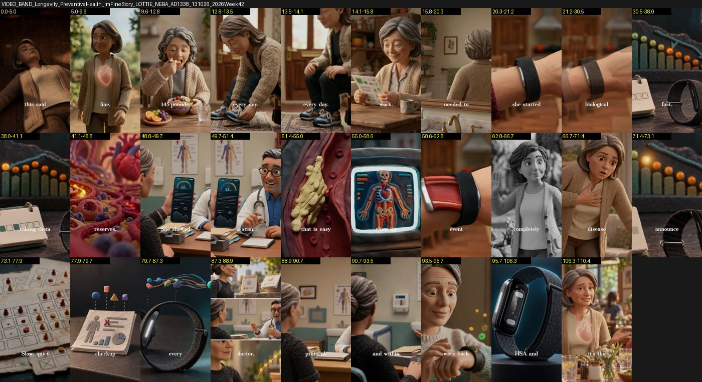

# VIDEO_BAND_Longevity_PreventiveHealth_ImFineStory_LOTTIE_NEBA_AD1338_131026_2026Week42

Master: `VIDEO_BAND_Longevity_PreventiveHealth_ImFineStory_LOTTIE_NEBA_AD1338_131026_2026Week42_9x16_Hook1.mp4` · 110.4s · 1080x1920

**Pacing:** 29 shots · avg 3.806s · median 3.587s · 2.54 cuts/10s · first cut 4.963s · 184.0 wpm · talk ratio 0.87 · cuts on word start 64.3% · cuts in speech gaps 85.7%
**Audio:** {'I_lufs': -19.7, 'LRA': 2.4, 'true_peak_db': -3.3} · BPM≈117.5 · music {'speech_rms_db': -24.2, 'pause_seconds': 4.9, 'pause_rms_db': -24.0, 'bed_minus_voice_db': 0.2, 'music_bed_likely': True} · cuts with SFX/transient 57.1%

**Captions:** 115 cards · 2 words/card (median) · y≈0.751 of frame height · text height≈0.0445 · colours {'white': 89, 'red': 17, 'other-colour': 7, 'dark/other': 2} · cards crossing a cut: 1
Highlighted: woman, this said, two words., I'm fine., 145pounds., 145 pounds, She ate, Last blood, made her, attention, curious, metabolic, capacity, That's, your cells

**Hook (0–3s) spoken:** Every woman who dropped dead like this said the same two
**Hook on-screen:** Every / the same / this said / who dropped / woman
**CTA (last 5s):** Feeling fine isn't proof. It's the warning. Link below. · on-screen: Feeling fine / isnt proof. / it's the / linkbelow / warning

## Beat sheet

| # | in–out (s) | dur | transition | spoken | on-screen text |
|---|---|---|---|---|---|
| 1 | 0.00–4.96 | 4.96 |  | Every woman who dropped dead like this said the same two words, I'm fine. | Every / woman [red] / who dropped / this said [red] / the same / two words. [other-colour] |
| 2 | 4.96–9.55 | 4.59 | cut +SFX hit | She was 51, and I'm fine was the answer she gave everyone. | I'm fine. [other-colour] / She was 51. / And Im / fine. / She gave / everyone |
| 3 | 9.55–12.76 | 3.21 | cut +SFX hit | 145 pounds. She ate well, | 145pounds. [red] / 145 pounds [other-colour] / She ate [red] |
| 4 | 12.76–13.51 | 0.75 | cut | walked every | every day |
| 5 | 13.51–14.10 | 0.58 | cut +SFX hit | day, | Last blood [red] |
| 6 | 14.10–15.85 | 1.75 | cut +SFX hit | last blood work normal. | Last blood [red] / Normal. |
| 7 | 15.85–20.27 | 4.42 | cut | Nothing about her routine made her think she needed to pay more attention to her heart. | Nothing about her / made her [red] / needed to / attention [red] / heart. |
| 8 | 20.27–21.23 | 0.96 | cut +SFX hit | Then she started | heart. / wearing |
| 9 | 21.23–30.53 | 9.3 | cut | wearing a hume band, not because she felt ill. She was curious about her biological age estimate and wanted to follow her everyday health trends. | wearing / a hume band. / Not because / curious [red] / biological / 332 |
| 10 | 30.53–38.04 | 7.51 | cut | Week one, it flagged her metabolic momentum was dropping fast. That's whether your body is adding years to your life, | Week one. / her / momentum was / fast. / That s / is adding |
| 11 | 38.04–41.12 | 3.09 | cut +SFX hit | or in her case, taking them away. | or, / in her case, / taking / them / metabolic [red] |
| 12 | 41.12–48.76 | 7.63 | cut | Her metabolic capacity was low. That's your body's energy reserves, how much fuel your cells can make. Hers was tanking. | metabolic [red] / capacity [red] / That's [red] / energy / How much / your cells [red] |
| 13 | 48.76–49.72 | 0.96 | cut | She showed her doctor | 63 / She showed |
| 14 | 49.72–51.38 | 1.67 | cut +SFX hit | who ran a scan. | 63 / 1,221 / who ran / scan. |
| 15 | 51.38–54.97 | 3.59 | cut | Severe arterial blockage that is easy to miss, because | 63 / scan. / arterial / that is easy / to miss |
| 16 | 54.97–58.60 | 3.63 | cut +SFX hit | women's heart disease doesn't show up the same way as men's. | womens / doesn't / the same way [red] / as mens. [red] |
| 17 | 58.60–62.77 | 4.17 | cut | She was weeks away from a cardiac event that would have killed her or left | weeks away / cardiac / that would / or left |
| 18 | 62.77–66.69 | 3.92 | cut +SFX hit | her disabled, but she felt completely fine. I'm fine. | disabled, / but she felt / fine. |
| 19 | 66.69–71.36 | 4.67 | cut | That's the thing nobody tells women. Heart disease is the number one killer, | That's the thing / nobody tells / disease / the number / but |
| 20 | 71.36–73.11 | 1.75 | cut | but it doesn't announce itself. | but / announce / It sends a |
| 21 | 73.11–77.91 | 4.8 | cut +SFX hit | It sends a pattern over months, slow, quiet, and invisible. | It sends a / pattern over / Slow, quiet / invisible |
| 22 | 77.91–79.66 | 1.75 | cut +SFX hit | Your yearly checkup misses it. | Your yearly / misses it. |
| 23 | 79.66–87.25 | 7.59 | cut +SFX hit | Your average smartwatch misses it. The Hume Band reads every biomarker at once, and the AI spots the pattern. | Your average / misses it. / The Hume / every / biomarker at / and the |
| 24 | 87.25–88.92 | 1.67 | cut | So she worked with her doctor, followed | So she / doctor. |
| 25 | 88.92–90.72 | 1.79 | cut +SFX hit | a tight protocol. She | followed a / protocol |
| 26 | 90.72–93.47 | 2.75 | cut +SFX hit | monitored her progress, and within months, | her [red] / and within / months. |
| 27 | 93.47–95.72 | 2.25 | cut +SFX hit | all of her metrics were back in the green. | months. / metrics / green. |
| 28 | 95.72–106.31 | 10.59 | cut | The Hume Band does it all for you. It's up to 30 % off right now. HSA and FSA eligible. No subscription. 30 -day money back guarantee. | band / does it all / It's up to / 30% off / right / now |
| 29 | 106.31–110.38 | 4.06 | cut +SFX hit | Feeling fine isn't proof. It's the warning. Link below. | Feeling fine / isnt proof. [other-colour] / it's the [other-colour] / warning [other-colour] / linkbelow [other-colour] |

## Hook variants

| hook | file | dur | first cut | spoken 0–3s | on-screen 0–3s |
|---|---|---|---|---|---|
| 1 | `ineStory_LOTTIE_NEBA_AD1338_131026_2026Week42_9x16_Hook1.mp4` | 110.4 | 4.963 | Every woman who dropped dead like this said the same two | Every / the same / this said / who dropped / woman |
| 2 | `ineStory_LOTTIE_NEBA_AD1338_131026_2026Week42_9x16_Hook2.mp4` | 105.7 | 4.88 |  |  |
| 3 | `ineStory_LOTTIE_NEBA_AD1338_131026_2026Week42_9x16_Hook3.mp4` | 111.1 | 5.714 |  |  |

## Full transcript

Every woman who dropped dead like this said the same two words, I'm fine. She was 51, and I'm fine was the answer she gave everyone. 145 pounds. She ate well, walked every day, last blood work normal. Nothing about her routine made her think she needed to pay more attention to her heart. Then she started wearing a hume band, not because she felt ill. She was curious about her biological age estimate and wanted to follow her everyday health trends. Week one, it flagged her metabolic momentum was dropping fast. That's whether your body is adding years to your life, or in her case, taking them away. Her metabolic capacity was low. That's your body's energy reserves, how much fuel your cells can make. Hers was tanking. She showed her doctor who ran a scan. Severe arterial blockage that is easy to miss, because women's heart disease doesn't show up the same way as men's. She was weeks away from a cardiac event that would have killed her or left her disabled, but she felt completely fine. I'm fine. That's the thing nobody tells women. Heart disease is the number one killer, but it doesn't announce itself. It sends a pattern over months, slow, quiet, and invisible. Your yearly checkup misses it. Your average smartwatch misses it. The Hume Band reads every biomarker at once, and the AI spots the pattern. So she worked with her doctor, followed a tight protocol. She monitored her progress, and within months, all of her metrics were back in the green. The Hume Band does it all for you. It's up to 30% off right now. HSA and FSA eligible. No subscription. 30-day money back guarantee. Feeling fine isn't proof. It's the warning. Link below.