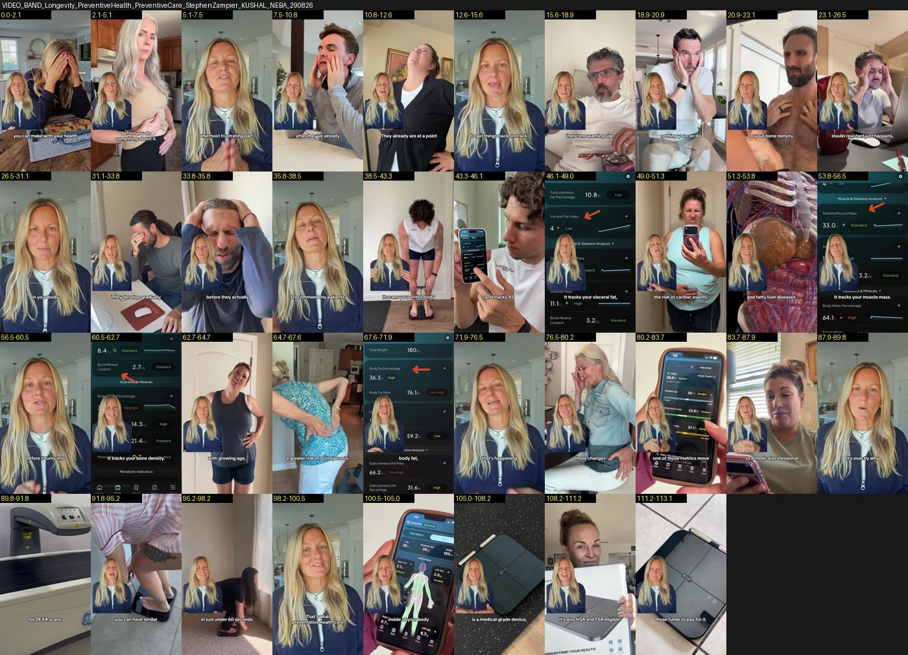

# VIDEO_BAND_Longevity_PreventiveHealth_PreventiveCare_StephenZampier_KUSHAL_NEBA_290826

Master: `VIDEO_BAND_Longevity_PreventiveHealth_PreventiveCare_StephenZampier_KUSHAL_NEBA_290826_Hook1_9x16.mp4` · 113.1s · 1080x1920

**Pacing:** 38 shots · avg 2.975s · median 2.869s · 3.27 cuts/10s · first cut 2.135s · 192.0 wpm · talk ratio 0.97 · cuts on word start 78.4% · cuts in speech gaps 64.9%
**Audio:** {'I_lufs': -22.1, 'LRA': 4.1, 'true_peak_db': -2.3} · BPM≈129.2 · music {'speech_rms_db': -27.7, 'pause_seconds': 0.2} · cuts with SFX/transient 40.5%

**Captions:** 231 cards · 1 words/card (median) · y≈0.763 of frame height · text height≈0.0293 · colours {'white': 201, 'red': 4, 'dark/other': 22, 'blue': 3, 'yellow': 1} · cards crossing a cut: 2
Highlighted: oryour bone density, High, High, you're developing, agreaterrisk ofosteoporosis., Standard, Standa, Stand.
**Headlines:** HumePod (46.0–48.0s, white) | Connected (46.0–48.0s, green) | SubcutaneousFatMass (46.0–46.0s, white) | 7.2kg (46.0–46.0s, white) | Verylow (46.0–46.0s, dark/other) | Subcutaneous (46.0–48.0s, white) | 10.8% (46.0–48.0s, white) | Low (46.0–48.0s, dark/other)

**Hook (0–3s) spoken:** The biggest mistake you can make with your health is waiting for symptoms
**Hook on-screen:** Thebiggestmistake / iswaitingforsymptoms / you can.makewith yourhealth / you canmakewith yourhealth
**CTA (last 5s):** it's also HSA and FSA eligible, so you can use those funds to pay for it. · on-screen: So you can use / UNDERSTANDYOURHEALTH / XHume / eHe / it'salsoHSAand FSAeligible. / th / those funds to pay for it.

## Beat sheet

| # | in–out (s) | dur | transition | spoken | on-screen text |
|---|---|---|---|---|---|
| 1 | 0.00–2.13 | 2.13 |  | The biggest mistake you can make with your health is | Thebiggestmistake / you canmakewith yourhealth / you can.makewith yourhealth / iswaitingforsymptoms |
| 2 | 2.13–5.07 | 2.94 | cut +SFX hit | waiting for symptoms before you do something about it. | iswaitingforsymptoms / beforeyoudo / something about it. / Asadoctor |
| 3 | 5.07–7.51 | 2.44 | cut +SFX hit | As a doctor, the most frustrating part is when | Asadoctor / themostfrustrating part |
| 4 | 7.51–10.84 | 3.34 | cut | our patients show up to us after they've already developed a problem. | showuptous / after they've already / developedaproblem |
| 5 | 10.84–12.61 | 1.77 | cut | They already are at a point where | They already are at a point |
| 6 | 12.61–15.58 | 2.97 | cut +SFX hit | it takes a lot of effort to get things back on track. | whereittakesalotofeffort / togetthingsbackontrack / to get things back on track. |
| 7 | 15.58–18.89 | 3.3 | cut | Most people think there's no warning sign for a cardiac event. | Most peoplethink / there's no warning sign / foracardiacevent. |
| 8 | 18.89–20.89 | 2.0 | cut | They think there's nothing you can do about losing | Theythinkthere's / nothingyou can do |
| 9 | 20.89–23.12 | 2.24 | cut | your muscle mass or your bone density. | about losingyourmusclemass / oryour bone density [red] / Theythinkbecoming |
| 10 | 23.12–26.53 | 3.4 | cut +SFX hit | They think becoming insulin resistant just happens. | Theythinkbecoming / insulin resistant just happens, |
| 11 | 26.53–31.13 | 4.61 | cut +SFX hit | But that's not true. Most things that happen in your body don't happen suddenly overnight. | butthat'snottrue. / Mostthingsthathappen / inyourbody / don'thappen / suddenlyovernight. / They developgradually |
| 12 | 31.13–33.80 | 2.67 | cut | They develop gradually over months and years before | They developgradually / overmonthsandyears |
| 13 | 33.80–35.80 | 2.0 | cut +SFX hit | they actually become a problem. | before they actually / becomeaproblem |
| 14 | 35.80–38.47 | 2.67 | cut +SFX hit | This is exactly why I recommend my patients have | Thisis exactlywhy / Irecommendmypatients |
| 15 | 38.47–43.28 | 4.8 | cut +SFX hit | the Hume Pod at home. It scans your entire body in under 30 seconds and | Irecommendmypatients / have the Hume pod at home. / Itscansyourentirebody / inunder30seconds |
| 16 | 43.28–46.08 | 2.8 | cut | tracks 45 different health metrics. | inunder30seconds / CITIONNGGLUB / INGREAB / andtracks45 / SINCE2012 / BRITAIN |
| 17 | 46.08–48.98 | 2.9 | cut +SFX hit | It tracks your visceral fat, which when elevated increases | HumePod (HEADLINE) / Connected [green] (HEADLINE) / SubcutaneousFatMass (HEADLINE) / 7.2kg (HEADLINE) / Verylow (HEADLINE) / Subcutaneous (HEADLINE) |
| 18 | 48.98–51.25 | 2.27 | cut | the risk of cardiovascular events, | whichwhenelevatedincreases / the risk of cardiac events, |
| 19 | 51.25–53.82 | 2.57 | cut +SFX hit | type 2 diabetes, and fatty liver diseases. It | the risk of cardiac events, / type2diabetes, / andfattyliverdiseases. |
| 20 | 53.82–56.49 | 2.67 | cut | tracks your muscle mass so you can see and | HumePod (HEADLINE) / Connected [green] (HEADLINE) / VisceralFat Index (HEADLINE) / Low [blue] (HEADLINE) / Muscle&SkeletonAnalysis (HEADLINE) / SkeletalMuscleMass |
| 21 | 56.49–60.53 | 4.04 | cut | catch the muscle decline before it turns into severe mobility issues. | HumePod (HEADLINE) / Connected [green] (HEADLINE) / Low [blue] (HEADLINE) / Muscle&SkeletonAnalysis (HEADLINE) / Standard / 3.2kg |
| 22 | 60.53–62.70 | 2.17 | cut +SFX hit | It tracks your bone density so you | SkeletalMass (HEADLINE) / 8.4kg (HEADLINE) / Standard (HEADLINE) / BoneMineral (HEADLINE) / 2.7kg (HEADLINE) / Content (HEADLINE) |
| 23 | 62.70–64.73 | 2.03 | cut | can see if, with growing age, | So you can see if / with growing age, |
| 24 | 64.73–67.57 | 2.84 | cut | you're developing a greater risk of osteoporosis. | you're developing [blue] / agreaterrisk ofosteoporosis. [blue] |
| 25 | 67.57–71.91 | 4.34 | cut +SFX hit | It also tracks your hydration, body fat, and overall metabolic age. | Body Pod (HEADLINE) / StepOnScale [green] (HEADLINE) / Hydration&Minerals (HEADLINE) / Body WaterPercentage (HEADLINE) / 46.5%Low (HEADLINE) / 36.2ibs |
| 26 | 71.91–76.54 | 4.64 | cut | You can stop every change that's happening inside your body as you get older, | Youcan'tstopevery change / that'shappening / insideyourbody / asyougetolder |
| 27 | 76.54–80.18 | 3.64 | cut | but you can make sure those changes don't catch you by surprise. If | Butyou can make sure / thosechanges / don't catch you by surprise. / 1:25 [blue] (HEADLINE) / BodyComp (HEADLINE) / Weight (HEADLINE) |
| 28 | 80.18–83.68 | 3.5 | cut | you start seeing one of those metrics move in the wrong direction, | 1:25 [blue] (HEADLINE) / BodyComp (HEADLINE) / Weight (HEADLINE) / Weekly Targets: 1/4 (HEADLINE) / 59.5kg (HEADLINE) / Standard (HEADLINE) |
| 29 | 83.68–87.89 | 4.2 | cut | you can take that information to a medical professional and actually do something about it. | you can takethat information / to amedical professional / andactuallydo / something about it. |
| 30 | 87.89–89.82 | 1.93 | cut | It's exactly why we refer our | It'sexactlywhy / wereferourpatients |
| 31 | 89.82–91.79 | 1.97 | cut +SFX hit | patients for DEXA scans. | wereferourpatients / LUNAR (HEADLINE) / forDEXAscans. |
| 32 | 91.79–95.23 | 3.44 | cut +SFX hit | And now with Hume Pod, you can have similar body composition insights | And now, with the Hume pod, / you can have similar / body compositioninsights |
| 33 | 95.23–98.20 | 2.97 | cut | at home in just under 60 seconds. | body compositioninsights / at home / in justunder 60seconds. / That'swhat / preventativehealth care |
| 34 | 98.20–100.53 | 2.34 | cut | That's what preventative health care should look like. | That'swhat / preventativehealth care / should look like. |
| 35 | 100.53–104.97 | 4.44 | cut | Understanding what's changing inside of your body before it becomes a problem. And | 1:25 [blue] (HEADLINE) / HumePod [blue] (HEADLINE) / Step On Seale [blue] (HEADLINE) / Humo Health * [blue] (HEADLINE) / Body (HEADLINE) / BodyComposition Fundamentals [blue] (HEADLINE) |
| 36 | 104.97–108.24 | 3.27 | cut +SFX hit | because HumePod is a medical grade device, | AndbecauseHumepod / is a medical-grade device, / it'salsoHSAand FSAeligible. / UNDERSTANDYOURHEALTH |
| 37 | 108.24–111.21 | 2.97 | cut | it's also HSA and FSA eligible, | it'salsoHSAand FSAeligible. / UNDERSTANDYOURHEALTH / th / eHe / So you can use |
| 38 | 111.21–113.07 | 1.86 | cut | so you can use those funds to pay for it. | So you can use / XHume / those funds to pay for it. |

## Hook variants

| hook | file | dur | first cut | spoken 0–3s | on-screen 0–3s |
|---|---|---|---|---|---|
| 1 | `ventiveCare_StephenZampier_KUSHAL_NEBA_290826_Hook1_9x16.mp4` | 113.1 | 2.135 | The biggest mistake you can make with your health is waiting for symptoms | Thebiggestmistake / iswaitingforsymptoms / you can.makewith yourhealth / you canmakewith yourhealth |
| 2 | `ventiveCare_StephenZampier_KUSHAL_NEBA_290826_Hook2_9x16.mp4` | 111.4 | 1.535 |  |  |
| 3 | `ventiveCare_StephenZampier_KUSHAL_NEBA_290826_Hook3_9x16.mp4` | 111.0 | 1.201 |  |  |

## Full transcript

The biggest mistake you can make with your health is waiting for symptoms before you do something about it. As a doctor, the most frustrating part is when our patients show up to us after they've already developed a problem. They already are at a point where it takes a lot of effort to get things back on track. Most people think there's no warning sign for a cardiac event. They think there's nothing you can do about losing your muscle mass or your bone density. They think becoming insulin resistant just happens. But that's not true. Most things that happen in your body don't happen suddenly overnight. They develop gradually over months and years before they actually become a problem. This is exactly why I recommend my patients have the Hume Pod at home. It scans your entire body in under 30 seconds and tracks 45 different health metrics. It tracks your visceral fat, which when elevated increases the risk of cardiovascular events, type 2 diabetes, and fatty liver diseases. It tracks your muscle mass so you can see and catch the muscle decline before it turns into severe mobility issues. It tracks your bone density so you can see if, with growing age, you're developing a greater risk of osteoporosis. It also tracks your hydration, body fat, and overall metabolic age. You can stop every change that's happening inside your body as you get older, but you can make sure those changes don't catch you by surprise. If you start seeing one of those metrics move in the wrong direction, you can take that information to a medical professional and actually do something about it. It's exactly why we refer our patients for DEXA scans. And now with Hume Pod, you can have similar body composition insights at home in just under 60 seconds. That's what preventative health care should look like. Understanding what's changing inside of your body before it becomes a problem. And because HumePod is a medical grade device, it's also HSA and FSA eligible, so you can use those funds to pay for it.