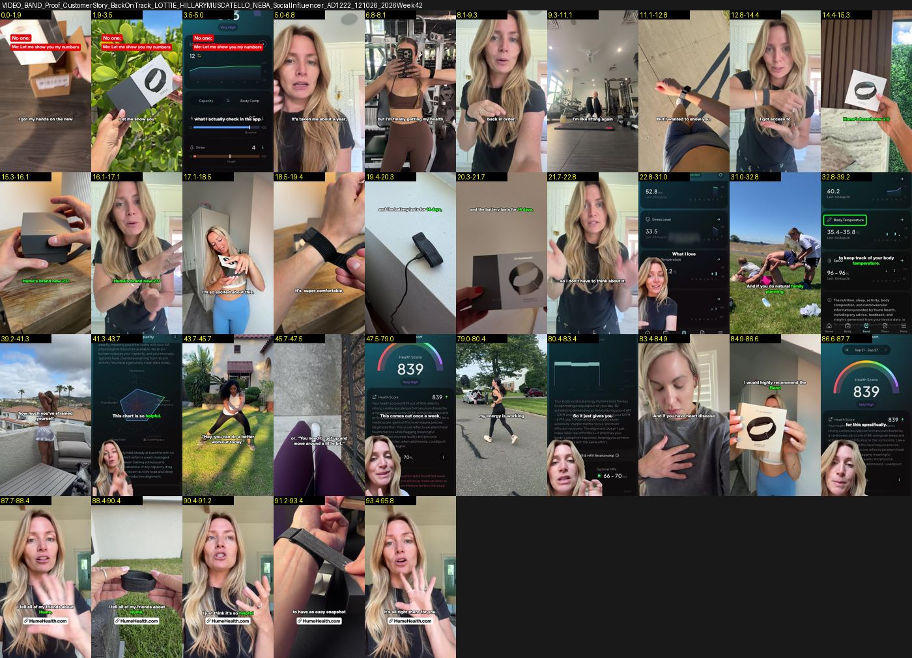

# VIDEO_BAND_Proof_CustomerStory_BackOnTrack_LOTTIE_HILLARYMUSCATELLO_NEBA_SocialInfluencer_AD1222_121026_2026Week42

Master: `VIDEO_BAND_Proof_CustomerStory_BackOnTrack_LOTTIE_HILLARYMUSCATELLO_NEBA_SocialInfluencer_AD1222_121026_2026Week42_Hook1_9x16.mp4` · 95.8s · 1080x1920

**Pacing:** 35 shots · avg 2.737s · median 1.62s · 3.55 cuts/10s · first cut 1.88s · 256.0 wpm · talk ratio 0.95 · cuts on word start 91.2% · cuts in speech gaps 64.7%
**Audio:** {'I_lufs': -15.1, 'LRA': 6.9, 'true_peak_db': 0.5} · BPM≈99.4 · music {'speech_rms_db': -19.8, 'pause_seconds': 1.0, 'pause_rms_db': -20.6, 'bed_minus_voice_db': -0.8, 'music_bed_likely': True} · cuts with SFX/transient 58.8%

**Captions:** 484 cards · 1.0 words/card (median) · y≈0.657 of frame height · text height≈0.0234 · colours {'red': 4, 'green': 28, 'white': 206, 'dark/other': 242, 'yellow': 4} · cards crossing a cut: 3
Highlighted: Igotmyhandsonthenew, HumeBand2.0., HumeBand2.0, but I'm finally getting myhealth, Hume'sbrandnew2.0, Im so excited aboutthis., I'm so excited aboutthis., It's super comfortable,, Humeapp., is that it tracks your stress, level., 35. jis that it.tracks your stress, sn02downfromyesterday., And if you do natural family, planning,
**Headlines:** No one: (0.0–4.5s, red) | Me:Let me show you my numbers (0.0–4.5s, red) | XHumeHealth (2.0–2.0s, yellow) | HealthScore (3.5–3.5s, dark/other) | 813 (3.5–3.5s, white) | Very High (3.5–4.0s, dark/other) | MetabolicMomentum (3.5–3.5s, white) | 12 (4.0–4.0s, white)

**Hook (0–3s) spoken:** I got my hands on the new Hume Band 2 .0. Let me show
**Hook on-screen:** HumeBand2.0 / HumeBand2.0. / Igotmyhandsonthenew / Letmeshowyou / Me:Let me show you my numbers / No one: / XHumeHealth
**CTA (last 5s):** helpful to have an easy snapshot of your health. You don't have to guess, it's all right there for you. · on-screen: HumeHealth.com / Youdon't have to guess. / it's all right there for you. / of your health. / to have an easy snapshot

## Beat sheet

| # | in–out (s) | dur | transition | spoken | on-screen text |
|---|---|---|---|---|---|
| 1 | 0.00–1.88 | 1.88 |  | I got my hands on the new Hume Band 2 | No one: [red] (HEADLINE) / Me:Let me show you my numbers [red] (HEADLINE) / Igotmyhandsonthenew [red] / HumeBand2.0. [green] |
| 2 | 1.88–3.50 | 1.62 | cut +SFX hit | .0. Let me show you what I | No one: [red] (HEADLINE) / Me:Let me show you my numbers [red] (HEADLINE) / HumeBand2.0. [green] / XHumeHealth [yellow] (HEADLINE) / HumeBand2.0 [green] / Letmeshowyou |
| 3 | 3.50–4.96 | 1.46 | cut +SFX hit | actually check in the app. | No one: [red] (HEADLINE) / Me:Let me show you my numbers [red] (HEADLINE) / HealthScore (HEADLINE) / 813 (HEADLINE) / Very High (HEADLINE) / MetabolicMomentum (HEADLINE) |
| 4 | 4.96–6.80 | 1.84 | cut +SFX hit | It's taken me about a year, but I'm | No one: [red] (HEADLINE) / Me:Let me show you my numbers [red] (HEADLINE) / Capacity / BodyComp / 100 / Baseline |
| 5 | 6.80–8.10 | 1.3 | cut +SFX hit | finally getting my health back | but I'm finally getting myhealth [red] / back inorder. |
| 6 | 8.10–9.26 | 1.16 | cut | in order. | back inorder. |
| 7 | 9.26–11.12 | 1.86 | cut | Like lifting again and you know, | back inorder. / I'm like lifting again / and, you know, all the things. |
| 8 | 11.12–12.84 | 1.72 | cut +SFX hit | all the things. But I wanted to show you, | and, you know, all the things. / ButIwanted to showyou. |
| 9 | 12.84–14.42 | 1.58 | cut | I got access to Hume's | gotaccessto / Igotaccessto |
| 10 | 14.42–15.26 | 0.84 | cut +SFX hit | brand | Igotaccessto / Hume'sbrandnew2.0 [green] |
| 11 | 15.26–16.12 | 0.86 | cut +SFX hit | new | Hume'sbrandnew2.0 [green] |
| 12 | 16.12–17.14 | 1.02 | cut | 2 .0. | Hume'sbrandnew2.0 [green] / Im so excited aboutthis. [red] |
| 13 | 17.14–18.48 | 1.34 | cut +SFX hit | I'm so excited about this. | Im so excited aboutthis. [red] / I'm so excited aboutthis. [red] |
| 14 | 18.48–19.40 | 0.92 | cut | Super comfortable and | I'm so excited aboutthis. [red] / It's super comfortable, [yellow] |
| 15 | 19.40–20.28 | 0.88 | cut | the battery lasts for | It's super comfortable, [yellow] / andthebatterylastsfor14days, [green] (HEADLINE) |
| 16 | 20.28–21.70 | 1.42 | cut +SFX hit | 14 days, which is so nice. | andthebatterylastsfor14days, [green] (HEADLINE) / whichis so nice, (HEADLINE) / LiveLonger,Bettr |
| 17 | 21.70–22.76 | 1.06 | cut +SFX hit | So I don't have to think about it. | So I don't have to think about it. |
| 18 | 22.76–31.00 | 8.24 | cut +SFX hit | Okay, so here we are in the Hume app. It keeps track of your steps. What I love is that it tracks your stress level. I'll look at my stress levels down from yesterday. That's so good. | HumeBand（62%) (HEADLINE) / Connected (HEADLINE) / Steps (HEADLINE) / 5417 (HEADLINE) / 193 (HEADLINE) / 2708 (HEADLINE) |
| 19 | 31.00–32.80 | 1.8 | cut +SFX hit | And if you do natural family planning, | And if you do natural family [green] / planning, [green] |
| 20 | 32.80–39.18 | 6.38 | cut | this is a really great way to keep check of your body temperature. Okay, now we're going to look at your metabolic capacity. This is based on | HumeBand(93%) (HEADLINE) / Last:28/Aug/26 (HEADLINE) / BodyTemperature (HEADLINE) / 35.8-37.2c (HEADLINE) / SpO2 / this is a really great way |
| 21 | 39.18–41.30 | 2.12 | cut | how much you've strained yourself, your stress and | how much you've strained / yourself, / your stress, [green] |
| 22 | 41.30–43.72 | 2.42 | cut +SFX hit | your sleep. This chart is so helpful. It will show you | your stress, [green] / MetabolicCapacity (HEADLINE) / Yourdailycapacitymatchesyourbaseline (HEADLINE) / exactly,meaningyouentertodaywithyourfull (HEADLINE) / physiologicalresourcesavailable.Nostrain (HEADLINE) / burdenreducesyourcapacity,andyourrecovery (HEADLINE) |
| 23 | 43.72–45.66 | 1.94 | cut | like, hey, you can do a better workout today or | "Hey,you can do a better [yellow] / workouttoday' [yellow] / workouttoday,' [yellow] |
| 24 | 45.66–47.48 | 1.82 | cut | you need to get up and move around a little bit. | or,"Youneedto getupand / movearound a little bit." |
| 25 | 47.48–79.02 | 31.54 | cut +SFX hit | It even has a day plan, which is just takes all the guesswork out of it. And then here's my health score here. This is so easy to look at. Each little stat has an info thing next to it. So if you don't know what it is, it will tell you and it will also give you recommendations. Okay, and now we are in my health report card. This comes out once a week. My score is really doing really well. My biological age is at 33, which my chronological age is 39. So that's really good. My cardiovascular score is doing well. So this will show me exactly like my heart efficiency where I am. | or,"Youneedto getupand / movearound a little bit." / MetabolicCapacity (HEADLINE) / Yourcapacityheldsteadyatbaselinewithno (HEADLINE) / reduction,whichreflectsawell-managed (HEADLINE) / balancebetweentrainingstimulusand (HEADLINE) |
| 26 | 79.02–80.36 | 1.34 | cut | My energy is working with | myenergyisworking |
| 27 | 80.36–83.40 | 3.04 | cut | my sleep and everything. So it gives you a lot of really good information. And | myenergyisworking / Optimal (HEADLINE) / Moderate (HEADLINE) / 6 AM - 12pM (HEADLINE) / morning (HEADLINE) / Moderate |
| 28 | 83.40–84.92 | 1.52 | cut | And if you have heart disease in your family, | OptimalHRV / Yourbody'snaturalenergyrhythms holdthekey (HEADLINE) / tooptimizingeveryaspectofyourday.By (HEADLINE) / schedulingdemandingactivitiesduringyour6AM (HEADLINE) / betterresultswiththesameeffort. / RestingHR&HRVRelationshipO |
| 29 | 84.92–86.64 | 1.72 | cut +SFX hit | I would highly recommend the band for | Iwould highlyrecommend the (HEADLINE) / Band [green] (HEADLINE) / HumeHealth / Humeheaunt / HumeBand2.0 |
| 30 | 86.64–87.72 | 1.08 | cut +SFX hit | this specifically. | HealthReport (HEADLINE) / Sep21-Sep27 (HEADLINE) / HealthScore (HEADLINE) / 839 (HEADLINE) / VeryHigh / 839 4 |
| 31 | 87.72–88.40 | 0.68 | cut +SFX hit | I tell all of | Itell all of myfriendsabout / Hume, [green] / HumeHealth.com |
| 32 | 88.40–90.40 | 2.0 | cut +SFX hit | my friends about QM and my family, I just think | Itell all of myfriendsabout / Hume, [green] / HumeHealth.com / I just think it's so helpful [green] |
| 33 | 90.40–91.20 | 0.8 | cut +SFX hit | it's so helpful to | HumeHealth.com / I just think it's so helpful [green] / to have an easy snapshot |
| 34 | 91.20–93.36 | 2.16 | cut +SFX hit | have an easy snapshot of your health. | HumeHealth.com / to have an easy snapshot / of your health. |
| 35 | 93.36–95.79 | 2.43 | cut | You don't have to guess, it's all right there for you. | HumeHealth.com / of your health. / Youdon't have to guess. / it's all right there for you. |

## Hook variants

| hook | file | dur | first cut | spoken 0–3s | on-screen 0–3s |
|---|---|---|---|---|---|
| 1 | `EBA_SocialInfluencer_AD1222_121026_2026Week42_Hook1_9x16.mp4` | 95.8 | 1.88 | I got my hands on the new Hume Band 2 .0. Let me show | HumeBand2.0 / HumeBand2.0. / Igotmyhandsonthenew / Letmeshowyou / Me:Let me show you my numbers / No one: / XHumeHealth |
| 2 | `EBA_SocialInfluencer_AD1222_121026_2026Week42_Hook2_9x16.mp4` | 96.8 | 1.78 | Things are finally settling down, so this is what I'm | HumeBand2.0 / Things are finally settling down / so THisiswhatI'musingtoget |
| 3 | `EBA_SocialInfluencer_AD1222_121026_2026Week42_Hook3_9x16.mp4` | 95.7 | 1.34 | My favorite part is being able to tap a metric and find | My favorite partis being / NowI'mobsessed / abletotapametricand / with checking my HRV |

## Full transcript

I got my hands on the new Hume Band 2.0. Let me show you what I actually check in the app. It's taken me about a year, but I'm finally getting my health back in order. Like lifting again and you know, all the things. But I wanted to show you, I got access to Hume's brand new 2.0. I'm so excited about this. Super comfortable and the battery lasts for 14 days, which is so nice. So I don't have to think about it. Okay, so here we are in the Hume app. It keeps track of your steps. What I love is that it tracks your stress level. I'll look at my stress levels down from yesterday. That's so good. And if you do natural family planning, this is a really great way to keep check of your body temperature. Okay, now we're going to look at your metabolic capacity. This is based on how much you've strained yourself, your stress and your sleep. This chart is so helpful. It will show you like, hey, you can do a better workout today or you need to get up and move around a little bit. It even has a day plan, which is just takes all the guesswork out of it. And then here's my health score here. This is so easy to look at. Each little stat has an info thing next to it. So if you don't know what it is, it will tell you and it will also give you recommendations. Okay, and now we are in my health report card. This comes out once a week. My score is really doing really well. My biological age is at 33, which my chronological age is 39. So that's really good. My cardiovascular score is doing well. So this will show me exactly like my heart efficiency where I am. My energy is working with my sleep and everything. So it gives you a lot of really good information. And And if you have heart disease in your family, I would highly recommend the band for this specifically. I tell all of my friends about QM and my family, I just think it's so helpful to have an easy snapshot of your health. You don't have to guess, it's all right there for you.