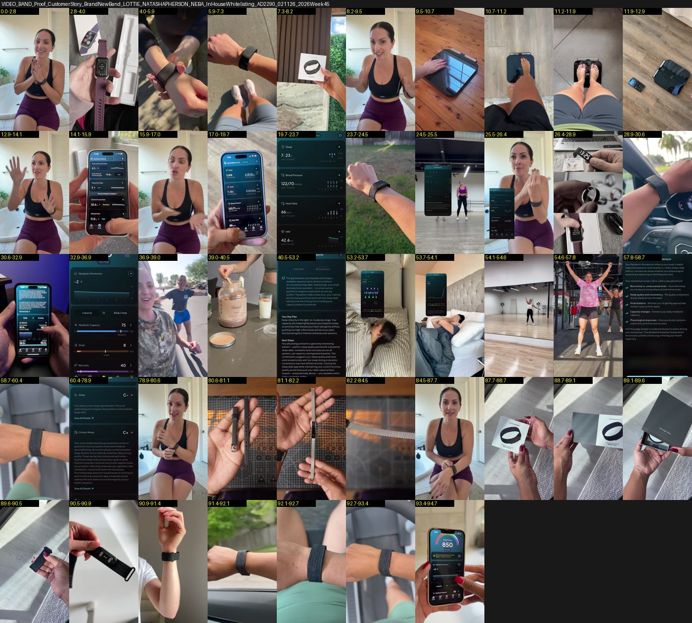

# VIDEO_BAND_Proof_CustomerStory_BrandNewBand_LOTTIE_NATASHAPHERSON_NEBA_InHouseWhitelisting_AD2290_021126_2026Week45

Master: `VIDEO_BAND_Proof_CustomerStory_BrandNewBand_LOTTIE_NATASHAPHERSON_NEBA_InHouseWhitelisting_AD2290_021126_2026Week45_9X16_HOOK1.mp4` · 94.7s · 1080x1920

**Pacing:** 47 shots · avg 2.016s · median 1.233s · 4.86 cuts/10s · first cut 2.767s · 258.0 wpm · talk ratio 0.97 · cuts on word start 84.8% · cuts in speech gaps 58.7%
**Audio:** {'I_lufs': -21.8, 'LRA': 4.3, 'true_peak_db': -4.3} · BPM≈107.7 · music {'speech_rms_db': -27.2, 'pause_seconds': 0.0} · cuts with SFX/transient 37.0%

**Hook (0–3s) spoken:** month I mentioned that I needed to get a new health tracker because I
**Hook on-screen:** 
**CTA (last 5s):** % off. My code is only good for 24 hours though, so I will draw the link for you to check it out. · on-screen: 

## Beat sheet

| # | in–out (s) | dur | transition | spoken | on-screen text |
|---|---|---|---|---|---|
| 1 | 0.00–2.77 | 2.77 |  | month I mentioned that I needed to get a new health tracker because |  |
| 2 | 2.77–4.03 | 1.27 | cut | I lost my other one. |  |
| 3 | 4.03–5.93 | 1.9 | cut +SFX hit | I finally got a new one and I love it. |  |
| 4 | 5.93–7.33 | 1.4 | cut | So I got the Hume Band 2 .0. |  |
| 5 | 7.33–8.20 | 0.87 | cut | It is brand new, |  |
| 6 | 8.20–9.50 | 1.3 | cut | just came out. |  |
| 7 | 9.50–10.73 | 1.23 | cut +SFX hit | I have the Hume scale. |  |
| 8 | 10.73–11.23 | 0.5 | cut | I've been using the |  |
| 9 | 11.23–11.93 | 0.7 | cut | same scale for a |  |
| 10 | 11.93–12.87 | 0.93 | cut | couple of years but |  |
| 11 | 12.87–14.13 | 1.27 | cut +SFX hit | I love that everything is |  |
| 12 | 14.13–15.93 | 1.8 | cut | trapped within the same app. |  |
| 13 | 15.93–17.03 | 1.1 | cut | It's super convenient. |  |
| 14 | 17.03–19.67 | 2.63 | cut +SFX hit | So when you open the app you're gonna toggle over to the band tab. That's |  |
| 15 | 19.67–23.73 | 4.07 | cut +SFX hit | where you're gonna see all of your raw data. So like sleep, HRG, stress, it |  |
| 16 | 23.73–24.53 | 0.8 | cut | even tells you |  |
| 17 | 24.53–25.47 | 0.93 | cut +SFX hit | your blood pressure. |  |
| 18 | 25.47–26.37 | 0.9 | cut +SFX hit | I personally have |  |
| 19 | 26.37–28.87 | 2.5 | cut | I'm not seeing any other wearable that does that, |  |
| 20 | 28.87–30.60 | 1.73 | cut | but you don't just get the raw data. |  |
| 21 | 30.60–32.93 | 2.33 | cut | Cume helps you make sense of all of it. |  |
| 22 | 32.93–36.87 | 3.93 | cut +SFX hit | I'll go over to the home screen and I love all those reports, especially the capacity report. |  |
| 23 | 36.87–39.00 | 2.13 | cut | This is kind of like your plan to tackle the day. |  |
| 24 | 39.00–40.47 | 1.47 | cut +SFX hit | Clearly, I need to work on my recovery. |  |
| 25 | 40.47–53.20 | 12.73 | cut +SFX hit | But if you tap on the little info button, it tells you what everything means. And then you can also scroll down and view more details. And it tells you how everything works together. One of the other reports that they have is the metabolic momentum, which this focuses more on how your |  |
| 26 | 53.20–53.70 | 0.5 | cut | sleep, |  |
| 27 | 53.70–54.10 | 0.4 | cut +SFX hit | your stress and |  |
| 28 | 54.10–54.63 | 0.53 | cut | lifestyle are |  |
| 29 | 54.63–57.80 | 3.17 | cut | impacting your long -term health. This is based off of recent patterns, |  |
| 30 | 57.80–58.73 | 0.93 | cut | so I feel like this |  |
| 31 | 58.73–60.37 | 1.63 | cut | is going to definitely improve for me when |  |
| 32 | 60.37–78.87 | 18.5 | cut | I focus more on my recovery. Last, you get a health score, which gives you pretty much a report card breakdown of all of these different areas. I love that you actually get a report for chronic illness. I have never seen another wearable that does this, but the Hume band can actually measure potential risks for type 2 diabetes, sleep apnea, and so much more. |  |
| 33 | 78.87–80.63 | 1.77 | cut +SFX hit | I know I've had some other bands where |  |
| 34 | 80.63–81.10 | 0.47 | cut | they're like |  |
| 35 | 81.10–82.20 | 1.1 | cut +SFX hit | thick and stiff and |  |
| 36 | 82.20–84.47 | 2.27 | cut | I feel like I can't move when I'm working out. like |  |
| 37 | 84.47–87.67 | 3.2 | cut | I have to adjust it constantly. I don't even notice this. |  |
| 38 | 87.67–88.73 | 1.07 | cut +SFX hit | And Hume did give me a |  |
| 39 | 88.73–89.10 | 0.37 | cut | code |  |
| 40 | 89.10–89.57 | 0.47 | cut | so you can |  |
| 41 | 89.57–90.47 | 0.9 | cut +SFX hit | get 30 % off. |  |
| 42 | 90.47–90.87 | 0.4 | cut | My code |  |
| 43 | 90.87–91.40 | 0.53 | cut | is only |  |
| 44 | 91.40–92.07 | 0.67 | cut +SFX hit | good for 24 |  |
| 45 | 92.07–92.73 | 0.67 | cut | hours though, |  |
| 46 | 92.73–93.37 | 0.63 | cut +SFX hit | so I will draw |  |
| 47 | 93.37–94.74 | 1.37 | cut | the link for you to check it out. |  |

## Hook variants

| hook | file | dur | first cut | spoken 0–3s | on-screen 0–3s |
|---|---|---|---|---|---|
| 1 | `_InHouseWhitelisting_AD2290_021126_2026Week45_9X16_HOOK1.mp4` | 94.7 | 2.767 | month I mentioned that I needed to get a new health tracker because I |  |
| 1 | `_InHouseWhitelisting_AD2290_021126_2026Week45_9X16_HOOK1.mp4` | 94.7 | 2.767 |  |  |
| 2 | `_InHouseWhitelisting_AD2290_021126_2026Week45_9X16_HOOK2.mp4` | 97.7 | 0.533 |  |  |
| 2 | `_InHouseWhitelisting_AD2290_021126_2026Week45_9X16_HOOK2.mp4` | 97.7 | 0.533 |  |  |
| 3 | `_InHouseWhitelisting_AD2290_021126_2026Week45_9X16_HOOK3.mp4` | 99.9 | 2.967 |  |  |
| 3 | `_InHouseWhitelisting_AD2290_021126_2026Week45_9X16_HOOK3.mp4` | 99.9 | 2.967 |  |  |
| 3 | `_InHouseWhitelisting_AD2290_021126_2026Week45_9X16_HOOK3.mp4` | 99.9 | 2.967 |  |  |

## Full transcript

month I mentioned that I needed to get a new health tracker because I lost my other one. I finally got a new one and I love it. So I got the Hume Band 2.0. It is brand new, just came out. I have the Hume scale. I've been using the same scale for a couple of years but I love that everything is trapped within the same app. It's super convenient. So when you open the app you're gonna toggle over to the band tab. That's where you're gonna see all of your raw data. So like sleep, HRG, stress, it even tells you your blood pressure. I personally have I'm not seeing any other wearable that does that, but you don't just get the raw data. Cume helps you make sense of all of it. I'll go over to the home screen and I love all those reports, especially the capacity report. This is kind of like your plan to tackle the day. Clearly, I need to work on my recovery. But if you tap on the little info button, it tells you what everything means. And then you can also scroll down and view more details. And it tells you how everything works together. One of the other reports that they have is the metabolic momentum, which this focuses more on how your sleep, your stress and lifestyle are impacting your long-term health. This is based off of recent patterns, so I feel like this is going to definitely improve for me when I focus more on my recovery. Last, you get a health score, which gives you pretty much a report card breakdown of all of these different areas. I love that you actually get a report for chronic illness. I have never seen another wearable that does this, but the Hume band can actually measure potential risks for type 2 diabetes, sleep apnea, and so much more. I know I've had some other bands where they're like thick and stiff and I feel like I can't move when I'm working out. like I have to adjust it constantly. I don't even notice this. And Hume did give me a code so you can get 30% off. My code is only good for 24 hours though, so I will draw the link for you to check it out.