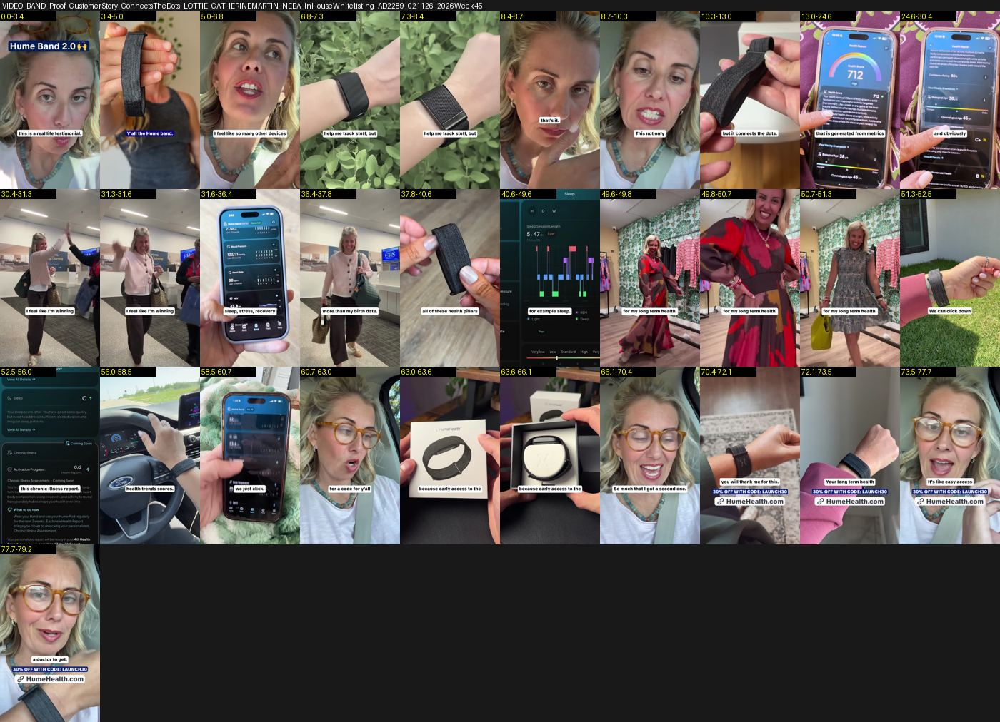

# VIDEO_BAND_Proof_CustomerStory_ConnectsTheDots_LOTTIE_CATHERINEMARTIN_NEBA_InHouseWhitelisting_AD2289_021126_2026Week45

Master: `VIDEO_BAND_Proof_CustomerStory_ConnectsTheDots_LOTTIE_CATHERINEMARTIN_NEBA_InHouseWhitelisting_AD2289_021126_2026Week45_9x16_hook1.mp4` · 79.2s · 1080x1920

**Pacing:** 31 shots · avg 2.555s · median 1.64s · 3.79 cuts/10s · first cut 3.44s · 198.0 wpm · talk ratio 0.97 · cuts on word start 50.0% · cuts in speech gaps 46.7%
**Audio:** {'I_lufs': -17.4, 'LRA': 6.0, 'true_peak_db': -1.6} · BPM≈123.0 · music {'speech_rms_db': -25.0, 'pause_seconds': 0.0} · cuts with SFX/transient 46.7%

**Hook (0–3s) spoken:** Let me just say this is a real life testimonial
**Hook on-screen:** 
**CTA (last 5s):** for this It's like easy access on the go to metrics that you don't have to go to a doctor to get · on-screen: 

## Beat sheet

| # | in–out (s) | dur | transition | spoken | on-screen text |
|---|---|---|---|---|---|
| 1 | 0.00–3.44 | 3.44 |  | Let me just say this is a real life testimonial y |  |
| 2 | 3.44–4.96 | 1.52 | cut | 'all the Hume Band. |  |
| 3 | 4.96–6.80 | 1.84 | cut +SFX hit | I feel like so many other devices out there helped |  |
| 4 | 6.80–7.32 | 0.52 | cut | me |  |
| 5 | 7.32–8.36 | 1.04 | cut +SFX hit | track steps but |  |
| 6 | 8.36–8.68 | 0.32 | cut +SFX hit | that's |  |
| 7 | 8.68–10.32 | 1.64 | cut | it. This not only |  |
| 8 | 10.32–13.04 | 2.72 | cut | helps you track my steps but it like connects the dots. |  |
| 9 | 13.04–24.56 | 11.52 | cut +SFX hit | I want to show y 'all here this is really cool health report. There's a weekly health score that is generated from metrics to daily habits. It's almost like a weekly credit score for my health. Oh look |  |
| 10 | 24.56–30.44 | 5.88 | cut +SFX hit | my biological age right now 38 and obviously my my chronicle age is 45. |  |
| 11 | 30.44–31.28 | 0.84 | cut +SFX hit | I feel like I'm winning. |  |
| 12 | 31.28–31.56 | 0.28 | cut |  |  |
| 13 | 31.56–36.36 | 4.8 | cut +SFX hit | That updates based on how I'm living, like sleep, stress, recovery, movement, composition, |  |
| 14 | 36.36–37.76 | 1.4 | cut +SFX hit | more than my birth date. |  |
| 15 | 37.76–40.64 | 2.88 | cut +SFX hit | Then I wanted to, like all of these health pillars, |  |
| 16 | 40.64–49.56 | 8.92 | cut | the vascular health, sleep, you can click on these. For example, sleep, view all details, more about it. Identify areas to focus on for |  |
| 17 | 49.56–49.84 | 0.28 | cut +SFX hit | my long |  |
| 18 | 49.84–50.72 | 0.88 | cut | -term health. |  |
| 19 | 50.72–51.28 | 0.56 | cut +SFX hit |  |  |
| 20 | 51.28–52.52 | 1.24 | cut +SFX hit | We can click down this |  |
| 21 | 52.52–55.96 | 3.44 | cut | chronic illness report. This is a way to monitor the |  |
| 22 | 55.96–58.52 | 2.56 | cut | long -term health trends, Scores and |  |
| 23 | 58.52–60.68 | 2.16 | cut | then like I said, we just click I |  |
| 24 | 60.68–63.00 | 2.32 | cut +SFX hit | begged them for a code for y 'all |  |
| 25 | 63.00–63.60 | 0.6 | cut | because early |  |
| 26 | 63.60–66.12 | 2.52 | cut | access to the human 2 .0 Obviously, |  |
| 27 | 66.12–70.44 | 4.32 | cut +SFX hit | I love it so much that I got a second one I'm telling you |  |
| 28 | 70.44–72.08 | 1.64 | cut | you will thank me for this your |  |
| 29 | 72.08–73.48 | 1.4 | cut | long -term health |  |
| 30 | 73.48–77.72 | 4.24 | cut | is gonna thank me for this It's like easy access on the go to metrics that you |  |
| 31 | 77.72–79.21 | 1.49 | cut | don't have to go to a doctor to get |  |

## Hook variants

| hook | file | dur | first cut | spoken 0–3s | on-screen 0–3s |
|---|---|---|---|---|---|
| 1 | `_InHouseWhitelisting_AD2289_021126_2026Week45_9x16_hook1.mp4` | 79.2 | 3.44 | Let me just say this is a real life testimonial |  |
| 1 | `_InHouseWhitelisting_AD2289_021126_2026Week45_9x16_hook1.mp4` | 79.2 | 3.44 |  |  |
| 2 | `_InHouseWhitelisting_AD2289_021126_2026Week45_9x16_hook2.mp4` | 82.6 | 2.56 |  |  |
| 2 | `_InHouseWhitelisting_AD2289_021126_2026Week45_9x16_hook2.mp4` | 82.6 | 2.56 |  |  |
| 3 | `_InHouseWhitelisting_AD2289_021126_2026Week45_9x16_hook3.mp4` | 81.3 | 5.56 |  |  |
| 3 | `_InHouseWhitelisting_AD2289_021126_2026Week45_9x16_hook3.mp4` | 81.3 | 5.56 |  |  |

## Full transcript

Let me just say this is a real life testimonial y'all the Hume Band. I feel like so many other devices out there helped me track steps but that's it. This not only helps you track my steps but it like connects the dots. I want to show y'all here this is really cool health report. There's a weekly health score that is generated from metrics to daily habits. It's almost like a weekly credit score for my health. Oh look my biological age right now 38 and obviously my my chronicle age is 45. I feel like I'm winning. That updates based on how I'm living, like sleep, stress, recovery, movement, composition, more than my birth date. Then I wanted to, like all of these health pillars, the vascular health, sleep, you can click on these. For example, sleep, view all details, more about it. Identify areas to focus on for my long-term health. We can click down this chronic illness report. This is a way to monitor the long-term health trends, Scores and then like I said, we just click I begged them for a code for y'all because early access to the human 2.0 Obviously, I love it so much that I got a second one I'm telling you you will thank me for this your long-term health is gonna thank me for this It's like easy access on the go to metrics that you don't have to go to a doctor to get