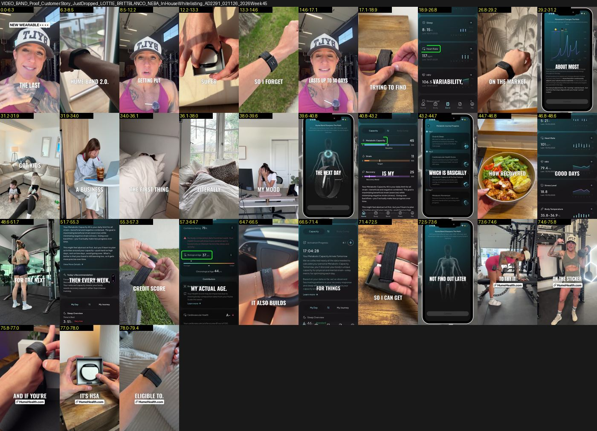

# VIDEO_BAND_Proof_CustomerStory_JustDropped_LOTTIE_BRITTBLANCO_NEBA_InHouseWhitelisting_AD2291_021126_2026Week45

Master: `VIDEO_BAND_Proof_CustomerStory_JustDropped_LOTTIE_BRITTBLANCO_NEBA_InHouseWhitelisting_AD2291_021126_2026Week45_Hook1_9x16.mp4` · 79.4s · 1080x1920

**Pacing:** 33 shots · avg 2.407s · median 1.9s · 4.03 cuts/10s · first cut 6.26s · 253.0 wpm · talk ratio 0.95 · cuts on word start 87.5% · cuts in speech gaps 68.8%
**Audio:** {'I_lufs': -22.2, 'LRA': 5.4, 'true_peak_db': -2.6} · BPM≈117.5 · music {'speech_rms_db': -27.6, 'pause_seconds': 0.7, 'pause_rms_db': -34.5, 'bed_minus_voice_db': -6.9, 'music_bed_likely': True} · cuts with SFX/transient 40.6%

**Captions:** 332 cards · 1.0 words/card (median) · y≈0.68 of frame height · text height≈0.0246 · colours {'white': 267, 'yellow': 2, 'dark/other': 58, 'red': 3, 'green': 2} · cards crossing a cut: 1
Highlighted: SCRAMBLING, HOW RECOVERED, ACTUALLY AM, NOTJUST, THEN EVERY WEEK., THE CRAZIEST, ITALSO BUILDS
**Headlines:** NEWWEARABLEOO (0.0–0.0s, white) | NEWWEARABLEO (0.5–0.5s, white) | NEWWEARABLE (1.0–1.0s, white) | TYB (1.0–1.0s, white) | NEWWEARABLEO (1.5–1.5s, white) | NEWWEARABLE (2.0–2.0s, white) | TIY (2.0–2.0s, white) | NEWWEARABLEO (2.5–2.5s, white)

**Hook (0–3s) spoken:** Okay, so I have to tell you guys about this because I've had it on my wrist the
**Hook on-screen:** BECAUSEI'VE / GUYSABOUTTHIS / HAD IT ON / NEWWEARABLE / NEWWEARABLEO / NEWWEARABLEOO / OKAY SOIHAVE / TIY / TYB
**CTA (last 5s):** the link right on the sticker. And if you're in the US, it's HSA and FSA Eligible 2. · on-screen: ANDFSA / ANDIFYOU'RE / BYLT / ELIGIBLETO. / HumeHealth.com / IT'SHSA / ON THE STICKER

## Beat sheet

| # | in–out (s) | dur | transition | spoken | on-screen text |
|---|---|---|---|---|---|
| 1 | 0.00–6.26 | 6.26 |  | Okay, so I have to tell you guys about this because I've had it on my wrist the last couple of weeks and it's actually starting to change my life. | NEWWEARABLEOO (HEADLINE) / OKAY SOIHAVE / NEWWEARABLEO (HEADLINE) / NEWWEARABLE (HEADLINE) / TYB (HEADLINE) / GUYSABOUTTHIS |
| 2 | 6.26–8.54 | 2.28 | cut | This is the Hume Band 2 .0, | NEWWEARABLE (HEADLINE) / CHANGE MY LIFE / HUME BAND 2.0. |
| 3 | 8.54–12.16 | 3.62 | cut | it just dropped. So you're getting put onto this before most people know it's out there. | ITJUST DROPPED / GETTING PUT / PEOPLE KNOW / IT'SALSO |
| 4 | 12.16–13.34 | 1.18 | cut +SFX hit | It's also super lightweight, so | IT'SALSO / LIGHTWEIGHT |
| 5 | 13.34–14.62 | 1.28 | cut +SFX hit | I forget it's on my wrist and | LIGHTWEIGHT / IT'S ON MYWRIST |
| 6 | 14.62–17.12 | 2.5 | cut +SFX hit | the charge lasts up to 14 days, so I'm not scrambling | TIY8 (HEADLINE) / AND THE CHARGE / LASTSUPTO14DAYS / SCRAMBLING [yellow] |
| 7 | 17.12–18.94 | 1.82 | cut +SFX hit | trying to find the charger. | SCRAMBLING [yellow] / TRYING TO FIND |
| 8 | 18.94–26.84 | 7.9 | cut | So on the Band tab, you get the stuff you'd expect. Sleep, heart rate variability, activity, but it also reads your blood pressure straight from your wrist. | 3:094 (HEADLINE) / HumeBand(93%) (HEADLINE) / 09steps (HEADLINE) / 1,751 (HEADLINE) / 2h16m / SO°ON'THE BAND'TAB |
| 9 | 26.84–29.18 | 2.34 | cut | Almost nothing else on the market actually does that. | ALMOST / ON THE MARKET / 3:10 (HEADLINE) / Yourcalorieclockreflects.theenergyyourbodyactually (HEADLINE) / ACTUALLY DOES THAT / thedayyourbodyisactuallyhaving |
| 10 | 29.18–31.16 | 1.98 | cut | The one I care about most is sleep. | 3:10 (HEADLINE) / Yourcalorieclockreflects.theenergyyourbodyactually (HEADLINE) / ACTUALLY DOES THAT / thedayyourbodyisactuallyhaving / 3:104 (HEADLINE) / days (HEADLINE) |
| 11 | 31.16–31.94 | 0.78 | cut +SFX hit | When you've got kids and | WHEN YOUVE |
| 12 | 31.94–34.02 | 2.08 | cut | you're building a business at the same time, | AND YOU'RE / AT THE SAME / SLEEP IS ALWAYS |
| 13 | 34.02–36.12 | 2.1 | cut | sleep is always the first thing that gets sacrificed and | SLEEP IS ALWAYS / THE FIRST THING / AND IT AFFECTS |
| 14 | 36.12–38.02 | 1.9 | cut | it affects literally everything else, | AND IT AFFECTS / LITERALLY / MY ENERGY |
| 15 | 38.02–39.60 | 1.58 | cut | my energy, my mood, and how I | MY ENERGY / AND HOW |
| 16 | 39.60–40.82 | 1.22 | cut | show up the next day. | 3:10 (HEADLINE) / THE NEXT DAY |
| 17 | 40.82–43.18 | 2.36 | cut +SFX hit | First thing it shows me is my metabolic capacity, | Capacity (HEADLINE) / BodyComp (HEADLINE) / MetabolicCapacity / 100 / Baseline / 11 |
| 18 | 43.18–44.74 | 1.56 | cut | which is basically my plan for the day | 3:08 (HEADLINE) / MetabolicJourneyProgress (HEADLINE) / Day1 (HEADLINE) / Strain&Sleep (HEADLINE) / patternstobuildyourbaseline.You (HEADLINE) / Statspage (HEADLINE) |
| 19 | 44.74–46.80 | 2.06 | cut +SFX hit | based on how recovered I actually am. | HOW RECOVERED [yellow] / ACTUALLY AM [red] |
| 20 | 46.80–48.62 | 1.82 | cut | Stacking good days like this is what builds | 23:00 (HEADLINE) / 5h21m (HEADLINE) / 17:00 (HEADLINE) / Last:13/10/2025 (HEADLINE) / Heart Rate (HEADLINE) / 101bpm (HEADLINE) |
| 21 | 48.62–51.70 | 3.08 | cut +SFX hit | a body that can keep up with me for the next 20, 30 years, | THAT CAN KEEP UP / FOR THE NEXT / 20.30YEARS |
| 22 | 51.70–55.34 | 3.64 | cut | not just get me through this week. Then every week I get a full health report, | Sleep (HEADLINE) / TimeAsleep (HEADLINE) / 5h21m (HEADLINE) / Low [red] (HEADLINE) / 13/10/2025 (HEADLINE) / NOTJUST [green] |
| 23 | 55.34–57.32 | 1.98 | cut +SFX hit | kind of like a credit score for your health. At | significantlybelowyourbody'sneeds.Thiscreateda / sleep debtof 2.7hours thatyour body is carrying / forward. / ActiveCalories / My Day (HEADLINE) / My Journey (HEADLINE) |
| 24 | 57.32–64.66 | 7.34 | cut | the top, it shows my biological age against my actual age. Then it breaks down my cardiovascular health, sleep, activity, and this is | FOR YOUR HEALTH / HealthReport (HEADLINE) / ConfidenceRating75% (HEADLINE) / Nobodycompositiondatafoundlastweek.Your (HEADLINE) / HealthScorewill showmorevariationasit's (HEADLINE) / basedonlyonlifestylefactorslikesleepand (HEADLINE) |
| 25 | 64.66–66.50 | 1.84 | cut +SFX hit | the craziest part. It also builds | THE CRAZIEST [red] / ITALSO BUILDS [red] |
| 26 | 66.50–71.40 | 4.9 | cut +SFX hit | a chronic illness report, flagging risks for things like type 2 diabetes or sleep apnea so | LifeAddedWithHume (HEADLINE) / This Week (HEADLINE) / Overall (HEADLINE) / You're agingabitfaster thanyou shouldbe duetonot / beingactive enough.You'renotattheworstlevel / quicklygetyoubackontrack.FocusonyourDaily |
| 27 | 71.40–72.54 | 1.14 | cut | I can get ahead of my health, | Sleep (HEADLINE) / REM (HEADLINE) / 6AM / 1O PM / REM / Awake |
| 28 | 72.54–73.56 | 1.02 | cut | not find out later. | 3:10 (HEADLINE) / NOT FIND OUT LATER / Continue |
| 29 | 73.56–74.62 | 1.06 | cut | If you want to try it, tap the | TO TRYIT / HumeHealth.com |
| 30 | 74.62–75.80 | 1.18 | cut +SFX hit | link right on the sticker. | HumeHealth.com / BYLT (HEADLINE) / ON THE STICKER |
| 31 | 75.80–76.98 | 1.18 | cut | And if you're in the US, | HumeHealth.com / ANDIFYOU'RE |
| 32 | 76.98–77.98 | 1.0 | cut | it's HSA and | HumeHealth.com / IT'SHSA |
| 33 | 77.98–79.44 | 1.46 | cut +SFX hit | FSA Eligible 2. | HumeHealth.com / ANDFSA / ELIGIBLETO. |

## Hook variants

| hook | file | dur | first cut | spoken 0–3s | on-screen 0–3s |
|---|---|---|---|---|---|
| 1 | `_InHouseWhitelisting_AD2291_021126_2026Week45_Hook1_9x16.mp4` | 79.4 | 6.26 | Okay, so I have to tell you guys about this because I've had it on my wrist the | BECAUSEI'VE / GUYSABOUTTHIS / HAD IT ON / NEWWEARABLE / NEWWEARABLEO / NEWWEARABLEOO / OKAY SOIHAVE / TIY |
| 2 | `_InHouseWhitelisting_AD2291_021126_2026Week45_Hook2_9x16.mp4` | 80.5 | 0.7 |  |  |
| 3 | `_InHouseWhitelisting_AD2291_021126_2026Week45_Hook3_9x16.mp4` | 81.7 | 2.04 |  |  |

## Full transcript

Okay, so I have to tell you guys about this because I've had it on my wrist the last couple of weeks and it's actually starting to change my life. This is the Hume Band 2.0, it just dropped. So you're getting put onto this before most people know it's out there. It's also super lightweight, so I forget it's on my wrist and the charge lasts up to 14 days, so I'm not scrambling trying to find the charger. So on the Band tab, you get the stuff you'd expect. Sleep, heart rate variability, activity, but it also reads your blood pressure straight from your wrist. Almost nothing else on the market actually does that. The one I care about most is sleep. When you've got kids and you're building a business at the same time, sleep is always the first thing that gets sacrificed and it affects literally everything else, my energy, my mood, and how I show up the next day. First thing it shows me is my metabolic capacity, which is basically my plan for the day based on how recovered I actually am. Stacking good days like this is what builds a body that can keep up with me for the next 20, 30 years, not just get me through this week. Then every week I get a full health report, kind of like a credit score for your health. At the top, it shows my biological age against my actual age. Then it breaks down my cardiovascular health, sleep, activity, and this is the craziest part. It also builds a chronic illness report, flagging risks for things like type 2 diabetes or sleep apnea so I can get ahead of my health, not find out later. If you want to try it, tap the link right on the sticker. And if you're in the US, it's HSA and FSA Eligible 2.