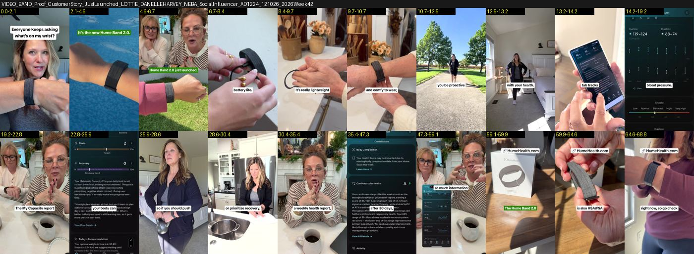

# VIDEO_BAND_Proof_CustomerStory_JustLaunched_LOTTIE_DANELLEHARVEY_NEBA_SocialInfluencer_AD1224_121026_2026Week42

Master: `VIDEO_BAND_Proof_CustomerStory_JustLaunched_LOTTIE_DANELLEHARVEY_NEBA_SocialInfluencer_AD1224_121026_2026Week42_Hook1_9x16.mp4` · 68.8s · 1080x1920

**Pacing:** 20 shots · avg 3.439s · median 2.3s · 2.76 cuts/10s · first cut 2.1s · 180.0 wpm · talk ratio 0.94 · cuts on word start 63.2% · cuts in speech gaps 73.7%
**Audio:** {'I_lufs': -19.5, 'LRA': 7.2, 'true_peak_db': -1.8} · BPM≈152.0 · music {'speech_rms_db': -24.4, 'pause_seconds': 0.0} · cuts with SFX/transient 47.4%

**Captions:** 228 cards · 1.0 words/card (median) · y≈0.616 of frame height · text height≈0.0234 · colours {'green': 6, 'white': 183, 'dark/other': 33, 'red': 6} · cards crossing a cut: 1
Highlighted: HumeBand2.0 justlaunched, HumeBand2.0 justlaunched., HumeBand2.0 justlaunched, The Band, Notoptimal, A Nobodycompositiondatafoundlastweek.Your, activity., basedonlyonlifestylefactorslikesleepand, Nobodycompositiondatafound lastweek.Your, HealthScorewill showmorevariationasit's, HumeBand2.0, TheHumeBand2.0
**Headlines:** Everyone keeps asking (0.0–1.5s, white) | what's on my wrist? (0.0–1.5s, white) | It'sthenewHumeBand2.0 (2.0–4.0s, green) | 521kcalover (13.0–13.0s, dark/other) | 1753Steps left (13.0–13.0s, blue) | Sleep (14.0–14.0s, white) | SleepSessionLength (14.0–14.0s, white) | 10h18m (14.0–14.0s, white)

**Hook (0–3s) spoken:** Everyone keeps asking what's on my wrist. It's the new HumeBand
**Hook on-screen:** Everyone keeps asking / It'sthenewHumeBand2.0 / what's on my wrist?
**CTA (last 5s):** the United States, and it's on sale right now, so go check it out while stocks last. · on-screen: Andit'sonsale / HumeHealth.com / intheUnitedStates. / it out while / right now, so go check / stockslast.

## Beat sheet

| # | in–out (s) | dur | transition | spoken | on-screen text |
|---|---|---|---|---|---|
| 1 | 0.00–2.10 | 2.1 |  | Everyone keeps asking what's on my wrist. | Everyone keeps asking (HEADLINE) / what's on my wrist? (HEADLINE) / It'sthenewHumeBand2.0 [green] (HEADLINE) |
| 2 | 2.10–4.57 | 2.47 | cut | It's the new HumeBand 2 .0. | It'sthenewHumeBand2.0 [green] (HEADLINE) / HumeBand2.0 justlaunched [green] |
| 3 | 4.57–6.70 | 2.13 | cut | HumeBand 2 .0 just launched. | HumeBand2.0 justlaunched [green] / HumeBand2.0 justlaunched. [green] / HumeBand2.0 justlaunched [green] |
| 4 | 6.70–8.43 | 1.73 | cut | It's got a 14 -day battery life. | It's got a 14 day / battery life. |
| 5 | 8.43–9.70 | 1.27 | cut | It's really lightweight and | battery life. / It's really lightweight |
| 6 | 9.70–10.70 | 1.0 | cut +SFX hit | comfy to wear and | and comfy to wear, |
| 7 | 10.70–12.53 | 1.83 | cut | it actually helps you be proactive with | and it actually helps / you be proactive |
| 8 | 12.53–13.23 | 0.7 | cut +SFX hit | your health. | 521kcalover (HEADLINE) / 1753Steps left [blue] (HEADLINE) / Zone / CO Heart Minutes / Zone3 / Zone2 |
| 9 | 13.23–14.17 | 0.93 | cut | The band tab tracks | 521kcalover (HEADLINE) / 1753Steps left [blue] (HEADLINE) / Zone / CO Heart Minutes / Zone3 / Zone2 |
| 10 | 14.17–19.20 | 5.03 | cut +SFX hit | your sleep, activity, heart rate, and even your blood pressure. I check this tab every day. | Sleep (HEADLINE) / SleepSessionLength (HEADLINE) / 10h18m (HEADLINE) / VeryHigh (HEADLINE) / 11/Mar/26 (HEADLINE) / yoursleep, |
| 11 | 19.20–22.77 | 3.57 | cut +SFX hit | The My Capacity report gives you a personalized plan based | The My Capacity report / gives you / a personalized plan |
| 12 | 22.77–25.90 | 3.13 | cut +SFX hit | on what your body can handle that day. | Very High (HEADLINE) / WMetabolicMomentum (HEADLINE) / 15个 (HEADLINE) / Capacity / BodyComp / 91 |
| 13 | 25.90–28.57 | 2.67 | cut | So if you should push a little bit | so if you should push / a little bit |
| 14 | 28.57–30.40 | 1.83 | cut | or prioritize recovery. | or prioritize recovery. / or prioritize recovery |
| 15 | 30.40–35.43 | 5.03 | cut +SFX hit | It also creates a weekly health report, almost like a credit score for your health, with | or prioritize recovery / Italso creates / a weekly health report, / almost like a / credit score / for your health, |
| 16 | 35.43–47.33 | 11.9 | cut | insights into your biological age, cardiovascular health, sleep and activity. And then after 30 days, it builds a chronic illness report to help monitor any potential risk trends. | for your health, / HealthScore (HEADLINE) / 827 (HEADLINE) / Very High (HEADLINE) / WMetabolicMomentum (HEADLINE) / with insights |
| 17 | 47.33–59.13 | 11.8 | cut +SFX hit | HumeBand 2 .0 really changes the way you think about tracking your health because it collects so much information that you can see the bigger picture rather than focusing on one thing. | Learnmore→ (HEADLINE) / Activity (HEADLINE) / Notenoughactivitydatawasavailableto (HEADLINE) / calculateyourActivityScorethisweek. (HEADLINE) / Sleep (HEADLINE) / Notenoughsleepdata was availableto calculate |
| 18 | 59.13–59.87 | 0.73 | cut +SFX hit | The Humeban | HumeHealth.com (HEADLINE) / TheHumeBand2.0 [green] |
| 19 | 59.87–64.57 | 4.7 | cut +SFX hit | 2 .0 is also HSA, FSA, eligible in the United States, | HumeHealth.com (HEADLINE) / TheHumeBand2.0 [green] / isalsoHSA/FSA / eligible / intheUnitedStates. |
| 20 | 64.57–68.78 | 4.21 | cut | and it's on sale right now, so go check it out while stocks last. | HumeHealth.com (HEADLINE) / Andit'sonsale / right now, so go check / it out while / stockslast. |

## Hook variants

| hook | file | dur | first cut | spoken 0–3s | on-screen 0–3s |
|---|---|---|---|---|---|
| 1 | `EBA_SocialInfluencer_AD1224_121026_2026Week42_Hook1_9x16.mp4` | 68.8 | 2.1 | Everyone keeps asking what's on my wrist. It's the new HumeBand | Everyone keeps asking / It'sthenewHumeBand2.0 / what's on my wrist? |
| 2 | `EBA_SocialInfluencer_AD1224_121026_2026Week42_Hook2_9x16.mp4` | 68.8 | 1.3 | Two -week battery life? Honestly, why couldn't everything be |  |
| 3 | `EBA_SocialInfluencer_AD1224_121026_2026Week42_Hook3_9x16.mp4` | 68.5 | 2.2 | Finally, a wearable that gives me data I'm actually excited |  |

## Full transcript

Everyone keeps asking what's on my wrist. It's the new HumeBand 2.0. HumeBand 2.0 just launched. It's got a 14-day battery life. It's really lightweight and comfy to wear and it actually helps you be proactive with your health. The band tab tracks your sleep, activity, heart rate, and even your blood pressure. I check this tab every day. The My Capacity report gives you a personalized plan based on what your body can handle that day. So if you should push a little bit or prioritize recovery. It also creates a weekly health report, almost like a credit score for your health, with insights into your biological age, cardiovascular health, sleep and activity. And then after 30 days, it builds a chronic illness report to help monitor any potential risk trends. HumeBand 2.0 really changes the way you think about tracking your health because it collects so much information that you can see the bigger picture rather than focusing on one thing. The Humeban 2.0 is also HSA, FSA, eligible in the United States, and it's on sale right now, so go check it out while stocks last.