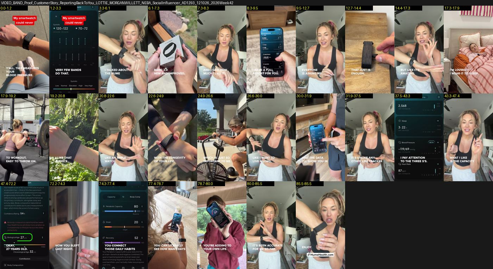

# VIDEO_BAND_Proof_CustomerStory_ReportingBackToYou_LOTTIE_MORGANWILLETT_NEBA_SocialInfluencer_AD1293_121026_2026Week42

Master: `VIDEO_BAND_Proof_CustomerStory_ReportingBackToYou_LOTTIE_MORGANWILLETT_NEBA_SocialInfluencer_AD1293_121026_2026Week42_Hook1_9x16.mp4` · 85.5s · 1080x1920

**Pacing:** 27 shots · avg 3.167s · median 1.9s · 3.04 cuts/10s · first cut 1.2s · 268.0 wpm · talk ratio 0.94 · cuts on word start 84.6% · cuts in speech gaps 65.4%
**Audio:** {'I_lufs': -12.6, 'LRA': 5.5, 'true_peak_db': 0.8} · BPM≈107.7 · music {'speech_rms_db': -18.6, 'pause_seconds': 0.0} · cuts with SFX/transient 34.6%

**Captions:** 435 cards · 1 words/card (median) · y≈0.718 of frame height · text height≈0.0258 · colours {'white': 280, 'dark/other': 148, 'yellow': 3, 'blue': 1, 'red': 3} · cards crossing a cut: 10
Highlighted: THATJUSTIS, ENOUGH., NOT ABIGSCREEN, -124/m20m, SEEHOW MANYDAYS, YOU'READDING TO, YOUR OWNLIFE.
**Headlines:** Mysmartwatch (0.0–3.0s, red) | could never (0.0–3.0s, red) | HumeBand（100%) (1.0–1.0s, dark/other) | 168 (1.0–1.0s, white) | 5291 (1.0–1.0s, dark/other) | Sleep (1.0–1.0s, white) | 22:00 (1.0–1.0s, dark/other) | 7h49m (1.0–1.0s, white)

**Hook (0–3s) spoken:** Y 'all, this measures your blood pressure. Very few bands do
**Hook on-screen:** 10AM / 11AM / 120 / 120-122 / 122/71mmHg / 12PM / 130 / 140 / 168 / 16:00 / 1PM / 22:00 / 24/Jul/26-30/Jul/26 / 2PM / 30/Jul/26 / 5291 / 70-72 / 7h49m / 8AM / 90bpm / BLOODPRESSURE. / BloodPressure / CYOURte / DO THAT. / Elevated / Fri / High / HowBloodPressureEstimationWorks? / HumeBand（100%) / Last:29/Jul/26 / Low / Mon / Mysmartwatch / Normal / Prev / Sleep / Systolic / Thu / VERYFEWBANDS / Very High / Wed / Y'ALL,THIS MEASURES / YOUR / YourHumeBandusesanopticalsensorthatshines / below.Thistechnigueiscalledphotoplethysmog / could never / essui / light intotheskinatyourwristandreadshowthe / lightchangesasbloodmovesthroughthevessels / mHg / tolic
**CTA (last 5s):** amazing. It's been accurate for me so far I love it. So anyways, I'll put the link on the screen. Enjoy · on-screen: ENJOY. / FORMESOFAR / FORMESOFAR. / HumeHealth.com / I'LL PUT THE LINK / ILOVEIT / IT'S BEENACCURATE / ON THESCREEN. / SO ANYWAYS

## Beat sheet

| # | in–out (s) | dur | transition | spoken | on-screen text |
|---|---|---|---|---|---|
| 1 | 0.00–1.20 | 1.2 |  | Y 'all, this measures your blood | Mysmartwatch [red] (HEADLINE) / could never [red] (HEADLINE) / Y'ALL,THIS MEASURES / YOUR / BLOODPRESSURE. / HumeBand（100%) (HEADLINE) |
| 2 | 1.20–3.33 | 2.13 | cut +SFX hit | pressure. Very few bands do that. | Mysmartwatch [red] (HEADLINE) / could never [red] (HEADLINE) / Y'ALL,THIS MEASURES / HumeBand（100%) (HEADLINE) / 168 (HEADLINE) / 5291 (HEADLINE) |
| 3 | 3.33–6.13 | 2.8 | cut | While I go on my story, I talked about the Hume Band 2 .0, | Mysmartwatch [red] (HEADLINE) / could never [red] (HEADLINE) / BloodPressure (HEADLINE) / Systolic (HEADLINE) / 120-122 (HEADLINE) / 70-72 (HEADLINE) |
| 4 | 6.13–7.27 | 1.13 | cut | new and improved. | BAND2.0 / NEW ANDIMPROVED, / HumeHealth / 24/7 Heelsh Thackong / ANDISAID HOW / MUCHILIKEIT. |
| 5 | 7.27–8.33 | 1.07 | cut | I said how much I like it. | ANDISAID HOW / MUCHILIKEIT. |
| 6 | 8.33–9.50 | 1.17 | cut | I have a full report for you. | ANDISAID HOW / MUCHILIKEIT. / HumeBand (83%) [blue] (HEADLINE) / CSleep / 7h48m / Last:02/Sep/26 |
| 7 | 9.50–12.67 | 3.17 | cut | Also the other question everyone has asked me, how long is the battery life? | ALSO, / THEOTHER QUESTION / EVERYONE / ISASKINGME / HOWLONGISTHE / BATTERY LIFE? |
| 8 | 12.67–14.40 | 1.73 | cut | 14 days, that is enough. | 14DAYS / THATJUSTIS [yellow] / ENOUGH. [yellow] |
| 9 | 14.40–17.27 | 2.87 | cut +SFX hit | It should sell you, but like it's amazing. I'm loving it. | THATJUSTIS [yellow] / ENOUGH. [yellow] / ITSHOULD / SELL YOU. / BUT LIKEIT'S / AMAZING. |
| 10 | 17.27–17.93 | 0.67 | cut | I wear it to sleep, | I'M LOVINGIT. / IWEARITTOSLEEP |
| 11 | 17.93–19.20 | 1.27 | cut +SFX hit | to workouts, easy to throw on. | 8888188 (HEADLINE) / TOWORKOUT / EASYTOTHROWON / LLIKETHAT / THERE'S |
| 12 | 19.20–20.77 | 1.57 | cut | I like that there's not a big screen. | LLIKETHAT / THERE'S / NOT ABIGSCREEN [yellow] |
| 13 | 20.77–22.57 | 1.8 | cut | I don't want notifications like an Apple Watch. | IDON'T WANT / NOTIFICATIONS / LIKEANAPPLE / WATCH |
| 14 | 22.57–24.93 | 2.37 | cut | This actually helps with the longevity of | HELPS / WITH THE LONGEVITY / OFYOURLIFE, |
| 15 | 24.93–26.60 | 1.67 | cut +SFX hit | your life, which is just so important | WITH THE LONGEVITY / OFYOURLIFE, / RNAD (HEADLINE) / WHICHISJUSTSO / IMPORTANTTO ME |
| 16 | 26.60–30.03 | 3.43 | cut | to me. As you all know, like I'm gonna live the long healthy lives. And the data | WHICHISJUSTSO / IMPORTANTTOME. / LIKEIWANT TO / LIVEALONG, / HEALTHYLIFE / -124/m20m [blue] |
| 17 | 30.03–31.93 | 1.9 | cut | I'll show you in the next story is unbelievable. | -124/m20m [blue] / ANDTHEDATA / 'LLSHOW YOU IN / 96.6-97.94 / 96-100 / THENEXTSTORY |
| 18 | 31.93–37.47 | 5.53 | cut +SFX hit | It's accurate, it's interesting. It's unlike any other like tracker I have seen before. | THENEXTSTORY / ISUNBELIEVABLE / IT'SACCURATE / IT'SINTERESTING / IT'SUNLIKEANY / OTHERLIKE TRACKER |
| 19 | 37.47–43.30 | 5.83 | cut +SFX hit | Okay, here is the app and the data. I pay attention to the three S's. So stress, my sleep, and my steps. | IHAVE SEEN / BEFORE. / HumeBand(100%) (HEADLINE) / 10582 (HEADLINE) / 168 (HEADLINE) / 5291 (HEADLINE) |
| 20 | 43.30–47.43 | 4.13 | cut | But beyond just that data, what I like is the capacity report tells me how to tackle my day, | Last:03/Sep/26 (HEADLINE) / HumeBand(85%) (HEADLINE) / Syncing... (HEADLINE) / 3210 (HEADLINE) / 2,568 (HEADLINE) / 1605 (HEADLINE) |
| 21 | 47.43–72.20 | 24.77 | cut | what your day to day needs to look like, how you can help yourself, how you can really optimize your day. And something else I pay attention to, which I've never seen on a tracker before, is an actual health score. Look at my biological age. Okay 27 years old. I kind of think of it as like a credit score for your age You can even track chronic illness and if you look right here at the metabolic momentum It's a daily longevity score that shows whether your everyday habits are moving your health in like a positive or a negative direction over time Rather | 100 (HEADLINE) / 73% [yellow] (HEADLINE) / TO TACKLEMYDAY / MetabolicCapacity (HEADLINE) / 1100 (HEADLINE) / Yourmetaboliccapacityscoreshowsastrong (HEADLINE) |
| 22 | 72.20–74.33 | 2.13 | cut +SFX hit | than only telling you how you slept last night the | RATHER THAN / HOWYOUSLEPT / LAST NIGHT, / THE HUME / BAND HELPS |
| 23 | 74.33–77.40 | 3.07 | cut +SFX hit | human band helps you connect those daily habits to your long -term health You | THE HUME / BAND HELPS / Capacity (HEADLINE) / BodyComp (HEADLINE) / 80 / MetabolicCapacity |
| 24 | 77.40–78.70 | 1.3 | cut | can literally see how many days | MetabolicCapacity (HEADLINE) / WhatItMeans (HEADLINE) / Metabolic Capacityisyourbody'sdaily"energy (HEADLINE) / budget."Ittellsyouhowreadyyouaretotakeon (HEADLINE) / physicalandmentalchallenges.Somedaysyou'll (HEADLINE) / havemoretogive,othersyou'llneedmorerecovery (HEADLINE) |
| 25 | 78.70–79.97 | 1.27 | cut +SFX hit | you're adding to your own life. The | 526 / YOU'READDING TO [red] / YOUR OWNLIFE. [red] |
| 26 | 79.97–85.47 | 5.5 | cut | stats are amazing. It's been accurate for me so far I love it. So anyways, I'll put the link on the screen. Enjoy | THESTATSARE / AMAZING / IT'S BEENACCURATE / FORMESOFAR / FORMESOFAR. / ILOVEIT |
| 27 | 85.47–85.50 | 0.04 | cut |  | HumeHealth.com / ENJOY. |

## Hook variants

| hook | file | dur | first cut | spoken 0–3s | on-screen 0–3s |
|---|---|---|---|---|---|
| 1 | `EBA_SocialInfluencer_AD1293_121026_2026Week42_Hook1_9x16.mp4` | 85.5 | 1.2 | Y 'all, this measures your blood pressure. Very few bands do | 10AM / 11AM / 120 / 120-122 / 122/71mmHg / 12PM / 130 / 140 |
| 1 | `EBA_SocialInfluencer_AD1293_121026_2026Week42_Hook1_9x16.mp4` | 85.5 | 1.2 | Y 'all, this measures your blood pressure. Very few bands do |  |
| 2 | `EBA_SocialInfluencer_AD1293_121026_2026Week42_Hook2_9x16.mp4` | 88.1 | 1.533 | I love this is more than just like a fitness tracker. I'm like, it actually |  |
| 2 | `EBA_SocialInfluencer_AD1293_121026_2026Week42_Hook2_9x16.mp4` | 88.1 | 1.533 | I love this is more than just like a fitness tracker. I'm like, it actually |  |
| 3 | `EBA_SocialInfluencer_AD1293_121026_2026Week42_Hook3_9x16.mp4` | 88.8 | 1.767 | The data is scary, accurate. It doesn't just give you these data |  |
| 3 | `EBA_SocialInfluencer_AD1293_121026_2026Week42_Hook3_9x16.mp4` | 88.8 | 1.767 | The data is scary, accurate. It doesn't just give you these data | 3:00元 / 7h48m / 7n48m / HighVery High / Very low |

## Full transcript

Y'all, this measures your blood pressure. Very few bands do that. While I go on my story, I talked about the Hume Band 2.0, new and improved. I said how much I like it. I have a full report for you. Also the other question everyone has asked me, how long is the battery life? 14 days, that is enough. It should sell you, but like it's amazing. I'm loving it. I wear it to sleep, to workouts, easy to throw on. I like that there's not a big screen. I don't want notifications like an Apple Watch. This actually helps with the longevity of your life, which is just so important to me. As you all know, like I'm gonna live the long healthy lives. And the data I'll show you in the next story is unbelievable. It's accurate, it's interesting. It's unlike any other like tracker I have seen before. Okay, here is the app and the data. I pay attention to the three S's. So stress, my sleep, and my steps. But beyond just that data, what I like is the capacity report tells me how to tackle my day, what your day to day needs to look like, how you can help yourself, how you can really optimize your day. And something else I pay attention to, which I've never seen on a tracker before, is an actual health score. Look at my biological age. Okay 27 years old. I kind of think of it as like a credit score for your age You can even track chronic illness and if you look right here at the metabolic momentum It's a daily longevity score that shows whether your everyday habits are moving your health in like a positive or a negative direction over time Rather than only telling you how you slept last night the human band helps you connect those daily habits to your long-term health You can literally see how many days you're adding to your own life. The stats are amazing. It's been accurate for me so far I love it. So anyways, I'll put the link on the screen. Enjoy