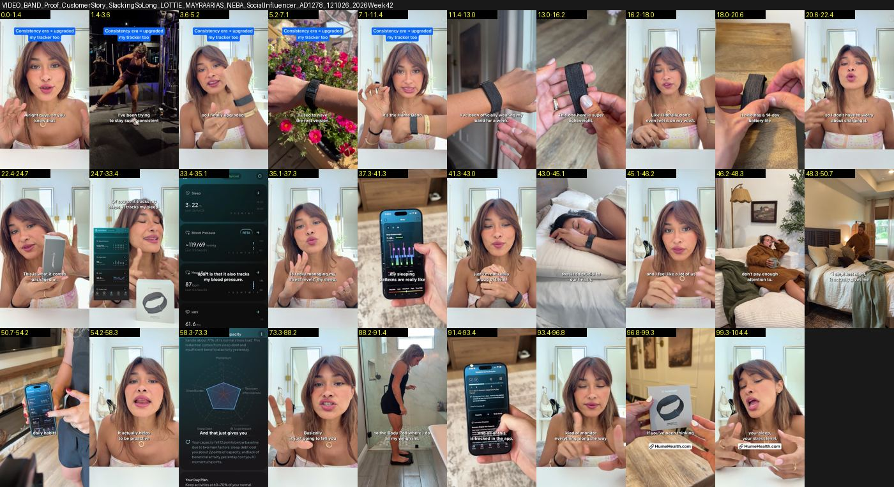

# VIDEO_BAND_Proof_CustomerStory_SlackingSoLong_LOTTIE_MAYRAARIAS_NEBA_SocialInfluencer_AD1278_121026_2026Week42

Master: `VIDEO_BAND_Proof_CustomerStory_SlackingSoLong_LOTTIE_MAYRAARIAS_NEBA_SocialInfluencer_AD1278_121026_2026Week42_Hook1_9x16.mp4` · 104.4s · 1080x1920

**Pacing:** 29 shots · avg 3.602s · median 2.3s · 2.68 cuts/10s · first cut 1.367s · 221.0 wpm · talk ratio 0.99 · cuts on word start 85.7% · cuts in speech gaps 64.3%
**Audio:** {'I_lufs': -12.7, 'LRA': 4.2, 'true_peak_db': 1.2} · BPM≈117.5 · music {'speech_rms_db': -19.0, 'pause_seconds': 0.5, 'pause_rms_db': -17.0, 'bed_minus_voice_db': 2.0, 'music_bed_likely': True} · cuts with SFX/transient 28.6%

**Captions:** 317 cards · 1 words/card (median) · y≈0.649 of frame height · text height≈0.0246 · colours {'red': 38, 'white': 229, 'dark/other': 46, 'other-colour': 1, 'yellow': 1, 'blue': 2} · cards crossing a cut: 15
Highlighted: Alrightguys,soyou, knowthat, I'vebeentrying, to stay super consistent, soI finally upgraded., I've been officially wearing my, band fora week., even feel it on my wrist., It also has a 14-day, battery life, so I don't have to worry, about charging it., This is what it comes, packaged in., I'm going to put a
**Headlines:** Consistency era +upgraded (0.0–9.0s, blue) | mytrackertoo (0.0–9.0s, blue) | uphere sothatyou can see (26.0–27.0s, white) | my results. (26.0–27.0s, white) | Of course it tracks my (28.0–30.0s, white) | steps,it tracks my sleep. (28.0–29.0s, white) | steps, it tracks my sleep (30.0–30.0s, white) | But what sets (31.0–32.0s, white)

**Hook (0–3s) spoken:** All right guys, so you know that I've been trying to stay super consistent at the
**Hook on-screen:** Alrightguys,soyou / Consistency era +upgraded / I'vebeentrying / atthegym, / knowthat / mytrackertoo / to stay super consistent
**CTA (last 5s):** tracking your stuff your sleep your stress level all of that you can do it all in one · on-screen: HumeHealth.com / about just tracking / all ofthat, / you can do it all in one. / your stress level, / yoursleep, / yoursteps,

## Beat sheet

| # | in–out (s) | dur | transition | spoken | on-screen text |
|---|---|---|---|---|---|
| 1 | 0.00–1.37 | 1.37 |  | All right guys, so you know that I've been | Consistency era +upgraded [blue] (HEADLINE) / mytrackertoo [blue] (HEADLINE) / Alrightguys,soyou [red] / knowthat [red] / I'vebeentrying [red] / to stay super consistent [red] |
| 2 | 1.37–3.57 | 2.2 | cut | trying to stay super consistent at the gym, | Consistency era +upgraded [blue] (HEADLINE) / mytrackertoo [blue] (HEADLINE) / I'vebeentrying [red] / to stay super consistent [red] / atthegym, / soI finally upgraded. [red] |
| 3 | 3.57–5.23 | 1.67 | cut | so I finally upgraded. | Consistency era +upgraded [blue] (HEADLINE) / mytrackertoo [blue] (HEADLINE) / soI finally upgraded. [red] / Iusedto have / thefirst version. |
| 4 | 5.23–7.13 | 1.9 | cut | I used to have the first version. | Consistency era +upgraded [blue] (HEADLINE) / mytrackertoo [blue] (HEADLINE) / Iusedto have / thefirst version. / XHume / This is the 2.0version. |
| 5 | 7.13–11.43 | 4.3 | cut | This is the 2 .0 version. It's the Hume band. I've been officially wearing | Consistency era +upgraded [blue] (HEADLINE) / mytrackertoo [blue] (HEADLINE) / This is the 2.0version. / It'stheHumeBand / I've been officially wearing my [red] / band fora week. [red] |
| 6 | 11.43–12.97 | 1.53 | cut | my band for a week. | I've been officially wearing my [red] / band fora week. [red] / WumeBane2.0 |
| 7 | 12.97–16.20 | 3.23 | cut +SFX hit | This one here is super lightweight, super comfortable. | This one here is super / lightweight, / supercomfortable. / LikeI literallydon't / even feel it on my wrist. [red] |
| 8 | 16.20–18.03 | 1.83 | cut | Like I literally don't even feel it on my wrist. | LikeI literallydon't / even feel it on my wrist. [red] / It also has a 14-day [other-colour] / battery life [yellow] |
| 9 | 18.03–20.60 | 2.57 | cut | It also has a 14 -day battery life, | It also has a 14-day [other-colour] / battery life [yellow] |
| 10 | 20.60–22.37 | 1.77 | cut | so I don't have to worry about charging it. | so I don't have to worry [red] / about charging it. [red] |
| 11 | 22.37–24.67 | 2.3 | cut | This is what it comes packaged in. | so I don't have to worry [red] / about charging it. [red] / This is what it comes [red] / packaged in. [red] |
| 12 | 24.67–33.43 | 8.77 | cut +SFX hit | I'm gonna put a screenshot up here so that you can see my results. Of course it tracks my steps, it tracks my sleep, but what sets this band apart is that it also | I'm going to put a [red] / screenshot / HumHeatt / uphere sothatyou can see (HEADLINE) / my results. (HEADLINE) / 99steps |
| 13 | 33.43–35.10 | 1.67 | cut +SFX hit | tracks my blood pressure right | apart is that italso tracks [red] / mybloodpressure, [red] / Homeleam / HumeBand(85%) (HEADLINE) / Synced (HEADLINE) / Sleep (HEADLINE) |
| 14 | 35.10–37.27 | 2.17 | cut | now is really managing my | Right now [red] / is really managing my [red] / stresslevels,my sleep, [red] |
| 15 | 37.27–41.33 | 4.07 | cut +SFX hit | stress levels, my sleep. My sleeping patterns are really like just, | is really managing my [red] / stresslevels,my sleep, [red] / 3:00% [blue] (HEADLINE) / StressLevel [blue] (HEADLINE) / 39.2 / stress,levelsrmysleep |
| 16 | 41.33–42.97 | 1.63 | cut | I'm not really proud of them but sleep | 7h48m / just'I'm not really / proud of them. / HighVeryHigh / Very low / just I'm not really |
| 17 | 42.97–45.10 | 2.13 | cut | is something that is so crucial to | But sleep is something / that is so crucial to / ourhealth, |
| 18 | 45.10–46.17 | 1.07 | cut +SFX hit | our health and I feel like | that is so crucial to / ourhealth, / andI feel like a lot of us |
| 19 | 46.17–48.33 | 2.17 | cut | a lot of us don't pay enough attention to. | andI feel like a lot of us / don't pay enough / attentionto. |
| 20 | 48.33–50.70 | 2.37 | cut +SFX hit | Instead of it just telling me how I slept last night, | don't pay enough / attentionto. / just telling me how / Islept last night, / it actually gives me |
| 21 | 50.70–54.17 | 3.47 | cut | it actually gives me daily habits and biomarkers that are going to help me | Islept last night, / it actually gives me / -124/72 / daily habits / 96-100x / andbiomarkers |
| 22 | 54.17–58.33 | 4.17 | cut | build better habits today. It actually helps to be proactive with your health. | andbiomarkers / that are going to help me / build better habits today. [red] / It actuallyhelps [red] / to be proactive [red] / withyour health [red] |
| 23 | 58.33–73.30 | 14.97 | cut +SFX hit | I'm actually gonna show you on here They have three different types of reports The first report is a capacity report and that just gives you a plan on how to tackle the day Then we have the weekly health report and what that does it gathers all your metrics and then it compares your | withyour health [red] / HealthReport (HEADLINE) / minimalactivitylevelsandmissingbody (HEADLINE) / compositiondata.Thisscorereflectsthe (HEADLINE) / significantimpactof sedentarybehavioron (HEADLINE) / comprehensivehealthmetrics,evenwhen (HEADLINE) |
| 24 | 73.30–88.17 | 14.87 | cut | Biological age to your actual age and we have the chronic illness report and that one is done after 30 days Basically is just going to tell you what direction your health is going in So think like heart health. I'll keep you posted on that one So | Focusonlighttomoderateactivities (HEADLINE) / today.Your capacityis significantly (HEADLINE) / reduced,sogentlemovementlike (HEADLINE) / MyDay / MyJourney / SleepOverview |
| 25 | 88.17–91.40 | 3.23 | cut | it actually connects to the body pod where I do all my weigh -ins and all | So it actually connects / to the Body Pod where I do / all myweighins, / and all ofthis / is tracked in the app, |
| 26 | 91.40–93.37 | 1.97 | cut | of this is tracked in the app So | and all ofthis / is tracked in the app, / Metabolle JourneyProgress [blue] (HEADLINE) / Next:Day5.MetabollcCepacity&MyDay / Duringourfirst5daysmetriesmayppe / personal basellne. |
| 27 | 93.37–96.77 | 3.4 | cut | I'll be able to just kind of monitor everything along the way | BedyComp / Capaclty / CAetivstionProgress! / Recovery ShapesYour Capselty / Yourbody'srecoveryfromstralnisanotherkey / factorinyour dallyMetabolleCapaelty.We |
| 28 | 96.77–99.30 | 2.53 | cut +SFX hit | I'll leave it linked here You've been thinking about just | XHumeHealth / 247HeahTaro / I'll leave it link here. / HumeHealth.com / XHumelHealth / Hume Band2.0 |
| 29 | 99.30–104.45 | 5.15 | cut | tracking your stuff your sleep your stress level all of that you can do it all in one | HumeHealth.com / tHumeHealth / about just tracking / yoursteps, / yoursleep, [red] / your stress level, [red] |

## Hook variants

| hook | file | dur | first cut | spoken 0–3s | on-screen 0–3s |
|---|---|---|---|---|---|
| 1 | `EBA_SocialInfluencer_AD1278_121026_2026Week42_Hook1_9x16.mp4` | 104.4 | 1.367 | All right guys, so you know that I've been trying to stay super consistent at the | Alrightguys,soyou / Consistency era +upgraded / I'vebeentrying / atthegym, / knowthat / mytrackertoo / to stay super consistent |
| 1 | `EBA_SocialInfluencer_AD1278_121026_2026Week42_Hook1_9x16.mp4` | 104.4 | 1.367 | Alright guys, so you know that I've been trying to stay super consistent at the |  |
| 2 | `EBA_SocialInfluencer_AD1278_121026_2026Week42_Hook2_9x16.mp4` | 98.1 | 1.5 | Unlike other wearables, this one actually focuses on |  |
| 2 | `EBA_SocialInfluencer_AD1278_121026_2026Week42_Hook2_9x16.mp4` | 98.1 | 1.5 | Unlike other wearables, this one actually focuses on |  |
| 3 | `EBA_SocialInfluencer_AD1278_121026_2026Week42_Hook3_9x16.mp4` | 99.7 | 3.233 | I'm actually really excited because I feel like I've been slacking for so long. |  |
| 3 | `EBA_SocialInfluencer_AD1278_121026_2026Week42_Hook3_9x16.mp4` | 99.7 | 3.233 | I'm actually really excited because I feel like I've been slacking for so long. |  |

## Full transcript

All right guys, so you know that I've been trying to stay super consistent at the gym, so I finally upgraded. I used to have the first version. This is the 2.0 version. It's the Hume band. I've been officially wearing my band for a week. This one here is super lightweight, super comfortable. Like I literally don't even feel it on my wrist. It also has a 14-day battery life, so I don't have to worry about charging it. This is what it comes packaged in. I'm gonna put a screenshot up here so that you can see my results. Of course it tracks my steps, it tracks my sleep, but what sets this band apart is that it also tracks my blood pressure right now is really managing my stress levels, my sleep. My sleeping patterns are really like just, I'm not really proud of them but sleep is something that is so crucial to our health and I feel like a lot of us don't pay enough attention to. Instead of it just telling me how I slept last night, it actually gives me daily habits and biomarkers that are going to help me build better habits today. It actually helps to be proactive with your health. I'm actually gonna show you on here They have three different types of reports The first report is a capacity report and that just gives you a plan on how to tackle the day Then we have the weekly health report and what that does it gathers all your metrics and then it compares your Biological age to your actual age and we have the chronic illness report and that one is done after 30 days Basically is just going to tell you what direction your health is going in So think like heart health. I'll keep you posted on that one So it actually connects to the body pod where I do all my weigh-ins and all of this is tracked in the app So I'll be able to just kind of monitor everything along the way I'll leave it linked here You've been thinking about just tracking your stuff your sleep your stress level all of that you can do it all in one