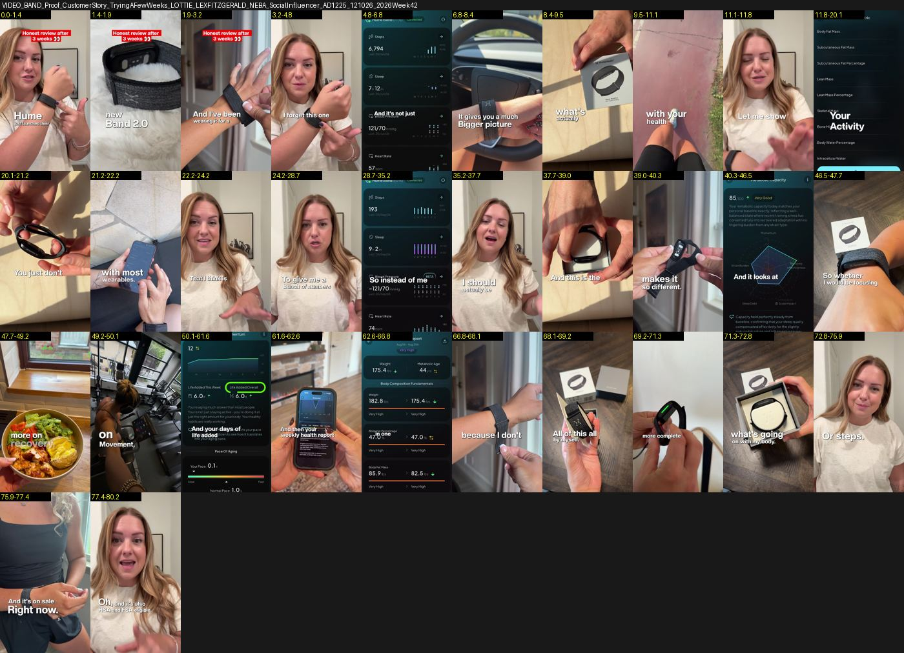

# VIDEO_BAND_Proof_CustomerStory_TryingAFewWeeks_LOTTIE_LEXFITZGERALD_NEBA_SocialInfluencer_AD1225_121026_2026Week42

Master: `VIDEO_BAND_Proof_CustomerStory_TryingAFewWeeks_LOTTIE_LEXFITZGERALD_NEBA_SocialInfluencer_AD1225_121026_2026Week42 Hook 1_9x16.mp4` · 80.2s · 1080x1920

**Pacing:** 32 shots · avg 2.507s · median 1.5s · 3.86 cuts/10s · first cut 1.42s · 248.0 wpm · talk ratio 0.97 · cuts on word start 83.9% · cuts in speech gaps 71.0%
**Audio:** {'I_lufs': -17.5, 'LRA': 4.4, 'true_peak_db': -0.0} · BPM≈117.5 · music {'speech_rms_db': -22.5, 'pause_seconds': 1.1, 'pause_rms_db': -27.5, 'bed_minus_voice_db': -5.0, 'music_bed_likely': True} · cuts with SFX/transient 58.1%

**Captions:** 313 cards · 1 words/card (median) · y≈0.655 of frame height · text height≈0.0281 · colours {'white': 235, 'red': 10, 'dark/other': 66, 'blue': 1, 'yellow': 1} · cards crossing a cut: 2
Highlighted: Iforget this one, It gives you a much, whichis, Hume connects, And this is the, I canopenmy, I would be focusing, moreon, recovery, Andthenyour, weeklyhealth.report, And it's on sale
**Headlines:** Honest review after (0.0–2.5s, red) | 3 weeks (0.0–2.5s, red) | HumeBand(77%) (5.0–6.0s, white) | Steps (5.0–6.0s, white) | 8492 (5.0–6.0s, dark/other) | 6,794 (5.0–6.0s, white) | 4246 (5.0–6.0s, dark/other) | Last:30/Jun/26 (5.5–6.0s, dark/other)

**Hook (0–3s) spoken:** Well, Hume just launched their new band 2 .0, and I've been wearing it for a few weeks.
**Hook on-screen:** 3 weeks / AndI'vebeen / Band2.0 / Honest review after / Hume / justlaunched their / new / wearing itfor a
**CTA (last 5s):** and it's on sale right now and it's also HSA and FSA eligible. · on-screen: And it's on sale / HSA and FSA eligible / HSA and FSA eligible. / Oh, and it's also / Right now.

## Beat sheet

| # | in–out (s) | dur | transition | spoken | on-screen text |
|---|---|---|---|---|---|
| 1 | 0.00–1.42 | 1.42 |  | Well, Hume just launched their new band 2 | Honest review after [red] (HEADLINE) / 3 weeks [red] (HEADLINE) / Hume / justlaunched their / new / Band2.0 |
| 2 | 1.42–1.86 | 0.44 | cut | .0, | Honest review after [red] (HEADLINE) / 3 weeks [red] (HEADLINE) / new / Band2.0 |
| 3 | 1.86–3.16 | 1.3 | cut | and I've been wearing it for a few weeks. | Honest review after [red] (HEADLINE) / 3 weeks [red] (HEADLINE) / new / Band2.0 / AndI'vebeen / wearing itfor a |
| 4 | 3.16–4.80 | 1.64 | cut +SFX hit | Forget that this one is even on my wrist, | Iforget this one [red] / is even on my wrist. |
| 5 | 4.80–6.82 | 2.02 | cut +SFX hit | and it's not just tracking steps. | Iforget this one [red] / is even on my wrist. / HumeBand(77%) (HEADLINE) / Steps (HEADLINE) / 8492 (HEADLINE) / 6,794 (HEADLINE) |
| 6 | 6.82–8.36 | 1.54 | cut +SFX hit | It gives you a much bigger picture of | It gives you a much [red] / Biggerpicture |
| 7 | 8.36–9.52 | 1.16 | cut | what's actually going on | It gives you a much [red] / Biggerpicture / HumeHealth" (HEADLINE) / Hume Band2.0 / 2417 Heaith Tracking / what's |
| 8 | 9.52–11.06 | 1.54 | cut | with your health over time. | with your (HEADLINE) / health / Let me show |
| 9 | 11.06–11.82 | 0.76 | cut +SFX hit | Let me show you the app. | Let me show |
| 10 | 11.82–20.06 | 8.24 | cut | First, you have all of the things that you would actually expect. Your sleep, your activity, your HRV, your heart data, and it even gives you your blood pressure insight, | 813 (HEADLINE) / Very High (HEADLINE) / WMetabolicMomentum (HEADLINE) / Capacity / Body Comp / First, you |
| 11 | 20.06–21.20 | 1.14 | cut +SFX hit | which is something you just don't really see | whichis [red] / something / withmost |
| 12 | 21.20–22.24 | 1.04 | cut | with most wearables. | withmost / But thisis |
| 13 | 22.24–24.18 | 1.94 | cut +SFX hit | But this is the part that I think is really important. | But thisis / ThatI think is / I don't |
| 14 | 24.18–28.68 | 4.5 | cut +SFX hit | I don't need another device to give me a bunch of numbers that I have absolutely no idea what to do with. | I don't / another device / To give me a / bunch of numbers / That I have / what to |
| 15 | 28.68–35.24 | 6.56 | cut | Hume connects the dots for you. So instead of me staring at a bunch of data wondering what any of it means, | Very High (HEADLINE) / WMetabolicMomentum (HEADLINE) / Body Comp / Capacity / 85 / MetabolicCapacity |
| 16 | 35.24–37.70 | 2.46 | cut +SFX hit | it helps tell me what I should actually be paying attention to. | It helps (HEADLINE) / I should / actually be / paying attention to. |
| 17 | 37.70–39.02 | 1.32 | cut +SFX hit | And this is the part that I think | And this is the [red] / makes it |
| 18 | 39.02–40.30 | 1.28 | cut +SFX hit | makes it so different. | makes it / so different. |
| 19 | 40.30–46.48 | 6.18 | cut | Every day I can open my capacity report and it looks at what my body has been doing and gives me a plan for that day. | makes it / so different. / Today [blue] (HEADLINE) / Yesterday (HEADLINE) / Yourmetabolicmomentumcurrently (HEADLINE) / sitsinstrongpositiveterritory,and (HEADLINE) |
| 20 | 46.48–47.70 | 1.22 | cut +SFX hit | So whether I would be focusing | MetabolicCapacity (HEADLINE) / SleepDebt / Capacityheldperfectlysteadyfrom / baseline,confirmingthatyoursleepquality / compensatedeffectivelyfortheslightly / Coming Soon |
| 21 | 47.70–49.18 | 1.48 | cut +SFX hit | more on recovery, | moreon [red] / recovery [yellow] / on |
| 22 | 49.18–50.12 | 0.94 | cut | on movement, | on / sleep, [blue] (HEADLINE) |
| 23 | 50.12–61.60 | 11.48 | cut +SFX hit | sleep, it also gives you things like your metabolic momentum, your pace of aging, and your days of life added. So you can actually see how the things you're doing every day are affecting your health long term. And then your weekly | sleep, [blue] (HEADLINE) / Yesterday'sResolution [blue] (HEADLINE) / Accumulated (HEADLINE) / Recovered (HEADLINE) / 51 (HEADLINE) / Strain (HEADLINE) |
| 24 | 61.60–62.62 | 1.02 | cut +SFX hit | health report | LowModerate High / Andthenyour [red] / weeklyhealth.report [red] / indicateshowyourbodyishandlingphysicaland / monitoring thismetric canihelpyouunderstand / how dalyhabits,sleep,and lfestylechoices |
| 25 | 62.62–66.76 | 4.14 | cut | basically pulls everything together in one place which I love because | ~125/71 (HEADLINE) / 1mmHg (HEADLINE) / HeartRate (HEADLINE) / 82bpm (HEADLINE) / Last:12/0ct/26 (HEADLINE) / HRV |
| 26 | 66.76–68.08 | 1.32 | cut | I don't want to have to interpret all | becauseIdon't / All of this all |
| 27 | 68.08–69.24 | 1.16 | cut | of this all by myself. | All of this all / So it gives |
| 28 | 69.24–71.28 | 2.04 | cut | So it gives me a much more complete picture of | So it gives / more complete / picture (HEADLINE) |
| 29 | 71.28–72.80 | 1.52 | cut +SFX hit | what's going on with my body instead | more complete / picture (HEADLINE) / what's going / on with my body |
| 30 | 72.80–75.88 | 3.08 | cut +SFX hit | of just focusing on waiter steps. The Humeban 2 .0 and | Instead of just / focusing on weight / Or steps. / The Hume / Band 2.0. |
| 31 | 75.88–77.36 | 1.48 | cut +SFX hit | it's on sale right now and | And it's on sale [red] / Right now. [red] (HEADLINE) |
| 32 | 77.36–80.21 | 2.85 | cut +SFX hit | it's also HSA and FSA eligible. | And it's on sale [red] / Right now. [red] (HEADLINE) / Oh, and it's also (HEADLINE) / HSA and FSA eligible / HSA and FSA eligible. |

## Hook variants

| hook | file | dur | first cut | spoken 0–3s | on-screen 0–3s |
|---|---|---|---|---|---|
| 1 | `BA_SocialInfluencer_AD1225_121026_2026Week42 Hook 1_9x16.mp4` | 80.2 | 1.42 | Well, Hume just launched their new band 2 .0, and I've been wearing it for a few weeks. | 3 weeks / AndI'vebeen / Band2.0 / Honest review after / Hume / justlaunched their / new / wearing itfor a |
| 2 | `BA_SocialInfluencer_AD1225_121026_2026Week42 Hook 2_9x16.mp4` | 83.1 | 0.56 | You have never seen me wear a fitness watch or a fitness ring before because I find | Orfitness / Seen / The girl who returned / You've never / becauseIfind them / everbought / everywearableshe / me wear a fitness watch |
| 3 | `BA_SocialInfluencer_AD1225_121026_2026Week42 Hook 3_9x16.mp4` | 83.3 | 1.46 | It's because it has up to 14 days of charge and mine | 10days inandIhaven't / It'sbecauseithas / XHumeHealth / and mine's still / of charge / touched the charger / up to 14 days |

## Full transcript

Well, Hume just launched their new band 2.0, and I've been wearing it for a few weeks. Forget that this one is even on my wrist, and it's not just tracking steps. It gives you a much bigger picture of what's actually going on with your health over time. Let me show you the app. First, you have all of the things that you would actually expect. Your sleep, your activity, your HRV, your heart data, and it even gives you your blood pressure insight, which is something you just don't really see with most wearables. But this is the part that I think is really important. I don't need another device to give me a bunch of numbers that I have absolutely no idea what to do with. Hume connects the dots for you. So instead of me staring at a bunch of data wondering what any of it means, it helps tell me what I should actually be paying attention to. And this is the part that I think makes it so different. Every day I can open my capacity report and it looks at what my body has been doing and gives me a plan for that day. So whether I would be focusing more on recovery, on movement, sleep, it also gives you things like your metabolic momentum, your pace of aging, and your days of life added. So you can actually see how the things you're doing every day are affecting your health long term. And then your weekly health report basically pulls everything together in one place which I love because I don't want to have to interpret all of this all by myself. So it gives me a much more complete picture of what's going on with my body instead of just focusing on waiter steps. The Humeban 2.0 and it's on sale right now and it's also HSA and FSA eligible.