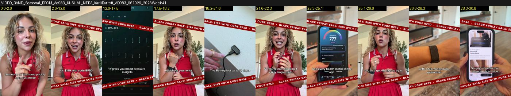

# VIDEO_BAND_Seasonal_BFCM_Ad983_KUSHAL_NEBA_KarliBarrett_AD983_061026_2026Week41

Master: `VIDEO_BAND_Seasonal_BFCM_Ad983_KUSHAL_NEBA_KarliBarrett_AD983_061026_2026Week41_Hook1_9x16.mp4` · 30.8s · 1080x1920

**Pacing:** 10 shots · avg 3.083s · median 2.599s · 2.92 cuts/10s · first cut 2.633s · 234.0 wpm · talk ratio 0.93 · cuts on word start 88.9% · cuts in speech gaps 66.7%
**Audio:** {'I_lufs': -7.0, 'LRA': 1.1, 'true_peak_db': 0.5} · BPM≈117.5 · music {'speech_rms_db': -9.8, 'pause_seconds': 0.6, 'pause_rms_db': -9.9, 'bed_minus_voice_db': -0.1, 'music_bed_likely': True} · cuts with SFX/transient 77.8%

**Captions:** 90 cards · 1.0 words/card (median) · y≈0.702 of frame height · text height≈0.0211 · colours {'red': 14, 'white': 34, 'dark/other': 37, 'yellow': 1, 'blue': 2, 'other-colour': 2} · cards crossing a cut: 2
Highlighted: Someone on the hume pricing, team just made, a very expensive mistake., The Hume Band 2.0 normally, ButforBlackFriday,, it's$199withcodeBF50., Andnobodyupstairshas, Thisisthebandthattracks, all day'andall night,, Andeveryhealth metricinthe, app, DEBF50, 777, You alsoget 45daystotry it,, BLACKI
**Headlines:** BLACKFRIDAYSALE:S199WITI (5.5–5.5s, red) | BLACKFRIDAYSALE:$199WITHCO (6.0–6.0s, red) | LACKFRIDAYSALE:$199WITHCO (6.0–6.0s, red) | RIDAYSALE:$199WITHCODEBF5 (7.0–7.0s, red) | RIDAYSALE:$199WITHCODEBF5C (7.0–7.0s, red) | ALE:$199WITHCODEBF50 (8.0–8.0s, red) | BLA (8.0–8.0s, red) | ALE:S199WITHCODEBF50.BLA (8.0–8.0s, red)

**Hook (0–3s) spoken:** Someone on the Hume pricing team just made a very expensive mistake. The HumeBand
**Hook on-screen:** Someone on the hume pricing / The Hume Band 2.0 normally / a very expensive mistake. / cost $356. / team just made
**CTA (last 5s):** days to try it with a full money back guarantee. So grab yours before someone fixes the price. · on-screen: $199 / $199WITHCODEBF50. BLACK / .BLACKFRIDAYSALE:S1S / 50. / ACKFRIDAYSALE:$199WITHCOD / BLACKFRIDAYS / BLACKFRIDAYSAL / BLACKFRIDAYSALE: / BLACKI / CellularRepair / DAYSALE:$199WITHCODEBF50 / EBF50

## Beat sheet

| # | in–out (s) | dur | transition | spoken | on-screen text |
|---|---|---|---|---|---|
| 1 | 0.00–2.63 | 2.63 |  | Someone on the Hume pricing team just made a very expensive mistake. | Someone on the hume pricing [red] / team just made [red] / a very expensive mistake. [red] / The Hume Band 2.0 normally [red] / cost $356. |
| 2 | 2.63–12.03 | 9.4 | cut +SFX hit | The HumeBand 2 .0 normally costs $356, but for Black Friday, it's $199 with code VF50 and nobody upstairs has noticed yet. This is the band that tracks your stress, | The Hume Band 2.0 normally [red] / cost $356. / BLACKFRIDAYSALE:S199WITI [red] (HEADLINE) / ButforBlackFriday, [red] / BLACKFRIDAYSALE:$199WITHCO [red] (HEADLINE) / LACKFRIDAYSALE:$199WITHCO [red] (HEADLINE) |
| 3 | 12.03–17.47 | 5.43 | cut | your sleep, your heart rate variability. It gives you blood pressure insights all day and all night, right | StressLevel (HEADLINE) / ACKFRIDAYSALE:$199WITHCOD [red] (HEADLINE) / Average (HEADLINE) / 53.7 (HEADLINE) / Moderate (HEADLINE) / 07/Aug/26 (HEADLINE) |
| 4 | 17.47–18.20 | 0.73 | cut +SFX hit | from your wrist. | Low / BloodPressure (HEADLINE) / Systolic / Normal / 140 / Diastolic |
| 5 | 18.20–21.63 | 3.43 | cut +SFX hit | The battery lasts up to 14 days, so you're not changing it every single night. | ACKFRIDAYSALE:$199WITHCODI [red] (HEADLINE) / The Battery last up to 14 dayS, / ACKFRIDAYSALE:$199WITHCODE [red] (HEADLINE) / DAYSALE:$199WITHCODEBF50 [red] (HEADLINE) / AYSALE:$199WITHCODEBF50 [red] (HEADLINE) / E:$199WITHCODEBF50 [red] (HEADLINE) |
| 6 | 21.63–22.30 | 0.67 | cut +SFX hit | And every health | DEBF50 [red] (HEADLINE) / BLACKFRIDAYSALE:$ [red] (HEADLINE) / Andeveryhealth metricinthe [red] / app [red] / ·BLACKFRIDAYSALE:S [red] (HEADLINE) / DEBF50 [red] |
| 7 | 22.30–25.13 | 2.83 | cut +SFX hit | metric in the app is free with no subscription. | DEBF50 [red] (HEADLINE) / BLACKFRIDAYSALE:$ [red] (HEADLINE) / Andeveryhealth metricinthe [red] / app [red] / ·BLACKFRIDAYSALE:S [red] (HEADLINE) / DEBF50 [red] |
| 8 | 25.13–26.63 | 1.5 | cut +SFX hit | You also get 45 days to try | AYSALE:$199WITHCODEBF50 [red] (HEADLINE) / You alsoget 45daystotry it, [red] / $199WITHCODEBF50. BLACK [red] (HEADLINE) / BLACKI [red] / S$199WITHCODEBF50 [red] (HEADLINE) |
| 9 | 26.63–28.27 | 1.63 | cut | it with a full money back guarantee. | ITHCODEBF5O·BLACKFRIDAY [red] (HEADLINE) / withafull moneyback [other-colour] / guarantee. [other-colour] / BLACKFRIDAYS [red] (HEADLINE) / ITHCODEBF5O [red] (HEADLINE) / EBF5O·BLACKFRIDAYSALE:S1 [red] (HEADLINE) |
| 10 | 28.27–30.83 | 2.57 | cut +SFX hit | So grab yours before someone fixes the price. | withafull moneyback [other-colour] / guarantee. [other-colour] / EBF5O·BLACKFRIDAYSALE:S1 [red] (HEADLINE) / .BLACKFRIDAYSALE:S1S [red] (HEADLINE) / EBF50 [red] / ODEBF50 [red] (HEADLINE) |

## Hook variants

| hook | file | dur | first cut | spoken 0–3s | on-screen 0–3s |
|---|---|---|---|---|---|
| 1 | `HAL_NEBA_KarliBarrett_AD983_061026_2026Week41_Hook1_9x16.mp4` | 30.8 | 2.633 | Someone on the Hume pricing team just made a very expensive mistake. The HumeBand | Someone on the hume pricing / The Hume Band 2.0 normally / a very expensive mistake. / cost $356. / team just made |
| 2 | `HAL_NEBA_KarliBarrett_AD983_061026_2026Week41_Hook2_9x16.mp4` | 30.9 | 2.233 | This price was never supposed to go live. The Hume Band 2 .0 | The Hume Band 2.0 normally / This price was never / cost $356. / supposed to go live. / supposed togo live |
| 3 | `HAL_NEBA_KarliBarrett_AD983_061026_2026Week41_Hook3_9x16.mp4` | 30.7 | 2.467 | We checked this price three times and it's still wrong. The Humeban 2 | And it's still wrong / And it's still wrong. / The Hume Band 2.0 normally / We checked this price three / cost$356. / times, |

## Full transcript

Someone on the Hume pricing team just made a very expensive mistake. The HumeBand 2.0 normally costs $356, but for Black Friday, it's $199 with code VF50 and nobody upstairs has noticed yet. This is the band that tracks your stress, your sleep, your heart rate variability. It gives you blood pressure insights all day and all night, right from your wrist. The battery lasts up to 14 days, so you're not changing it every single night. And every health metric in the app is free with no subscription. You also get 45 days to try it with a full money back guarantee. So grab yours before someone fixes the price.