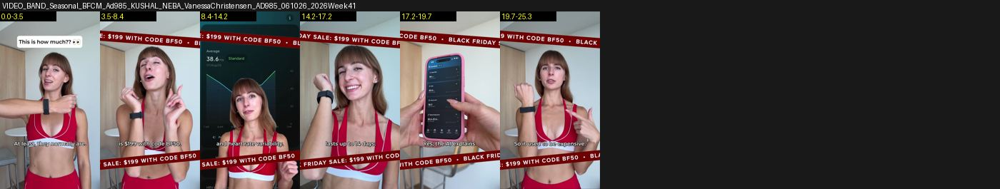

# VIDEO_BAND_Seasonal_BFCM_Ad985_KUSHAL_NEBA_VanessaChristensen_AD985_061026_2026Week41

Master: `VIDEO_BAND_Seasonal_BFCM_Ad985_KUSHAL_NEBA_VanessaChristensen_AD985_061026_2026Week41_Hook1_9x16.mp4` · 25.3s · 1080x1920

**Pacing:** 6 shots · avg 4.213s · median 4.184s · 1.98 cuts/10s · first cut 3.5s · 208.0 wpm · talk ratio 0.93 · cuts on word start 100.0% · cuts in speech gaps 100.0%
**Audio:** {'I_lufs': -22.1, 'LRA': 3.3, 'true_peak_db': -6.3} · BPM≈117.5 · music {'speech_rms_db': -27.7, 'pause_seconds': 1.0, 'pause_rms_db': -31.4, 'bed_minus_voice_db': -3.7, 'music_bed_likely': True} · cuts with SFX/transient 60.0%

**Captions:** 43 cards · 1 words/card (median) · y≈0.731 of frame height · text height≈0.034 · colours {'red': 11, 'white': 30, 'dark/other': 2} · cards crossing a cut: 0
Highlighted: These are way too expensive., Yes,ittracksyourstress., Yes,ittracksyoursleep, and heart rate variability., Yes,it givesyoublood, pressureinsights all day., Yes,thebatterylife, lastsupto14days, subscription on topof it., So it used to be expensive., But not anymore.
**Headlines:** This is how much?? (0.0–3.0s, white) | LACKFRIDAYSALE:$199WITH (3.5–4.0s, white) | BLACKFRIDAYSALE:$199V (3.5–3.5s, white) | FRIDAY SALE:$199 WITH (4.0–4.0s, white) | COD (4.0–4.0s, white) | DAYSALE:$199 WITHCODE B (4.5–4.5s, white) | KFRIDAYSALE:$199WITHCOD (4.5–4.5s, white) | SALE:$199WITHCODEBF50 (5.0–5.5s, white)

**Hook (0–3s) spoken:** these are way too expensive. At least they normally are.
**Hook on-screen:** At least, they normally are. / These are way too expensive. / This is how much??
**CTA (last 5s):** there's no subscription on top of it. So it used to be expensive, but not anymore. · on-screen: $199 WITHCODEBF50. BL / 50 / 99WITHCODEBF50 / AY / BF50 / BLACK / BLACKFRIDAYS / BLACKFRIDAYSALE / BLACKFRIDAYSALE:$19 / BLACKFRIDAYSALE:$199WI / But not anymore. / CODEBF5O

## Beat sheet

| # | in–out (s) | dur | transition | spoken | on-screen text |
|---|---|---|---|---|---|
| 1 | 0.00–3.50 | 3.5 |  | these are way too expensive. At least they normally are. | This is how much?? (HEADLINE) / These are way too expensive. [red] / At least, they normally are. |
| 2 | 3.50–8.37 | 4.87 | cut +SFX hit | But for Black Friday, the Human 2 .0 is $199 with code BF50. | LACKFRIDAYSALE:$199WITH (HEADLINE) / Butfor BlackFriday,the / BLACKFRIDAYSALE:$199V (HEADLINE) / FRIDAY SALE:$199 WITH (HEADLINE) / COD (HEADLINE) / DAYSALE:$199 WITHCODE B (HEADLINE) |
| 3 | 8.37–14.20 | 5.83 | cut +SFX hit | Yes, it tracks your stress. Yes, it tracks your sleep and heart rate variability. Yes, it gives you blood pressure insights all day. | is$199withcodeBF50. / BLACKFRIDAY SALE:$1 (HEADLINE) / · BLACKFRIDAY SALI (HEADLINE) / DEBF50 / StressLevel (HEADLINE) / ACKFRIDAY SALE:$199WITH (HEADLINE) |
| 4 | 14.20–17.17 | 2.97 | cut | Yes, the battery life lasts up to 14 days. | BLACKFRIDAYSALE:$199W (HEADLINE) / Yes,thebatterylife [red] / F5O.BLACKFRIDAYSALE:$1S [red] (HEADLINE) / FRIDAY SALE:$199 WITH COD (HEADLINE) / WITH / ACKFRIDAYSALE:$199 [red] (HEADLINE) |
| 5 | 17.17–19.73 | 2.57 | cut | Yes, the AI explains what your numbers mean. | WITHCODEBF5O (HEADLINE) / BLACK (HEADLINE) / 6:49. / Yes,theAlexplains / .BL / E:$199WITHCODEBF50 (HEADLINE) |
| 6 | 19.73–25.28 | 5.55 | cut +SFX hit | And yes, there's no subscription on top of it. So it used to be expensive, but not anymore. | ACKFRIDAYSALE:$199WITH (HEADLINE) / Andyes,there'sno / BLACKFRIDAYSALE:$199 W (HEADLINE) / AY (HEADLINE) / SALE:$199WITHCODEBF (HEADLINE) / subscription on topof it. [red] |

## Hook variants

| hook | file | dur | first cut | spoken 0–3s | on-screen 0–3s |
|---|---|---|---|---|---|
| 1 | `BA_VanessaChristensen_AD985_061026_2026Week41_Hook1_9x16.mp4` | 25.3 | 3.5 | these are way too expensive. At least they normally are. | At least, they normally are. / These are way too expensive. / This is how much?? |
| 1 | `BA_VanessaChristensen_AD985_061026_2026Week41_Hook1_9x16.mp4` | 25.3 | 8.367 | These are way too expensive. At least, they normally are. |  |
| 2 | `BA_VanessaChristensen_AD985_061026_2026Week41_Hook2_9x16.mp4` | 26.1 | 4.333 | $356 for a wellness band, |  |
| 2 | `BA_VanessaChristensen_AD985_061026_2026Week41_Hook2_9x16.mp4` | 26.1 | 9.2 | $356 for a wellness band, |  |
| 3 | `BA_VanessaChristensen_AD985_061026_2026Week41_Hook3_9x16.mp4` | 23.9 | 2.167 | Nobody should pay full price for a health band. But for Black Friday, | BLACKFRIDAY SALE:$199 / BLACKFRIDAYSALE:$199 WIT / ButforBlackFriday,the / CKFRIDAYSALE:$199WITH / Nobody should pay / full price for a health band. |
| 3 | `BA_VanessaChristensen_AD985_061026_2026Week41_Hook3_9x16.mp4` | 23.9 | 7.033 | Nobody should pay full price for a health band. But for Black Friday, |  |

## Full transcript

these are way too expensive. At least they normally are. But for Black Friday, the Human 2.0 is $199 with code BF50. Yes, it tracks your stress. Yes, it tracks your sleep and heart rate variability. Yes, it gives you blood pressure insights all day. Yes, the battery life lasts up to 14 days. Yes, the AI explains what your numbers mean. And yes, there's no subscription on top of it. So it used to be expensive, but not anymore.