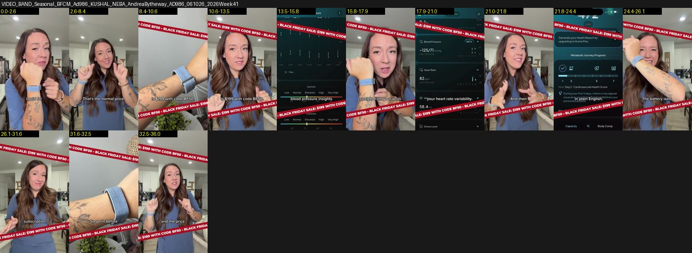

# VIDEO_BAND_Seasonal_BFCM_Ad986_KUSHAL_NEBA_AndreaBytheway_AD986_061026_2026Week41

Master: `VIDEO_BAND_Seasonal_BFCM_Ad986_KUSHAL_NEBA_AndreaBytheway_AD986_061026_2026Week41_Hook1_9x16.mp4` · 36.0s · 1080x1920

**Pacing:** 13 shots · avg 2.77s · median 2.6s · 3.33 cuts/10s · first cut 2.6s · 162.0 wpm · talk ratio 0.96 · cuts on word start 50.0% · cuts in speech gaps 25.0%
**Audio:** {'I_lufs': -19.7, 'LRA': 3.6, 'true_peak_db': -1.2} · BPM≈129.2 · music {'speech_rms_db': -25.4, 'pause_seconds': 2.4, 'pause_rms_db': -25.9, 'bed_minus_voice_db': -0.6, 'music_bed_likely': True} · cuts with SFX/transient 66.7%

**Captions:** 79 cards · 1 words/card (median) · y≈0.727 of frame height · text height≈0.0246 · colours {'white': 54, 'dark/other': 23, 'red': 1, 'other-colour': 1} · cards crossing a cut: 0
Highlighted: LOW, Sogetitbefore
**Headlines:** .BLACKFRIDAYSALE:$199WITHCODI (7.0–7.0s, red) | ·BLACKFRIDAYSALE:S199WITHCODI (7.0–7.0s, red) | EBF5O·BLACKFRIDAYSALE:S199WITH (8.0–8.0s, red) | ICODEBF5O·BLACKFRIDAYSALE:S199 (9.0–9.0s, red) | CODEBF5O·BLACKFRIDAYSALE:$199 (9.0–9.0s, red) | WITHCODEBF5O·BLACKFRIDAYSAL (10.0–10.0s, red) | WITHCODEBF5O·BLACKFRIDAYSALI (10.0–10.0s, red) | E:$199WITHCODEBF5O·BLACKFRIDA (11.0–11.0s, red)

**Hook (0–3s) spoken:** Guess what I paid for this health band?
**Hook on-screen:** $356? / Guesswhat / MOZAM / paid for / this health band / this health band.
**CTA (last 5s):** you pay So get it before Cyber Monday ends and the price goes back to 356 · on-screen: 9WITHCODEBF5O·BLACKFRIDAYSAL / CODEBF5O·BLACKFRIDAYSALE:S199 / CyberMondayends / E:$199WITHCODEBF50·BLACKFRIDA / E:S199WITHCODEBF5OBLACKFRIDA / HCODEBF5O·BLACKFRIDAYSALE:S19 / Sogetitbefore / WITHCODEBF5OBLACKFRIDAYSAL / YSALE:$199WITHCODEBF50·BLACK / YSALE:$199WITHCODEBF5O·BLACK / andtheprice / goesbackto$356.

## Beat sheet

| # | in–out (s) | dur | transition | spoken | on-screen text |
|---|---|---|---|---|---|
| 1 | 0.00–2.60 | 2.6 |  | Guess what I paid for this health band? | MOZAM / Guesswhat / paid for / this health band. / this health band / $356? |
| 2 | 2.60–8.37 | 5.77 | cut +SFX hit | $356. That's the normal price. For Black Friday, the HumeBand | $356? / That's the normal price. / HOAS / .BLACKFRIDAYSALE:$199WITHCODI [red] (HEADLINE) / MO2AM / ForBlackFriday, |
| 3 | 8.37–10.60 | 2.23 | cut +SFX hit | 2 .0 is $199 with | EBF5O·BLACKFRIDAYSALE:S199WITH [red] (HEADLINE) / theHumeBand2.0 / ICODEBF5O·BLACKFRIDAYSALE:S199 [red] (HEADLINE) / is$199withcodeBF50. / CODEBF5O·BLACKFRIDAYSALE:$199 [red] (HEADLINE) / WITHCODEBF5O·BLACKFRIDAYSAL [red] (HEADLINE) |
| 4 | 10.60–13.47 | 2.87 | cut | code BF50, and it gives you blood | E:$199WITHCODEBF5O·BLACKFRIDA [red] (HEADLINE) / is$199withcodeBF50 / E:S199WITHCODEBF5O·BLACKFRIDA [red] (HEADLINE) / YSALE:$199WITHCODEBF5O·BLACK [red] (HEADLINE) / is$199withcodeBF50. / YSALE:$199WITHCODEBF50.BLACK [red] (HEADLINE) |
| 5 | 13.47–15.83 | 2.37 | cut +SFX hit | pressure insights day and night. Straight | FRIDAYSALE:S199WITHCODEBF5O·B [red] (HEADLINE) / Anditgivesyou / FRIDAYSALE:$199WITHCODEBF5O.B [red] (HEADLINE) / BloodPressure (HEADLINE) / LACKFRIDAYSALE:$199WITHCODEBF [red] (HEADLINE) / Systolic (HEADLINE) |
| 6 | 15.83–17.90 | 2.07 | cut +SFX hit | from your wrist. It tracks your | DEBF5O·BLACKFRIDAYSALE:S199WI [red] (HEADLINE) / straight from your wrist. / DEBF5O.BLACKFRIDAYSALE:$199WI [red] (HEADLINE) / ITHCODEBF5O·BLACKFRIDAYSALE:$T [red] (HEADLINE) / THCODEBF5O·BLACKFRIDAYSALE:ST [red] (HEADLINE) |
| 7 | 17.90–21.00 | 3.1 | cut | stress, your sleep, your heart rate variability, and then | StressLevel (HEADLINE) / I99WITHCODEBF5O.BLACKFRIDAYS [red] (HEADLINE) / Average (HEADLINE) / 39.9 (HEADLINE) / Low [green] (HEADLINE) / Mon |
| 8 | 21.00–21.77 | 0.77 | cut +SFX hit | the AI explains | CKFRIDAYSALE:S199WITHCODEBF50 [red] (HEADLINE) / Andthen / KFRIDAYSALE:S199WITHCODEBF50 [red] (HEADLINE) |
| 9 | 21.77–24.37 | 2.6 | cut +SFX hit | every number in plain English. | 11:244 [blue] (HEADLINE) / ·BLACKFRIDAYSALE:S199WITHCODE [red] (HEADLINE) / HealthScore [red] (HEADLINE) / 472 (HEADLINE) / HumePlusExclusive / GenerateyourHealthReportby |
| 10 | 24.37–26.10 | 1.73 | cut +SFX hit | The battery lasts up to 14 | MetabolicJourneyProgress / Next:Day2.CardiovascularHealthScore / Low (HEADLINE) / GenerateyourHealthReportby (HEADLINE) / upgradingtoHumePlus (HEADLINE) / personalbaseline. |
| 11 | 26.10–31.63 | 5.53 | cut | days, And there's no subscription. So that price is the last thing you pay So | :$199WITHCODEBF5O.BLACKFRIDAY [red] (HEADLINE) / upto14days. / S199WITHCODEBF5O·BLACKFRIDAY [red] (HEADLINE) / SALE:S199WITHCODEBF5O·BLACKF [red] (HEADLINE) / SALE:S199WITHCODEBF5O·BLACKFE [red] (HEADLINE) / RIDAYSALE:$199WITHCODEBF5O·BL [red] (HEADLINE) |
| 12 | 31.63–32.53 | 0.9 | cut +SFX hit | get it before Cyber | HCODEBF5O·BLACKFRIDAYSALE:S19 [red] (HEADLINE) / Sogetitbefore [other-colour] / CODEBF5O·BLACKFRIDAYSALE:S199 [red] (HEADLINE) |
| 13 | 32.53–36.01 | 3.48 | cut | Monday ends and the price goes back to 356 | 9WITHCODEBF5O·BLACKFRIDAYSAL [red] (HEADLINE) / CyberMondayends / WITHCODEBF5OBLACKFRIDAYSAL [red] (HEADLINE) / E:$199WITHCODEBF50·BLACKFRIDA [red] (HEADLINE) / andtheprice / E:S199WITHCODEBF5OBLACKFRIDA [red] (HEADLINE) |

## Hook variants

| hook | file | dur | first cut | spoken 0–3s | on-screen 0–3s |
|---|---|---|---|---|---|
| 1 | `L_NEBA_AndreaBytheway_AD986_061026_2026Week41_Hook1_9x16.mp4` | 36.0 | 2.6 | Guess what I paid for this health band? | $356? / Guesswhat / MOZAM / paid for / this health band / this health band. |
| 2 | `L_NEBA_AndreaBytheway_AD986_061026_2026Week41_Hook2_9x16.mp4` | 36.1 | 2.6 | Most people guessed the price wrong on this one. | $356? / Most people guess / on this one. / the price wrong |
| 3 | `L_NEBA_AndreaBytheway_AD986_061026_2026Week41_Hook3_9x16.mp4` | 36.6 | 9.0 | How much would you pay for a band that tracks your blood pressure? | How much / for a band / that tracks / would you pay / your blood pressure? |

## Full transcript

Guess what I paid for this health band? $356. That's the normal price. For Black Friday, the HumeBand 2.0 is $199 with code BF50, and it gives you blood pressure insights day and night. Straight from your wrist. It tracks your stress, your sleep, your heart rate variability, and then the AI explains every number in plain English. The battery lasts up to 14 days, And there's no subscription. So that price is the last thing you pay So get it before Cyber Monday ends and the price goes back to 356