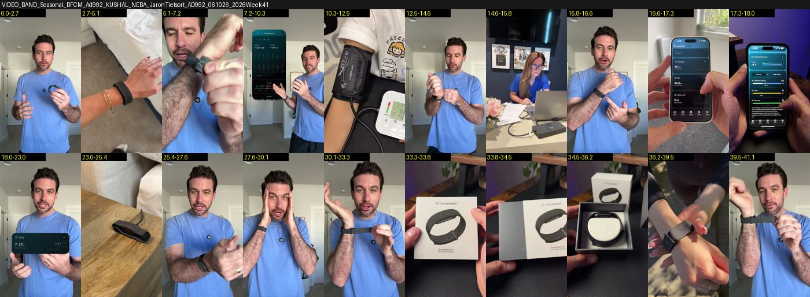

# VIDEO_BAND_Seasonal_BFCM_Ad992_KUSHAL_NEBA_JaronTietsort_AD992_061026_2026Week41

Master: `VIDEO_BAND_Seasonal_BFCM_Ad992_KUSHAL_NEBA_JaronTietsort_AD992_061026_2026Week41_9X16_HOOK1.mp4` · 41.1s · 1080x1920

**Pacing:** 20 shots · avg 2.054s · median 2.183s · 4.63 cuts/10s · first cut 2.667s · 218.0 wpm · talk ratio 0.94 · cuts on word start 84.2% · cuts in speech gaps 57.9%
**Audio:** {'I_lufs': -15.9, 'LRA': 3.0, 'true_peak_db': 0.1} · BPM≈152.0 · music {'speech_rms_db': -20.9, 'pause_seconds': 0.2} · cuts with SFX/transient 73.7%

**Captions:** 13 cards · 1 words/card (median) · y≈0.59 of frame height · text height≈0.0258 · colours {'white': 12, 'dark/other': 1} · cards crossing a cut: 0
**Headlines:** TYPE:ACMNP-1 (11.0–12.0s, white) | AS (12.0–12.0s, white)

**Hook (0–3s) spoken:** High blood pressure has no symptoms. So this Christmas, I gave my
**Hook on-screen:** 
**CTA (last 5s):** So get her this before Cyber Monday ends, she'll thank you for it. And maybe grab one for yourself too. · on-screen: 

## Beat sheet

| # | in–out (s) | dur | transition | spoken | on-screen text |
|---|---|---|---|---|---|
| 1 | 0.00–2.67 | 2.67 |  | High blood pressure has no symptoms. So this Christmas, |  |
| 2 | 2.67–5.13 | 2.47 | cut | I gave my wife a band that tracks it all day. |  |
| 3 | 5.13–7.20 | 2.07 | cut | It's the Hume Band 2 .0. |  |
| 4 | 7.20–10.27 | 3.07 | cut +SFX hit | It gives her blood pressure insights all day and all night without |  |
| 5 | 10.27–12.50 | 2.23 | cut | one of those annoying tightening cuffs. | TYPE:ACMNP-1 (HEADLINE) / 78 / WHO / 79 / AS (HEADLINE) / Hello |
| 6 | 12.50–14.63 | 2.13 | cut +SFX hit | So instead of just getting one reading a year at |  |
| 7 | 14.63–15.80 | 1.17 | cut | her doctor's office, |  |
| 8 | 15.80–16.60 | 0.8 | cut +SFX hit | it's monitoring it |  |
| 9 | 16.60–17.33 | 0.73 | cut +SFX hit | all day and | 65bpm / 86.0m / 19.6 / Last://M/25 |
| 10 | 17.33–18.00 | 0.67 | cut | all night. | 65bpm / 86.0m / 19.6 / Last://M/25 |
| 11 | 18.00–23.03 | 5.03 | cut +SFX hit | It also tracks her stress and her steps and her sleep. Best of all, there's no subscription. | 46.8 / 99 Steps / 1,946 |
| 12 | 23.03–25.37 | 2.33 | cut +SFX hit | The battery, it lasts up to 14 days and |  |
| 13 | 25.37–27.63 | 2.27 | cut +SFX hit | it's FSA and HSA eligible. And |  |
| 14 | 27.63–30.07 | 2.43 | cut +SFX hit | maybe the craziest part is that for Black Friday, |  |
| 15 | 30.07–33.27 | 3.2 | cut +SFX hit | it's only $199 with code DF50 instead |  |
| 16 | 33.27–33.80 | 0.53 | cut +SFX hit | of |  |
| 17 | 33.80–34.50 | 0.7 | cut +SFX hit | the $356 | HHuneea |
| 18 | 34.50–36.17 | 1.67 | cut +SFX hit | that I paid for it. | HumoHealth |
| 19 | 36.17–39.47 | 3.3 | cut +SFX hit | So get her this before Cyber Monday ends, she'll thank you for it. |  |
| 20 | 39.47–41.08 | 1.61 | cut +SFX hit | And maybe grab one for yourself too. |  |

## Hook variants

| hook | file | dur | first cut | spoken 0–3s | on-screen 0–3s |
|---|---|---|---|---|---|
| 1 | `AL_NEBA_JaronTietsort_AD992_061026_2026Week41_9X16_HOOK1.mp4` | 41.1 | 2.667 | High blood pressure has no symptoms. So this Christmas, I gave my |  |
| 1 | `AL_NEBA_JaronTietsort_AD992_061026_2026Week41_9X16_HOOK1.mp4` | 41.1 | 2.667 |  |  |
| 2 | `AL_NEBA_JaronTietsort_AD992_061026_2026Week41_9X16_HOOK2.mp4` | 42.1 | 0.533 |  |  |
| 2 | `AL_NEBA_JaronTietsort_AD992_061026_2026Week41_9X16_HOOK2.mp4` | 42.1 | 0.533 |  |  |
| 3 | `AL_NEBA_JaronTietsort_AD992_061026_2026Week41_9X16_HOOK3.mp4` | 41.8 | 3.333 |  |  |
| 3 | `AL_NEBA_JaronTietsort_AD992_061026_2026Week41_9X16_HOOK3.mp4` | 41.8 | 3.333 |  |  |

## Full transcript

High blood pressure has no symptoms. So this Christmas, I gave my wife a band that tracks it all day. It's the Hume Band 2.0. It gives her blood pressure insights all day and all night without one of those annoying tightening cuffs. So instead of just getting one reading a year at her doctor's office, it's monitoring it all day and all night. It also tracks her stress and her steps and her sleep. Best of all, there's no subscription. The battery, it lasts up to 14 days and it's FSA and HSA eligible. And maybe the craziest part is that for Black Friday, it's only $199 with code DF50 instead of the $356 that I paid for it. So get her this before Cyber Monday ends, she'll thank you for it. And maybe grab one for yourself too.