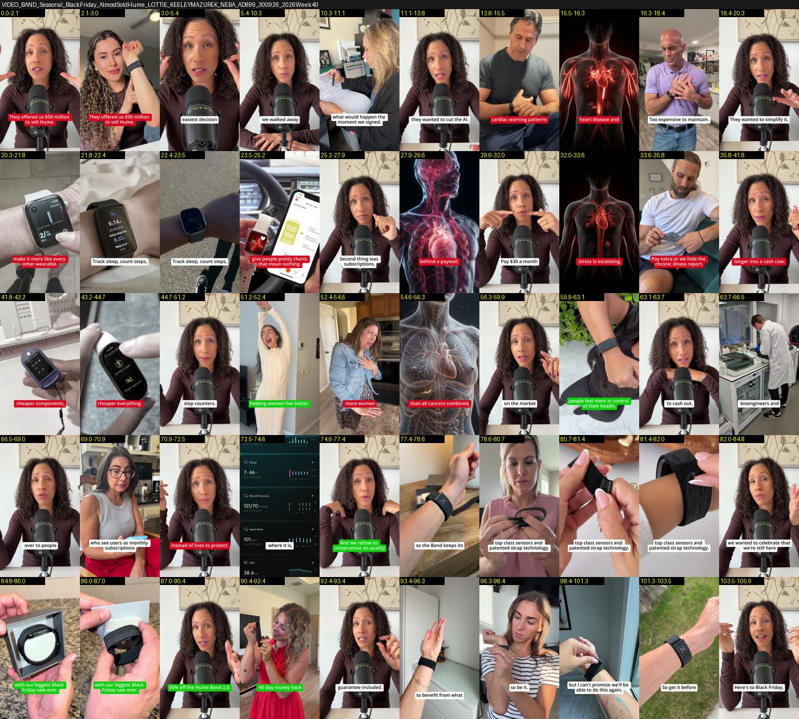

# VIDEO_BAND_Seasonal_BlackFriday_AlmostSoldHume_LOTTIE_KEELEYMAZUREK_NEBA_AD899_300926_2026Week40

Master: `VIDEO_BAND_Seasonal_BlackFriday_AlmostSoldHume_LOTTIE_KEELEYMAZUREK_NEBA_AD899_300926_2026Week40_Hook1_9x16.mp4` · 105.9s · 1080x1920

**Pacing:** 50 shots · avg 2.118s · median 2.05s · 4.63 cuts/10s · first cut 2.133s · 237.0 wpm · talk ratio 0.96 · cuts on word start 77.6% · cuts in speech gaps 51.0%
**Audio:** {'I_lufs': -14.8, 'LRA': 3.0, 'true_peak_db': 0.2} · BPM≈129.2 · music {'speech_rms_db': -20.3, 'pause_seconds': 3.1, 'pause_rms_db': -21.2, 'bed_minus_voice_db': -0.9, 'music_bed_likely': True} · cuts with SFX/transient 57.1%

**Captions:** 129 cards · 3 words/card (median) · y≈0.761 of frame height · text height≈0.0351 · colours {'red': 32, 'white': 81, 'dark/other': 5, 'green': 11} · cards crossing a cut: 10
Highlighted: They offered us $50 million, to sell Hume., Everyone thought we were, crazy., cardiacwarning patterns, heart disease and, make it more like every, otherwearable, otherwearable., givepeoplepretty charts, that mean nothing, cardiac detection, behind a paywall, or you don't get warned that, your cardiovascular
**Headlines:** 16:03 (24.0–24.0s, white) | Hiking (43.0–43.0s, dark/other) | Treadmill (44.0–44.0s, dark/other) | Jumprope (44.0–44.0s, dark/other) | 99Steps (73.0–73.0s, white) | 2,957 (73.0–73.0s, white) | 5918 (73.0–73.0s, dark/other) | Last:07/Aug/26 (73.0–74.0s, dark/other)

**Hook (0–3s) spoken:** They offered us $50 million to sell Hume. Walking
**Hook on-screen:** They offered us $50 million / to sell Hume.
**CTA (last 5s):** to do this again. So get it before the offer ends. Here's to Black Friday, and here's to living better with Hume. · on-screen: Here's to Black Friday, / So get it before / able to do this again, / and here's to living better / but I can't promise we'll be / the offer ends. / with Hume.

## Beat sheet

| # | in–out (s) | dur | transition | spoken | on-screen text |
|---|---|---|---|---|---|
| 1 | 0.00–2.13 | 2.13 |  | They offered us $50 million to | They offered us $50 million [red] / to sell Hume. [red] |
| 2 | 2.13–3.00 | 0.87 | cut | sell Hume. | They offered us $50 million [red] / to sell Hume. [red] |
| 3 | 3.00–5.40 | 2.4 | cut +SFX hit | Walking away was the easiest decision we ever made. | Walking away was the / easiest decision / we ever made. |
| 4 | 5.40–10.30 | 4.9 | cut +SFX hit | Everyone thought we were crazy. But the reason we walked away was because we knew exactly what would happen the moment | we ever made. / Everyone thought we were [red] / crazy. [red] / But the reason / wasbecausewe / knew exactly |
| 5 | 10.30–11.13 | 0.83 | cut +SFX hit | we signed. So first | whatwouldhappenthe / moment we signed. / So first thing, |
| 6 | 11.13–13.83 | 2.7 | cut +SFX hit | thing, they wanted to cut the AI. The algorithm that detects cardiac | So first thing, / they wanted to cut the Al. / The algorithm that detects |
| 7 | 13.83–15.47 | 1.63 | cut +SFX hit | warning patterns that correlate with | cardiacwarning patterns [red] / that correlate with |
| 8 | 15.47–16.30 | 0.83 | cut +SFX hit | heart disease and heart | that correlate with / heart disease and [red] |
| 9 | 16.30–18.40 | 2.1 | cut | attacks too expensive to maintain. They | heart disease and [red] / Too expensive to maintain. |
| 10 | 18.40–20.30 | 1.9 | cut +SFX hit | wanted to simplify it, make it more like every | Too expensive to maintain. / They wanted to simplify it, / make it more like every [red] / otherwearable [red] |
| 11 | 20.30–21.80 | 1.5 | cut | other wearable. Track, | make it more like every [red] / otherwearable [red] / 1:08 / Stand / 112PM6PM / 12AM6AM |
| 12 | 21.80–22.37 | 0.57 | cut | sleep, count | 9h14m / 23:49-09:03 / Actualsleeptime / 8h32m / Sleep score / Track sleep, count steps, |
| 13 | 22.37–23.47 | 1.1 | cut | steps, give people | 9h14m / 23:49-09:03 / Actualsleeptime / 8h32m / Sleep score / Track sleep, count steps, |
| 14 | 23.47–25.17 | 1.7 | cut +SFX hit | pretty charts that mean nothing. | 09:57 / givepeoplepretty charts [red] / that mean nothing [red] / 16:03 (HEADLINE) / 02:15PM,Work / High |
| 15 | 25.17–27.90 | 2.73 | cut +SFX hit | Second thing was subscriptions. They wanted to lock the cardiac | givepeoplepretty charts [red] / that mean nothing [red] / Second thing was / subscriptions. / They wanted to lock the |
| 16 | 27.90–29.63 | 1.73 | cut | detection behind a paywall. Pay | cardiac detection [red] / behind a paywall [red] |
| 17 | 29.63–32.00 | 2.37 | cut | $30 a month or you don't get warned that your cardiovascular | Pay $30 a month / or you don't get warned that [red] |
| 18 | 32.00–33.57 | 1.57 | cut +SFX hit | stress is escalating. | your cardiovascular [red] / stress is escalating [red] |
| 19 | 33.57–35.77 | 2.2 | cut | Pay extra or we hide the chronic illness report. | Payextra or we hide the [red] / chronic illness report. [red] |
| 20 | 35.77–41.77 | 6.0 | cut | Turn something that was designed to help people longer into a cash cow. Third thing was they wanted to change suppliers. | Turn something that was / designed to help people [red] / longer into a cash cow. [red] / Third thing was they wanted / to change suppliers. |
| 21 | 41.77–43.23 | 1.47 | cut | Cheaper sensors, cheaper components, | FINGERT / Cheapersensors, [red] / Hiking (HEADLINE) / cheaper components [red] |
| 22 | 43.23–44.70 | 1.47 | cut | cheaper everything. | Hiking (HEADLINE) / cheaper components [red] / Treadmill (HEADLINE) / Jumprope (HEADLINE) / cheaper everything [red] |
| 23 | 44.70–51.17 | 6.47 | cut | Same race to the bottom that's made other trackers just expensive step counters. We said no to all of it because we are obsessed with one thing, helping | Sameracetothe bottom [red] / that's made other trackers [red] / justexpensive [red] / step counters. / becauseweareobsessed / with one thing: |
| 24 | 51.17–52.37 | 1.2 | cut +SFX hit | women live better. Heart | helping women live better. [green] |
| 25 | 52.37–54.60 | 2.23 | cut +SFX hit | disease kills more women than all cancers combined. | helping women live better. [green] / more women [red] / than all cancers combined, [red] |
| 26 | 54.60–56.27 | 1.67 | cut +SFX hit | And most have no idea | than all cancers combined, [red] / and most have no idea [red] |
| 27 | 56.27–59.90 | 3.63 | cut | they're at risk because there's nothing on the market actually looking for the warning signs. | and most have no idea [red] / because there's nothing / on the market / actuallylookingforthe [red] / warning signs. [red] |
| 28 | 59.90–63.13 | 3.23 | cut +SFX hit | We built the band to make people feel more in control of their health. We didn't do that to cash | We built the Band to make [green] / peoplefeel more in control [green] / oftheirhealth [green] / to cash out. |
| 29 | 63.13–63.70 | 0.57 | cut | out. We | to cash out. |
| 30 | 63.70–66.47 | 2.77 | cut +SFX hit | didn't spend years with Harvard bioengineers and almost go broke twice | We didn't spend / bioengineers and / almost go broke |
| 31 | 66.47–69.03 | 2.57 | cut +SFX hit | to hand it over to people who see users | almost go broke / twce to hand it / over to people / who see users as monthly / subscriptions |
| 32 | 69.03–70.93 | 1.9 | cut +SFX hit | as monthly subscriptions instead | who see users as monthly / subscriptions |
| 33 | 70.93–72.50 | 1.57 | cut +SFX hit | of lives to protect. | insteadof livestoprotect [red] |
| 34 | 72.50–74.63 | 2.13 | cut +SFX hit | Our AI stays exactly where it is. No | 99Steps (HEADLINE) / 2,957 (HEADLINE) / 5918 (HEADLINE) / Last:07/Aug/26 (HEADLINE) / Sleep (HEADLINE) / 7h46m |
| 35 | 74.63–77.40 | 2.77 | cut +SFX hit | subscriptions ever. And we refuse to compromise on quality. | no subscriptions ever. / And werefuseto [green] / compromiseon quality [green] |
| 36 | 77.40–78.63 | 1.23 | cut | So the band keeps | And werefuseto [green] / compromiseon quality [green] / so the Band keeps its |
| 37 | 78.63–80.73 | 2.1 | cut | its top class sensors and patented strap | top class sensors and / patented strap technology. |
| 38 | 80.73–81.37 | 0.63 | cut | technology. | top class sensors and / patented strap technology. |
| 39 | 81.37–82.00 | 0.63 | cut +SFX hit | But | top class sensors and / patented strap technology. |
| 40 | 82.00–84.77 | 2.77 | cut +SFX hit | the reason I'm telling you this is we wanted to celebrate that we're still here with | But the reason I'm telling / you this is / we wanted to celebrate that / we're still here |
| 41 | 84.77–86.03 | 1.27 | cut | our biggest Black Friday sale | withour biggest Black [green] / Fridaysaleever. [green] |
| 42 | 86.03–87.03 | 1.0 | cut +SFX hit | ever. | withour biggest Black [green] / Fridaysaleever. [green] / We're giving you a massive |
| 43 | 87.03–90.43 | 3.4 | cut | We're giving you a massive 50 % off the Hume Band 2 .0, | We're giving you a massive / 50%offtheHumeBand2.0 [green] |
| 44 | 90.43–92.43 | 2.0 | cut +SFX hit | free shipping and a 45 -day money -back guarantee | 50%offtheHumeBand2.0 [green] / 45daymoneyback [green] |
| 45 | 92.43–93.37 | 0.93 | cut | included. | 45daymoneyback [green] / guarantee included. |
| 46 | 93.37–96.27 | 2.9 | cut +SFX hit | We want more women to benefit from what we've built, so if we have to slash the | guarantee included. / Wewantmorewomen / we've built / so if we have to |
| 47 | 96.27–98.40 | 2.13 | cut | price, so be it. You can get yours right now | so if we have to / So be it. / You can get yours |
| 48 | 98.40–101.30 | 2.9 | cut +SFX hit | at HumeHealth .com, but I can't promise we'll be able to do this | You can get yours / Humehealth.com [green] / but I can't promise we'll be / able to do this again, |
| 49 | 101.30–103.50 | 2.2 | cut +SFX hit | again. So get it before the offer ends. | but I can't promise we'll be / able to do this again, / So get it before / the offer ends. |
| 50 | 103.50–105.91 | 2.41 | cut +SFX hit | Here's to Black Friday, and here's to living better with Hume. | Here's to Black Friday, / and here's to living better / with Hume. |

## Hook variants

| hook | file | dur | first cut | spoken 0–3s | on-screen 0–3s |
|---|---|---|---|---|---|
| 1 | `IE_KEELEYMAZUREK_NEBA_AD899_300926_2026Week40_Hook1_9x16.mp4` | 105.9 | 2.133 | They offered us $50 million to sell Hume. Walking | They offered us $50 million / to sell Hume. |
| 2 | `IE_KEELEYMAZUREK_NEBA_AD899_300926_2026Week40_Hook2_9x16.mp4` | 107.3 | 2.767 | This Black Friday deal comes with a story, because we almost sold Hume. | Becausewealmost / This Black Friday deal / comes with a story. |
| 3 | `IE_KEELEYMAZUREK_NEBA_AD899_300926_2026Week40_Hook3_9x16.mp4` | 105.9 | 3.8 | Before I explain why the band 2 .0 is half -priced, I need to explain | Band 2.0 is half price, / Before I explain why the / I need to explain why |
| 4 | `IE_KEELEYMAZUREK_NEBA_AD899_300926_2026Week40_Hook4_9x16.mp4` | 106.7 | 0.833 | Selling Hume for 50 million would have changed our lives, but |  |

## Full transcript

They offered us $50 million to sell Hume. Walking away was the easiest decision we ever made. Everyone thought we were crazy. But the reason we walked away was because we knew exactly what would happen the moment we signed. So first thing, they wanted to cut the AI. The algorithm that detects cardiac warning patterns that correlate with heart disease and heart attacks too expensive to maintain. They wanted to simplify it, make it more like every other wearable. Track, sleep, count steps, give people pretty charts that mean nothing. Second thing was subscriptions. They wanted to lock the cardiac detection behind a paywall. Pay $30 a month or you don't get warned that your cardiovascular stress is escalating. Pay extra or we hide the chronic illness report. Turn something that was designed to help people longer into a cash cow. Third thing was they wanted to change suppliers. Cheaper sensors, cheaper components, cheaper everything. Same race to the bottom that's made other trackers just expensive step counters. We said no to all of it because we are obsessed with one thing, helping women live better. Heart disease kills more women than all cancers combined. And most have no idea they're at risk because there's nothing on the market actually looking for the warning signs. We built the band to make people feel more in control of their health. We didn't do that to cash out. We didn't spend years with Harvard bioengineers and almost go broke twice to hand it over to people who see users as monthly subscriptions instead of lives to protect. Our AI stays exactly where it is. No subscriptions ever. And we refuse to compromise on quality. So the band keeps its top class sensors and patented strap technology. But the reason I'm telling you this is we wanted to celebrate that we're still here with our biggest Black Friday sale ever. We're giving you a massive 50% off the Hume Band 2.0, free shipping and a 45-day money-back guarantee included. We want more women to benefit from what we've built, so if we have to slash the price, so be it. You can get yours right now at HumeHealth.com, but I can't promise we'll be able to do this again. So get it before the offer ends. Here's to Black Friday, and here's to living better with Hume.