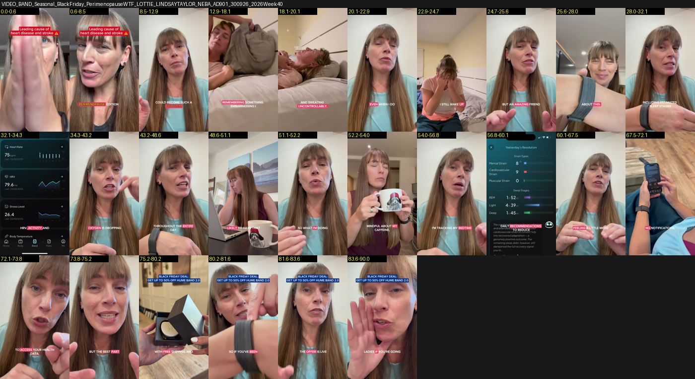

# VIDEO_BAND_Seasonal_BlackFriday_PerimenopauseWTF_LOTTIE_LINDSAYTAYLOR_NEBA_AD901_300926_2026Week40

Master: `VIDEO_BAND_Seasonal_BlackFriday_PerimenopauseWTF_LOTTIE_LINDSAYTAYLOR_NEBA_AD901_300926_2026Week40_Hook1_9x16.mp4` · 90.0s · 1080x1920

**Pacing:** 26 shots · avg 3.46s · median 2.7s · 2.78 cuts/10s · first cut 0.6s · 224.0 wpm · talk ratio 0.91 · cuts on word start 76.0% · cuts in speech gaps 72.0%
**Audio:** {'I_lufs': -14.7, 'LRA': 4.3, 'true_peak_db': 0.7} · BPM≈117.5 · music {'speech_rms_db': -19.7, 'pause_seconds': 2.3, 'pause_rms_db': -19.1, 'bed_minus_voice_db': 0.6, 'music_bed_likely': True} · cuts with SFX/transient 64.0%

**Hook (0–3s) spoken:** On today's episode of what the hell is
**Hook on-screen:** 
**CTA (last 5s):** eligible too. Ladies, if you're going through menopause, I get it. This thing, it's got your back. · on-screen: 

## Beat sheet

| # | in–out (s) | dur | transition | spoken | on-screen text |
|---|---|---|---|---|---|
| 1 | 0.00–0.60 | 0.6 |  |  |  |
| 2 | 0.60–8.53 | 7.93 | cut +SFX hit | On today's episode of what the hell is happening to me, Perry Menopause Edition. Why am I exhausted all day and why to wake at night? |  |
| 3 | 8.53–12.87 | 4.33 | cut | Who knew getting sleep could become such a problem? Every night, 3 a .m., I'm wired. |  |
| 4 | 12.87–18.07 | 5.2 | cut | Why to wake, kicking off the covers, remembering something embarrassing I said in 1999 |  |
| 5 | 18.07–20.07 | 2.0 | cut +SFX hit | and sweating uncontrollably. |  |
| 6 | 20.07–22.90 | 2.83 | cut +SFX hit | The annoying part is, even when I do get eight hours in bed, |  |
| 7 | 22.90–24.67 | 1.77 | cut | I still wake up totally drained. |  |
| 8 | 24.67–25.60 | 0.93 | cut +SFX hit | But an amazing friend of |  |
| 9 | 25.60–28.03 | 2.43 | cut | mine told me about this, the HumeBand 2 .0. It |  |
| 10 | 28.03–32.10 | 4.07 | cut +SFX hit | tracks your sleep, including estimated sleep stages along with heart rate, |  |
| 11 | 32.10–34.30 | 2.2 | cut +SFX hit | HRV, activity, and recovery trends. |  |
| 12 | 34.30–43.20 | 8.9 | cut +SFX hit | It shows your sleep quality as well. How much sleep is deep sleep and when your blood oxygen is dropping and making you wake up. But what I really like is this optimal bedtime thing because |  |
| 13 | 43.20–48.57 | 5.37 | cut +SFX hit | the band is tracking your body throughout the entire day. It tells you when your body is ready to wind down and |  |
| 14 | 48.57–51.13 | 2.57 | cut | when you're less likely to have that wired feeling. |  |
| 15 | 51.13–52.23 | 1.1 | cut +SFX hit | So what I'm doing isn't |  |
| 16 | 52.23–53.97 | 1.73 | cut +SFX hit | being more mindful about my caffeine. |  |
| 17 | 53.97–56.83 | 2.87 | cut +SFX hit | I'm tracking my bedtime time and workouts with the band and |  |
| 18 | 56.83–60.13 | 3.3 | cut | getting daily recommendations to reduce my sleep death. |  |
| 19 | 60.13–67.50 | 7.37 | cut +SFX hit | As a fixed menopause, girl, no. But it is so nice feeling a little more in control and not working against your body all the time. |  |
| 20 | 67.50–72.13 | 4.63 | cut +SFX hit | And it has no screen buzzing at you, no notifications and no subscription fee to |  |
| 21 | 72.13–73.83 | 1.7 | cut +SFX hit | access your health data. |  |
| 22 | 73.83–75.17 | 1.33 | cut | But the best part is 50 |  |
| 23 | 75.17–80.20 | 5.03 | cut +SFX hit | % off for Black Friday with free shipping and a 45 day money back guarantee. |  |
| 24 | 80.20–81.60 | 1.4 | cut | So if you've been considering one, |  |
| 25 | 81.60–83.63 | 2.03 | cut +SFX hit | check the link while they offer is live. |  |
| 26 | 83.63–89.95 | 6.32 | cut | It's HSA and FSA eligible too. Ladies, if you're going through menopause, I get it. This thing, it's got your back. |  |

## Hook variants

| hook | file | dur | first cut | spoken 0–3s | on-screen 0–3s |
|---|---|---|---|---|---|
| 1 | `IE_LINDSAYTAYLOR_NEBA_AD901_300926_2026Week40_Hook1_9x16.mp4` | 90.0 | 0.6 | On today's episode of what the hell is |  |
| 1 | `INDSAYTAYLOR_NEBA_AD901_300926_2026Week40_Hook1_9x16_RAW.mp4` | 90.0 | 0.6 |  |  |
| 2 | `IE_LINDSAYTAYLOR_NEBA_AD901_300926_2026Week40_Hook2_9x16.mp4` | 93.2 | 16.1 |  |  |
| 2 | `INDSAYTAYLOR_NEBA_AD901_300926_2026Week40_Hook2_9x16_RAW.mp4` | 93.2 | 46.433 |  |  |
| 3 | `IE_LINDSAYTAYLOR_NEBA_AD901_300926_2026Week40_Hook3_9x16.mp4` | 86.2 | 9.133 |  |  |
| 3 | `INDSAYTAYLOR_NEBA_AD901_300926_2026Week40_Hook3_9x16_RAW.mp4` | 86.2 | 39.467 |  |  |
| 4 | `IE_LINDSAYTAYLOR_NEBA_AD901_300926_2026Week40_Hook4_9x16.mp4` | 87.7 | 10.6 |  |  |
| 4 | `INDSAYTAYLOR_NEBA_AD901_300926_2026Week40_Hook4_9x16_RAW.mp4` | 87.7 | 40.933 |  |  |

## Full transcript

On today's episode of what the hell is happening to me, Perry Menopause Edition. Why am I exhausted all day and why to wake at night? Who knew getting sleep could become such a problem? Every night, 3 a.m., I'm wired. Why to wake, kicking off the covers, remembering something embarrassing I said in 1999 and sweating uncontrollably. The annoying part is, even when I do get eight hours in bed, I still wake up totally drained. But an amazing friend of mine told me about this, the HumeBand 2.0. It tracks your sleep, including estimated sleep stages along with heart rate, HRV, activity, and recovery trends. It shows your sleep quality as well. How much sleep is deep sleep and when your blood oxygen is dropping and making you wake up. But what I really like is this optimal bedtime thing because the band is tracking your body throughout the entire day. It tells you when your body is ready to wind down and when you're less likely to have that wired feeling. So what I'm doing isn't being more mindful about my caffeine. I'm tracking my bedtime time and workouts with the band and getting daily recommendations to reduce my sleep death. As a fixed menopause, girl, no. But it is so nice feeling a little more in control and not working against your body all the time. And it has no screen buzzing at you, no notifications and no subscription fee to access your health data. But the best part is 50% off for Black Friday with free shipping and a 45 day money back guarantee. So if you've been considering one, check the link while they offer is live. It's HSA and FSA eligible too. Ladies, if you're going through menopause, I get it. This thing, it's got your back.