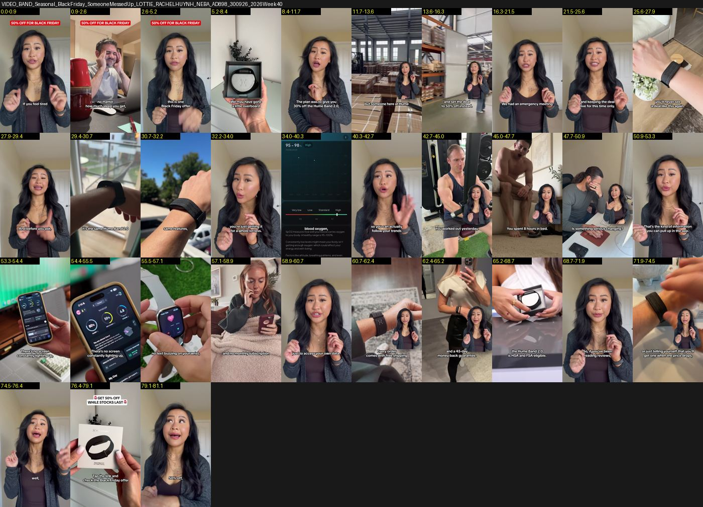

# VIDEO_BAND_Seasonal_BlackFriday_SomeoneMessedUp_LOTTIE_RACHELHUYNH_NEBA_AD898_300926_2026Week40

Master: `VIDEO_BAND_Seasonal_BlackFriday_SomeoneMessedUp_LOTTIE_RACHELHUYNH_NEBA_300926_2026Week40_Hook1_9x16.mp4` · 81.1s · 1080x1920

**Pacing:** 33 shots · avg 2.457s · median 2.302s · 3.95 cuts/10s · first cut 0.901s · 226.0 wpm · talk ratio 0.93 · cuts on word start 81.2% · cuts in speech gaps 59.4%
**Audio:** {'I_lufs': -18.7, 'LRA': 5.7, 'true_peak_db': 0.1} · BPM≈117.5 · music {'speech_rms_db': -25.6, 'pause_seconds': 3.4, 'pause_rms_db': -26.7, 'bed_minus_voice_db': -1.1, 'music_bed_likely': True} · cuts with SFX/transient 71.9%

**Captions:** 148 cards · 1.0 words/card (median) · y≈0.752 of frame height · text height≈0.0293 · colours {'white': 113, 'dark/other': 31, 'red': 2, 'green': 2} · cards crossing a cut: 3
Highlighted: made amistake, over time., MEDIUM, 2:13PM
**Headlines:** 5O%OFFFORBLACKFRIDAY (0.0–0.5s, red) | 5O%OFFFORBLACKFRIDAY (1.5–2.0s, red) | 50%OFFFORBLACKFRIDAY (2.5–3.0s, red) | 5O%OFFFORBLACKFRIDAY (3.5–4.0s, red) | gSteps (34.0–34.0s, white) | 466 (34.0–34.0s, white) | Last:14/08/2025 (34.0–35.0s, dark/other) | Sleep (34.0–34.0s, white)

**Hook (0–3s) spoken:** If you feel tired no matter how much sleep you get, this is one
**Hook on-screen:** 50%OFFFORBLACKFRIDAY / 5O%OFFFORBLACKFRIDAY / BlackFridayoffer / If you feel tired / howmuchsleepyouget / howmuchsleepyouget, / nomatter / thisisone
**CTA (last 5s):** Tap the link and check the Black Friday offer while it's still live. 50 % off, I take the win. · on-screen: 24/7Health Tracking / 50%off, / DGET50%OFF / GET 50% OFF / HumeBand2.0 / Tapthelinkand / WHILE STOCKSLASTD / WHILESTOCKSLAST / WHILESTOCKSLASTL / XHumeHealth / checktheBlackFridayoffer / whileit'sstillive.

## Beat sheet

| # | in–out (s) | dur | transition | spoken | on-screen text |
|---|---|---|---|---|---|
| 1 | 0.00–0.90 | 0.9 |  | If you feel tired no | 5O%OFFFORBLACKFRIDAY [red] (HEADLINE) / If you feel tired |
| 2 | 0.90–2.64 | 1.74 | cut +SFX hit | matter how much sleep you get, | 5O%OFFFORBLACKFRIDAY [red] (HEADLINE) / If you feel tired / nomatter / howmuchsleepyouget, / 5O%OFFFORBLACKFRIDAY [red] (HEADLINE) / howmuchsleepyouget |
| 3 | 2.64–5.17 | 2.54 | cut +SFX hit | this is one Black Friday offer you're not gonna wanna miss. | 50%OFFFORBLACKFRIDAY [red] (HEADLINE) / thisisone / BlackFridayoffer / 5O%OFFFORBLACKFRIDAY [red] (HEADLINE) / you'renot / going to want to miss. |
| 4 | 5.17–8.38 | 3.2 | cut | We may have gone a little overboard with Hume's Black Friday sale. | Live Longer.Better. / Wemayhavegone / alittleoverboard / Live Longer,Better. / withHume's Black Fridaysale. |
| 5 | 8.38–11.71 | 3.34 | cut +SFX hit | The plan was to give you 30 % off the Hume ban 2 .0, | withHume's Black Fridaysale. / The plan was togive you / 30%offtheHumeBand2.0 / 30%offtheHumeBand2.0, |
| 6 | 11.71–13.65 | 1.94 | cut | but someone here at Hume made a mistake and | butsomeonehereatHume / made amistake [red] |
| 7 | 13.65–16.32 | 2.67 | cut +SFX hit | set the deal to 50 % off instead. | andsetthedeal / to50%offinstead. |
| 8 | 16.32–21.52 | 5.21 | cut +SFX hit | Yep, half price. We had an emergency meeting and half the team wanted to kill it immediately, but | andsetthedeal / to50%offinstead. / half price. / Wehad an emergency meeting / and half theteam / wanted to kill it immediately. |
| 9 | 21.52–25.63 | 4.11 | cut +SFX hit | we're owning our mistake and keeping the deal live for this time only, which | we'reowningourmistake / andkeepingthe deal / live for this time only. |
| 10 | 25.63–27.93 | 2.3 | cut | means you'll never see a deal like this again. And | Whichmeans / you'llneversee / adeal likethisagain |
| 11 | 27.93–29.40 | 1.47 | cut +SFX hit | before you ask, yes, | And before youask, / yes, |
| 12 | 29.40–30.66 | 1.27 | cut +SFX hit | it's the same HumeBan 2 .0, | yes, / it'sthesameHumeBand2.0 |
| 13 | 30.66–32.17 | 1.5 | cut +SFX hit | same features, | samefeatures, / you're justgettingit / fora wholelotless. |
| 14 | 32.17–34.03 | 1.87 | cut +SFX hit | you're just getting it for a whole lot less. | you're justgettingit / fora wholelotless. / gSteps (HEADLINE) / 466 (HEADLINE) / Last:14/08/2025 (HEADLINE) / Sleep (HEADLINE) |
| 15 | 34.03–40.27 | 6.24 | cut +SFX hit | It tracks your sleep, cardiac stress, HRV, blood oxygen, activity, and gives you blood pressure insights so | gSteps (HEADLINE) / 466 (HEADLINE) / Last:14/08/2025 (HEADLINE) / Sleep (HEADLINE) / 23:00 (HEADLINE) / 6n23m (HEADLINE) |
| 16 | 40.27–42.74 | 2.47 | cut | you can actually follow your trends over time. | HumeBand(59%) (HEADLINE) / Connected (HEADLINE) / 2,957 (HEADLINE) / Last:07/Aug/26 (HEADLINE) / Sleep (HEADLINE) / 7h46m |
| 17 | 42.74–45.05 | 2.3 | cut +SFX hit | You worked out yesterday. How did you recover? | Youworkedoutyesterday, / How did you recover? / You spent 8 hours in bed. |
| 18 | 45.05–47.71 | 2.67 | cut | You spent eight hours in bed. What did your sleep look like? | You spent 8 hours in bed. / Whatdidyoursleeplook like? |
| 19 | 47.71–50.85 | 3.14 | cut +SFX hit | Is your blood pressure trending? Is something serious changing? That's | Isyourblood / pressuretrending? / Issomething seriouschanging? |
| 20 | 50.85–53.32 | 2.47 | cut +SFX hit | the kind of information that you can pull up in the app. There's | That's thekind ofinformation / youcanpullupintheapp. |
| 21 | 53.32–54.35 | 1.03 | cut +SFX hit | no screen constantly | That's thekind ofinformation / youcanpullupintheapp. / WHOOP / There'snoscreen / constantlylightingup, |
| 22 | 54.35–55.49 | 1.13 | cut +SFX hit | lighting up, | WHOOP / There'snoscreen / constantlylightingup, / 98% (HEADLINE) / TODAY / 2:18米 |
| 23 | 55.49–57.12 | 1.64 | cut | no text buzzing on your wrist, | WHOOP / There'snoscreen / constantlylightingup, / 98% (HEADLINE) / TODAY / 2:18米 |
| 24 | 57.12–58.89 | 1.77 | cut +SFX hit | and no monthly subscription just | andnomonthlysubscription |
| 25 | 58.89–60.69 | 1.8 | cut | to access your own data. | justtoaccessyourowndata, / justtoaccessyourowndata. |
| 26 | 60.69–62.40 | 1.7 | cut | Every order comes with free shipping and | Everyorder / comes with freeshipping |
| 27 | 62.40–65.20 | 2.8 | cut +SFX hit | a 45 -day money -back guarantee. And the | Everyorder / comes with freeshipping / and a 45-day / money-back guarantee. / theHumeBand2.0 / isHSAand FSA-eligible. |
| 28 | 65.20–68.70 | 3.5 | cut +SFX hit | HumeBand 2 .0 is HSA and FSA -allegable. | theHumeBand2.0 / isHSAand FSA-eligible. |
| 29 | 68.70–71.94 | 3.24 | cut +SFX hit | So if you've been reading reviews, comparing other wearables, | So,ifyou'vebeen / readingreviews, / comparingotherwearables, |
| 30 | 71.94–74.54 | 2.6 | cut +SFX hit | or just telling yourself that you'll get one when the price drops, | orjusttellingyourselfthatyou'll / getonewhen thepricedrops |
| 31 | 74.54–76.38 | 1.84 | cut | well, it dropped. | well, / it dropped. |
| 32 | 76.38–79.08 | 2.7 | cut +SFX hit | Tap the link and check the Black Friday offer while it's still live. | it dropped. / DGET50%OFF (HEADLINE) / WHILESTOCKSLASTL (HEADLINE) / HumeBand2.0 / Tapthelinkand / checktheBlackFridayoffer |
| 33 | 79.08–81.09 | 2.01 | cut +SFX hit | 50 % off, I take the win. | DGET50%OFF (HEADLINE) / WHILE STOCKSLASTD (HEADLINE) / 50%off, |

## Hook variants

| hook | file | dur | first cut | spoken 0–3s | on-screen 0–3s |
|---|---|---|---|---|---|
| 1 | `dUp_LOTTIE_RACHELHUYNH_NEBA_300926_2026Week40_Hook1_9x16.mp4` | 81.1 | 0.901 | If you feel tired no matter how much sleep you get, this is one | 50%OFFFORBLACKFRIDAY / 5O%OFFFORBLACKFRIDAY / BlackFridayoffer / If you feel tired / howmuchsleepyouget / howmuchsleepyouget, / nomatter / thisisone |
| 2 | `dUp_LOTTIE_RACHELHUYNH_NEBA_300926_2026Week40_Hook2_9x16.mp4` | 80.5 | 1.869 |  |  |
| 3 | `dUp_LOTTIE_RACHELHUYNH_NEBA_300926_2026Week40_Hook3_9x16.mp4` | 79.7 | 3.77 |  |  |
| 4 | `dUp_LOTTIE_RACHELHUYNH_NEBA_300926_2026Week40_Hook4_9x16.mp4` | 78.5 | 2.603 |  |  |

## Full transcript

If you feel tired no matter how much sleep you get, this is one Black Friday offer you're not gonna wanna miss. We may have gone a little overboard with Hume's Black Friday sale. The plan was to give you 30% off the Hume ban 2.0, but someone here at Hume made a mistake and set the deal to 50% off instead. Yep, half price. We had an emergency meeting and half the team wanted to kill it immediately, but we're owning our mistake and keeping the deal live for this time only, which means you'll never see a deal like this again. And before you ask, yes, it's the same HumeBan 2.0, same features, you're just getting it for a whole lot less. It tracks your sleep, cardiac stress, HRV, blood oxygen, activity, and gives you blood pressure insights so you can actually follow your trends over time. You worked out yesterday. How did you recover? You spent eight hours in bed. What did your sleep look like? Is your blood pressure trending? Is something serious changing? That's the kind of information that you can pull up in the app. There's no screen constantly lighting up, no text buzzing on your wrist, and no monthly subscription just to access your own data. Every order comes with free shipping and a 45-day money-back guarantee. And the HumeBand 2.0 is HSA and FSA-allegable. So if you've been reading reviews, comparing other wearables, or just telling yourself that you'll get one when the price drops, well, it dropped. Tap the link and check the Black Friday offer while it's still live. 50% off, I take the win.