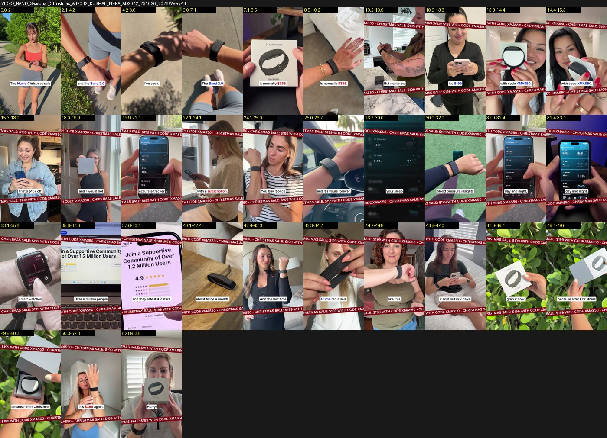

# VIDEO_BAND_Seasonal_Christmas_Ad2042_KUSHAL_NEBA_AD2042_291026_2026Week44

Master: `VIDEO_BAND_Seasonal_Christmas_Ad2042_KUSHAL_NEBA_AD2042_291026_2026Week44_9X16_HOOK1.mp4` · 53.5s · 1080x1920

**Pacing:** 33 shots · avg 1.62s · median 1.833s · 5.99 cuts/10s · first cut 2.1s · 172.0 wpm · talk ratio 0.93 · cuts on word start 68.8% · cuts in speech gaps 40.6%
**Audio:** {'I_lufs': -18.5, 'LRA': 2.2, 'true_peak_db': -0.1} · BPM≈143.6 · music {'speech_rms_db': -22.9, 'pause_seconds': 0.6, 'pause_rms_db': -21.1, 'bed_minus_voice_db': 1.8, 'music_bed_likely': True} · cuts with SFX/transient 56.2%

**Captions:** 93 cards · 1 words/card (median) · y≈0.694 of frame height · text height≈0.0304 · colours {'blue': 9, 'white': 69, 'red': 6, 'dark/other': 7, 'yellow': 2} · cards crossing a cut: 2
Highlighted: The Hume Christmas sale, Band 2.0, and the Band 2.0, Band 2.0, The Band 2.0, is normally $356., is normally $356, it's, $199, withcodeXMAS50, withcodeXMAS50., withasubscription., ITHCODEXMAS5O·CHRISTMASSAL, neverdo., HRISTMASSALE:$199WITHCODEXM
**Headlines:** XHumeHealth (8.0–8.0s, white) | DEXMAS50.CHRISTMASSALE:$199 (10.0–10.0s, white) | .CHRISTMASSALE:$199WITHCOD (11.0–11.0s, white) | MASSALE:$199WITHCODEXMAS50 (12.0–12.0s, white) | $199WITHCODEXMAS50·CHRISTN (13.0–13.0s, white) | $199WITHCODEXMAS50.CHRISTN (13.0–13.0s, white) | HCODEXMAS5O.CHRISTMASSALE: (14.0–14.0s, white) | HCODEXMAS5OCHRISTMASSALE: (14.0–14.0s, white)

**Hook (0–3s) spoken:** The Hume Christmas Sale is live and the band 2 .0
**Hook on-screen:** Band 2.0 / The Hume Christmas sale / and the / and the Band 2.0 / is live,
**CTA (last 5s):** it now because after Christmas, it's 356 again. Hurry. · on-screen: DEXMAS50.CHRISTMASSALE:$199 / DEXMAS50CHRISTMASSALE:$199 / Hurry! / MASSALE:$199WITHCODEXMAS50 / O.CHRISTMASSALE:$199WITHCOD / O·CHRISTMASSALE:$199WITHCOD / SALE:$199WITHCODEXMAS50.CH / WITHCODEXMAS5O·CHRISTMASS / becauseafterChristmas / it's $356 again.

## Beat sheet

| # | in–out (s) | dur | transition | spoken | on-screen text |
|---|---|---|---|---|---|
| 1 | 0.00–2.10 | 2.1 |  | The Hume Christmas Sale is live and | The Hume Christmas sale [blue] / is live, / and the / Band 2.0 [blue] |
| 2 | 2.10–4.17 | 2.07 | cut +SFX hit | the band 2 .0 just dropped to | and the / Band 2.0 [blue] / and the Band 2.0 [blue] / Band 2.0 [blue] / and the / just dropped |
| 3 | 4.17–6.00 | 1.83 | cut +SFX hit | the lowest price I've seen. | to the lowest price / I've seen. |
| 4 | 6.00–7.13 | 1.13 | cut +SFX hit | The band 2 .0 is | The Band 2.0 [blue] / XHumeHealth / is normally $356. [red] |
| 5 | 7.13–8.50 | 1.37 | cut | normally $356, | XHumeHealth / is normally $356. [red] / XHumeHealth (HEADLINE) / HumeBand2.0 / 24/7HealthTracking / is normally $356 [red] |
| 6 | 8.50–10.20 | 1.7 | cut | but | is normally $356 [red] / DEXMAS50.CHRISTMASSALE:$199 (HEADLINE) / Butrightnow |
| 7 | 10.20–10.93 | 0.73 | cut +SFX hit | right now it's | DEXMAS50.CHRISTMASSALE:$199 (HEADLINE) / Butrightnow |
| 8 | 10.93–13.30 | 2.37 | cut | $199 with | .CHRISTMASSALE:$199WITHCOD (HEADLINE) / it's [blue] / $199 [blue] / MASSALE:$199WITHCODEXMAS50 (HEADLINE) / $199WITHCODEXMAS50·CHRISTN (HEADLINE) / $199WITHCODEXMAS50.CHRISTN (HEADLINE) |
| 9 | 13.30–14.40 | 1.1 | cut | code XMAS50. | it's [blue] / $199 [blue] / $199WITHCODEXMAS50·CHRISTN (HEADLINE) / $199WITHCODEXMAS50.CHRISTN (HEADLINE) / HCODEXMAS5O.CHRISTMASSALE: (HEADLINE) / withcodeXMAS50 [blue] |
| 10 | 14.40–15.30 | 0.9 | cut +SFX hit | That's | HCODEXMAS5O.CHRISTMASSALE: (HEADLINE) / withcodeXMAS50 [blue] / HCODEXMAS5OCHRISTMASSALE: (HEADLINE) / MAS50·CHRISTMASSALE:$199WITH (HEADLINE) / withcodeXMAS50. [blue] / MAS50.CHRISTMASSALE:$199WITH (HEADLINE) |
| 11 | 15.30–18.03 | 2.73 | cut +SFX hit | $157 off and | MAS50·CHRISTMASSALE:$199WITH (HEADLINE) / withcodeXMAS50. [blue] / MAS50.CHRISTMASSALE:$199WITH (HEADLINE) / HRISTMASSALE:$199WITHCODEXM [red] (HEADLINE) / That's $157 off, / HRISTMASSALE:$199WITHCODEXM |
| 12 | 18.03–19.90 | 1.87 | cut | I would not wait on it. | 9WITHCODEXMAS5O.CHRISTMAS (HEADLINE) / andIwouldnot / 9WITHCODEXMAS5O·CHRISTMAS (HEADLINE) / DEXMAS5O.CHRISTMASSALE:$199 (HEADLINE) / wait on it. / DEXMAS50.CHRISTMASSALE:$199 (HEADLINE) |
| 13 | 19.90–22.13 | 2.23 | cut +SFX hit | This is the most accurate tracker out there that | 50.CHRISTMASSALE:$199WITHCO (HEADLINE) / 65bpm / 86.0ms / This is the most / 5O.CHRISTMASSALE:$199WITHCO [red] (HEADLINE) / TMASSALE:$199WITHCODEXMAS5 (HEADLINE) |
| 14 | 22.13–24.10 | 1.97 | cut +SFX hit | doesn't come with a subscription. | E:$199WITHCODEXMAS50.CHRIST (HEADLINE) / thatdoesn'tcome / THCODEXMAS5O.CHRISTMASSALE (HEADLINE) / withasubscription. [red] / KMAS50.CHRISTMASSALE:$199WIT (HEADLINE) / You buyitonce |
| 15 | 24.10–25.03 | 0.93 | cut | You buy it once and | KMAS50.CHRISTMASSALE:$199WIT (HEADLINE) / You buyitonce / CHRISTMASSALE:$199WITHCODEX (HEADLINE) / andit'syoursforever. |
| 16 | 25.03–26.70 | 1.67 | cut | it's yours forever. It | CHRISTMASSALE:$199WITHCODEX (HEADLINE) / andit'syoursforever. / SSALE:$199WITHCODEXMAS50·C (HEADLINE) / SSALE:$199WITHCODEXMAS50:C (HEADLINE) |
| 17 | 26.70–30.00 | 3.3 | cut +SFX hit | tracks your stress, your sleep, and HRV. | HumeBand(65%) (HEADLINE) / 99WITHCODEXMAS5O.CHRISTMAS (HEADLINE) / Sleep (HEADLINE) / 7h23m / BloodPressure / 122/70 mmHg |
| 18 | 30.00–31.97 | 1.97 | cut +SFX hit | And it gives your blood pressure insights day | STMASSALE:$199WITHCODEXMAS (HEADLINE) / Anditgivesyour / LE:$199WITHCODEXMAS50.CHRIS (HEADLINE) / bloodpressureinsights |
| 19 | 31.97–32.43 | 0.47 | cut +SFX hit | and | VITHCODEXMAS5O.CHRISTMASSAL (HEADLINE) / 1:368 [blue] (HEADLINE) / 09steps (HEADLINE) / 12,218 / 65bpm / dayand night, |
| 20 | 32.43–33.13 | 0.7 | cut +SFX hit | night, which | VITHCODEXMAS5O.CHRISTMASSAL (HEADLINE) / 1:368 [blue] (HEADLINE) / 09steps (HEADLINE) / 12,218 / 65bpm / dayand night, |
| 21 | 33.13–35.60 | 2.47 | cut | most smartwatches never do. | XMAS50.CHRISTMASSALE:$199W (HEADLINE) / L1:08 (HEADLINE) / Move. (HEADLINE) / 12AM6AM12PM6PM (HEADLINE) / 460 / CAL |
| 22 | 35.60–37.63 | 2.03 | cut +SFX hit | Over a million people wear this thing and | 199WITHCODEXMAS50.CHRISTMA (HEADLINE) / Hume [blue] (HEADLINE) / JoinaSupportiveCommunity (HEADLINE) / ofOver12MillionUsers (HEADLINE) / Over a million people / CODEXMAS5O:CHRISTMASSALE:$ (HEADLINE) |
| 23 | 37.63–40.10 | 2.47 | cut | they rate it 4 .7 stars. | AS50CHRISTMASSALE:$199WITH (HEADLINE) / ook (HEADLINE) / Join a Supportive (HEADLINE) / CommunityofOver (HEADLINE) / 1,2MillionUsers (HEADLINE) / 4.9 |
| 24 | 40.10–42.40 | 2.3 | cut | You only charge it about twice a month. | ALE:$199WITHCODEXMAS50·CHR (HEADLINE) / You only charge it / ALE:$199WITHCODEXMAS50.CHR [yellow] (HEADLINE) / WITHCODEXMAS5O.CHRISTMASSA (HEADLINE) / abouttwiceamonth / WITHCODEXMAS5O·CHRISTMASSA [yellow] (HEADLINE) |
| 25 | 42.40–43.27 | 0.87 | cut +SFX hit | And the last time | abouttwiceamonth / EXMAS50.CHRISTMASSALE:$199V (HEADLINE) / .CHRISTMASSALE:$199WITHCODE (HEADLINE) / Andthelasttime / CHRISTMASSALE:$199WITHCODE |
| 26 | 43.27–44.17 | 0.9 | cut | Hume ran a sale | .CHRISTMASSALE:$199WITHCODE (HEADLINE) / Andthelasttime / CHRISTMASSALE:$199WITHCODE / MASSALE:$199WITHCODEXMAS50 (HEADLINE) / like this, |
| 27 | 44.17–44.83 | 0.67 | cut +SFX hit | like this, | MASSALE:$199WITHCODEXMAS50 (HEADLINE) / like this, |
| 28 | 44.83–47.03 | 2.2 | cut +SFX hit | it sold out in seven days. | $199WITHCODEXMAS50.CHRISTM (HEADLINE) / it sold out in 7 days. / $199WITHCODEXMAS50·CHRISTM (HEADLINE) / CODEXMAS5O.CHRISTMASSALE: (HEADLINE) / HCODEXMAS5O.CHRISTMASSALE: (HEADLINE) / 1AS50CHRISTMASSALE:$199WITH (HEADLINE) |
| 29 | 47.03–49.13 | 2.1 | cut | So if you want one, grab it now because | 1AS50CHRISTMASSALE:$199WITH (HEADLINE) / XHumeHealth" / So if you / IAS50.CHRISTMASSALE:$199WITH [yellow] (HEADLINE) / HRISTMASSALE:$199WITHCODEXM [other-colour] (HEADLINE) / XHumeHealth |
| 30 | 49.13–49.57 | 0.43 | cut +SFX hit | after | SALE:$199WITHCODEXMAS50.CH (HEADLINE) / becauseafterChristmas |
| 31 | 49.57–50.33 | 0.77 | cut +SFX hit | Christmas, | becauseafterChristmas / WITHCODEXMAS5O·CHRISTMASS (HEADLINE) / WITHCODEXMAS5O·CHRISTMASS [yellow] |
| 32 | 50.33–52.80 | 2.47 | cut | it's 356 again. | becauseafterChristmas / WITHCODEXMAS5O·CHRISTMASS (HEADLINE) / WITHCODEXMAS5O·CHRISTMASS [yellow] / DEXMAS50CHRISTMASSALE:$199 (HEADLINE) / it's $356 again. [red] / DEXMAS50.CHRISTMASSALE:$199 [red] (HEADLINE) |
| 33 | 52.80–53.45 | 0.65 | cut | Hurry. | MASSALE:$199WITHCODEXMAS50 (HEADLINE) / Hurry! |

## Hook variants

| hook | file | dur | first cut | spoken 0–3s | on-screen 0–3s |
|---|---|---|---|---|---|
| 1 | `s_Ad2042_KUSHAL_NEBA_AD2042_291026_2026Week44_9X16_HOOK1.mp4` | 53.5 | 2.1 | The Hume Christmas Sale is live and the band 2 .0 | Band 2.0 / The Hume Christmas sale / and the / and the Band 2.0 / is live, |
| 1 | `s_Ad2042_KUSHAL_NEBA_AD2042_291026_2026Week44_9X16_HOOK1.mp4` | 53.5 | 2.1 |  |  |
| 2 | `s_Ad2042_KUSHAL_NEBA_AD2042_291026_2026Week44_9X16_HOOK2.mp4` | 51.3 | 1.0 |  |  |
| 2 | `s_Ad2042_KUSHAL_NEBA_AD2042_291026_2026Week44_9X16_HOOK2.mp4` | 51.3 | 1.0 |  |  |
| 3 | `s_Ad2042_KUSHAL_NEBA_AD2042_291026_2026Week44_9X16_HOOK3.mp4` | 51.2 | 1.6 |  |  |
| 3 | `s_Ad2042_KUSHAL_NEBA_AD2042_291026_2026Week44_9X16_HOOK3.mp4` | 51.2 | 1.6 |  |  |

## Full transcript

The Hume Christmas Sale is live and the band 2.0 just dropped to the lowest price I've seen. The band 2.0 is normally $356, but right now it's $199 with code XMAS50. That's $157 off and I would not wait on it. This is the most accurate tracker out there that doesn't come with a subscription. You buy it once and it's yours forever. It tracks your stress, your sleep, and HRV. And it gives your blood pressure insights day and night, which most smartwatches never do. Over a million people wear this thing and they rate it 4.7 stars. You only charge it about twice a month. And the last time Hume ran a sale like this, it sold out in seven days. So if you want one, grab it now because after Christmas, it's 356 again. Hurry.