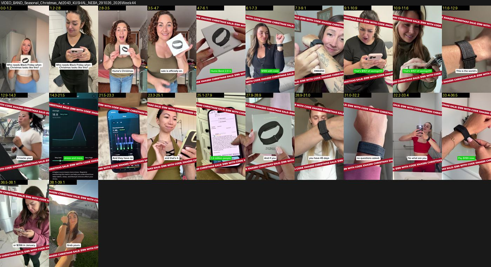

# VIDEO_BAND_Seasonal_Christmas_Ad2043_KUSHAL_NEBA_291026_2026Week44

Master: `VIDEO_BAND_Seasonal_Christmas_Ad2043_KUSHAL_NEBA_291026_2026Week44_Hook1_9x16.mp4` · 39.1s · 1080x1920

**Pacing:** 22 shots · avg 1.776s · median 1.4s · 5.37 cuts/10s · first cut 1.233s · 184.0 wpm · talk ratio 0.92 · cuts on word start 85.7% · cuts in speech gaps 47.6%
**Audio:** {'I_lufs': -19.1, 'LRA': 1.9, 'true_peak_db': -3.0} · BPM≈161.5 · music {'speech_rms_db': -24.2, 'pause_seconds': 0.5, 'pause_rms_db': -21.1, 'bed_minus_voice_db': 3.1, 'music_bed_likely': True} · cuts with SFX/transient 57.1%

**Captions:** 114 cards · 1.0 words/card (median) · y≈0.703 of frame height · text height≈0.0269 · colours {'white': 87, 'green': 9, 'dark/other': 15, 'red': 1, 'other-colour': 1, 'yellow': 1} · cards crossing a cut: 4
Highlighted: HumeBand2.0is, $199withcode, That's$157of savings!!!!, sleep,, SpO2,, stress and more., yourbloodpressure,, VeryHigh, 1.2millionpeople, $366$183, ★★★★, Pay$199now,
**Headlines:** XMAS50CHRISTMASSALE:S199WITH (4.5–4.5s, red) | XMAS5OCHRISTMASSALE:$199WITHC (4.5–4.5s, red) | DEXMAS5OCHRISTMASSALE:S199WIT (5.0–5.0s, red) | DEXMAS5OCHRISTMASSALE:$199WIT (5.0–5.0s, red) | CODEXMAS5OCHRISTMASSALE:S1991 (5.5–5.5s, red) | CODEXMAS5OCHRISTMASSALE:S199V (5.5–5.5s, red) | THCODEXMAS5OCHRISTMASSALE:S19 (6.0–6.0s, red) | THCODEXMAS5OCHRISTMASSALE:$19 (6.0–6.0s, red)

**Hook (0–3s) spoken:** Who needs Black Friday when Christmas looks like this? Hume's
**Hook on-screen:** Christmaslookslikethis? / WhoneedsBlackFridaywhen
**CTA (last 5s):** now or $356 in January. Grab yours. · on-screen: 5OCHRISTMASSALE:$199WITHCODEX / AS50OCHRISTMASSALE:S199WITHCOD / AS5OCHRISTMASSALE:S199WITHCODE / CHRISTMASSALE:$199WITHCODEXM / CHRISTMASSALE:S199WITHCODEXMA / Grab yours. / IRISTMASSALE:$199WITHCODEXMAS5 / ISTMASSALE:S199WITHCODEXMAS50 / Pay$199now, / TMASSALE:S199WITHCODEXMAS5OCI / or$356inJanuary.

## Beat sheet

| # | in–out (s) | dur | transition | spoken | on-screen text |
|---|---|---|---|---|---|
| 1 | 0.00–1.23 | 1.23 |  | Who needs Black Friday when | WhoneedsBlackFridaywhen / Christmaslookslikethis? |
| 2 | 1.23–2.80 | 1.57 | cut | Christmas looks like this? | WhoneedsBlackFridaywhen / Christmaslookslikethis? |
| 3 | 2.80–3.53 | 0.73 | cut | Hume's Christmas Sale | WhoneedsBlackFridaywhen / Christmaslookslikethis? / Hume'sChristmas / sale is officially on. |
| 4 | 3.53–4.73 | 1.2 | cut +SFX hit | is officially on and | sale is officially on. / XMAS50CHRISTMASSALE:S199WITH [red] (HEADLINE) / HumeBand2.0 / Andthe / XMAS5OCHRISTMASSALE:$199WITHC [red] (HEADLINE) |
| 5 | 4.73–6.10 | 1.37 | cut +SFX hit | the Hume Band 2 .0 is | XMAS50CHRISTMASSALE:S199WITH [red] (HEADLINE) / HumeBand2.0 / Andthe / XMAS5OCHRISTMASSALE:$199WITHC [red] (HEADLINE) / DEXMAS5OCHRISTMASSALE:S199WIT [red] (HEADLINE) / HumeBand2.0is [green] |
| 6 | 6.10–7.30 | 1.2 | cut | $199 with | THCODEXMAS5OCHRISTMASSALE:S19 [red] (HEADLINE) / $199withcode [green] / THCODEXMAS5OCHRISTMASSALE:$19 [red] (HEADLINE) / I99WITHCODEXMAS5OCHRISTMASSA [red] (HEADLINE) / I99WITHCODEXMAS5OCHRISTMASSAI [red] (HEADLINE) |
| 7 | 7.30–9.13 | 1.83 | cut | code XMAS50. That's | $199withcode [green] / I99WITHCODEXMAS5OCHRISTMASSA [red] (HEADLINE) / I99WITHCODEXMAS5OCHRISTMASSAI [red] (HEADLINE) / ALE:$199WITHCODEXMAS5OCHRISTM [red] (HEADLINE) / XMAS50 / ALE:S199WITHCODEXMAS50CHRISTM [red] (HEADLINE) |
| 8 | 9.13–10.87 | 1.73 | cut +SFX hit | $157 of | MASSALE:$199WITHCODEXMAS5OCHI [red] (HEADLINE) / That's$157of savings!!!! [green] / HRISTMASSALE:S199WITHCODEXMAS [red] (HEADLINE) / HRISTMASSALE:S199WITHCODEXMAS! [red] (HEADLINE) |
| 9 | 10.87–11.57 | 0.7 | cut | savings. | That's$157of savings!!!! [green] / S5OCHRISTMASSALE:S199WITHCODE [red] (HEADLINE) / S5OCHRISTMASSALE:$199WITHCODE [red] (HEADLINE) |
| 10 | 11.57–12.87 | 1.3 | cut | This is the world's first longevity | EXMAS5OCHRISTMASSALE:$199WITH [red] (HEADLINE) / Thisistheworld's / EXMAS50CHRISTMASSALE:$199WITH [red] (HEADLINE) |
| 11 | 12.87–14.30 | 1.43 | cut | band. It tracks your HRV, | CODEXMAS5OCHRISTMASSALE:$199 [red] (HEADLINE) / first longevityband. / CODEXMAS50CHRISTMASSALE:$199 [red] (HEADLINE) / WITHCODEXMAS5OCHRISTMASSALE [red] (HEADLINE) / Ittracks your / WITHCODEXMAS5OCHRISTMASSALE: [red] (HEADLINE) |
| 12 | 14.30–21.47 | 7.17 | cut +SFX hit | sleep heart rate, SPO2, stress and more. Plus it tracks your blood pressure, which most wearables don't and | WITHCODEXMAS5OCHRISTMASSALE [red] (HEADLINE) / Ittracks your / WITHCODEXMAS5OCHRISTMASSALE: [red] (HEADLINE) / Sleep (HEADLINE) / E:S199WITHCODEXMAS50CHRISTMAS [red] (HEADLINE) / SleepSessionLength (HEADLINE) |
| 13 | 21.47–23.27 | 1.8 | cut +SFX hit | they have no subscription on top. | 7h46m (HEADLINE) / Heart Rate / 101bpm / Body / More / Plans |
| 14 | 23.27–25.10 | 1.83 | cut +SFX hit | You pay once and that's it. | SALE:$199WITHCODEXMAS5OCHRISTI [red] (HEADLINE) / 3:044 [blue] (HEADLINE) / Sleep [blue] (HEADLINE) / SleepSessionLength / Standard / 7h48m |
| 15 | 25.10–27.87 | 2.77 | cut +SFX hit | 1 .2 million people already own one And | CHRISTMASSALE:$199WITHCODEXMA [red] (HEADLINE) / Commt (HEADLINE) / 1,2MillionU58 [red] (HEADLINE) / 4.9 (HEADLINE) / Most Beceni / 1112213025 |
| 16 | 27.87–28.87 | 1.0 | cut +SFX hit | if you don't love it, | HCODEXMAS50CHRISTMASSALE:S199 [red] (HEADLINE) / KHumeHealth (HEADLINE) / HumeBand2.0 / 24/7HealthTracking / And if you / EXMAS5OCHRISTMASSALE:S199WITH [red] (HEADLINE) |
| 17 | 28.87–31.00 | 2.13 | cut | you have 45 days to send it back, no | WITHCODEXMAS5OCHRISTMASSALE: [red] (HEADLINE) / you have 45 days / CODEXMAS5OCHRISTMASSALE:$199W [red] (HEADLINE) / I99WITHCODEXMAS5OCHRISTMASSAI [red] (HEADLINE) / to senditback, / THCODEXMAS5OCHRISTMASSALE:S19 [red] (HEADLINE) |
| 18 | 31.00–32.17 | 1.17 | cut +SFX hit | questions asked. | E:$199WITHCODEXMAS5OCHRISTMAS [red] (HEADLINE) / no questions asked. / WITHCODEXMAS5OCHRISTMASSALE [red] (HEADLINE) / ALE:S199WITHCODEXMAS5OCHRISTM [red] (HEADLINE) / Sowhatareyou / $199WITHCODEXMAS50OCHRISTMASS [red] (HEADLINE) |
| 19 | 32.17–33.43 | 1.27 | cut | So what are you waiting for? | ALE:S199WITHCODEXMAS5OCHRISTM [red] (HEADLINE) / Sowhatareyou / $199WITHCODEXMAS50OCHRISTMASS [red] (HEADLINE) / SSALE:S199WITHCODEXMAS5OCHRIS [red] (HEADLINE) / waiting for? / ALE:S199WITHCODEXMAS50CHRISTMA [red] (HEADLINE) |
| 20 | 33.43–36.47 | 3.03 | cut +SFX hit | Pay $199 now or $356 | SSALE:S199WITHCODEXMAS5OCHRIS [red] (HEADLINE) / waiting for? / ALE:S199WITHCODEXMAS50CHRISTMA [red] (HEADLINE) / MASSALE:$199WITHCODEXMAS5OCH [red] (HEADLINE) / Pay$199now, [green] / SSALE:$199WITHCODEXMAS5OCHRIS [red] (HEADLINE) |
| 21 | 36.47–38.13 | 1.67 | cut +SFX hit | in January. | CHRISTMASSALE:S199WITHCODEXMA [red] (HEADLINE) / or$356inJanuary. / IRISTMASSALE:$199WITHCODEXMAS5 [red] (HEADLINE) / 5OCHRISTMASSALE:$199WITHCODEX [red] (HEADLINE) / CHRISTMASSALE:$199WITHCODEXM [red] (HEADLINE) / AS50OCHRISTMASSALE:S199WITHCOD [red] (HEADLINE) |
| 22 | 38.13–39.08 | 0.95 | cut +SFX hit | Grab yours. | AS50OCHRISTMASSALE:S199WITHCOD [red] (HEADLINE) / Grab yours. / AS5OCHRISTMASSALE:S199WITHCODE [red] (HEADLINE) |

## Hook variants

| hook | file | dur | first cut | spoken 0–3s | on-screen 0–3s |
|---|---|---|---|---|---|
| 1 | `hristmas_Ad2043_KUSHAL_NEBA_291026_2026Week44_Hook1_9x16.mp4` | 39.1 | 1.233 | Who needs Black Friday when Christmas looks like this? Hume's | Christmaslookslikethis? / WhoneedsBlackFridaywhen |
| 2 | `hristmas_Ad2043_KUSHAL_NEBA_291026_2026Week44_Hook2_9x16.mp4` | 38.9 | 1.067 |  |  |
| 3 | `hristmas_Ad2043_KUSHAL_NEBA_291026_2026Week44_Hook3_9x16.mp4` | 39.8 | 1.667 |  |  |
| 4 | `hristmas_Ad2043_KUSHAL_NEBA_291026_2026Week44_Hook4_9x16.mp4` | 39.7 | 1.967 |  |  |

## Full transcript

Who needs Black Friday when Christmas looks like this? Hume's Christmas Sale is officially on and the Hume Band 2.0 is $199 with code XMAS50. That's $157 of savings. This is the world's first longevity band. It tracks your HRV, sleep heart rate, SPO2, stress and more. Plus it tracks your blood pressure, which most wearables don't and they have no subscription on top. You pay once and that's it. 1.2 million people already own one And if you don't love it, you have 45 days to send it back, no questions asked. So what are you waiting for? Pay $199 now or $356 in January. Grab yours.