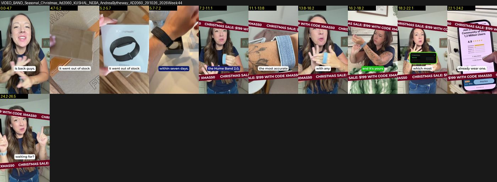

# VIDEO_BAND_Seasonal_Christmas_Ad2060_KUSHAL_NEBA_AndreaBytheway_AD2060_291026_2026Week44

Master: `VIDEO_BAND_Seasonal_Christmas_Ad2060_KUSHAL_NEBA_AndreaBytheway_AD2060_291026_2026Week44_9x16_hook1.mp4` · 26.5s · 1080x1920

**Pacing:** 11 shots · avg 2.409s · median 2.336s · 3.77 cuts/10s · first cut 4.72s · 240.0 wpm · talk ratio 0.93 · cuts on word start 100.0% · cuts in speech gaps 100.0%
**Audio:** {'I_lufs': -21.1, 'LRA': 5.6, 'true_peak_db': -2.0} · BPM≈136.0 · music {'speech_rms_db': -27.2, 'pause_seconds': 0.0} · cuts with SFX/transient 40.0%

**Captions:** 65 cards · 1 words/card (median) · y≈0.697 of frame height · text height≈0.0363 · colours {'white': 58, 'green': 2, 'dark/other': 3, 'red': 1, 'blue': 1} · cards crossing a cut: 1
Highlighted: HumeChristmassale, andit'syours, 50%0FF, $366$183
**Headlines:** RAG (4.5–4.5s, white) | XHmeHealth (5.0–5.0s, white) | E: $199 WITH CODE XMAS50 (7.0–7.0s, white) | CODEXMAS50 (8.0–8.0s, white) | CHRISTMAS S (8.0–8.0s, white) | CHRISTMAS SALE: $199 WI (9.0–9.0s, white) | AS SALE:$199 WITHCODEXMA (10.0–10.0s, white) | WITHCODEXMAS5O (11.0–11.0s, white)

**Hook (0–3s) spoken:** The once a year Hume Christmas Cell is bad guys.
**Hook on-screen:** HumeChristmassale / The once a year / is back guys.
**CTA (last 5s):** track. Over a million people already wear one. So what are you waiting for? Hurry and grab yours. Thank you for watching. · on-screen: $199 WITH CODE XMAS50 / $366$183 / 1,2MillionUsers / 1ASSALE:$199WITHCODEXM / 4.9 / 4.9★★★ / 50 / 50%0FF / 9WITHCODEXMAS50 / AS SALE: $199 WITH CODE XN / CHRI / CHRISTM

## Beat sheet

| # | in–out (s) | dur | transition | spoken | on-screen text |
|---|---|---|---|---|---|
| 1 | 0.00–4.72 | 4.72 |  | The once a year Hume Christmas Cell is bad guys. Last time they ran a cell like this, | The once a year / HumeChristmassale [green] / is back guys. / Last time / they ran a sale / RAG (HEADLINE) |
| 2 | 4.72–5.16 | 0.44 | cut | it went | RAG (HEADLINE) / it went out of stock / XHmeHealth (HEADLINE) |
| 3 | 5.16–5.68 | 0.52 | cut +SFX hit | on to stock | it went out of stock / XHmeHealth (HEADLINE) / HumeBand2.0 / 24/7 Hean Trnckeg / within seven days |
| 4 | 5.68–7.20 | 1.52 | cut | within seven days. | HumeBand2.0 / 24/7 Hean Trnckeg / within seven days / within seven days. / E: $199 WITH CODE XMAS50 (HEADLINE) / So if you've been |
| 5 | 7.20–11.08 | 3.88 | cut | So if you've been wanting to get the HumeBang 2 .0, I would not wait on it. | E: $199 WITH CODE XMAS50 (HEADLINE) / So if you've been / CODEXMAS50 (HEADLINE) / CHRISTMAS S (HEADLINE) / wanting to get / CHRISTI |
| 6 | 11.08–13.80 | 2.72 | cut +SFX hit | This is literally the most accurate tracker right now and | WITHCODEXMAS5O (HEADLINE) / CHRIS (HEADLINE) / This is literally / STMAS SALE: $199 WITH COD (HEADLINE) / XMAS50 (HEADLINE) / CHRISTMAS SALE: $ (HEADLINE) |
| 7 | 13.80–16.16 | 2.36 | cut +SFX hit | does not come with any subscription. | .E: $199 WITH CODE XMAS50 (HEADLINE) / And does not come / CHRISTMAS SA / DDEXMAS50 / CODEXMAS50 (HEADLINE) / CHRISTMAS (HEADLINE) |
| 8 | 16.16–18.16 | 2.0 | cut | You buy it once and it's yours forever. | YOU (HEADLINE) / 50 (HEADLINE) / CHRISTMAS SALE: $199 W (HEADLINE) / You buy it once / RISTMAS SALE: $199 WITH CO (HEADLINE) / AS SALE: $199 WITH CODE XM (HEADLINE) |
| 9 | 18.16–22.08 | 3.92 | cut +SFX hit | Plus it also tracks blood pressure, which most wearables don't track. | WITH CODEXMAS50 (HEADLINE) / CHRIS (HEADLINE) / Plusitalsotracks / CH / 99WITHCODEXMAS50 / XMAS50 (HEADLINE) |
| 10 | 22.08–24.16 | 2.08 | cut | Over a million people already wear one. | ICODEXMAS50 (HEADLINE) / CHRISTMAS (HEADLINE) / Join a Suppo (HEADLINE) / Community of Over (HEADLINE) / 1,2MillionUsers (HEADLINE) / 4.9★★★ |
| 11 | 24.16–26.50 | 2.34 | cut | So what are you waiting for? Hurry and grab yours. Thank | 1ASSALE:$199WITHCODEXM (HEADLINE) / So what are you / CHRISTM / THCODEXMAS50 / 9WITHCODEXMAS50 (HEADLINE) / CHRI (HEADLINE) |

## Hook variants

| hook | file | dur | first cut | spoken 0–3s | on-screen 0–3s |
|---|---|---|---|---|---|
| 1 | `_NEBA_AndreaBytheway_AD2060_291026_2026Week44_9x16_hook1.mp4` | 26.5 | 4.72 | The once a year Hume Christmas Cell is bad guys. | HumeChristmassale / The once a year / is back guys. |
| 1 | `_NEBA_AndreaBytheway_AD2060_291026_2026Week44_9x16_hook1.mp4` | 26.5 | 4.72 |  |  |
| 2 | `_NEBA_AndreaBytheway_AD2060_291026_2026Week44_9x16_hook2.mp4` | 33.5 | 4.0 |  |  |
| 2 | `_NEBA_AndreaBytheway_AD2060_291026_2026Week44_9x16_hook2.mp4` | 33.5 | 4.0 |  |  |
| 3 | `_NEBA_AndreaBytheway_AD2060_291026_2026Week44_9x16_hook3.mp4` | 29.5 | 1.36 |  |  |
| 3 | `_NEBA_AndreaBytheway_AD2060_291026_2026Week44_9x16_hook3.mp4` | 29.5 | 1.36 |  |  |

## Full transcript

The once a year Hume Christmas Cell is bad guys. Last time they ran a cell like this, it went on to stock within seven days. So if you've been wanting to get the HumeBang 2.0, I would not wait on it. This is literally the most accurate tracker right now and does not come with any subscription. You buy it once and it's yours forever. Plus it also tracks blood pressure, which most wearables don't track. Over a million people already wear one. So what are you waiting for? Hurry and grab yours. Thank you for watching.