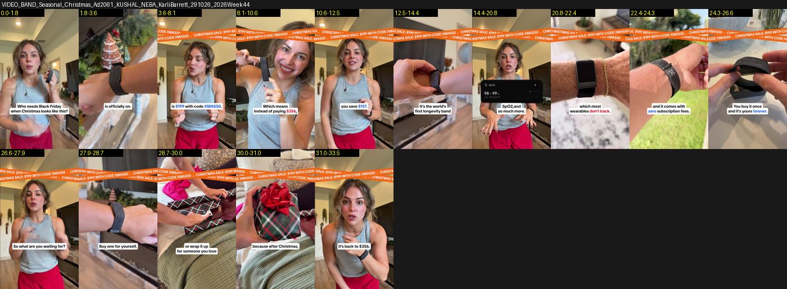

# VIDEO_BAND_Seasonal_Christmas_Ad2061_KUSHAL_NEBA_KarliBarrett_291026_2026Week44

Master: `VIDEO_BAND_Seasonal_Christmas_Ad2061_KUSHAL_NEBA_KarliBarrett_291026_2026Week44_Hook1_9x16.mp4` · 33.5s · 1080x1920

**Pacing:** 15 shots · avg 2.23s · median 1.868s · 4.19 cuts/10s · first cut 1.835s · 214.0 wpm · talk ratio 0.91 · cuts on word start 92.9% · cuts in speech gaps 64.3%
**Audio:** {'I_lufs': -18.2, 'LRA': 3.1, 'true_peak_db': -1.1} · BPM≈99.4 · music {'speech_rms_db': -22.1, 'pause_seconds': 1.2, 'pause_rms_db': -23.2, 'bed_minus_voice_db': -1.1, 'music_bed_likely': True} · cuts with SFX/transient 42.9%

**Captions:** 45 cards · 1 words/card (median) · y≈0.681 of frame height · text height≈0.0281 · colours {'white': 30, 'blue': 10, 'red': 3, 'dark/other': 2} · cards crossing a cut: 0
Highlighted: Hume'sChristmassale, theHumeBand2.0, $199withcodeXMAS50, $199, withcodeXMAS50, $199withcodeXMAS50, insteadofpaying$356, insteadofpaying$356,, $157., wearablesdon'ttrack., zerosubscriptionfees., zerosubscriptionfees, andit'syoursforever.
**Headlines:** ISTMASSALE:$199WITHCODEXMAS50.CHRIS (3.5–3.5s, red) | ASSALE:$199IN- (3.5–3.5s, red) | COU:CHRISTMAS (3.5–3.5s, red) | ASSALE:$199WITHCODEXMAS50·CHRISTMAS (4.0–4.0s, red) | LE:$199WITHC (4.0–4.0s, red) | UnRISTMASSALI (4.0–4.0s, red) | 199WITHCODFV (4.5–4.5s, red) | LE:$199WITHCODEXMAS50.CHRISTMASSALI (4.5–4.5s, red)

**Hook (0–3s) spoken:** Who Needs Black Friday When Christmas Looks Like This? Hume's Christmas Sale is officially
**Hook on-screen:** Hume'sChristmassale / WhoneedsBlackFriday / is officially on. / when Christmas looks like this?
**CTA (last 5s):** or wrap it up for someone you love because after Christmas it's back to $356. · on-screen: -LAMAS50.CHI / .CHRISTMASS / 1IMIASSALE:$199 / 99WITHCODFVI- / AS50.CHRIST / CHRISTMASSALE:$199WITHCODEXMAS50 / E:$199WITHCODEXMAS50.CHRISTMASSALE / EXMAS50.CHRISTMASSALE:$199WITHCODE / HRISTMASSAIE. / ICODEXMAS5n / JALE:$199WITHC / SALE:$199WITI:

## Beat sheet

| # | in–out (s) | dur | transition | spoken | on-screen text |
|---|---|---|---|---|---|
| 1 | 0.00–1.83 | 1.83 |  | Who Needs Black Friday When Christmas Looks Like This? | WhoneedsBlackFriday / when Christmas looks like this? |
| 2 | 1.83–3.64 | 1.8 | cut +SFX hit | Hume's Christmas Sale is officially on and | WhoneedsBlackFriday / when Christmas looks like this? / Hume'sChristmassale [blue] / is officially on. / ISTMASSALE:$199WITHCODEXMAS50.CHRIS [red] (HEADLINE) / ASSALE:$199IN- [red] (HEADLINE) |
| 3 | 3.64–8.07 | 4.44 | cut | right now the Hume Band 2 .0 is $199 with code XMAS50, | ISTMASSALE:$199WITHCODEXMAS50.CHRIS [red] (HEADLINE) / ASSALE:$199IN- [red] (HEADLINE) / COU:CHRISTMAS [red] (HEADLINE) / Andrightnow / ASSALE:$199WITHCODEXMAS50·CHRISTMAS [red] (HEADLINE) / LE:$199WITHC [red] (HEADLINE) |
| 4 | 8.07–10.64 | 2.57 | cut | which means instead of paying $356, | HRISTMASSALE:$199WITHCODEXMAS50.CHR [red] (HEADLINE) / MASSALE:$1901 [red] (HEADLINE) / .IUOU.CHRISTM [red] (HEADLINE) / Whichmeans / insteadofpaying$356 [red] / SALE:$199WITHCODEXMAS50.CHRISTMASS [red] (HEADLINE) |
| 5 | 10.64–12.51 | 1.87 | cut | you save $157. | MAS5O.CHRICT [red] (HEADLINE) / DEXMAS50.CHRISTMASSALE:$199WITHCOD [red] (HEADLINE) / VVITHCODEXMA [red] (HEADLINE) / yousave / $157. [blue] / CHRISTMASSAIF [red] (HEADLINE) |
| 6 | 12.51–14.41 | 1.9 | cut | It's the world's first longevity band that | STMASSALE:$199WITHCODEXMAS50.CHRIST [red] (HEADLINE) / SSALE:$199WIIT [red] (HEADLINE) / UCHRISTMAS [red] (HEADLINE) / It'stheworld's / firstlongevityband / 99WITHCODFV [red] (HEADLINE) |
| 7 | 14.41–20.82 | 6.41 | cut +SFX hit | actually tracks your HRV, sleep, heart rate, SBO2, and so much more. Plus, it also tracks your blood pressure, | It'stheworld's / firstlongevityband / 99WITHCODFV [red] (HEADLINE) / LE:$199WITHCODEXMAS50.CHRISTMASSALE [red] (HEADLINE) / -.01MASSALE:$199 [red] (HEADLINE) / ITHCODEXMAS50CHRISTMASSALE:$199WIT [red] (HEADLINE) |
| 8 | 20.82–22.36 | 1.54 | cut | which most wearables don't track, | AAS50.CHRISTMASSALE:$199WITHCODEXMA [red] (HEADLINE) / .CHRISTMAC [red] (HEADLINE) / LUDEXMAS50 [red] (HEADLINE) / whichmost / wearablesdon'ttrack. [red] / CHRISTMASSALE:$199WITHCODEXMAS50CH [red] (HEADLINE) |
| 9 | 22.36–24.32 | 1.97 | cut +SFX hit | and it comes with zero subscription fees. | whichmost / wearablesdon'ttrack. [red] / CHRISTMASSALE:$199WITHCODEXMAS50CH [red] (HEADLINE) / STMASSALE:$1O0 [red] (HEADLINE) / S50.CHRIST [red] (HEADLINE) / ASSALE:$199WITHCODEXMAS50.CHRISTMAS [red] (HEADLINE) |
| 10 | 24.32–26.59 | 2.27 | cut +SFX hit | You buy it once and it's yours forever. | anditcomeswith / ITHCODEXMACF [red] (HEADLINE) / 99WITHCODEXMAS50.CHRISTMASSALE:$199 [red] (HEADLINE) / 100ALE:$199WIT [red] (HEADLINE) / zerosubscriptionfees [blue] / CODEXMAS50.CHRISTMASSALE:$199WITHCO [red] (HEADLINE) |
| 11 | 26.59–27.89 | 1.3 | cut | So what are you waiting for? | RISTMASSALE:$199WITHCODEXMAS50.CHRI [red] (HEADLINE) / MASSALE:$190 [red] (HEADLINE) / .UJU.CHRISTMA [red] (HEADLINE) / So whatareyou waitingfor? |
| 12 | 27.89–28.66 | 0.77 | cut +SFX hit | Buy one for yourself or | SALE:$199WITHCODEXMAS50.CHRISTMASSA [red] (HEADLINE) / $199WITHCOnE [red] (HEADLINE) / .NOIMASSALE:$T [red] (HEADLINE) / Buyoneforyourself, |
| 13 | 28.66–29.96 | 1.3 | cut +SFX hit | wrap it up for someone you love because | ICODEXMAS5n [red] (HEADLINE) / WITHCODEXMAS50.CHRISTMASSALE:$199W [red] (HEADLINE) / JALE:$199WITHC [red] (HEADLINE) / orwrapitup / forsomeoneyoulove |
| 14 | 29.96–30.96 | 1.0 | cut | after Christmas it's | AS50.CHRIST [red] (HEADLINE) / EXMAS50.CHRISTMASSALE:$199WITHCODE [red] (HEADLINE) / WVIIHCODEXMA [red] (HEADLINE) / becauseafterChristmas, |
| 15 | 30.96–33.45 | 2.49 | cut | back to $356. | HRISTMASSAIE. [red] (HEADLINE) / CHRISTMASSALE:$199WITHCODEXMAS50 [red] (HEADLINE) / -LAMAS50.CHI [red] (HEADLINE) / it'sbackto$356. / TMASSALE:$199WITHCODEXMAS5O.CHRISTN [red] (HEADLINE) / SALE:$199WITI: [red] (HEADLINE) |

## Hook variants

| hook | file | dur | first cut | spoken 0–3s | on-screen 0–3s |
|---|---|---|---|---|---|
| 1 | `61_KUSHAL_NEBA_KarliBarrett_291026_2026Week44_Hook1_9x16.mp4` | 33.5 | 1.835 | Who Needs Black Friday When Christmas Looks Like This? Hume's Christmas Sale is officially | Hume'sChristmassale / WhoneedsBlackFriday / is officially on. / when Christmas looks like this? |
| 2 | `61_KUSHAL_NEBA_KarliBarrett_291026_2026Week44_Hook2_9x16.mp4` | 33.5 | 1.935 |  |  |
| 3 | `61_KUSHAL_NEBA_KarliBarrett_291026_2026Week44_Hook3_9x16.mp4` | 36.4 | 4.805 |  |  |

## Full transcript

Who Needs Black Friday When Christmas Looks Like This? Hume's Christmas Sale is officially on and right now the Hume Band 2.0 is $199 with code XMAS50, which means instead of paying $356, you save $157. It's the world's first longevity band that actually tracks your HRV, sleep, heart rate, SBO2, and so much more. Plus, it also tracks your blood pressure, which most wearables don't track, and it comes with zero subscription fees. You buy it once and it's yours forever. So what are you waiting for? Buy one for yourself or wrap it up for someone you love because after Christmas it's back to $356.