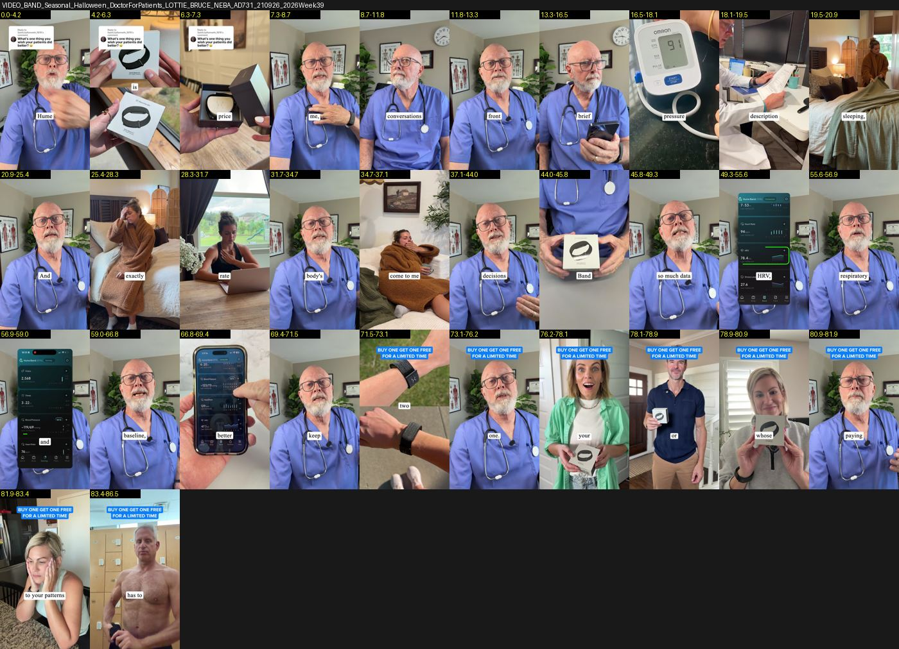

# VIDEO_BAND_Seasonal_Halloween_DoctorForPatients_LOTTIE_BRUCE_NEBA_AD731_210926_2026Week39

Master: `VIDEO_BAND_Seasonal_Halloween_DoctorForPatients_LOTTIE_BRUCE_NEBA_AD731_210926_2026Week39_Hook1_9x16.mp4` · 86.5s · 1080x1920

**Pacing:** 32 shots · avg 2.705s · median 2.067s · 3.58 cuts/10s · first cut 4.167s · 184.0 wpm · talk ratio 0.94 · cuts on word start 80.6% · cuts in speech gaps 61.3%
**Audio:** {'I_lufs': -14.4, 'LRA': 5.2, 'true_peak_db': 0.3} · BPM≈136.0 · music {'speech_rms_db': -19.1, 'pause_seconds': 0.7, 'pause_rms_db': -16.5, 'bed_minus_voice_db': 2.6, 'music_bed_likely': True} · cuts with SFX/transient 67.7%

**Captions:** 143 cards · 1 words/card (median) · y≈0.644 of frame height · text height≈0.034 · colours {'white': 137, 'blue': 2, 'dark/other': 4} · cards crossing a cut: 0
Highlighted: START, STOP
**Headlines:** What'sonethingyou (0.0–7.0s, white) | wishyourpatientsdid (0.0–5.0s, white) | TALANATOMY (0.5–0.5s, white) | Health (4.0–4.0s, white) | XHumeHealth (4.0–4.0s, white) | wishyourpatientsdidlealth (5.5–5.5s, white) | XHumeHealth (5.5–6.0s, white) | wishyourpatientsdid (6.0–7.0s, white)

**Hook (0–3s) spoken:** What if all my patients wore this Hume Band 2 .0?
**Hook on-screen:** Band / Hume / TALANATOMY / What'sonethingyou / if all / patients / this / wishyourpatientsdid / wore
**CTA (last 5s):** attention to your patterns before your body has to shout for your attention. · on-screen: BUYONEGETONEFREE / FORALIMITEDTIME / attention / attention. / shout / to your patterns / your body

## Beat sheet

| # | in–out (s) | dur | transition | spoken | on-screen text |
|---|---|---|---|---|---|
| 1 | 0.00–4.17 | 4.17 |  | What if all my patients wore this Hume Band 2 .0? Well, | What'sonethingyou (HEADLINE) / wishyourpatientsdid (HEADLINE) / if all / TALANATOMY (HEADLINE) / patients / wore |
| 2 | 4.17–6.27 | 2.1 | cut +SFX hit | right now, Hume is giving you two for | What'sonethingyou (HEADLINE) / wishyourpatientsdid (HEADLINE) / Health (HEADLINE) / Hume Band2.0 / 24/fHeamThacil / right |
| 3 | 6.27–7.33 | 1.07 | cut +SFX hit | the price of one. | What'sonethingyou (HEADLINE) / XHumeHealth (HEADLINE) / wishyourpatientsdid (HEADLINE) / Hume Band 2.0 / 24/7Heain Tracking / two |
| 4 | 7.33–8.70 | 1.37 | cut +SFX hit | It doesn't replace me, but it | What'sonethingyou (HEADLINE) / wishyourpatientsdid (HEADLINE) / Replyto (HEADLINE) / of one. / MUSCUUR.ASTONEI (HEADLINE) / me, |
| 5 | 8.70–11.80 | 3.1 | cut +SFX hit | can make our conversations much more productive. | 12 (HEADLINE) / 10 (HEADLINE) / SKELETALANATOMY (HEADLINE) / it can make / 11 (HEADLINE) / conversations |
| 6 | 11.80–13.33 | 1.53 | cut +SFX hit | When a patient sits in front of me, | MUSCUURAUTONEY (HEADLINE) / a patient / of me, |
| 7 | 13.33–16.53 | 3.2 | cut +SFX hit | I'm just getting one brief snapshot of their health. | of me, / 11 (HEADLINE) / 10 (HEADLINE) / one / 12 (HEADLINE) / SXOELETALANATON (HEADLINE) |
| 8 | 16.53–18.10 | 1.57 | cut | One blood pressure reading, | OMRON (HEADLINE) / 91 (HEADLINE) / SYS (HEADLINE) / DIA (HEADLINE) / PULSE / START [blue] |
| 9 | 18.10–19.50 | 1.4 | cut +SFX hit | one description of | odforthesoul / one / description |
| 10 | 19.50–20.87 | 1.37 | cut | how they've been sleeping. | sleeping, |
| 11 | 20.87–25.37 | 4.5 | cut +SFX hit | I asked them, how long have you felt this way? And most people genuinely don't know. | MUSCUURAUS (HEADLINE) / I ask them / MIUSCUUARANATOTY (HEADLINE) / felt / MUSCUURAUTCMI (HEADLINE) / And |
| 12 | 25.37–28.33 | 2.97 | cut +SFX hit | They can't remember exactly when their sleep changed. They | MUSCULARASATONEY (HEADLINE) / know. / exactly / their / changed. |
| 13 | 28.33–31.70 | 3.37 | cut +SFX hit | don't know their resting heart rate has been trending upwards. | changed. / their / rate / upwards. |
| 14 | 31.70–34.73 | 3.03 | cut | They might have missed their body's warning signs and only | MUSCUARANATONEY / have / body's / signs |
| 15 | 34.73–37.10 | 2.37 | cut | come to me when they feel exhausted. | come to me / feel / We have to |
| 16 | 37.10–43.97 | 6.87 | cut | We have to use the information available to make the best decisions possible. But we're not magicians. But the | We have to / information / available / CULARANTOMY / best / possible. |
| 17 | 43.97–45.80 | 1.83 | cut +SFX hit | HumeBand 2 .0 continuously | the Hume / 2.0 |
| 18 | 45.80–49.30 | 3.5 | cut +SFX hit | collects so much data about your body, | MUSCULARANATOATY / continuously / MUSCUURANASON / collects / about / body, |
| 19 | 49.30–55.63 | 6.33 | cut +SFX hit | your sleep, your recovery, heart rate, HRV, blood oxygen, skin temperature, | body, / 40 (HEADLINE) / 45 (HEADLINE) / ULARANATONEY / 82 / Recovery |
| 20 | 55.63–56.93 | 1.3 | cut | respiratory rate, | respiratory |
| 21 | 56.93–58.97 | 2.03 | cut +SFX hit | stress, and blood pressure trends. | 27.6 / BodyTemperature / 35.6-36.9c / SpO2 / stress / 90-98% |
| 22 | 58.97–66.83 | 7.87 | cut +SFX hit | And because it compares these signals with your personal baseline, I can genuinely see how long things have been the way they are. | because / compares / these / personal / baseline, / see |
| 23 | 66.83–69.43 | 2.6 | cut +SFX hit | The more data, the better the decisions. | 3:516 [blue] (HEADLINE) / 心sleep (HEADLINE) / 4h20m (HEADLINE) / ~123/73mmHg / 129bpm / data, |
| 24 | 69.43–71.47 | 2.03 | cut | Or we can keep guessing. Right now, | 129bpm / 47.1ms / 3:516 [blue] (HEADLINE) / ~123/73mmHg (HEADLINE) / 42.1 / the decisions. |
| 25 | 71.47–73.10 | 1.63 | cut | Hume is offering two ban 2 | now, / BUYONEGETONEFREE [blue] (HEADLINE) / FORALIMITEDTIME [blue] (HEADLINE) / two / 2.0s |
| 26 | 73.10–76.17 | 3.07 | cut +SFX hit | .0s for the price of one. Keep one for yourself and | BUYONEGETONEFREE [blue] (HEADLINE) / FORALIMITEDTIME [blue] (HEADLINE) / 2.0s / price / one / and |
| 27 | 76.17–78.10 | 1.93 | cut | give the second to your partner a | BUYONEGETONEFREE [blue] (HEADLINE) / FORALIMITEDTIME [blue] (HEADLINE) / and / your / parent |
| 28 | 78.10–78.90 | 0.8 | cut +SFX hit | parent or someone | BUYONEGETONEFREE [blue] (HEADLINE) / FORALIMITEDTIME [blue] (HEADLINE) / parent |
| 29 | 78.90–80.87 | 1.97 | cut | else whose health matters to you. | BUYONEGETONEFREE [blue] (HEADLINE) / FORALIMITEDTIME [blue] (HEADLINE) / someone else / matters |
| 30 | 80.87–81.87 | 1.0 | cut +SFX hit | Start paying attention | BUYONEGETONEFREE [blue] (HEADLINE) / FORALIMITEDTIME [blue] (HEADLINE) / paying |
| 31 | 81.87–83.43 | 1.57 | cut +SFX hit | to your patterns before | BUYONEGETONEFREE [blue] (HEADLINE) / FORALIMITEDTIME [blue] (HEADLINE) / attention / to your patterns |
| 32 | 83.43–86.55 | 3.12 | cut +SFX hit | your body has to shout for your attention. | BUYONEGETONEFREE [blue] (HEADLINE) / FORALIMITEDTIME [blue] (HEADLINE) / to your patterns / your body / shout / attention. |

## Hook variants

| hook | file | dur | first cut | spoken 0–3s | on-screen 0–3s |
|---|---|---|---|---|---|
| 1 | `nts_LOTTIE_BRUCE_NEBA_AD731_210926_2026Week39_Hook1_9x16.mp4` | 86.5 | 4.167 | What if all my patients wore this Hume Band 2 .0? | Band / Hume / TALANATOMY / What'sonethingyou / if all / patients / this / wishyourpatientsdid |
| 1 | `nts_LOTTIE_BRUCE_NEBA_AD731_210926_2026Week39_Hook1_9x16.mp4` | 86.5 | 4.167 | What if all my patients wore this Hume Band 2 .0? |  |
| 2 | `nts_LOTTIE_BRUCE_NEBA_AD731_210926_2026Week39_Hook2_9x16.mp4` | 88.1 | 1.867 | I get asked this a lot. This is the only wearable | FC / Fitnesswearables/ / I get / a lot. / asked / is the only / take?? / this |
| 2 | `nts_LOTTIE_BRUCE_NEBA_AD731_210926_2026Week39_Hook2_9x16.mp4` | 88.1 | 1.867 | I get asked this a lot. This is the only wearable |  |
| 3 | `nts_LOTTIE_BRUCE_NEBA_AD731_210926_2026Week39_Hook3_9x16.mp4` | 95.1 | 2.333 | For doctors like me to help people like you, we need information. |  |
| 3 | `nts_LOTTIE_BRUCE_NEBA_AD731_210926_2026Week39_Hook3_9x16.mp4` | 95.1 | 2.333 | For doctors like me to help people like you, we need information. | 42.1 / 47.1ms / 95.9-99.7F / HUSCULARANATOMET / MUSCULAR.ANATONNK / MUSCULARASATONTY / SCULARANATONEY |

## Full transcript

What if all my patients wore this Hume Band 2.0? Well, right now, Hume is giving you two for the price of one. It doesn't replace me, but it can make our conversations much more productive. When a patient sits in front of me, I'm just getting one brief snapshot of their health. One blood pressure reading, one description of how they've been sleeping. I asked them, how long have you felt this way? And most people genuinely don't know. They can't remember exactly when their sleep changed. They don't know their resting heart rate has been trending upwards. They might have missed their body's warning signs and only come to me when they feel exhausted. We have to use the information available to make the best decisions possible. But we're not magicians. But the HumeBand 2.0 continuously collects so much data about your body, your sleep, your recovery, heart rate, HRV, blood oxygen, skin temperature, respiratory rate, stress, and blood pressure trends. And because it compares these signals with your personal baseline, I can genuinely see how long things have been the way they are. The more data, the better the decisions. Or we can keep guessing. Right now, Hume is offering two ban 2.0s for the price of one. Keep one for yourself and give the second to your partner a parent or someone else whose health matters to you. Start paying attention to your patterns before your body has to shout for your attention.