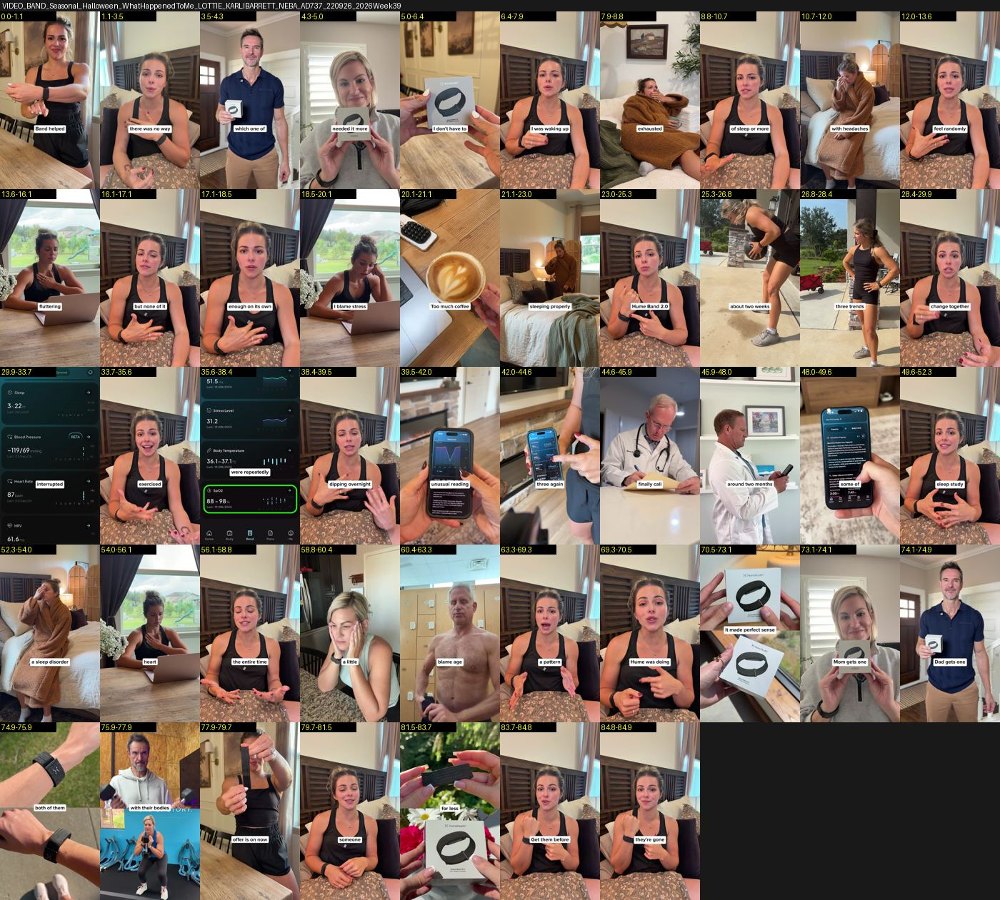

# VIDEO_BAND_Seasonal_Halloween_WhatHappenedToMe_LOTTIE_KARLIBARRETT_NEBA_AD737_220926_2026Week39

Master: `VIDEO_BAND_Seasonal_Halloween_WhatHappenedToMe_LOTTIE_KARLIBARRETT_NEBA_AD737_220926_2026Week39_Hook1_9x16.mp4` · 84.9s · 1080x1920

**Pacing:** 47 shots · avg 1.806s · median 1.6s · 5.42 cuts/10s · first cut 1.1s · 244.0 wpm · talk ratio 0.95 · cuts on word start 87.0% · cuts in speech gaps 76.1%
**Audio:** {'I_lufs': -16.7, 'LRA': 4.6, 'true_peak_db': 0.3} · BPM≈117.5 · music {'speech_rms_db': -20.9, 'pause_seconds': 0.2} · cuts with SFX/transient 56.5%

**Captions:** 173 cards · 1 words/card (median) · y≈0.646 of frame height · text height≈0.0269 · colours {'white': 164, 'dark/other': 7, 'blue': 2} · cards crossing a cut: 1
Highlighted: get one free, STORY.
**Headlines:** HumeBand(85%) (30.0–30.0s, dark/other) | Syncing... (30.0–30.0s, dark/other) | 09steps (30.0–30.0s, white) | 3210 (30.0–31.0s, dark/other) | 2,568 (30.0–31.0s, white) | 1605 (30.0–31.0s, dark/other) | Last:03/Sep/26 (30.0–31.0s, dark/other) | HumeBand（85%) (31.0–31.0s, dark/other)

**Hook (0–3s) spoken:** After what this band helped me notice about my own health, there was no way I
**Hook on-screen:** After what this / Band helped / about my own / menotice / there was no way
**CTA (last 5s):** miss the chance to protect someone that you love. Two bands for less than the price of one, get them before they're · on-screen: 24/7 Health Tracking / Get them before / HumeBand2.0 / Twobands / XHumeHealth / price of one / that you love / the chance

## Beat sheet

| # | in–out (s) | dur | transition | spoken | on-screen text |
|---|---|---|---|---|---|
| 1 | 0.00–1.10 | 1.1 |  | After what this band helped me | After what this / Band helped / menotice |
| 2 | 1.10–3.47 | 2.37 | cut | notice about my own health, there was no way I could choose which | menotice / about my own / there was no way / I could choose |
| 3 | 3.47–4.27 | 0.8 | cut | one of my parents needed | I could choose / which one of / needed it more |
| 4 | 4.27–5.03 | 0.77 | cut | it more, | needed it more / XHumeHealth" / Hume Band2.0 / With this offer |
| 5 | 5.03–6.43 | 1.4 | cut | but with this offer, I don't have to. | XHumeHealth" / Hume Band2.0 / With this offer / XHumeHeaith" / I don't have to / lumeHealth |
| 6 | 6.43–7.93 | 1.5 | cut +SFX hit | So for months, I was waking up | I don't have to / lumeHealth / I was waking up |
| 7 | 7.93–8.80 | 0.87 | cut | exhausted. | exhausted |
| 8 | 8.80–10.67 | 1.87 | cut +SFX hit | Even when I got eight hours of sleep or more, | I got eight hours / of sleepormore |
| 9 | 10.67–12.03 | 1.37 | cut +SFX hit | I'd wake up with headaches, feel | withheadaches / feel randomly |
| 10 | 12.03–13.60 | 1.57 | cut | randomly breathless, | feel randomly / breathless |
| 11 | 13.60–16.10 | 2.5 | cut +SFX hit | and occasionally get this fluttering feeling in my chest, | get this / feeling / but none of it |
| 12 | 16.10–17.07 | 0.97 | cut +SFX hit | but none of it felt serious | but none of it / felt serious |
| 13 | 17.07–18.47 | 1.4 | cut | enough on its own. | felt serious / enoughon its own |
| 14 | 18.47–20.07 | 1.6 | cut +SFX hit | I blamed stress most of the time, | enoughon its own / Iblamestress / Too much coffee |
| 15 | 20.07–21.07 | 1.0 | cut | too much coffee, | Too much coffee / Maybe it was not |
| 16 | 21.07–23.00 | 1.93 | cut +SFX hit | maybe it was not sleeping properly, | Maybe it was not / sleeping properly |
| 17 | 23.00–25.33 | 2.33 | cut +SFX hit | but then I started wearing the Hume Band 2 .0, | I started / Hume Band 2.0 |
| 18 | 25.33–26.80 | 1.47 | cut | and after about two weeks, | Hume Band 2.0 / about two weeks |
| 19 | 26.80–28.37 | 1.57 | cut | I noticed three trends that | I noticed / three trends |
| 20 | 28.37–29.93 | 1.57 | cut +SFX hit | were starting to change together. My | three trends / changetogether |
| 21 | 29.93–33.67 | 3.73 | cut | sleep kept getting interrupted. My recovery was staying low even | HumeBand(85%) (HEADLINE) / Syncing... (HEADLINE) / 09steps (HEADLINE) / 3210 (HEADLINE) / 2,568 (HEADLINE) / 1605 (HEADLINE) |
| 22 | 33.67–35.60 | 1.93 | cut | when I hadn't exercised and | I hadn't / exercised |
| 23 | 35.60–38.40 | 2.8 | cut +SFX hit | my blood oxygen trends were repeatedly dipping | HRV (HEADLINE) / 51.5ms (HEADLINE) / Last:19/08/2025 (HEADLINE) / Stress Level (HEADLINE) / 31.2 (HEADLINE) / BodyTemperature |
| 24 | 38.40–39.47 | 1.07 | cut | overnight. | HRV (HEADLINE) / 51.5ms (HEADLINE) / Stress Level (HEADLINE) / 31.2 (HEADLINE) / BodyTemperature / 36.1-37.1 |
| 25 | 39.47–42.03 | 2.57 | cut +SFX hit | I figured one unusual reading could be nothing, | dipping overnight / 46.9 / unusual reading / Yourstresslevel(measuredfrom0.0to100.01 / indicateshowyourbodyishandlingphysicaland / could be nothing |
| 26 | 42.03–44.60 | 2.57 | cut +SFX hit | but seeing all three again and again was what made | -124/72m / But seeing all / 96.6-97.9 / three again / 98:1880 / what made me |
| 27 | 44.60–45.93 | 1.33 | cut +SFX hit | me finally call my doctor. | BlaneS / finally call |
| 28 | 45.93–47.97 | 2.03 | cut +SFX hit | I showed them around two months of data, | I showed them / around two months |
| 29 | 47.97–49.63 | 1.67 | cut | explained some of my symptoms, | Mext/DayS·MetauolieGapasityAMyDay (HEADLINE) / Duringyourfirst5days.metriesmayappear (HEADLINE) / personalbaseline, / ViewFullourney / BedyGemp / Capacity |
| 30 | 49.63–52.30 | 2.67 | cut +SFX hit | and my doctor ordered a sleep study and a heart monitor. | and my doctor / sleep study / That's |
| 31 | 52.30–53.97 | 1.67 | cut +SFX hit | That's when I found out I had a sleep disorder and | That's / a sleep disorder |
| 32 | 53.97–56.10 | 2.13 | cut +SFX hit | an intermittent heart rhythm issue. | and an / heart / And honestly |
| 33 | 56.10–58.83 | 2.73 | cut +SFX hit | And honestly, the entire time I was thinking about my parents, | And honestly / the entire time / about my parents |
| 34 | 58.83–60.40 | 1.57 | cut +SFX hit | they've both felt a little tired recently | they've both felt / tired recently |
| 35 | 60.40–63.30 | 2.9 | cut +SFX hit | but they always blame age or stress. | tired recently / but they always / blameage / orstress |
| 36 | 63.30–69.30 | 6.0 | cut +SFX hit | And after what happened to me, I don't want either of them brushing off a pattern just because each symptom seems small on its own. | orstress / whathappenedtome / either of them / a pattern / eachsymptom / seemssmall |
| 37 | 69.30–70.53 | 1.23 | cut +SFX hit | When I saw Hume was doing a | When I saw / Hume was doing |
| 38 | 70.53–73.10 | 2.57 | cut | buy one get one free, it made perfect sense. | XHumeHealth" (HEADLINE) / Hume Band 2.0 / get one free [blue] / HumeHealth / Humo Band 2.0 / XHumeHealth (HEADLINE) |
| 39 | 73.10–74.07 | 0.97 | cut | Mom gets one, | Mom gets one / Dad gets one |
| 40 | 74.07–74.87 | 0.8 | cut +SFX hit | dad gets one, | Dad gets one |
| 41 | 74.87–75.93 | 1.07 | cut +SFX hit | and I know both of them are | both of them |
| 42 | 75.93–77.93 | 2.0 | cut | keeping in touch with their body's warning signs. | are keeping / STORY. [blue] / warning signs |
| 43 | 77.93–79.67 | 1.73 | cut | The buy one get one free offer is on now, so | one get one free / offerisonnow |
| 44 | 79.67–81.53 | 1.87 | cut | don't miss the chance to protect someone that you love. | the chance / that you love |
| 45 | 81.53–83.73 | 2.2 | cut +SFX hit | Two bands for less than the price of one, | Twobands / XHumeHealth / price of one / HumeBand2.0 / 24/7 Health Tracking |
| 46 | 83.73–84.83 | 1.1 | cut | get them before they're | Get them before |
| 47 | 84.83–84.89 | 0.05 | cut +SFX hit |  |  |

## Hook variants

| hook | file | dur | first cut | spoken 0–3s | on-screen 0–3s |
|---|---|---|---|---|---|
| 1 | `TIE_KARLIBARRETT_NEBA_AD737_220926_2026Week39_Hook1_9x16.mp4` | 84.9 | 1.1 | After what this band helped me notice about my own health, there was no way I | After what this / Band helped / about my own / menotice / there was no way |
| 1 | `TIE_KARLIBARRETT_NEBA_AD737_220926_2026Week39_Hook1_9x16.mp4` | 84.9 | 1.1 | After what this band helped me notice about my own health, there was no way I |  |
| 2 | `TIE_KARLIBARRETT_NEBA_AD737_220926_2026Week39_Hook2_9x16.mp4` | 85.1 | 2.467 | When I bought this band, I didn't expect to find out that I had a sleep disorder and | I didn't expect / When I bought / disorder / that I had / this Band / to find out |
| 2 | `TIE_KARLIBARRETT_NEBA_AD737_220926_2026Week39_Hook2_9x16.mp4` | 85.1 | 2.467 | When I bought this band, I didn't expect to find out that I had a sleep disorder and |  |
| 3 | `TIE_KARLIBARRETT_NEBA_AD737_220926_2026Week39_Hook3_9x16.mp4` | 86.3 | 0.767 | Imagine finding health warnings you've been ignoring for literally months then realizing | -124/2 / -124/72mmg / -6'L6-9'96 / 34.8 / 34.8m / 44.2 / 6-49- / 96-100% |
| 3 | `TIE_KARLIBARRETT_NEBA_AD737_220926_2026Week39_Hook3_9x16.mp4` | 86.3 | 0.767 | Imagine finding health warnings you've been ignoring for literally months then realizing | -124/72mo / -6L6-996 / 34.8m / 34.8m* / 34.8mm / 44.2 / 6.49- / 7010m |

## Full transcript

After what this band helped me notice about my own health, there was no way I could choose which one of my parents needed it more, but with this offer, I don't have to. So for months, I was waking up exhausted. Even when I got eight hours of sleep or more, I'd wake up with headaches, feel randomly breathless, and occasionally get this fluttering feeling in my chest, but none of it felt serious enough on its own. I blamed stress most of the time, too much coffee, maybe it was not sleeping properly, but then I started wearing the Hume Band 2.0, and after about two weeks, I noticed three trends that were starting to change together. My sleep kept getting interrupted. My recovery was staying low even when I hadn't exercised and my blood oxygen trends were repeatedly dipping overnight. I figured one unusual reading could be nothing, but seeing all three again and again was what made me finally call my doctor. I showed them around two months of data, explained some of my symptoms, and my doctor ordered a sleep study and a heart monitor. That's when I found out I had a sleep disorder and an intermittent heart rhythm issue. And honestly, the entire time I was thinking about my parents, they've both felt a little tired recently but they always blame age or stress. And after what happened to me, I don't want either of them brushing off a pattern just because each symptom seems small on its own. When I saw Hume was doing a buy one get one free, it made perfect sense. Mom gets one, dad gets one, and I know both of them are keeping in touch with their body's warning signs. The buy one get one free offer is on now, so don't miss the chance to protect someone that you love. Two bands for less than the price of one, get them before they're